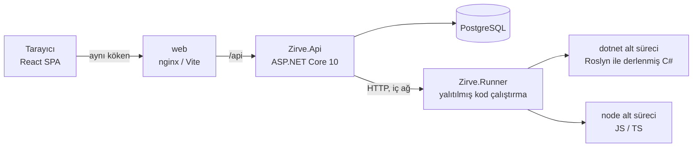

# Zirve

Büyük teknoloji şirketlerinde yazılım mühendisi olmak isteyenler için mülakat hazırlık platformu: konu anlatımları, açıklamalı testler ve tarayıcıda çalışan kodlama pratiği (C#, JavaScript, TypeScript).

## Mimari



| Parça | Teknoloji | Sorumluluk |
| --- | --- | --- |
| `web/` | React 19, TypeScript, Vite, Tailwind CSS 4, TanStack Query, React Router, Monaco | Arayüz |
| `src/Zirve.Api` | ASP.NET Core 10 Minimal API, EF Core, ASP.NET Core Identity | Kimlik, katalog, testler, problemler, ilerleme, arama |
| `src/Zirve.Runner` | ASP.NET Core 10, Roslyn, Node.js | Kullanıcı kodunu derler, ayrı süreçte sınırlarla çalıştırır, sonucu değerlendirir |
| `src/Zirve.Shared` | .NET sınıf kitaplığı | API ile Runner arasındaki sözleşmeler, problem imzası, başlangıç kodu üreteci |
| `content/` | Markdown + YAML | Dersler, testler, problemler (kod olarak içerik) |
| PostgreSQL | 18 | Kalıcı veri, Türkçe kök bulmalı tam metin arama |

### Öne çıkan tasarım kararları

- **Kod olarak içerik.** Dersler, testler ve problemler `content/` altında düz dosyalardır; API açılışta doğrular ve veritabanına eşitler. İçerik sürümlenir, gözden geçirilir ve testlerle doğrulanır.
- **Her çözüm test edilir.** Her problemin referans çözümü (C# ve TypeScript), test paketinde gerçek koşucuyla problemin bütün testlerinden geçirilir. Hatalı test verisi ya da bozuk çözüm ana dala giremez.
- **Yalıtılmış kod çalıştırma.** Kullanıcı kodu API sürecinde değil, ayrı bir serviste, her çalıştırma için ayrı bir alt süreçte, süre/bellek/çıktı sınırlarıyla çalışır. Ayrıntılar: [Güvenlik](#güvenlik).
- **Çerez tabanlı oturum.** `HttpOnly`, `SameSite=Strict` çerez ve ek olarak CSRF belirteci. Tarayıcıda JavaScript'in okuyabildiği bir erişim belirteci (token) yoktur.
- **Tek köken.** SPA ve API aynı adresten sunulur (geliştirmede Vite vekili, üretimde nginx); CORS gerekmez.
- **İki dil.** Site Türkçe (varsayılan) ve İngilizcedir. Dil, sağ üstteki düğmeyle seçilir ve tarayıcıda saklanır; ilk ziyarette tarayıcının dili Türkçe değilse İngilizce açılır. İstemci dili `Accept-Language` başlığıyla bildirir; API içeriği, arama sonuçlarını ve hata iletilerini o dilde döndürür. Ayrıntılar: [İki dilli içerik](#iki-dilli-içerik).

## Hızlı başlangıç (yerel geliştirme)

Gerekenler: [.NET 10 SDK](https://dotnet.microsoft.com/download) ve [Node.js 22.12+](https://nodejs.org). Docker ya da ayrı bir PostgreSQL kurulumu **gerekmez**: geliştirme veritabanı npm üzerinden gelen PostgreSQL ikilileriyle çalışır.

```bash
npm run setup   # bağımlılıkları kurar (kök, web, Runner'ın Node paketi, dotnet-ef)
npm run dev     # veritabanı + Runner + API + web
```

- Site: <http://localhost:5173>
- API belgeleri (yalnızca geliştirmede): <http://localhost:5080/scalar>

İlk açılışta veritabanı şeması oluşturulur ve `content/` klasörü eşitlenir. Veriler `.pgdata/` klasöründe saklanır; sıfırlamak için sunucuyu durdurup klasörü silin.

| Komut | Ne yapar |
| --- | --- |
| `npm run dev` | Bütün yığını başlatır; `Ctrl+C` hepsini durdurur |
| `npm run db` | Yalnızca geliştirme veritabanını başlatır (`npm run db -- stop` durdurur) |
| `npm test` | Backend ve frontend testlerini çalıştırır (veritabanı açık olmalı) |
| `dotnet test --project tests/Zirve.Tests` | Backend testleri |
| `npm --prefix web run lint` / `typecheck` / `test` / `build` | Frontend denetimleri |
| `dotnet ef migrations add <Ad> --project src/Zirve.Api --output-dir Data/Migrations` | Yeni EF Core migration'ı |

## İçerik eklemek

İçerik `content/` altındadır. Değişiklikler API yeniden başlatıldığında eşitlenir; hatalı içerik API'nin açılmasını engeller ve bütün hatalar birlikte listelenir.

```text
content/
  tracks.yaml                        yollar ve bölümler (sıra = dosyadaki sıra)
  lessons/{yol}/{bölüm}/NN-slug.md    ders: YAML ön bilgi + Markdown
  quizzes/{yol}/NN-slug.yaml          test
  problems/NNN-slug.md                problem: ön bilgi + tanım + İpuçları + Çözüm + Testler
```

Dersi henüz yazılmamış bölümler ve yollar sitede yayımlanmaz; `tracks.yaml` planlanan müfredatı güvenle listeleyebilir.

**Ders** (`lessons/csharp/temeller/01-deger-ve-referans-tipleri.md`):

```markdown
---
title: Değer ve Referans Tipleri
summary: Tek cümlelik özet.
minutes: 12
level: beginner        # beginner | intermediate | advanced
---
Markdown içerik. ```mermaid kod blokları diyagram olarak çizilir.
```

**Test** (`quizzes/csharp/01-temeller.yaml`):

```yaml
title: C# Temelleri
description: Kısa açıklama.
level: beginner
timeLimitMinutes: 15
questions:
  - q: Soru metni (Markdown; kod bloğu için `q: |` kullanın)
    options: ["A", "B", "C", "D"]
    answer: 2              # 1 tabanlı; birden fazla doğru için [1, 3]
    difficulty: easy
    why: Neden doğru olduğunun açıklaması.
```

**Problem** (`problems/001-iki-sayinin-toplami.md`): ön bilgide imza (`function`, `params`, `returns`) ve karşılaştırma kipi (`exact`, `unordered`, `unordered-nested`) tanımlanır; başlangıç kodları her dil için bu imzadan üretilir. Gövdede `## İpuçları`, `## Çözüm` (içinde ` ```csharp solution ` ve ` ```typescript solution ` blokları) ve `## Testler` (JSON) bölümleri bulunur. Sınıf tasarımı problemleri için `kind: class` kullanılır; örnek: `problems/014-min-yigin.md`.

Desteklenen tipler: `int`, `long`, `double`, `bool`, `string`, `char`, `T[]`, `List<T>`, `ListNode`, `TreeNode`.

**Adım adım anlatım** (isteğe bağlı): bir problemin çözümünü satır satır izleten etkileşimli, kendi başına duran statik sayfa. `web/public/walkthroughs/{problem-slug}/` altına `index.html` ve `walkthrough.js` olarak konur (satır içi betik kullanılmaz; içerik güvenlik politikası `script-src 'self'` kalır) ve slug `web/src/lib/walkthroughs.ts` listesine eklenir. Problem sayfasında çözüm "Cevabı göster" düğmesinin arkasındadır; anlatımı olan problemlerde cevap açılınca "Adım adım göster" düğmesi `/problems/{slug}/adim-adim` sayfasına götürür.

## İki dilli içerik

Türkçe içerik asıldır; İngilizce çeviriler `content/en/` altında, Türkçe dosyalarla **aynı yollarda** durur ve yalnızca metin taşır. Sıra, düzey, süre, doğru şıklar, problem imzası ve testler her zaman Türkçe dosyadan gelir; böylece ikisi birbirinden kopamaz.

```text
content/en/
  tracks.yaml                        yolların ve bölümlerin İngilizce başlık ve açıklamaları (slug ile eşleşir)
  lessons/{yol}/{bölüm}/NN-slug.md    ön bilgide yalnızca title ve summary + Markdown
  quizzes/{yol}/NN-slug.yaml          title, description, questions: [{ q, options, why }] (sıra ve şık sayısı aynı)
  problems/NNN-slug.md                ön bilgide yalnızca title + tanım + "## Hints" + "## Solution" (Testler yok)
```

- Problem çevirisindeki ` ```csharp solution ` ve ` ```typescript solution ` bloklarında yalnızca yorumlar çevrilir; testler kodun yorumlar dışında Türkçe çözümle aynı kaldığını doğrular.
- Karşılığı olmayan ya da yapısı tutmayan (soru/şık/ipucu sayısı farklı) bir çeviri dosyası içerik hatasıdır. Çevirisi olmayan içerik İngilizce sitede Türkçe görünür; ancak test paketi her içeriğin çevrilmiş olmasını bekler, bu yüzden yeni bir ders, test ya da problem eklerken İngilizcesini de ekleyin.
- Adım adım anlatımların İngilizce kopyası `web/public/walkthroughs/{slug}/en/` altındadır (`index.html` + `walkthrough.js`, `<html lang="en">`).
- Arayüz metinleri her bileşenin yanında `defineMessages({ tr, en })` ile tanımlanır (`web/src/i18n/`); İngilizce sözlük Türkçeyle aynı biçimde olmazsa TypeScript derlemesi hata verir.
- Kod çalıştırma servisinin iletileri (süre sınırı, derleme ve test koşucusu hataları) de isteğin dilindedir.

## Testler

- **Runner testleri:** gerçek derleyici ve gerçek alt süreçlerle üç dilde çalıştırma, derleme/çalışma zamanı hataları, zaman aşımı, yasaklı API'ler, sandbox kaçış denemeleri.
- **İçerik doğrulama:** bütün içerik yüklenir; her referans çözüm bütün testlerden geçirilir. Her içeriğin İngilizce çevirisi vardır ve çevrilen çözümler kodda Türkçeyle aynıdır.
- **API entegrasyon testleri:** uygulama bellekte, gerçek PostgreSQL'e karşı ayağa kalkar (her test sınıfı için tek kullanımlık veritabanı). Sunucu adresi `ZIRVE_TEST_DB` ortam değişkeniyle verilir; yoksa yerel geliştirme veritabanı kullanılır, ona da ulaşılamazsa bu testler atlanır.
- **Frontend:** Vitest ile API istemcisi (CSRF akışı) ve yardımcılar.

CI (`.github/workflows/ci.yml`) bunların hepsini her itme ve PR'da çalıştırır.

## Docker ile çalıştırma

```bash
cp .env.example .env    # parolaları ve Runner anahtarını değiştirin
docker compose up --build
```

Site <http://localhost:8080> adresinde açılır. Üretimde nginx'in önüne TLS sonlandıran bir yük dengeleyici ya da ters vekil koyun ve `REQUIRE_SECURE_COOKIES=true` bırakın.

> Bu depo Docker kurulu olmayan bir makinede geliştirildi: Dockerfile'lar ve `docker-compose.yml` henüz çalıştırılarak **sınanmadı**. İlk kullanımda sorun çıkarsa yapılandırmayı buna göre düzeltin.

## Güvenlik

Kullanıcıdan gelen kodu çalıştırmak bu sistemin en riskli işidir. Savunma katmanları:

1. **Ayrı servis, ayrı ağ.** Runner, API'den ayrı bir kapsayıcıdır ve `internal` bir Docker ağındadır: internete ve veritabanına ulaşamaz. API ile arasında paylaşılan bir anahtar vardır.
2. **Kapsayıcı kısıtları.** Salt-okunur dosya sistemi, `no-new-privileges`, süreç/bellek/işlemci sınırları. Runner süreci yalnızca beş Linux yetkisine (SETUID, SETGID, KILL, CHOWN, DAC_OVERRIDE) sahiptir; bunlar 3. maddedeki yalıtım içindir.
3. **Çalıştırma başına alt süreç ve kullanıcı.** Her istek kendi sürecinde, temizlenmiş ortam değişkenleriyle, süre ve çıktı sınırıyla çalışır; sınır aşılırsa süreç ağacı öldürülür. Kapsayıcıda (`Runner:Isolation`) her eşzamanlı yuvanın kendi Linux kullanıcısı vardır: çocuk süreç `setpriv` ile hiçbir yetkisi olmayan bu kullanıcıya geçer, veri belleği `RLIMIT_DATA` ile sınırlanır (V8 yığınının dışındaki ArrayBuffer'lar dahil) ve çalışma klasörü yalnızca ona açıktır. Böylece dil düzeyindeki kısıtları aşan bir kod bile Runner'ın ortamını (API anahtarı), başka kullanıcıların kodunu ve süreçlerini göremez. Çalıştırma bitince o kullanıcının arkada kalan bütün süreçleri öldürülür.
4. **Dil düzeyinde kısıtlar (derinlemesine savunma).** C# kodu yalnızca izin verilen derlemelere başvurabilir; dosya, ağ, yansıma ve süreç API'leri derleme aşamasında reddedilir. JavaScript ayrı bir V8 bağlamında, `eval` kapalı ve Node izin modeliyle (`--permission`) çalışır.
5. **API tarafı.** Kod çalıştırma oturum açmış kullanıcılara özeldir ve kullanıcı başına hız sınırı uygulanır.

4. madde tek başına bir güvenlik sınırı **değildir**; asıl sınır 1–3. maddelerdir. Yerel geliştirmede (`npm run dev`) Runner kapsayıcısız, sizin kullanıcınızla ve çalıştırma başına yalıtım olmadan çalışır: yalnızca güvendiğiniz kodu çalıştırın. Yalıtımın kendisi CI'da gerçek Runner kapsayıcısında sınanır (kullanıcı değişimi, bellek sınırı, çalıştırmalar arası erişim). Çalıştırmalar aynı iç ağı paylaşır; internete açık bir kurulumda daha güçlü yalıtım için gVisor ya da Firecracker gibi bir çalışma zamanı değerlendirin.

Diğer önlemler: parolalar ASP.NET Core Identity ile özetlenir (PBKDF2), başarısız girişlerde hesap kilitlenir, giriş/kayıt uç noktaları IP başına sınırlandırılır, hata yanıtları iç ayrıntı sızdırmaz, API yanıtları önbelleğe alınmaz, nginx katı bir Content-Security-Policy gönderir.

## Yapılandırma

Ayarlar `appsettings.json` içindedir ve ortam değişkenleriyle (`Bölüm__Anahtar`) ezilebilir. Gizli değerleri depoya koymayın.

| Ayar | Servis | Açıklama |
| --- | --- | --- |
| `ConnectionStrings__Default` | API | PostgreSQL bağlantı dizesi (zorunlu) |
| `Database__ApplyMigrationsOnStartup` | API | Açılışta migration uygular (geliştirmede açık) |
| `Runner__BaseUrl`, `Runner__ApiKey` | API | Runner adresi ve paylaşılan anahtar |
| `Auth__RequireSecureCookies` | API | Çerezlerde `Secure` bayrağı (üretimde `true`) |
| `DataProtection__KeysPath` | API | Oturum çerezlerini şifreleyen anahtarların kalıcı klasörü |
| `ForwardedHeaders__Enabled` | API | Ters vekil arkasında `X-Forwarded-*` başlıklarına güven |
| `RateLimiting__*` | API | Genel, giriş ve kod çalıştırma hız sınırları |
| `Runner__ApiKey` | Runner | İsteklerde beklenen anahtar |
| `Runner__TestsTimeoutSeconds`, `Runner__MemoryLimitMb`, … | Runner | Çalıştırma sınırları (`RunnerOptions.cs`) |

## Proje yapısı

```text
content/            dersler, testler, problemler
deploy/             nginx yapılandırması
scripts/            geliştirme betikleri (dev.mjs, dev-db.mjs)
src/Zirve.Api/      API: Features/ (dikey dilimler), Data/, Content/, Infrastructure/
src/Zirve.Runner/   kod çalıştırma servisi: CSharp/, Node/, Execution/
src/Zirve.Shared/   ortak sözleşmeler
tests/Zirve.Tests/  Runner, içerik ve API testleri
web/                React uygulaması: src/pages, src/components, src/lib
```
