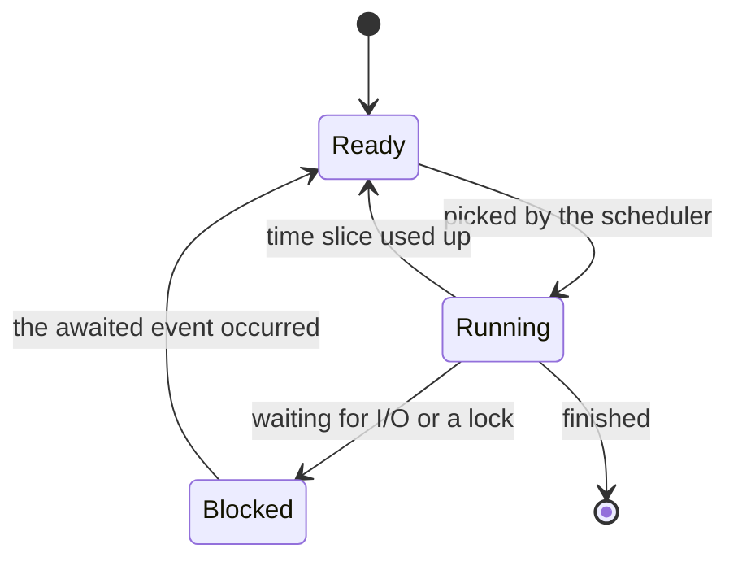

"What's the difference between a process and a thread?" gets asked at every level, from intern to senior engineer. The more senior you are, the deeper the expected answer: how memory is shared, what context switching costs, why concurrent code produces wrong results. This lesson builds that chain from start to finish.

## Process and thread

A **process** is an instance of a running program. The operating system gives each process its own **virtual address space**, open files, and other resources. One process can't read another process's memory directly; when one crashes, the others aren't affected.

A **thread** is a unit of execution within a process. Every process has at least one thread. The threads of the same process **share** memory; each thread has only its own stack, registers, and program counter.

| | Process | Thread |
| --- | --- | --- |
| Memory | Its own address space | Shares the process's heap and global data |
| Owns | Address space, file handles, environment | Stack, registers, program counter |
| Creation cost | High | Low |
| Communication | Inter-process communication (pipes, sockets, shared memory) | Directly through shared memory (requires synchronization) |
| Isolation | Strong: if one crashes, the other survives | Weak: one thread's bug can bring down the whole process |

This difference shows up in architectural decisions. Browsers run each tab in a separate process: when a page crashes or is attacked, the other tabs are protected. A web server, on the other hand, handles requests with threads in the same process: a shared cache and connection pool are cheap.

## Scheduling and context switching

A CPU core runs one thread at a time. The operating system's scheduler shares the cores among threads, and each thread is in one of these states:



A core moving from one thread to another is called a **context switch**: the registers are saved and the other thread's are loaded. If the switch is between different processes, the virtual memory mapping also changes and the address translation cache (TLB) is largely invalidated; that's why switching between processes is more expensive. A single switch takes on the order of microseconds, but in a system with thousands of threads, a significant share of CPU time can be spent switching instead of doing work.

### Concurrency and parallelism

- **Concurrency:** multiple tasks **making progress** in the same time period. It's possible even on a single core; the tasks are sliced and take turns.
- **Parallelism:** multiple tasks running at the **same instant**. It requires multiple cores.

### CPU-bound and I/O-bound work

| | CPU-bound | I/O-bound |
| --- | --- | --- |
| Example | Image processing, compression, encryption | Database query, HTTP call, file read |
| Bottleneck | The CPU | Waiting time |
| The right tool | Parallelism with as many threads as cores | Asynchronous I/O: waiting work doesn't hold a thread |

A web server spends most of its time waiting on the database and other services. Dedicating a thread to each request and letting it wait is expensive: each thread is typically allocated stack space measured in megabytes, and scheduling thousands of threads increases the cost of context switching. C#'s `async/await`, JavaScript's event loop, Go's goroutines, and Java's virtual threads are different solutions to this problem: work that's waiting doesn't occupy an operating system thread.

## Virtual memory

Every process sees a large, contiguous **virtual address space**, as if all of the machine's memory were its own. The operating system and the CPU's memory management unit (MMU) translate these addresses into physical memory.

- Memory is divided into **pages**, usually 4 KB each. Every process has a **page table** that maps virtual pages to physical frames.
- To speed up translation, the CPU keeps recent translations in a small cache called the **TLB**.
- When a process accesses a page that isn't in physical memory, a **page fault** occurs. The operating system finds the page (allocating a zeroed page if it's being used for the first time, or reading it from disk if it's in swap) and the process continues where it left off. Page faults that require a disk read are very slow.

What virtual memory gives you:

- **Isolation:** a process can't address another process's pages.
- **Sharing:** the same library is mapped into many processes' address spaces as a single physical copy.
- **Copy-on-write:** on Unix, a child process created with `fork()` shares the parent's pages without copying them; a page is copied only when one of them writes to it.
- **An address space larger than physical memory:** rarely used pages can be moved to disk (swap). When memory truly runs out, the system starts moving pages constantly and nearly grinds to a halt (thrashing).

### Process memory layout

| Region | Contents |
| --- | --- |
| Code (text) | The program's machine code; read-only |
| Data | Global and static variables |
| Heap | Dynamically allocated objects (`new`); managed by the garbage collector or the programmer |
| Stack | Separate for each thread: function call frames, local variables, return addresses |

The stack grows with every call and shrinks on return; its size is limited (usually 1–8 MB). Recursion that never terminates or goes very deep exceeds this limit: **stack overflow**. That's why, for a tree that may be very deep, you write an iterative DFS with an explicit stack instead of a recursive one.

## The memory hierarchy

Speed and capacity are inversely related. Approximate orders of magnitude:

| Access | Time |
| --- | --- |
| L1 cache | ~1 ns |
| L2 cache | ~4 ns |
| L3 cache | ~10–40 ns |
| Main memory (RAM) | ~100 ns |
| Random read from an NVMe SSD | ~20–100 µs |
| Network round trip within the same data center | ~0.5 ms |
| Seek on a spinning disk | ~10 ms |
| Intercontinental network round trip | ~150 ms |

There are two consequences:

- **Reading from memory is thousands of times faster than reading over the network.** This is why caching is so central to system design.
- **Locality matters.** The CPU doesn't fetch individual bytes from memory but 64-byte **cache lines**. Traversing an array sequentially is usually much faster than traversing a linked list with the same number of elements: array elements are contiguous, while linked list nodes are scattered across memory and each step can cause a cache miss. Even if the Big-O is the same, the real running time differs.

## Race condition

When multiple threads access shared data at the same time and at least one of them writes, the result comes to depend on the order in which the threads run. This is called a **race condition**.

```csharp
int counter = 0;
Parallel.For(0, 1_000_000, _ => counter++);
Console.WriteLine(counter);   // usually less than 1,000,000
```

`counter++` looks like a single operation but is three steps: **read, add one, write back**. Two threads read the same value (e.g. 41) and both write 42; one increment is lost. This is the in-memory equivalent of the lost update problem in databases.

Ways to fix it:

```csharp
// 1) Atomic operation: an increment the CPU performs in a single step
Parallel.For(0, 1_000_000, _ => Interlocked.Increment(ref counter));

// 2) Lock: only one thread at a time enters the critical section
var gate = new Lock();
Parallel.For(0, 1_000_000, _ => { lock (gate) { counter++; } });
```

The best solution is often **not to share**: each thread computes its own local total, and the totals are combined at the end. Immutable data also eliminates race conditions from the start.

## Synchronization tools

| Tool | What it does | Example use |
| --- | --- | --- |
| **Lock / mutex** | One thread at a time in the critical section | Updating a shared dictionary |
| **Semaphore** | At most N threads at a time | At most 10 concurrent requests to a service |
| **Reader-writer lock** | Many readers or a single writer | Configuration that's read often and changes rarely |
| **Condition variable / signal** | Wait until a condition holds | "The queue is not empty" in a producer-consumer queue |
| **Atomic operations** | Update a single variable without a lock | Counters, flags |

Locks should be held briefly. Waiting on I/O inside a lock ties every other thread to that I/O.

## Deadlock

Two or more threads lock up forever, each waiting for a resource another one holds:

```text
Thread A: acquires lock 1  →  waits for lock 2
Thread B: acquires lock 2  →  waits for lock 1
```

A deadlock requires **four conditions to hold at the same time** (the Coffman conditions):

1. **Mutual exclusion:** a resource can be held by only one thread at a time.
2. **Hold and wait:** a thread holds one resource while waiting for another.
3. **No preemption:** a held resource can't be forcibly taken away from the thread.
4. **Circular wait:** the threads wait on each other in a way that forms a cycle.

Breaking any one of them prevents deadlock. The most common methods in practice:

- **Always acquire locks in the same order** (breaks circular wait). For example, in a transfer between two accounts, lock the account with the smaller ID first.
- **Try the lock with a timeout** (`Monitor.TryEnter`, `SemaphoreSlim.WaitAsync(timeout)`): if you can't acquire it, release what you hold and try again.
- **Avoid holding more than one lock at a time;** if you must, acquire them all at once.

Two closely related concepts:

- **Livelock:** the threads aren't blocked, but they never make progress while trying to yield to each other, like two people meeting in a hallway who both step aside in the same direction.
- **Starvation:** a thread never gets access to a resource because others keep grabbing priority.

## Summary

- Processes have separate address spaces; threads share the process's memory, and only their stacks are their own.
- Context switching isn't free; for I/O-bound work, use asynchronous I/O instead of adding more threads.
- Virtual memory provides isolation, sharing, and copy-on-write; a page fault is very expensive if it requires a disk read.
- Each level of the memory hierarchy is an order of magnitude slower; locality determines real performance.
- `counter++` isn't atomic; you need an atomic operation, a lock, or no sharing.
- Deadlock has four conditions; acquiring locks in a consistent order breaks circular wait.
