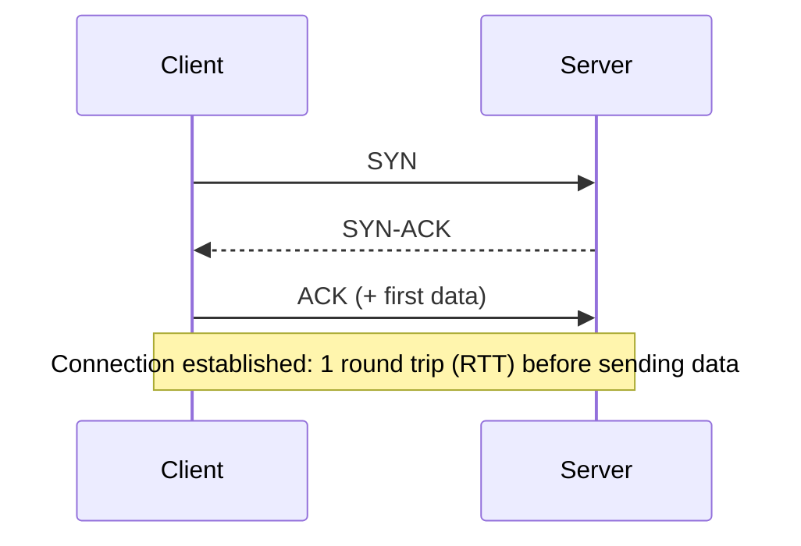

Nearly everything a backend engineer writes runs over the network: APIs, database connections, calls between services. Knowing where latency comes from, why a connection is slow to open, or the difference between a 502 and a 504 pays off both in interviews and when debugging in production.

## Layers

A network consists of layers, each built on top of the one below it. The model used in practice is the TCP/IP model:

| Layer | Role | Examples | Address |
| --- | --- | --- | --- |
| Application | Application-specific protocol | HTTP, DNS, SMTP, gRPC | URL, domain name |
| Transport | Process-to-process delivery | TCP, UDP, QUIC (over UDP) | Port |
| Network (internet) | Machine to machine, routing between networks | IP (IPv4, IPv6) | IP address |
| Link | Delivery within the same physical network | Ethernet, Wi-Fi | MAC address |

The seven-layer OSI model is a conceptual reference; terms like "L4 load balancer" (at the transport layer, it distributes TCP connections) and "L7 load balancer" (at the application layer, it looks at the HTTP path and headers) come from it.

**IP** delivers packets on a "best effort" basis: packets can be lost, duplicated, or arrive out of order. Reliability is the job of a higher layer.

## TCP and UDP

| | TCP | UDP |
| --- | --- | --- |
| Connection | Yes (handshake) | No |
| Reliability | Lost packets are retransmitted | No guarantee |
| Ordering | Preserved | Not preserved |
| Flow and congestion control | Yes | No |
| Overhead and latency | Higher | Low |
| Use | Web, databases, email, file transfer | DNS queries, video calls, games, QUIC |

### The TCP three-way handshake



That's why opening a new connection is expensive, especially when the client and server are far apart. **Connection pooling** and **keep-alive** (reusing the connection) eliminate this cost. It's also one of the reasons not to create a new `HttpClient` for every request in an application.

TCP's other mechanisms:

- **Flow control:** the receiver announces how much data it can accept (the window size); a fast sender doesn't overwhelm a slow receiver.
- **Congestion control:** the sender probes the network's capacity; a new connection starts slowly and gradually increases its rate (slow start). It treats packet loss as a sign of congestion and slows down.
- **Head-of-line blocking:** if a packet is lost, the packets behind it aren't delivered to the application, even if they've arrived, until the lost packet is retransmitted.
- **Closing the connection:** it's closed with FIN. The side that initiates the close keeps the connection in the `TIME_WAIT` state for a while; this is why clients that open thousands of very short-lived connections run out of ports.

UDP provides none of these guarantees. In a video call there's no point in retransmitting a delayed audio packet; that moment has passed. For applications like these, low latency is worth more than reliability.

## DNS

DNS translates a domain name into an IP address. For `www.example.com`:

1. The browser and operating system caches are checked.
2. If it's not there, the configured **resolver** (your ISP's, or a public resolver like 1.1.1.1) is asked.
3. If the resolver doesn't have it cached, it asks, in order, the **root servers** (who handles `.com`?), the **TLD servers** (who handles `example.com`?), and the domain's **authoritative server**.
4. The answer is cached at every layer for the record's **TTL**.

| Record | Meaning |
| --- | --- |
| `A` / `AAAA` | Domain name → IPv4 / IPv6 address |
| `CNAME` | Domain name → another domain name (alias) |
| `MX` | The domain's mail servers |
| `TXT` | Free text; domain verification, SPF |
| `NS` | The domain's authoritative name servers |

The practical consequence of TTL: when you change a DNS record, it can take up to the TTL to propagate worldwide. That's why lowering the TTL a few days ahead of a planned migration is a common practice. DNS is also used for geographic load distribution: the address of the data center closest to the user is returned.

## TLS

TLS (the "S" in HTTPS) provides three things:

- **Confidentiality:** no one in between can read the content.
- **Integrity:** the content can't be altered in transit; if it is, the change is detected.
- **Authentication:** the server you're talking to really is `example.com`. The server presents a **certificate** signed by a trusted certificate authority (CA); the browser verifies the signature chain up to the root certificates it trusts.

The TLS 1.3 handshake goes roughly like this:

1. The client sends the cipher suites it supports and its key exchange share.
2. The server returns its own key exchange share, its certificate, and a signature over the handshake.
3. The two sides derive a shared **session key** that never crosses the network; from then on, all data is encrypted with this key.

Why are two kinds of encryption used together? **Asymmetric** encryption (public/private keys) makes it possible to agree on a key and authenticate over an insecure channel, but it's slow. **Symmetric** encryption (AES-GCM, ChaCha20) is very fast but requires both sides to know the same key. TLS uses the asymmetric method only in the handshake and encrypts the data with the symmetric key.

Because new ephemeral keys are generated for each connection (ECDHE), previously recorded traffic can't be decrypted even if the server's private key is stolen later. This is called **forward secrecy**.

The TLS 1.3 handshake takes 1 RTT (2 RTT in TLS 1.2). With a server you've talked to before, data can be sent in the first request with **0-RTT**; but this data can be replayed, so it should only be used for idempotent requests.

## HTTP

HTTP is a request-response protocol and is **stateless**: every request must be understandable on its own. State such as sessions is carried with cookies or tokens.

```http
GET /api/problems/iki-sayinin-toplami HTTP/1.1
Host: zirve.example
Accept: application/json
Cookie: session=...

HTTP/1.1 200 OK
Content-Type: application/json
Cache-Control: no-store

{ "slug": "iki-sayinin-toplami", ... }
```

### Methods

| Method | Purpose | Safe | Idempotent |
| --- | --- | --- | --- |
| `GET` | Read a resource | Yes | Yes |
| `HEAD` | Get the headers only | Yes | Yes |
| `POST` | Create a new resource or start an operation | No | **No** |
| `PUT` | Replace a resource entirely (or create it at the given address) | No | Yes |
| `PATCH` | Partially modify a resource | No | Not guaranteed |
| `DELETE` | Delete a resource | No | Yes |

- **Safe:** doesn't change state on the server. Browsers and browser extensions may prefetch safe requests; that's why a link that deletes something with `GET` is dangerous.
- **Idempotent:** whether the same request is sent once or ten times, the **final state** on the server is the same. Calling `DELETE /orders/5` a second time may return 404; the response differs but the state is the same. These are the requests that can safely be **retried** after a network error. To retry a `POST` safely, the client needs to send an **idempotency key**.

### Status codes

| Code | Meaning | When |
| --- | --- | --- |
| `200 OK` | Success | A read or update |
| `201 Created` | Created | A new resource via `POST`; with a `Location` header |
| `204 No Content` | Success, no body | Deletion |
| `301` / `308` | Permanent redirect | The address changed permanently; the browser caches it |
| `302` / `307` | Temporary redirect | The server decides each time |
| `304 Not Modified` | The cached copy is still valid | A conditional request (`If-None-Match`) matched |
| `400 Bad Request` | The request is malformed | Broken JSON, invalid field |
| `401 Unauthorized` | **Not authenticated** | No session, or an invalid token |
| `403 Forbidden` | **Not authorized** | Who you are is known, but you don't have permission for this operation |
| `404 Not Found` | The resource doesn't exist | |
| `409 Conflict` | Conflict with the current state | Concurrent update, a record that already exists |
| `422 Unprocessable Content` | The format is correct, the content is invalid | Business rule validation |
| `429 Too Many Requests` | Rate limit | With a `Retry-After` header |
| `500 Internal Server Error` | Unexpected error on the server | |
| `502 Bad Gateway` | The proxy got an invalid response from the upstream service | The upstream service crashed or dropped the connection |
| `503 Service Unavailable` | The service is temporarily unable to serve | Overload, maintenance |
| `504 Gateway Timeout` | The proxy didn't get a response from the upstream service in time | The upstream service is slow |

The rule: **4xx is the client's problem, 5xx is the server's.** Retrying a 4xx error unchanged won't help; transient 5xx errors like 503 and 504, however, may resolve with retries spaced out over time.

### Cache and cookie headers

- `Cache-Control: max-age=3600` says the response can be used for one hour without asking again; `no-store` asks that it not be stored at all.
- `ETag` is the response's version tag. The client sends the tag with `If-None-Match` on the next request; if the content hasn't changed, the server returns a `304` with no body, saving bandwidth.
- Session cookies should be marked `HttpOnly` (JavaScript can't read them, protecting against XSS), `Secure` (HTTPS only), and `SameSite` (not sent on requests coming from other sites, protecting against CSRF).

## HTTP versions

| | HTTP/1.1 | HTTP/2 | HTTP/3 |
| --- | --- | --- | --- |
| Transport | TCP | TCP | QUIC (over UDP) |
| Format | Text | Binary frames | Binary frames |
| Concurrent requests per connection | Effectively one; browsers open ~6 connections per domain | Multiplexing: many streams on a single connection | Multiplexing |
| Header compression | None | HPACK | QPACK |
| Head-of-line blocking | At the request level | Solved at the application level, **persists at the TCP level** | Streams are independent of each other; solved |
| Connection setup | TCP + TLS | TCP + TLS | TLS 1.3 built into QUIC: a single round trip |

In HTTP/2, many requests flow over a single TCP connection. But a single packet lost in TCP stalls **all** the streams on that connection; on lossy mobile networks this is a noticeable slowdown. That's why HTTP/3 dropped TCP and moved to QUIC, which runs over UDP: a loss stalls only the affected stream. Because QUIC connections are tied to a connection ID rather than an IP address, a connection can continue without dropping when a phone switches from Wi-Fi to a mobile network.

## Real-time communication

| Method | How | When |
| --- | --- | --- |
| Short polling | The client asks at regular intervals | Simple; costs latency and empty requests |
| Long polling | The server holds the response until there's new data | Real-time behavior compatible with older infrastructure |
| Server-Sent Events | A one-way, continuous stream from server to client | Notifications, live scores, progress updates |
| WebSocket | A two-way, persistent channel over a single connection | Chat, multiplayer games, collaborative editing |

## What happens when you type an address into the browser

A classic interview question. A short, layered answer:

1. **Parsing:** the browser interprets the input as a URL (scheme, domain name, path). If the domain is on the HSTS list, HTTPS is used directly.
2. **DNS:** the domain name is translated into an IP address (caches, resolver, root → TLD → authoritative server).
3. **TCP connection:** a three-way handshake to port 443 on the server. (With HTTP/3, QUIC instead.)
4. **TLS handshake:** the certificate is verified and the session key is derived.
5. **HTTP request:** the `GET /` request is sent with headers and cookies.
6. **Server side:** the request reaches the CDN, the load balancer, and the application server; the application prepares the response using a cache or the database.
7. **Response:** the status code, headers, and HTML come back.
8. **Rendering:** the browser parses the HTML and builds the DOM, loads the CSS, runs the JavaScript, makes new requests for subresources (reusing the same connection), and paints the page.

The interviewer usually asks you to go deeper on one step: DNS caches, the TLS handshake, or the server-side architecture. Rather than skimming over all of them, be prepared enough to dig deep into whichever step you're asked about.

## Summary

- TCP provides reliable, ordered delivery, but setting up a connection takes a round trip; reuse connections. UDP comes without guarantees and is for work that needs low latency.
- DNS answers stay cached for the TTL; record changes take time to propagate.
- TLS uses asymmetric encryption for authentication and key agreement, and symmetric encryption for the data.
- `GET`, `PUT`, and `DELETE` are idempotent; `POST` isn't. 401 means not authenticated, 403 means not authorized; 4xx is the client's error, 5xx the server's.
- HTTP/2 brought multiplexing on a single connection, but TCP's head-of-line blocking remained; HTTP/3 solved it with QUIC.
