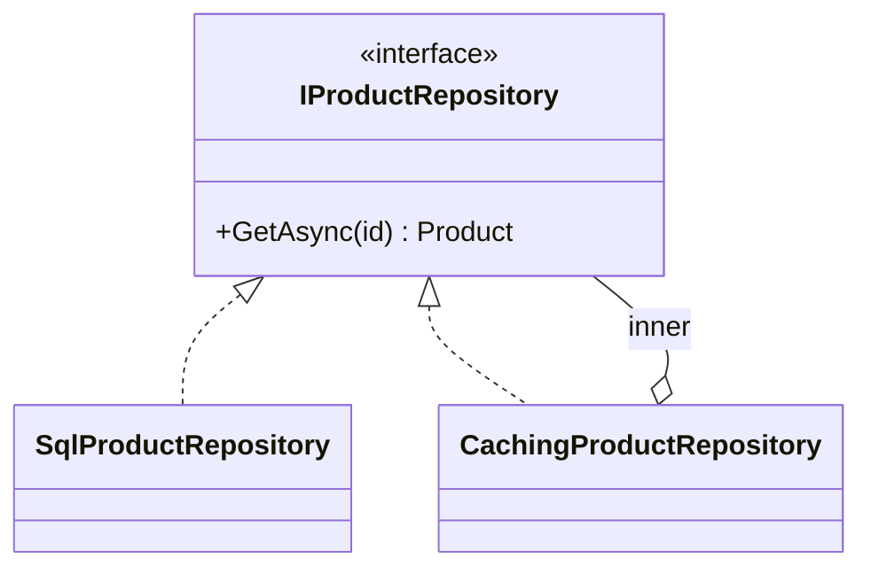

Design patterns are named solutions to design problems that come up again and again. Their biggest benefit is that they provide **a shared vocabulary**: the sentence "let's put a decorator here" stands in for several paragraphs of explanation. In an interview, you're not expected to recite patterns from memory; you're expected to see a problem and say which pattern would help and what it costs.

Patterns fall into three groups:

| Group | Question | Patterns in this lesson |
| --- | --- | --- |
| Creational | How are objects created? | Factory, Builder, Singleton |
| Structural | How are objects put together? | Adapter, Decorator |
| Behavioral | How do objects share responsibility? | Strategy, Observer, Command, Chain of Responsibility |

## Strategy

**Problem:** the same task can be done in several ways, and which one to use is decided at runtime. Burying them all in a single method with `if/switch` means changing that method for every new option.

**Solution:** put each algorithm in a separate class behind a common interface.

```csharp
public interface IShippingCostStrategy
{
    decimal Calculate(Parcel parcel);
}

public sealed class StandardShipping : IShippingCostStrategy
{
    public decimal Calculate(Parcel parcel) => 30m + parcel.WeightKg * 5m;
}

public sealed class ExpressShipping : IShippingCostStrategy
{
    public decimal Calculate(Parcel parcel) => 80m + parcel.WeightKg * 8m;
}

public sealed class Checkout(IShippingCostStrategy shipping)
{
    public decimal Total(Cart cart) => cart.Subtotal + shipping.Calculate(cart.Parcel);
}
```

It's everywhere in .NET: `List<T>.Sort(IComparer<T>)` takes the sorting strategy from outside, and `StringComparer.OrdinalIgnoreCase` is a comparison strategy. If the strategy is just a single method, a delegate (`Func<Parcel, decimal>`) is often simpler than a class. In ASP.NET Core, **keyed services** can be used to select among multiple implementations by key (`AddKeyedSingleton<IShippingCostStrategy, ExpressShipping>("express")`).

## Factory

**Problem:** which concrete class to create depends on a condition, or the creation itself is complex. Spreading this knowledge across client code means changing many places every time a new type is added.

**Solution:** gather the creation decision in a single place.

```csharp
public sealed class PaymentGatewayFactory(IServiceProvider services)
{
    public IPaymentGateway Create(PaymentMethod method) => method switch
    {
        PaymentMethod.Card         => services.GetRequiredService<CardGateway>(),
        PaymentMethod.BankTransfer => services.GetRequiredService<BankTransferGateway>(),
        _ => throw new ArgumentOutOfRangeException(nameof(method)),
    };
}
```

Client code sees only `IPaymentGateway`; adding a new payment method changes a single place.

The best-known example in .NET is `IHttpClientFactory`. Creating a `new HttpClient()` for every request can lead to socket exhaustion, because closed connections hold on to their sockets for a while; using a single `HttpClient` forever, on the other hand, means DNS changes go unnoticed. The factory solves both problems by pooling the underlying connection handlers and recycling them at regular intervals. This is exactly the value of moving creation logic into a factory: the complexity stays in one place.

## Builder

**Problem:** an object has many optional parts. Constructors with dozens of parameters are unreadable; an object modified step by step, on the other hand, can be used in a half-finished, invalid state.

**Solution:** a separate builder that configures the object step by step; in the final step (`Build`), the rules are validated and an **immutable** object is produced.

```csharp
var builder = WebApplication.CreateBuilder(args);   // the builder
builder.Services.AddProblemDetails();               // step-by-step configuration
builder.Logging.AddConsole();

var app = builder.Build();                          // the immutable application object
```

ASP.NET Core startup is this pattern itself: once the configuration phase is over, the service registrations can no longer be changed.

In modern C#, a builder is often unnecessary for small objects: object initializers and `required` and `init` members provide the same readability.

```csharp
var options = new RetryOptions
{
    MaxAttempts = 5,                     // required
    Delay = TimeSpan.FromSeconds(1),     // init
};
```

Builder is for cases where construction really has multiple steps or where there are rules between the parts that need to be validated.

## Singleton

**Problem:** there should be only one instance of a class for the lifetime of the application (configuration, a cache, a connection pool).

The classic implementation:

```csharp
public sealed class AppSettings
{
    private static readonly Lazy<AppSettings> instance = new(() => new AppSettings());
    public static AppSettings Instance => instance.Value;    // thread-safe, lazy
    private AppSettings() { }
}
```

Singleton is the most criticized pattern, because:

- **It's hidden global state.** `AppSettings.Instance` can be called from anywhere; you can't tell from a method's signature what it depends on.
- **It makes testing harder.** It can't be replaced with a fake instance in tests, and tests affect each other through shared state.
- **It brings concurrency problems.** The single instance is shared across all threads; any mutable state inside it requires synchronization.

In modern applications, the "single instance" need is met by the DI container: `services.AddSingleton<IClock, SystemClock>()`. There's still only one instance, but the class doesn't know that; it receives the dependency through its constructor and is easily replaced in tests. For example, injecting .NET's `TimeProvider` abstraction instead of reading the time directly with `DateTime.UtcNow` makes time-dependent code testable.

## Adapter

**Problem:** the interface of a class you want to use (usually from a third-party library) doesn't match the interface your code expects, and you can't change that class.

**Solution:** a thin wrapper that translates between the two interfaces.

```csharp
// The SDK we can't change
public class AcmeSmsClient
{
    public AcmeResponse SendText(string msisdn, string body, bool unicode) { /* ... */ }
}

// Our interface
public interface INotifier
{
    Task NotifyAsync(User user, string message);
}

public sealed class AcmeSmsNotifier(AcmeSmsClient client) : INotifier
{
    public Task NotifyAsync(User user, string message)
    {
        var response = client.SendText(user.PhoneNumber, message, unicode: true);
        if (!response.Ok) throw new NotificationFailedException(response.ErrorCode);
        return Task.CompletedTask;
    }
}
```

The gain: the rest of the application never knows about the SDK. When the provider changes, only the adapter is rewritten; in tests, `INotifier` is easy to fake. This "anti-corruption layer" habit pays off in every integration with an external system.

## Decorator

**Problem:** adding new behavior to an existing object without changing it or the code that uses it (caching, logging, retries, metrics).

**Solution:** a wrapper that implements the same interface and holds the real object inside it. It does its own work and forwards the call to the inner object.



```csharp
public sealed class CachingProductRepository(IProductRepository inner, IMemoryCache cache)
    : IProductRepository
{
    public Task<Product?> GetAsync(int id) =>
        cache.GetOrCreateAsync($"product:{id}", entry =>
        {
            entry.AbsoluteExpirationRelativeToNow = TimeSpan.FromMinutes(5);
            return inner.GetAsync(id);
        });
}

// Registration: client code asks for IProductRepository and gets the cached version
builder.Services.AddScoped<SqlProductRepository>();
builder.Services.AddScoped<IProductRepository>(sp => new CachingProductRepository(
    sp.GetRequiredService<SqlProductRepository>(),
    sp.GetRequiredService<IMemoryCache>()));
```

Decorators can be stacked: logging → caching → retry → the real object. The classic .NET example is streams: `new GZipStream(new BufferedStream(fileStream), CompressionMode.Compress)`; each layer is a `Stream` and adds a capability to the one before it.

The difference from inheritance: writing a subclass adds behavior at compile time and for a single class; a decorator can add behavior at runtime and to **any** object that implements the interface.

## Observer

**Problem:** when something happens in one object, other objects need to know about it; but you don't want the object raising the event to know each of them individually.

**Solution:** the publisher keeps a list of subscribers and notifies all of them when the event occurs. In C#, this is built into the language: `event`.

```csharp
public sealed class Order
{
    public event EventHandler<OrderShippedEventArgs>? Shipped;

    public void Ship()
    {
        Status = OrderStatus.Shipped;
        Shipped?.Invoke(this, new OrderShippedEventArgs(Id));
    }
}

order.Shipped += (_, e) => emails.SendShippingNotice(e.OrderId);
order.Shipped += (_, e) => analytics.Track("order_shipped", e.OrderId);
```

The order class knows nothing about either email or analytics; adding a new reaction doesn't change the order.

A pitfall worth knowing: the publisher holds references to its subscribers. A short-lived object that subscribes to a long-lived publisher (e.g. a singleton) **won't be collected by the garbage collector** unless the subscription is removed with `-=`. This is a classic source of memory leaks in .NET.

The same idea shows up at the system level as **publish-subscribe** (pub/sub): services publish events through a message broker, and the interested services subscribe.

## Command

**Problem:** instead of running an operation immediately, we want to store it, queue it, log it, or undo it.

**Solution:** turn the request into an object that carries everything needed to execute it.

```csharp
public interface IEditorCommand
{
    void Execute();
    void Undo();
}

public sealed class InsertText(Document document, int position, string text) : IEditorCommand
{
    public void Execute() => document.Insert(position, text);
    public void Undo() => document.Delete(position, text.Length);
}

// Undo: keep the executed commands on a stack
var history = new Stack<IEditorCommand>();
```

Undo/redo in text editors, jobs placed on background job queues (they are serialized commands), and the concept of a "command" in CQRS are all applications of this pattern.

## Chain of Responsibility

**Problem:** a request must pass through several handlers in sequence; each handler can process the request, modify it, or cut the chain short.

**Solution:** link the handlers into a chain; each one decides whether to call the next.

The ASP.NET Core middleware pipeline is this very pattern:

```csharp
app.Use(async (context, next) =>
{
    if (!context.Request.Headers.ContainsKey("X-Api-Key"))
    {
        context.Response.StatusCode = StatusCodes.Status401Unauthorized;
        return;                       // cut the chain short
    }

    await next(context);              // pass it to the next one
});
```

On the `HttpClient` side, `DelegatingHandler` plays the same role: retries, logging, and adding an authentication header are added to the chain of handlers that outgoing requests pass through.

## At a glance

| Pattern | Problem it solves | Example in .NET |
| --- | --- | --- |
| Strategy | Choosing an algorithm at runtime | `IComparer<T>`, `StringComparer` |
| Factory | Deciding in one place which class to create | `IHttpClientFactory`, `ILoggerFactory` |
| Builder | Multi-step construction ending in an immutable object | `WebApplication.CreateBuilder`, `UriBuilder` |
| Singleton | A single instance | `AddSingleton` in DI, `TimeProvider.System` |
| Adapter | Adapting an incompatible interface | Third-party SDK wrappers |
| Decorator | Adding behavior without changing the object | `GZipStream`, `BufferedStream` |
| Observer | Notifying an unknown number of subscribers of an event | `event`, `IObservable<T>` |
| Command | Turning a request into an object to store, queue, or undo | Background jobs, undo stacks |
| Chain of Responsibility | Passing a request through a sequence of handlers | Middleware, `DelegatingHandler` |

## When not to use patterns

- **A pattern is a tool, not a goal.** If there's no problem, there should be no pattern. Strategies with a single implementation and factories that produce only one class are needless indirection.
- **The language itself lightens many patterns.** A single-method strategy can be written as a lambda, an iterator with `yield return`, an observer with `event`. Many patterns that require a class in Java come down to one line in C#.
- **In an interview**, when you propose a pattern, say which change you're guarding against with it: the sentence "I put it behind an adapter because the payment provider may change" is worth far more than just naming the pattern.

## Summary

- Patterns are a shared vocabulary; each provides flexibility against a particular kind of change.
- Strategy abstracts the algorithm, Factory the creation, and Builder the multi-step setup.
- Singleton has global state and testability problems; meet the single-instance need with DI.
- Adapter fits external systems to your own interface; Decorator adds behavior without changing the object.
- Observer (`event` in C#) decouples the publisher from its subscribers; forgetting to unsubscribe is a memory leak.
- Command turns a request into an object; Chain of Responsibility passes a request through a pipeline of handlers. ASP.NET Core middleware is an example.
