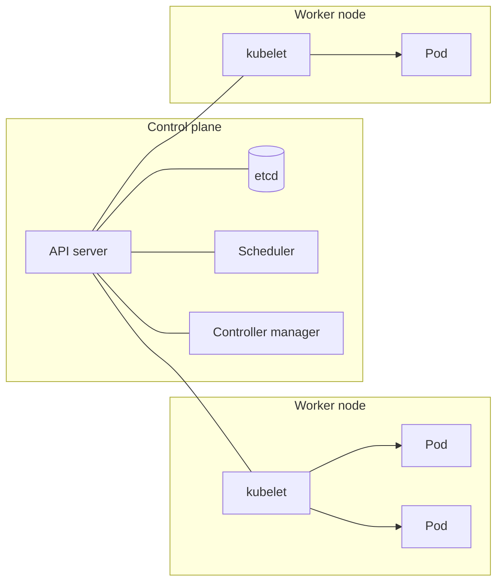

6 of the 18 job postings ask for Kubernetes directly (often as AKS on Azure). A backend developer isn't expected to be a cluster administrator. What's expected is this: understanding how your service runs on Kubernetes, being able to read and write its manifests, and designing your service to fit that environment.

## The problem it solves

Docker runs containers on one machine. In production, you need:

- 300 containers spread across 20 machines.
- A container restarted when it crashes, and moved to another machine when its machine dies.
- More instances when traffic grows.
- New versions deployed without downtime, and rolled back if something goes wrong.
- Containers able to find each other despite changing IP addresses.

Kubernetes solves these with a **desired state** model: you say "run 3 instances of this image." Control loops continuously watch the actual state and move it toward the desired state. If an instance dies, they start a new one. You describe the "what," not the "how" (declarative).

## Cluster architecture



- **API server:** the gateway everything talks to. `kubectl` sends its requests here too.
- **etcd:** the distributed key-value store that holds the entire state of the cluster (replicated with Raft).
- **Scheduler:** decides which node a new pod is placed on.
- **Controller manager:** the loops that reconcile the desired state with the actual state.
- **kubelet:** the agent on each node that runs the pods.

In managed services (AKS, EKS, GKE), the cloud provider operates the control plane.

## Core objects

| Object | What it's for |
| --- | --- |
| **Pod** | The smallest unit. One (sometimes several) containers with a shared IP and storage. Ephemeral |
| **Deployment** | Manages the desired number of pods and their updates (a ReplicaSet under the hood) |
| **Service** | A stable DNS name and virtual IP in front of changing pods, plus load balancing |
| **Ingress** / **Gateway API** | Routes incoming HTTP traffic from outside to services by host and path |
| **ConfigMap** | Non-secret configuration |
| **Secret** | Secret configuration (by default only base64, not encrypted) |
| **Namespace** | Logically separates resources (team, environment) |
| **StatefulSet** | Applications that need a stable identity and persistent disk (databases) |
| **Job / CronJob** | Run-to-completion or scheduled work |

## A manifest for a .NET service

```yaml
apiVersion: apps/v1
kind: Deployment
metadata:
  name: orders-api
spec:
  replicas: 3
  selector:
    matchLabels: { app: orders-api }
  strategy:
    type: RollingUpdate
    rollingUpdate: { maxUnavailable: 0, maxSurge: 1 }
  template:
    metadata:
      labels: { app: orders-api }
    spec:
      containers:
        - name: api
          image: myregistry.azurecr.io/orders-api:1.4.2
          ports: [{ containerPort: 8080 }]
          env:
            - name: ConnectionStrings__Db
              valueFrom: { secretKeyRef: { name: orders-secrets, key: db } }
          envFrom:
            - configMapRef: { name: orders-config }
          resources:
            requests: { cpu: 250m, memory: 256Mi }
            limits: { memory: 512Mi }
          readinessProbe:
            httpGet: { path: /health/ready, port: 8080 }
            periodSeconds: 5
          livenessProbe:
            httpGet: { path: /health/live, port: 8080 }
            periodSeconds: 10
            failureThreshold: 3
          startupProbe:
            httpGet: { path: /health/live, port: 8080 }
            failureThreshold: 30
            periodSeconds: 2
---
apiVersion: v1
kind: Service
metadata:
  name: orders-api
spec:
  selector: { app: orders-api }
  ports: [{ port: 80, targetPort: 8080 }]
```

Other services in the cluster reach this service at `http://orders-api` (from another namespace, `orders-api.<namespace>.svc.cluster.local`).

## Probes

| Probe | If it fails | What it should check |
| --- | --- | --- |
| **startup** | The other probes don't start; the container is restarted when the time runs out | Has the application started (for slow-starting applications) |
| **readiness** | The pod is removed from behind the Service (it gets no traffic) | Is it ready to take traffic, are critical dependencies reachable |
| **liveness** | The container is **restarted** | Is the process stuck. It should **not** check dependencies |

The classic mistake: the liveness probe checks the database. The database doesn't respond for 30 seconds, and Kubernetes restarts **all** the pods. When the database comes back, no service is left running.

## Resource requests and limits

- **requests:** the guaranteed resources the scheduler reserves when it places the pod.
- **limits:** the upper bound. A container that exceeds its **memory** limit is killed (`OOMKilled`). A container that exceeds its **CPU** limit is not killed but slowed down (throttling).

Good practice: realistic requests and limits for memory. For CPU, set a request and set the limit carefully or not at all, because CPU throttling causes latency spikes that are hard to explain. The .NET runtime reads container limits and sizes the GC heap accordingly.

## Scaling and updates

The **Horizontal Pod Autoscaler (HPA)** changes the number of pods based on a metric:

```yaml
apiVersion: autoscaling/v2
kind: HorizontalPodAutoscaler
metadata: { name: orders-api }
spec:
  scaleTargetRef: { apiVersion: apps/v1, kind: Deployment, name: orders-api }
  minReplicas: 3
  maxReplicas: 20
  metrics:
    - type: Resource
      resource: { name: cpu, target: { type: Utilization, averageUtilization: 70 } }
```

For event-driven scaling, such as on queue length, use **KEDA** (it can read RabbitMQ, Kafka, and Service Bus queues).

**Rolling update:** pods of the new version start one at a time, and the old ones shut down once the new ones are ready. `maxUnavailable: 0` ensures capacity never drops. If something goes wrong, `kubectl rollout undo deployment/orders-api` goes back to the previous version.

**Graceful shutdown:** when a pod is shut down, `SIGTERM` arrives first and the pod is removed from the Service. But these two propagate concurrently: traffic may keep arriving for a while. The common fix is a short `preStop` wait plus the application finishing in-flight requests on `SIGTERM`. The default grace period is 30 seconds (`terminationGracePeriodSeconds`).

## Basic kubectl commands

```bash
kubectl get pods -n orders                       # list pods
kubectl describe pod orders-api-7d9f -n orders   # events: why won't it start?
kubectl logs -f deploy/orders-api -n orders      # logs
kubectl apply -f k8s/                            # apply manifests
kubectl rollout status deploy/orders-api         # deployment progress
kubectl port-forward svc/orders-api 5000:80      # reach the service from your machine
kubectl exec -it orders-api-7d9f -- sh           # get inside
```

Common pod states: `ImagePullBackOff` (wrong image name or registry permissions), `CrashLoopBackOff` (the application starts and crashes immediately; check the logs), `OOMKilled` (memory limit exceeded), `Pending` (no resources available to place it).

## Helm and GitOps

- **Helm:** the Kubernetes package manager. It manages manifests as templates (per-environment values with `values.yaml`) and releases.
- **Kustomize:** manages environment differences with layered patches instead of templates (built into `kubectl`).
- **GitOps (Argo CD, Flux):** the desired state of the cluster is kept in a Git repository. The tool continuously syncs the cluster with the repository. A deployment is a PR merge, and every change is auditable.

## Preparing your service for Kubernetes

- Be stateless: sessions and files aren't kept in the pod (use Redis, blob storage).
- Read configuration from environment variables and files (12-factor).
- Write separate liveness and readiness endpoints.
- Shut down gracefully on `SIGTERM`.
- Write logs to stdout and send traces with OpenTelemetry.
- Run migrations as a separate Job or a deployment pipeline step, not at pod startup.

## Asked in interviews

- **"What's the difference between a Pod and a Deployment?"** A Pod is a single running instance and is ephemeral. A Deployment manages the desired number of pods and their updates.
- **"Why do you need a Service?"** Pod IPs change. A Service provides a stable name and load balancing.
- **"What's the difference between liveness and readiness?"** If liveness fails, the container is restarted. If readiness fails, traffic is cut off. Dependency checks belong to readiness.
- **"A pod is in CrashLoopBackOff. What do you do?"** I read the logs and events of the previous crash with `kubectl logs --previous` and `describe`. Usually it's missing configuration or a dependency that's unreachable at startup.
- **"Are Secrets secure?"** By default they're only base64. You need etcd encryption, RBAC, and external vault integration (the Key Vault CSI driver, External Secrets).

## Summary

- Kubernetes lets you describe the desired state and has control loops maintain it.
- A Pod is ephemeral. A Deployment manages pods, a Service gives them a stable name, and Ingress exposes them to the outside.
- Startup, readiness, and liveness probes answer different questions. Liveness doesn't check dependencies.
- Exceeding the memory limit kills the container; exceeding the CPU limit slows it down.
- HPA and KEDA scale, rolling updates deploy without downtime, and Helm and GitOps simplify management.
