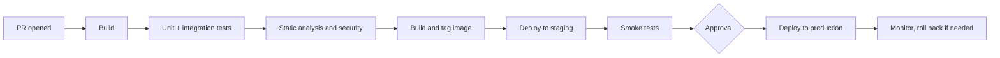

9 of the 18 job postings ask for CI/CD: GitHub Actions, GitLab CI, Azure DevOps, or Jenkins. Which tool it is matters less. The concepts and good practices are the same. There's also a real example in the `.github/workflows` folder of the Zirve repository.

## Three concepts

- **Continuous integration (CI):** Every change is merged into the main branch often (at least once a day). On every merge, the code is built and the tests run automatically. The goal is to catch integration problems while they're small.
- **Continuous delivery:** Every commit on the main branch is in a state where it **can go to production at any moment**. Releasing to production happens at the push of a button (with human approval).
- **Continuous deployment:** Every commit that passes the tests goes to production **automatically**. There is no human approval.

## A typical pipeline



Core principles:

- **Build once, deploy the same artifact everywhere.** The image tested in staging and the image that goes to production must be **the same**. The only difference between environments is configuration.
- **Fast feedback.** The PR pipeline should stay under 10 minutes. Slow tests are parallelized or moved to a separate nightly pipeline.
- **A red pipeline comes first.** If the main branch is broken, the team fixes it before starting new work.
- **The pipeline is code too.** It's versioned in the repository and reviewed.

## A .NET pipeline with GitHub Actions

```yaml
name: ci
on:
  pull_request:
  push:
    branches: [main]

jobs:
  build-test:
    runs-on: ubuntu-latest
    steps:
      - uses: actions/checkout@v4
      - uses: actions/setup-dotnet@v4
        with:
          global-json-file: global.json
      - uses: actions/cache@v4
        with:
          path: ~/.nuget/packages
          key: nuget-${{ hashFiles('**/Directory.Packages.props', '**/*.csproj') }}
      - run: dotnet restore
      - run: dotnet build --no-restore -c Release -warnaserror
      - run: dotnet format --verify-no-changes
      - run: dotnet test --no-build -c Release --collect:"XPlat Code Coverage"
      - name: Vulnerable packages
        # The command exits with 0 even when it finds vulnerabilities; check its output so the step fails.
        run: |
          dotnet list package --vulnerable --include-transitive 2>&1 | tee vulnerable.txt
          ! grep -q "has the following vulnerable packages" vulnerable.txt

  image:
    needs: build-test
    if: github.ref == 'refs/heads/main'
    runs-on: ubuntu-latest
    permissions:
      contents: read
      packages: write
    steps:
      - uses: actions/checkout@v4
      - uses: docker/login-action@v3
        with:
          registry: ghcr.io
          username: ${{ github.actor }}
          password: ${{ secrets.GITHUB_TOKEN }}
      - uses: docker/build-push-action@v6
        with:
          push: true
          tags: ghcr.io/acme/orders-api:${{ github.sha }}
```

Things to watch:

- **The image tag is the commit hash.** It's always clear which code is running. `latest` is not used.
- **Permissions are kept as narrow as possible** (`permissions:`). If the pipeline token is compromised, the damage stays limited.
- **Secret values** live in repository or environment secrets and are masked in logs. For cloud access, **OIDC federation** is preferred over long-lived keys: the pipeline gets a short-lived identity on every run.
- **Third-party actions** are a supply chain risk. Choose trusted publishers, and pin critical ones to a commit SHA.

In Azure DevOps Pipelines and GitLab CI the syntax differs, but the concepts are the same: trigger, stage, job, step, artifact, environment, and approval.

## Quality gates

The checks a PR must pass before it can be merged (branch protection rules):

| Gate | Example tools |
| --- | --- |
| Build and warnings | `-warnaserror`, analyzers, nullable warnings |
| Formatting | `dotnet format`, `.editorconfig` |
| Tests | xUnit, coverage report |
| Static analysis | SonarQube / SonarCloud, Roslyn analyzers |
| Security | CodeQL (code), Dependabot or `dotnet list package --vulnerable` (dependencies), gitleaks (leaked secrets), Trivy (images) |
| Review | At least one approval, CODEOWNERS |

SonarQube's "quality gate" defines thresholds for coverage, duplication, and bugs in new code. If the gate applies to **new code** rather than the entire legacy codebase, the team improves quality without drowning in old debt.

## Environments

The typical chain: **dev → test/staging → production**. The more staging resembles production, the more valuable it is (same kind of infrastructure, similar data volume, same configuration mechanism).

- Per-environment configuration lives in the environment itself (secrets, Key Vault, ConfigMap), not in the repository.
- Approval and deployment window rules for production deployments are defined at the environment level.
- **Database migrations** are a separate step in the pipeline and are written to be backward compatible (expand-contract). That way, even if the application is rolled back, the schema can still run it.

## Safe deployment strategies

| Strategy | How | Benefit | Cost |
| --- | --- | --- | --- |
| **Rolling** | Instances are replaced one at a time | No extra infrastructure | Two versions run side by side for a while |
| **Blue-green** | The new version (green) is fully set up next to the old one (blue), and traffic is switched at once | Instant rollback: switch the traffic back | Twice the resources |
| **Canary** | A small share of traffic (1%, 5%, 25%...) goes to the new version while metrics are watched | A bug affects a small audience | Requires metrics and automation |
| **Feature flag** | The code is deployed but the feature is off; a flag turns it on | Separates deployment from release, instant kill switch | Flag debt: old flags must be cleaned up |

In every strategy where two versions run side by side, **backward compatibility** is a must: the old version must be able to read data written by the new version, and API and message contracts must not break.

**Feature flags** also make trunk-based development possible: an unfinished feature sits on the main branch behind a disabled flag, and you don't need long-lived branches. In .NET, the `Microsoft.FeatureManagement` library is used along with services such as Azure App Configuration, LaunchDarkly, or the open-source Unleash.

## Rollback and measurement

- Every deployment must be **reversible**. A pipeline whose rollback has never been rehearsed won't help during a real incident.
- Automated checks after deployment: error rate, latency, business metrics. If a threshold is exceeded, the canary is stopped automatically.
- **DORA metrics** measure a team's delivery performance: deployment frequency, lead time for changes (from commit to production), change failure rate, and time to restore service. High-performing teams both deploy more often and produce fewer failures. Frequent, small deployments are safer than rare, large ones.

## Asked in interviews

- **"What's the difference between continuous delivery and continuous deployment?"** In the first, every commit can go to production, but releasing requires approval. In the second, it goes out automatically.
- **"It worked in staging but not in production. Why?"** A different artifact, different configuration, a different data volume, or infrastructure differences. I deploy the same image and minimize the differences between environments.
- **"What's the difference between blue-green and canary?"** Blue-green switches traffic all at once and can be rolled back instantly. Canary shifts traffic gradually and limits the impact of a bug.
- **"Why feature flags?"** They separate deployment from release. A disabled feature can wait on the main branch, and when something goes wrong it can be turned off without a deployment.
- **"Which security checks would you put in your pipeline?"** Dependency scanning, static code analysis, secret scanning, image scanning, least-privilege permissions, and short-lived cloud identities.

## Summary

- CI builds and tests every change. Continuous delivery keeps every commit ready to release; continuous deployment releases it automatically.
- The same artifact, built once, goes to every environment. The only difference is configuration.
- Quality gates: build, formatting, tests, static analysis, security scans, and review.
- Rolling, blue-green, canary, and feature flags strike different balances of risk and cost. All of them require backward compatibility.
- Rollback is rehearsed. DORA metrics measure delivery performance.
