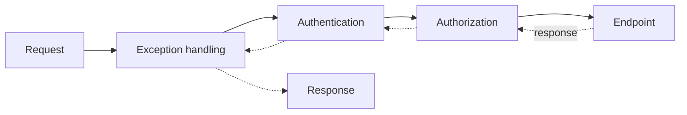

ASP.NET Core is built on two core ideas: requests pass through a **middleware pipeline**, and dependencies are supplied by a **DI container**. In .NET backend interviews, you are almost certain to be asked about both.

## The request pipeline

Every HTTP request passes through a sequence of components (middleware). Each middleware does one of three things: it processes the request and **passes it to the next one**, it produces the response itself and **short-circuits** the pipeline, or it works **on the response** after the next component returns.



The request travels inward and the response travels outward through the same components **in reverse order**. That is why exception handling sits on the outermost layer: so it can catch the exception thrown by anything inside.

```csharp
var app = builder.Build();

app.UseExceptionHandler();     // outermost: catches every error from the inner layers
app.UseHttpsRedirection();
app.UseRateLimiter();
app.UseAuthentication();       // "who are you?"  -> HttpContext.User is populated
app.UseAuthorization();        // "are you allowed?"  -> looks at User

app.MapGet("/orders/{id}", GetOrder).RequireAuthorization();

app.Run();
```

**Order determines behavior.** If `UseAuthorization` comes before `UseAuthentication`, authorization looks at a user that has not been populated yet and rejects every request. If the static files middleware comes before authentication, the files are served to everyone.

Writing your own middleware is simple:

```csharp
app.Use(async (context, next) =>
{
    var watch = Stopwatch.StartNew();

    await next(context);                         // the rest of the pipeline

    logger.LogInformation("{Method} {Path} -> {Status} ({Elapsed} ms)",
        context.Request.Method, context.Request.Path,
        context.Response.StatusCode, watch.ElapsedMilliseconds);
});
```

If `next` is not called, the pipeline ends there. Once the response has started being sent, you can no longer change the headers or the status code.

### Middleware vs. filters

Middleware runs for every request, independently of the endpoint (logging, CORS, authentication). **Filters** (endpoint filters, action filters in MVC) are attached to specific endpoints and can access model binding results (validation, endpoint-specific authorization).

## Dependency Injection

Instead of **creating** its dependencies itself, a class **receives** them from outside. The benefits: dependencies can be swapped with fakes in tests, classes depend on abstractions rather than concrete types, and object lifetimes are managed in one place.

```csharp
public interface IOrderRepository
{
    Task<Order?> FindAsync(int id, CancellationToken cancellationToken);
}

public class OrderService(IOrderRepository orders, ILogger<OrderService> logger)
{
    public async Task<Order> GetAsync(int id, CancellationToken cancellationToken)
    {
        logger.LogDebug("Reading order: {OrderId}", id);
        return await orders.FindAsync(id, cancellationToken) ?? throw new OrderNotFoundException(id);
    }
}

builder.Services.AddScoped<IOrderRepository, SqlOrderRepository>();
builder.Services.AddScoped<OrderService>();
```

When `OrderService` is requested, the container looks at its constructor parameters and resolves the dependencies recursively.

### Service lifetimes

| Lifetime | When a new instance is created | Typical use |
| --- | --- | --- |
| **Singleton** | **Once** for the lifetime of the application | Configuration, caches, the `HttpClient` factory; stateless, thread-safe services |
| **Scoped** | Once **per HTTP request** | `DbContext`, request context, unit of work |
| **Transient** | **Every time it is requested** | Lightweight, stateless helpers |

Singleton services are used by many requests at the same time, so they **must be thread-safe**. If one holds mutable shared state, concurrency bugs are inevitable.

### Captive dependency

The most frequently asked DI mistake: **a long-lived service holding on to a short-lived service.**

```csharp
builder.Services.AddSingleton<ReportCache>();     // singleton
builder.Services.AddScoped<AppDbContext>();       // scoped

public class ReportCache(AppDbContext db) { }     // BUG
```

The singleton is created once and holds the `DbContext` it received for the lifetime of the application. That `DbContext` is not thread-safe, may already have been disposed at the end of the request, and carries stale data. In the development environment, ASP.NET Core catches this with **scope validation** and fails at startup.

The rule: a service may only depend on services whose lifetime is **the same as or longer than** its own.

If a singleton really needs a scoped service (e.g. a background service), it opens its own scope:

```csharp
public class CleanupService(IServiceScopeFactory scopeFactory) : BackgroundService
{
    protected override async Task ExecuteAsync(CancellationToken stoppingToken)
    {
        while (!stoppingToken.IsCancellationRequested)
        {
            await using (var scope = scopeFactory.CreateAsyncScope())
            {
                var db = scope.ServiceProvider.GetRequiredService<AppDbContext>();
                await db.ExpiredSessions.ExecuteDeleteAsync(stoppingToken);
            }

            await Task.Delay(TimeSpan.FromHours(1), stoppingToken);
        }
    }
}
```

### Other common mistakes

- **Service locator**: injecting `IServiceProvider` into a class and pulling services from it. It hides dependencies and makes testing harder; prefer constructor injection.
- **Creating `HttpClient` with `new` on every use.** This leads to socket exhaustion. Use `IHttpClientFactory` (`AddHttpClient`); it pools connections and tracks DNS changes.
- **Doing work in the constructor.** Constructors should only store dependencies; they should not make network or database calls.
- **Too many dependencies.** A constructor with seven or eight parameters is a sign that the class does too much.

## Configuration: the Options pattern

Instead of reading settings from `IConfiguration` with string keys, bind them to typed classes and validate them at startup:

```csharp
public sealed class SmtpOptions
{
    [Required] public string Host { get; set; } = "";
    [Range(1, 65535)] public int Port { get; set; } = 587;
}

builder.Services.AddOptions<SmtpOptions>()
    .BindConfiguration("Smtp")
    .ValidateDataAnnotations()
    .ValidateOnStart();           // with invalid settings the app never starts
```

Configuration sources are layered, and each later one overrides the earlier ones: `appsettings.json` → `appsettings.{Environment}.json` → user secrets (in development) → environment variables → command line. Don't put secret values (passwords, keys) in the repository; use environment variables or a secret store.

## Error handling

Instead of catching exceptions in every endpoint one by one, handle them centrally and respond to the client in a standard format (`ProblemDetails`, RFC 9457). Never leak internal details (stack traces, SQL) in production; write them to the log.

```csharp
builder.Services.AddProblemDetails();
builder.Services.AddExceptionHandler<GlobalExceptionHandler>();
app.UseExceptionHandler();
```

## Asked in interviews

- **"Why does middleware order matter?"** The request passes through in order and the response in reverse order; authentication must come before authorization, and exception handling before everything else.
- **"What is the difference between scoped and transient?"** Scoped is one instance per request; transient is a new instance on every resolution. If two classes in the same request ask for the same scoped service, they get the **same** instance.
- **"Why is DbContext scoped?"** It is not thread-safe and represents a unit of work; having one per request is both safe and natural.
- **"What if I need a scoped service inside a singleton?"** I open a scope with `IServiceScopeFactory`.

## Summary

- The request passes through the middleware pipeline in order and the response in reverse order; order is a matter of correctness.
- DI: receive dependencies through the constructor and depend on abstractions.
- Lifetimes: singleton (application), scoped (request), transient (every time). A long-lived service must not hold on to a short-lived one.
- Read settings in a typed, validated way with the Options pattern; convert errors centrally to `ProblemDetails`.
