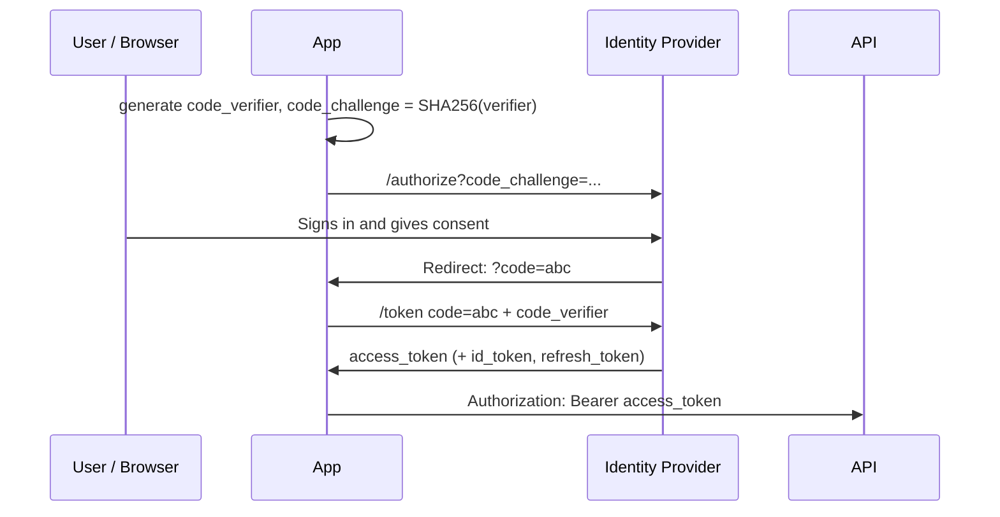

Security questions are almost certain to come up for senior roles, especially in finance, payments and healthcare. The interviewer looks at two things: whether you keep the concepts apart (authentication vs. authorization, OAuth vs. OIDC), and whether you prevent common vulnerabilities as you write code.

## Two separate questions

- **Authentication:** "Who are you?" The result is an identity (`ClaimsPrincipal`). Failure returns `401`.
- **Authorization:** "Are you allowed to do this?" It decides by looking at the identity. Failure returns `403`.

In ASP.NET Core, authentication is done through a **scheme** (cookie, JWT bearer, OpenID Connect). The scheme's job is to read the request and populate `HttpContext.User`.

## Cookies or JWT?

| | Session cookie | JWT (bearer token) |
| --- | --- | --- |
| Where is the state? | On the server, or inside an encrypted cookie | In the token itself (signed) |
| Revocation | Easy: delete the session | Hard: the token stays valid until it expires |
| Storage in the browser | `HttpOnly` cookie, JavaScript can't read it | Usually in memory or in storage |
| CSRF risk | Yes, prevented with `SameSite` and anti-forgery tokens | None if sent in a header |
| XSS risk | The cookie can't be stolen (`HttpOnly`) | A token in `localStorage` can be stolen via XSS |
| Best fit | A web app served from the same origin | Service-to-service calls, mobile clients, third-party APIs |

A frequent interview question is "Is it OK to store a JWT in `localStorage`?" The answer: it is not recommended for browser apps, because it is exposed to XSS. For browsers, the **BFF (Backend for Frontend)** pattern is preferred: the server side holds the tokens, and the browser only gets an `HttpOnly`, `Secure`, `SameSite=Strict` cookie.

### The structure of a JWT

`header.payload.signature`, all three Base64Url-encoded. The payload is **not encrypted**; anyone can read it. The signature only proves that the content has not been modified. That is why secret data such as passwords or card numbers never goes into a token.

```csharp
builder.Services.AddAuthentication(JwtBearerDefaults.AuthenticationScheme)
    .AddJwtBearer(options =>
    {
        options.Authority = "https://login.example.com";   // OIDC provider: keys are fetched from here
        options.Audience = "orders-api";
        options.TokenValidationParameters = new TokenValidationParameters
        {
            ValidateIssuer = true,
            ValidateAudience = true,
            ValidateLifetime = true,
            ClockSkew = TimeSpan.FromSeconds(30),
        };
    });
```

What must be validated: the **signature**, the **issuer** (who issued it), the **audience** (who it was issued for) and the **lifetime** (`exp`, `nbf`). If the audience is not validated, a token issued for a different service is also valid on your API.

### Short-lived access tokens and refresh tokens

Access tokens are short-lived (5–15 minutes) because they cannot be revoked. When one expires, the client gets a new one with a long-lived **refresh token**. The refresh token is stored on the server and can be revoked. Good practice is **refresh token rotation**: a new one is issued on every use and the old one becomes invalid. If an old refresh token is used again, you know it was stolen, and all tokens for that session are revoked.

## OAuth 2.0 and OpenID Connect

The two most frequently confused concepts:

- **OAuth 2.0 is a delegated authorization protocol.** It says "this app may access my calendar on my behalf". The result is an **access token**. It does not tell you, in a standard way, who the user is.
- **OpenID Connect (OIDC) is an identity layer built on top of OAuth 2.0.** It also issues an **ID token** (a JWT) that says who the user is and when and how they signed in.

"Sign in with Google" is OIDC. "This app can upload files to my Drive" is OAuth.

### Which flow, when?

| Flow | Who uses it |
| --- | --- |
| **Authorization Code + PKCE** | Anything where a user signs in: web, SPA, mobile |
| **Client Credentials** | Service-to-service calls with no user |
| **Device Code** | Devices without a keyboard (TV, CLI) |
| ~~Implicit~~, ~~Resource Owner Password~~ | Don't use them. OAuth 2.1 removes them |



**PKCE** (Proof Key for Code Exchange) makes a `code` stolen during the redirect useless: getting a token requires the `code_verifier`, which only the app knows.

You don't write the identity provider yourself. Common options: Microsoft Entra ID, Auth0/Okta, Keycloak (open source), Duende IdentityServer and OpenIddict (.NET).

## Authorization

### Role-based

```csharp
app.MapDelete("/api/users/{id}", DeleteUser).RequireAuthorization(p => p.RequireRole("Admin"));
```

It is simple, but it gets messy as the number of roles grows.

### Policy-based

It gathers a rule under a name. The endpoint only knows the policy name:

```csharp
builder.Services.AddAuthorizationBuilder()
    .AddPolicy("CanRefund", policy => policy
        .RequireAuthenticatedUser()
        .RequireClaim("permission", "payments:refund"));

app.MapPost("/api/payments/{id}/refunds", Refund).RequireAuthorization("CanRefund");
```

### Resource-based: preventing IDOR

The most common real-world vulnerability is this: the user is authenticated and the endpoint is protected, but on a `GET /api/orders/123` call nobody checks whether the order **belongs to that user**. Anyone who changes the number in the URL sees someone else's order. This is called **IDOR** (Insecure Direct Object Reference), and it is part of *Broken Access Control*, the first item on the OWASP list.

```csharp
public sealed class OrderOwnerHandler : AuthorizationHandler<SameOwnerRequirement, Order>
{
    protected override Task HandleRequirementAsync(
        AuthorizationHandlerContext context, SameOwnerRequirement requirement, Order order)
    {
        if (order.CustomerId == context.User.FindFirstValue(ClaimTypes.NameIdentifier))
        {
            context.Succeed(requirement);
        }

        return Task.CompletedTask;
    }
}

// In the endpoint:
var result = await authorization.AuthorizeAsync(user, order, "SameOwner");
if (!result.Succeeded) return TypedResults.NotFound();   // 404 so as not to leak that it exists
```

A simpler and often sufficient approach: filter the query by user from the start (`Where(o => o.CustomerId == userId)`). In multi-tenant systems, EF Core's **global query filter** feature adds this filter to every query automatically.

## The OWASP Top 10 and their .NET counterparts

| Risk | Mitigation in .NET |
| --- | --- |
| **Broken Access Control** | Authorization on every endpoint. Resource ownership checks. Deny everything by default (`FallbackPolicy`) |
| **Injection (SQL, command)** | EF Core and Dapper generate parameterized queries. Don't concatenate strings with `FromSqlRaw`; use `FromSql($"... {id}")` |
| **Cryptographic Failures** | Hash passwords with ASP.NET Core Identity's `PasswordHasher` or with Argon2/bcrypt. Don't write your own crypto. TLS is mandatory |
| **Security Misconfiguration** | Detailed error pages and the OpenAPI UI are off in production. No `AllowAnyOrigin` + credentials in CORS |
| **Vulnerable Components** | `dotnet list package --vulnerable`, Dependabot, regular updates |
| **Authentication Failures** | Account lockout, MFA, rate limiting on sign-in, short-lived tokens |
| **Software and Data Integrity Failures** | Signed packages, dependency verification in CI, never deserializing untrusted data with `BinaryFormatter` (it has been removed) |
| **Logging and Monitoring Failures** | Log failed sign-ins and authorization denials. **Don't log** tokens or passwords |
| **SSRF** | If you send requests to a URL the user provides, use an allowlist of domains and block internal network addresses |

**XSS:** Razor and React encode output by default. Vulnerabilities appear when you deliberately bypass this: `Html.Raw` in Razor, `dangerouslySetInnerHTML` in React. The `Content-Security-Policy` header is used as an additional safeguard.

**CSRF:** In apps that authenticate with cookies, another site can send requests from the user's browser. Mitigation: `SameSite=Lax/Strict` cookies and anti-forgery tokens on state-changing requests.

**Mass assignment (over-posting):** If you bind a domain entity directly to the request body, the client can send `IsAdmin: true`. Use a separate DTO for the request.

## Secrets management

- Connection strings, API keys and certificates **never go into the repository**. Use `dotnet user-secrets` in development, and Azure Key Vault, AWS Secrets Manager or HashiCorp Vault in production.
- In the cloud, the best option is to go **passwordless**: *Managed Identity* on Azure, an *IAM Role* on AWS. The app gets its identity from the platform, and there is no password to store.

```csharp
builder.Configuration.AddAzureKeyVault(
    new Uri("https://orders-kv.vault.azure.net/"),
    new DefaultAzureCredential());   // developer account locally, Managed Identity in the cloud
```

- A secret that was committed by mistake **counts as compromised** even if it is deleted from the history, and it is changed (rotated) right away.

## Asked in interviews

- **"What is the difference between OAuth and OpenID Connect?"** OAuth is delegated authorization and issues an access token. OIDC adds identity on top of it and issues an ID token.
- **"Where do you store the token in an SPA?"** If possible, I don't store it at all. With the BFF pattern the token stays on the server, and the browser gets an `HttpOnly` cookie.
- **"How do you revoke a JWT?"** I can't directly. I use short lifetimes, refresh token rotation and, if necessary, a revocation list (a `jti` blocklist).
- **"A user can see someone else's order. What is wrong?"** Resource ownership is not checked (IDOR). I filter the query by user or add resource-based authorization.
- **"Which flow for service-to-service calls?"** Client Credentials. In the cloud, Managed Identity if possible.

## Summary

- Authentication asks "who are you", authorization asks "are you allowed". The first produces `401`, the second `403`.
- Use `HttpOnly` cookies and BFF in the browser, and JWT between services. The contents of a JWT are not encrypted.
- Authorization Code + PKCE for user sign-in, Client Credentials for services.
- Policy-based and resource-based authorization are more flexible than role checks. IDOR is the most common real-world vulnerability.
- Parameterized queries, off-the-shelf password hashing, up-to-date packages and passwordless cloud identity close most OWASP risks.
