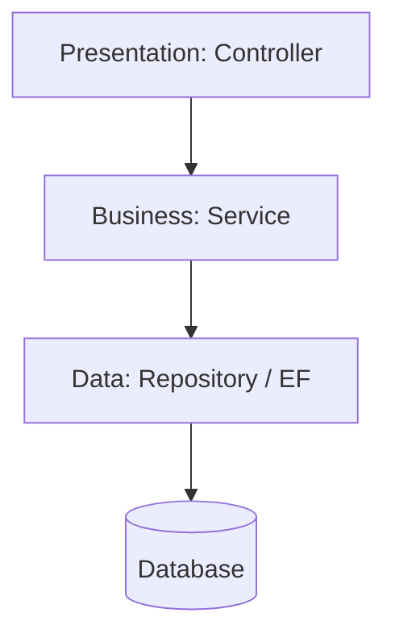
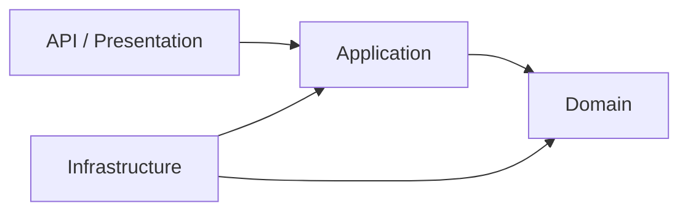

Most .NET job postings in Turkey ask for "Clean Architecture", "layered architecture" and "CQRS/MediatR". European postings add "Vertical Slices" to that. You applied Clean Architecture step by step in the Library Management API project. This lesson brings the concepts together and prepares you to answer the interview question "Why did you choose this structure?"

## Classic layered architecture



It is simple and familiar. The problem: dependencies flow **toward the database**. The business layer depends on the data layer. Changing data access may require touching the business layer, and business rules cannot be tested without a database.

## Clean Architecture

The structure proposed by Robert C. Martin (the same idea as the Hexagonal and Onion architectures): **dependencies always point inward.** Inner layers know nothing about outer layers.



| Layer | Contents | Depends on |
| --- | --- | --- |
| **Domain** | Entities, value objects, domain events, business rules | Nothing |
| **Application** | Use cases (command and query handlers), interfaces (`IOrderRepository`, `IEmailSender`) | Domain |
| **Infrastructure** | EF Core, email, message queues, external API clients: the implementations of the interfaces in Application | Application, Domain |
| **API** | Endpoints, DI setup, authentication | Application (and Infrastructure for setup) |

The key idea is **dependency inversion** (the D in SOLID). Application says "I need an email sender" and defines the `IEmailSender` interface. Infrastructure implements it with SMTP. That way the business logic stays independent of infrastructure and can be tested with fake implementations.

**Trade-offs:**

- The number of projects and files grows. A simple CRUD feature touches four projects.
- Risk of over-abstraction: an interface for everything, a separate DTO and mapping code for every entity.
- In small services the cost can outweigh the benefit.

## Vertical Slice architecture

An approach popularized by Jimmy Bogard: organize code **by feature, not by technical layer**. A feature's endpoint, validation, handler and data access live in a single folder, often in a single file.

```text
Features/
  Orders/
    PlaceOrder.cs        // request, validator, handler, endpoint
    CancelOrder.cs
    GetOrderById.cs
  Products/
    ...
```

```csharp
public static class PlaceOrder
{
    public sealed record Command(Guid ProductId, int Quantity);
    public sealed record Result(Guid OrderId);

    public static void Map(IEndpointRouteBuilder app) =>
        app.MapPost("/api/orders", async (Command command, Handler handler, CancellationToken ct) =>
        {
            var result = await handler.HandleAsync(command, ct);
            return TypedResults.Created($"/api/orders/{result.OrderId}", result);
        });

    public sealed class Handler(AppDbContext db, TimeProvider clock)
    {
        public async Task<Result> HandleAsync(Command command, CancellationToken ct)
        {
            var product = await db.Products.FindAsync([command.ProductId], ct)
                ?? throw new NotFoundException("Product not found");

            var order = Order.Place(product, command.Quantity, clock.GetUtcNow());
            db.Orders.Add(order);
            await db.SaveChangesAsync(ct);
            return new Result(order.Id);
        }
    }
}
```

**The benefit:** changing a feature means touching one place. Coupling between features is low. Each slice can be simple (EF Core directly) or complex (a domain model), depending on what it needs.

**The risk:** duplication and inconsistency across slices. Shared business rules should still be gathered in the domain model.

In practice the two are often combined: the Domain layer stays separate, while the Application and API layers are organized into vertical slices.

## CQRS

**Command Query Responsibility Segregation:** operations that change state (commands) and operations that read it (queries) are written with different models.

**The simple form (same database):**

- The command side loads the domain model, applies the business rules and saves with EF Core.
- The query side skips the domain model. It projects directly into the DTO the screen needs (EF Core `Select`, Dapper or raw SQL).

This form fits almost every project, and its cost is low. The read side doesn't have to load complex domain objects.

**The full form (separate read model):**

- Commands update the write database and publish events.
- The events update a separate store optimized for reads (Elasticsearch, a denormalized table, Redis).
- The read model is **eventually consistent**: there is a delay between a write and it becoming visible on reads.

Full CQRS is only worth it when the load or shape of reads and writes is very different. It is often mentioned together with Event Sourcing, but the two are independent: CQRS can be applied without event sourcing.

## MediatR and pipeline behaviors

MediatR is an in-process mediator that routes a request to its handler. The endpoint only says `sender.Send(command)`:

```csharp
public sealed record PlaceOrderCommand(Guid ProductId, int Quantity) : IRequest<Guid>;

public sealed class PlaceOrderHandler(AppDbContext db) : IRequestHandler<PlaceOrderCommand, Guid>
{
    public async Task<Guid> Handle(PlaceOrderCommand request, CancellationToken ct) { /* ... */ }
}
```

Its real strength is **pipeline behaviors**: adding cross-cutting concerns around every request, once.

```csharp
public sealed class ValidationBehavior<TRequest, TResponse>(IEnumerable<IValidator<TRequest>> validators)
    : IPipelineBehavior<TRequest, TResponse> where TRequest : notnull
{
    public async Task<TResponse> Handle(TRequest request, RequestHandlerDelegate<TResponse> next, CancellationToken ct)
    {
        var failures = (await Task.WhenAll(validators.Select(v => v.ValidateAsync(request, ct))))
            .SelectMany(r => r.Errors).ToList();

        if (failures.Count > 0) throw new ValidationException(failures);
        return await next();
    }
}
```

Validation, logging, transactions and performance measurement are defined in one place this way.

**Criticisms and what you should know:**

- MediatR is an extra layer of indirection: the answer to "Which code does this endpoint run?" is one file away. "Go to definition" in the IDE doesn't work.
- The same cross-cutting concerns can also be handled with ASP.NET Core endpoint filters or simple decorators.
- In 2025, with version 13, MediatR moved to a commercial license model (there is a free community license for small companies). AutoMapper followed the same path. That is why some teams write their own small mediator or inject handler classes directly.

In an interview, a good answer to "Do you use MediatR?" explains the trade-off: the benefit of pipeline behaviors versus the cost of indirection and licensing.

## Which structure, when?

| Situation | Recommendation |
| --- | --- |
| Small service, mostly CRUD | Vertical slices, EF Core directly. Keep the number of layers low |
| Rich business rules, long-lived product | A separate Domain layer (DDD) + Clean Architecture, or combined with slices |
| Very different read and write loads | CQRS, with a separate read model if needed |
| New team, consistency matters | Clear layer rules and architecture tests |

The worst choice is to build the most complex structure without needing it. Architecture should be proportional to today's needs and those of the near future.

## Asked in interviews

- **"What is the dependency rule in Clean Architecture?"** Dependencies point inward. Domain depends on nothing. Infrastructure interfaces are defined in an inner layer and implemented in an outer layer.
- **"What is the difference between Vertical Slice and Clean Architecture?"** One organizes code by technical layer, the other by feature. They can also be used together.
- **"Do you need a separate database to use CQRS?"** No. The simple form is separating command and query models on the same database.
- **"What are the benefits and costs of MediatR?"** The benefit is gathering cross-cutting concerns in one place with pipeline behaviors. The cost is indirection, discoverability and, now, licensing.
- **"Which architecture would you choose for this project?"** I ask about the needs: how heavy the business rules are, team size, expected lifetime. Then I choose the simplest structure that is sufficient.

## Summary

- Layered architecture is simple, but dependencies flow toward the database.
- Clean Architecture inverts dependencies inward: business logic becomes independent of infrastructure and testable.
- Vertical Slice organizes code by feature. Changes stay in one place.
- The simple form of CQRS (separate read and write models) is cheap and common. The full form brings eventual consistency.
- MediatR pipeline behaviors are powerful, but they come with the cost of indirection and licensing.
