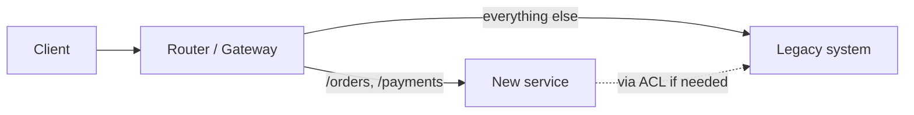

"Experience with microservice architecture" is one of the most frequent requirements in .NET job postings in Turkey. Logvance's posting is even more explicit: "production experience with modular monoliths and microservices". GlobalPBX asks for "refactoring and modernizing legacy systems". This lesson answers three questions: When should you split? Where should you split? How should the pieces talk to each other?

## Three options

| | Monolith | Modular monolith | Microservices |
| --- | --- | --- | --- |
| Unit of deployment | One | One | One per service |
| Internal structure | Often tangled | Modules with clear boundaries | Separate codebases |
| Database | Shared | Shared server, a schema per module | Separate per service |
| Calls between modules | Method calls | The module's public interface or in-process events | Over the network (HTTP, gRPC, messages) |
| Transactions | Easy | Easy (same database) | Distributed: saga, outbox |
| Independent scaling and deployment | No | No | Yes |
| Operational cost | Low | Low | High: observability, networking, deployment pipelines |

### The real reasons for microservices

Microservices are a tool for **scaling an organization**, not a performance tool. Valid reasons:

- **Teams need to deploy independently.** Fifty developers deploying to a single codebase on the same day has become a bottleneck.
- **One part's scaling needs are very different from the others'.** The search service needs 100 instances, the admin panel needs 2.
- **One part needs fault isolation.** When reporting crashes, payments must not be affected.
- **One part needs a different technology.**

If none of these apply, microservices only add cost. A frequently cited example in this debate is the 2023 post from the Amazon Prime Video team describing how they moved a monitoring service from microservices back to a monolith and cut its cost by 90%.

### The modular monolith: a sensible default

For a new product, the safest starting point is usually a modular monolith:

```text
src/
  Modules/
    Ordering/      Ordering.Api (public interface), Ordering.Core, Ordering.Infrastructure
    Inventory/
    Billing/
  Host/            starts them all in a single process
```

Rules:

- Each module has **its own schema** (`ordering.orders`, `inventory.stock`). A module never queries another module's tables.
- Modules access each other only through a **public interface** (e.g. `IInventoryModule.ReserveAsync`) or **in-process events**. The `internal` access modifier and architecture tests protect this boundary.
- If a module is later extracted into a separate service, the work is to turn the in-process call into a network call and the in-process event into a message queue. That is why a modular monolith is a **reversible** path toward microservices.

## Drawing service boundaries

The wrong boundary is the most expensive mistake you can make with microservices. Tips:

- **Follow bounded contexts** (see the DDD lesson). Draw the boundary around a business capability with its own language and rules: Ordering, Payments, Inventory, Shipping.
- **Don't split by technical layer.** Splits like "database service" or "validation service" spread every feature across several services.
- **Things that change together stay together.** If every feature change requires updating three services at the same time, the boundary is wrong.
- **Chatty services** (ones that make dozens of calls to each other for a single request) have been split incorrectly.

### The distributed monolith

The worst outcome: "microservices" that can't be deployed independently, are tied to each other by synchronous chains and share a common database. It combines all the rigidity of a monolith with all the difficulties of a distributed system. The signs:

- Deploying one service requires deploying the others at the same time.
- Services read and write the same tables.
- When one service crashes, the failure cascades and brings down all of them.

## Communication

### Synchronous (HTTP/gRPC)

It is simple and answers immediately. But it creates **temporal coupling**: if the called service is down, the caller fails too. As the chain grows, availability drops multiplicatively: a chain of five services at 99.9% availability each is about 99.5%.

Where to use it: queries that need an immediate answer ("what is this product's price?"). Use timeouts, retries and a circuit breaker on every call.

### Asynchronous (messages and events)

The caller drops a message on a queue and moves on. If the receiver isn't running at that moment, the message waits. Coupling goes down, but the system becomes **eventually consistent** and debugging gets harder.

- A **command** (`ReserveStock`): asks a specific receiver to do something. It has exactly one receiver.
- An **event** (`OrderPlaced`): announces that something happened. The publisher doesn't know who is listening. It can have zero or many receivers.

In an event-driven architecture, services don't call each other; they react to each other's events. The trade-off: the answer to "what exactly happens when an order is placed?" isn't written down in one place. Distributed tracing is essential for this.

## Data

The **database per service** rule ensures that services don't depend on each other's schemas. The consequences:

- **No JOINs.** Another service's data is requested through its API or kept in a local copy via events (the Ordering service stores the customer name in its own table and updates it on a `CustomerRenamed` event).
- **No distributed transactions.** Two-phase commit (2PC) isn't practical for microservices. A **saga** is used instead: each step runs its own local transaction, and on failure the earlier steps are undone with **compensating actions**.
- **Writing to the database and publishing a message must be consistent.** The solution is the **transactional outbox**: the message is written to an outbox table in the same transaction as the business data, and a separate process forwards it to the queue.

You can build a saga and an outbox hands-on in the "Event-Driven Order System" project in the System Design track.

## The front door: API gateway and BFF

You don't want clients to know the addresses of dozens of services. An **API gateway** is the single entry point: routing, authentication, rate limiting, TLS termination. In the .NET world, **YARP** (Yet Another Reverse Proxy) is Microsoft's library. In the cloud, Azure API Management or AWS API Gateway is used.

**BFF (Backend for Frontend)**: a separate, thin gateway for each client type (web, mobile). It combines the data the mobile app needs into a single call.

## Strangler fig: modernizing a legacy system

This pattern, named by Martin Fowler, takes its name from a fig species that gradually wraps around a tree and replaces it. Rewriting a legacy system all at once (a big bang rewrite) is very risky. The new system can't catch up for years, the business doesn't stop, and the old system keeps changing.



Steps:

1. Put a router in front of the legacy system. At first, all traffic goes to the old one.
2. Pick a capability (well bounded, high value, reasonable risk). Build it in the new system.
3. Route that capability's traffic to the new system. If needed, compare first with shadow traffic (the new system runs too, but its response isn't used).
4. Delete the corresponding part of the old code. Repeat.

To keep the new system from being polluted by the legacy model, an **anti-corruption layer** does the translation between them. On the data side, you usually need two-way synchronization or CDC (change data capture) for a while.

## Asked in interviews

- **"Would you start a new project with microservices?"** Usually not. I start with a modular monolith, clarify the boundaries, and extract a module into a service when a real reason appears.
- **"How do you draw service boundaries?"** By business capabilities and bounded contexts. I keep things that change together in the same place.
- **"How do you do a transaction that spans two services in microservices?"** With a saga. Each step is a local transaction, with compensation on failure. I publish messages reliably with an outbox.
- **"What is a distributed monolith?"** Services that are deployed separately but have to be deployed together, tightly coupled through the database and synchronous chains.
- **"How would you modernize a 20-year-old system?"** Strangler fig: a router in front, moving to the new system one capability at a time, an anti-corruption layer, and deleting the old part at each step.

## Summary

- Microservices are an organizational scaling tool with high operational cost. Without a reason for them, a modular monolith is the sensible default.
- Boundaries are drawn by business capabilities and bounded contexts. Don't split by technical layer.
- Synchronous calls bring temporal coupling; asynchronous messages bring eventual consistency.
- Database per service: APIs or local copies instead of JOINs, sagas and outboxes instead of distributed transactions.
- Legacy systems are replaced piece by piece with the strangler fig pattern and an anti-corruption layer.
