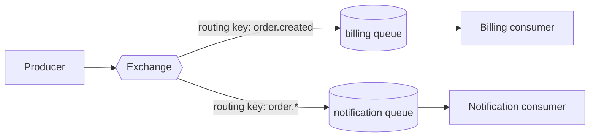
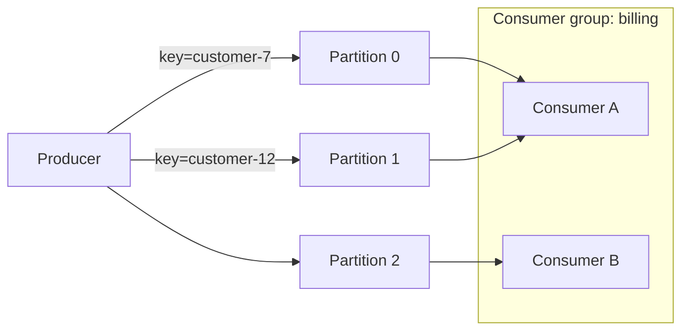

Message queues are the most frequently requested piece of infrastructure in job postings: 9 out of 18 postings name RabbitMQ, Kafka or Azure Service Bus. Logvance's posting spells out the interview question directly: "handling message loss, retries and dead-letter queues". In System Design we saw why queues are used. This lesson explains how the three products work and how to use them correctly in .NET.

## Delivery guarantees

| Guarantee | Meaning | How you get it |
| --- | --- | --- |
| **At most once** | A message may be lost, but is never processed twice | Acknowledge (ack) before processing |
| **At least once** | A message is never lost, but may be processed twice | Acknowledge after processing |
| **Exactly once** | Neither loss nor duplication | Doesn't really exist end to end. You get its **effect** with "at least once + an idempotent consumer" |

Almost all real systems work **at least once**. Why do duplicates happen? The consumer processes the message, writes to the database and crashes just before sending the ack. Since the broker never got the ack, it delivers the message again. That is why **every consumer must be written to be idempotent.** This is the most important sentence in this lesson.

## RabbitMQ

RabbitMQ is a classic **message broker**. It pushes messages to the consumer, and once the consumer acknowledges a message, it is deleted from the queue.



The producer sends a message not directly to a queue but to an **exchange**. The exchange distributes the message to queues according to its **binding** rules.

| Exchange type | Routing |
| --- | --- |
| **Direct** | When the routing key matches exactly |
| **Topic** | By pattern: `order.*` (exactly one word), `order.#` (zero or more words) |
| **Fanout** | To every bound queue, ignoring the key (broadcast) |
| **Headers** | By header values |

### Reliability settings

- **Durable queues and messages:** a `durable: true` queue and persistent messages. Otherwise messages are lost when the broker restarts. For high availability, use a **quorum queue** (Raft-based replication).
- **Publisher confirms:** the producer verifies that the broker actually received the message.
- **Manual acknowledgment:** `autoAck: false`. When the consumer finishes the work it sends `BasicAck`; on failure, `BasicNack`.
- **Prefetch (QoS):** the maximum number of unacknowledged messages handed to a consumer at once. If left unlimited, a single consumer pulls the whole queue into its memory.
- **Dead-letter exchange (DLX):** messages that are rejected (`requeue: false`), expire or exceed the queue limit go to another exchange and from there to a "dead letter" queue. That way a **poison message** (one that fails every time) doesn't block the queue forever.

```csharp
// RabbitMQ.Client 7: the API is fully async
var factory = new ConnectionFactory { HostName = "localhost" };
await using var connection = await factory.CreateConnectionAsync();
await using var channel = await connection.CreateChannelAsync();

await channel.ExchangeDeclareAsync("orders", ExchangeType.Topic, durable: true);
await channel.QueueDeclareAsync("billing", durable: true, exclusive: false, autoDelete: false,
    arguments: new Dictionary<string, object?>
    {
        ["x-queue-type"] = "quorum",
        ["x-dead-letter-exchange"] = "orders.dlx",
    });
await channel.QueueBindAsync("billing", "orders", routingKey: "order.created");
await channel.BasicQosAsync(prefetchSize: 0, prefetchCount: 20, global: false);

var consumer = new AsyncEventingBasicConsumer(channel);
consumer.ReceivedAsync += async (_, delivery) =>
{
    try
    {
        var message = JsonSerializer.Deserialize<OrderCreated>(delivery.Body.Span)!;
        await billing.HandleAsync(message);                                       // must be idempotent
        await channel.BasicAckAsync(delivery.DeliveryTag, multiple: false);
    }
    catch (Exception)
    {
        await channel.BasicNackAsync(delivery.DeliveryTag, multiple: false, requeue: false);  // goes to the DLX
    }
};
await channel.BasicConsumeAsync("billing", autoAck: false, consumer);
```

**Retries:** putting a failed message straight back with `requeue: true` creates a hot loop that reprocesses it hundreds of times per second. The right approach is a **delayed retry**: the message goes to a waiting queue with a TTL and returns to the main queue when the time is up. After a set number of attempts it lands in the DLQ, which triggers an alert and a manual review process.

## Kafka

Kafka is not a queue but a **distributed, durable log**. Messages are not deleted after they are read. They stay on disk for a configured period (retention), and each consumer tracks its own read position.



| Concept | Meaning |
| --- | --- |
| **Topic** | A category of messages (`orders`) |
| **Partition** | An ordered, append-only part of a topic. The unit of parallelism |
| **Offset** | A message's sequence number within a partition |
| **Key** | Messages with the same key go to **the same partition** |
| **Consumer group** | Within a group, a partition is assigned to **only one** consumer. Different groups read the same messages independently |

The consequences that come up in interviews:

- **Ordering is guaranteed only within a partition.** If the order of an order's events matters, the key must be the order ID.
- **Parallelism is limited by the number of partitions.** If you read a 6-partition topic with 10 consumers, 4 of them sit idle.
- **Increasing the number of partitions later** changes the key-to-partition mapping and breaks ordering assumptions. Choose it up front based on your needs.
- **Replay:** a consumer can move its offset back and reprocess past events. It is a powerful feature for backfilling a new service with historical data or correcting faulty processing.
- **Rebalance:** when a consumer joins or leaves the group, partitions are redistributed. Consumption pauses briefly while this happens.

```csharp
var config = new ConsumerConfig
{
    BootstrapServers = "localhost:9092",
    GroupId = "billing",
    EnableAutoCommit = false,              // we commit the offset ourselves after processing
    AutoOffsetReset = AutoOffsetReset.Earliest,
};

using var consumer = new ConsumerBuilder<string, string>(config).Build();
consumer.Subscribe("orders");

while (!stoppingToken.IsCancellationRequested)
{
    var result = consumer.Consume(stoppingToken);
    await billing.HandleAsync(result.Message.Key, result.Message.Value);   // idempotent
    consumer.Commit(result);                                                // at least once
}
```

On the producer side, the `Acks = Acks.All` and `EnableIdempotence = true` settings guarantee that a message written to the broker also reaches the replicas, and that the producer's retries don't create duplicates.

Kafka has no built-in DLQ. A failing message is written to a separate `orders.dlq` topic and the consumer advances its offset. Otherwise a single poison message stops the entire partition.

## RabbitMQ or Kafka?

| | RabbitMQ | Kafka |
| --- | --- | --- |
| Model | The broker pushes messages and deletes them once acknowledged | A durable log; the consumer pulls and tracks its position |
| Routing | Rich (exchange types) | Simple (topic + key) |
| Ordering | Per queue (with a single consumer) | Per partition |
| Replay | No (a deleted message is gone) | Yes (for the retention period) |
| Throughput | High | Very high (millions of messages/sec) |
| Best fit | Task queues, commands, complex routing | Event streaming, event sourcing, analytics, CDC, streams with many consumers |

## Azure Service Bus

Azure's managed enterprise message broker. It appears in postings from Microsoft and from companies that use Azure.

- **Queue:** point to point. **Topic + subscription:** publish-subscribe, and each subscription can have its own filter.
- **Peek-lock:** when a message is read it is locked but not deleted. If the consumer calls `Complete`, it is deleted; if it calls `Abandon`, it becomes visible again; if the lock expires, it also becomes visible again.
- **Max delivery count:** once this count is exceeded, the message is automatically moved to the **built-in dead-letter subqueue**.
- **Sessions:** messages with the same `SessionId` are delivered in order and to a single consumer (FIFO). Used for per-order ordering.
- **Duplicate detection:** discards duplicates arriving with the same `MessageId` within a given time window.
- **Scheduled messages:** a message that becomes visible at a future time.

```csharp
await using var client = new ServiceBusClient("orders-ns.servicebus.windows.net", new DefaultAzureCredential());
await using var processor = client.CreateProcessor("orders", "billing",
    new ServiceBusProcessorOptions { AutoCompleteMessages = false, MaxConcurrentCalls = 10 });

processor.ProcessMessageAsync += async args =>
{
    var order = args.Message.Body.ToObjectFromJson<OrderCreated>();
    await billing.HandleAsync(order);
    await args.CompleteMessageAsync(args.Message);
};
processor.ProcessErrorAsync += args => { logger.LogError(args.Exception, "Service Bus error"); return Task.CompletedTask; };
await processor.StartProcessingAsync();
```

Close relatives: **Azure Event Hubs** is for Kafka-like event streaming (it also speaks the Kafka protocol). **Azure Storage Queues** is a simple, cheap queue. The AWS counterparts are SQS (queues), SNS (publish-subscribe) and Kinesis or MSK (streaming).

## MassTransit and similar libraries

With raw client libraries, you have to hand-write retries, DLQs, serialization, outbox, sagas and distributed tracing every time. **MassTransit** provides these over RabbitMQ, Azure Service Bus, Amazon SQS and Kafka behind a single abstraction:

```csharp
builder.Services.AddMassTransit(x =>
{
    x.AddConsumer<OrderCreatedConsumer>();
    x.AddEntityFrameworkOutbox<AppDbContext>(o => o.UsePostgres().UseBusOutbox());
    x.UsingRabbitMq((context, cfg) =>
    {
        cfg.UseMessageRetry(r => r.Exponential(5, TimeSpan.FromSeconds(1), TimeSpan.FromMinutes(1), TimeSpan.FromSeconds(5)));
        cfg.ConfigureEndpoints(context);
    });
});

public sealed class OrderCreatedConsumer(AppDbContext db) : IConsumer<OrderCreated>
{
    public async Task Consume(ConsumeContext<OrderCreated> context) { /* ... */ }
}
```

A licensing note: MassTransit moved to a commercial license with version 9. Version 8.x remains open source. Alternatives: **Wolverine**, **Rebus**, **NServiceBus** (commercial). In an interview, it is enough to know at least one of them by name and to be able to answer "why a library instead of the raw client?"

## The idempotent consumer

Ways to make sure that when the same message arrives twice, the result is as if it had arrived once:

1. **A processed-messages table:** write the message ID to a table with a unique index, **in the same transaction** as the business data. On the second arrival, the uniqueness constraint is violated and the message is skipped.

```csharp
await using var tx = await db.Database.BeginTransactionAsync(ct);
if (await db.ProcessedMessages.AnyAsync(m => m.Id == messageId, ct)) return;   // already processed
db.ProcessedMessages.Add(new ProcessedMessage(messageId, DateTime.UtcNow));
db.Invoices.Add(Invoice.For(order));
await db.SaveChangesAsync(ct);    // in a race, the unique index stops the second one
await tx.CommitAsync(ct);
```

2. **A naturally idempotent operation:** `SET status = 'Paid'` gives the same result even if it runs twice. `SET balance = balance - 100` does not.
3. **Uniqueness on a business key:** there can be only one invoice per order. A unique index on `Invoices(OrderId)`.

## Outbox: writing to the database and publishing a message consistently

```csharp
db.Orders.Add(order);
await db.SaveChangesAsync(ct);
await bus.Publish(new OrderCreated(order.Id));   // if we crash here: the order exists, the event doesn't
```

If we write them in the reverse order, this time the event exists and the order doesn't. The **transactional outbox** solution: the event is written to an `outbox` table **in the same transaction** as the order. A separate background process reads the table, sends the messages to the broker and marks the sent ones. Sending is at least once, so the consumer must still be idempotent. MassTransit and Wolverine provide an outbox out of the box. You can build the logic yourself in System Design › Project 3.

## Asked in interviews

- **"How do you prevent message loss?"** Durable queues and messages, publisher confirms, manual acks (after processing), and an outbox for database and message consistency.
- **"What if the same message arrives twice?"** With at-least-once delivery that's normal. I write the consumer to be idempotent: a processed-messages table or a unique index on the business key.
- **"A poison message is blocking the queue. What do you do?"** Limited, delayed retries, then the DLQ. An alert for the DLQ and a tool for reprocessing.
- **"How do you get ordering in Kafka?"** Only within a partition. I give messages whose order matters the same key.
- **"I added more consumers but Kafka didn't get faster. Why?"** There are fewer partitions than consumers. The extra consumers sit idle.
- **"RabbitMQ or Kafka?"** RabbitMQ for task queues and routing. Kafka for high-volume event streams, replay and reads by many consumers.

## Summary

- In practice, delivery is at least once. Every consumer must be idempotent.
- RabbitMQ: routing through exchanges, durability, manual acks, prefetch, DLX and delayed retries.
- Kafka: a partitioned, durable log. Ordering within a partition, parallelism limited by the number of partitions, replay via offsets.
- Azure Service Bus: peek-lock, a built-in DLQ, FIFO with sessions, and duplicate detection.
- Libraries like MassTransit provide retries, outbox and sagas out of the box. Check their licenses.
- Make database writes and message publishing consistent with an outbox.
