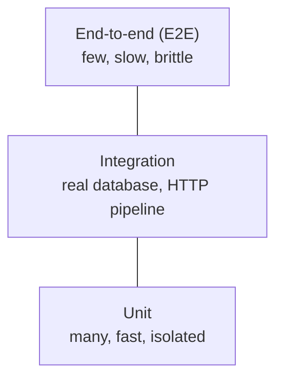

"Experience with unit and integration testing" is one of the most common lines in job postings. Trendyol's posting explicitly says "testable design, CI as a quality gate". In an interview, you are usually asked either to write a test for a class or to answer "how would you test this?"

## The test pyramid



| Layer | What it tests | Speed | Count |
| --- | --- | --- | --- |
| Unit | A single class or function, with no external dependencies | Milliseconds | Many |
| Integration | Components working together: API + database + serialization | Seconds | Moderate |
| End-to-end | A user scenario, through the real UI | Minutes | Few |

The pyramid's message: invest most in the layer that catches bugs most cheaply. In recent years the "testing trophy" view has also become popular for backend services: integration tests have become so cheap with Testcontainers that, in CRUD services with little business logic, integration tests give the most confidence. Both positions are defensible. What matters is the reasoning behind your choice.

## A good unit test

**FIRST**: Fast, Isolated (independent of each other), Repeatable (same result in every environment), Self-validating (reports pass/fail by itself), Timely (written along with the code).

In structure, **Arrange-Act-Assert**:

```csharp
public sealed class OrderTests
{
    [Fact]
    public void Cancel_refunds_when_order_is_paid()
    {
        // Arrange
        var order = OrderBuilder.Paid(total: 250m);

        // Act
        var result = order.Cancel(reason: "customer request");

        // Assert
        Assert.True(result.IsSuccess);
        Assert.Equal(OrderStatus.Cancelled, order.Status);
        Assert.Contains(order.DomainEvents, e => e is RefundRequested { Amount: 250m });
    }

    [Theory]
    [InlineData(OrderStatus.Shipped)]
    [InlineData(OrderStatus.Delivered)]
    public void Cancel_fails_after_shipping(OrderStatus status)
    {
        var order = OrderBuilder.WithStatus(status);

        var result = order.Cancel("too late");

        Assert.False(result.IsSuccess);
    }
}
```

- **The test name describes the behavior:** `Cancel_refunds_when_order_is_paid`. When a test breaks, its name should tell you what broke.
- **Test behavior, not implementation details.** Testing private methods, or verifying every step with "was this method called?", produces brittle tests that break on every refactor.
- **One behavior per test.** You can have several `Assert`s, but they should all verify the same behavior.
- `[Theory]` and `[InlineData]` repeat the same behavior with different inputs.

In xUnit, **a new instance of the class** is created for every test. Shared setup goes in the constructor, and cleanup goes in `IDisposable`/`IAsyncLifetime`. Expensive shared resources (a database container) are shared with `IClassFixture<T>` or a collection fixture.

## Test doubles

| Kind | What it does | Example |
| --- | --- | --- |
| **Dummy** | Only fills a parameter and is never used | A logger that can't be `null` |
| **Stub** | Returns a fixed answer | A clock service that always returns `2026-01-01` |
| **Fake** | A working but simple implementation | An in-memory repository |
| **Mock** | Verifies which calls were made | "Was the email service called once?" |
| **Spy** | Behaves like the real object but records calls | |

With **NSubstitute**:

```csharp
[Fact]
public async Task Placing_an_order_sends_confirmation()
{
    var clock = Substitute.For<TimeProvider>();
    clock.GetUtcNow().Returns(new DateTimeOffset(2026, 11, 24, 10, 0, 0, TimeSpan.Zero));
    var email = Substitute.For<IEmailSender>();
    var service = new OrderService(new InMemoryOrderRepository(), email, clock);

    await service.PlaceAsync(new PlaceOrder("ada@example.com", [new("SKU-1", 2)]), CancellationToken.None);

    await email.Received(1).SendAsync(
        Arg.Is<Email>(e => e.To == "ada@example.com"), Arg.Any<CancellationToken>());
}
```

Rule: **don't mock types you don't own.** Mocking `DbContext` or `HttpClient` produces brittle tests that try to imitate how those types really behave. Instead, mock your own abstraction (`IOrderRepository`) or write an integration test. EF Core's InMemory provider doesn't behave like a real database either (no transactions, constraints, or SQL translation), and Microsoft doesn't recommend it for testing.

The Moq library is also widely used. The SponsorLink component, added to one of its versions in 2023, read a hash of the developer's Git email address during the build. It caused controversy, and many teams switched to NSubstitute. In an interview, it's enough to recognize the syntax of both.

## Testable design

If writing a test is hard, that is usually a sign of a design problem:

- **`DateTime.Now`, `Guid.NewGuid()`, `Random`** called directly make the test unrepeatable. `TimeProvider` in .NET 8 lets you inject the clock.
- **Dependencies created with `new`** can't be replaced. Take them through the constructor.
- **Static state** leaks between tests.
- **Separate domain logic from infrastructure.** If `Order.Cancel` is a pure method, you can test it without any fakes. This is the biggest payoff of Clean Architecture.

## Integration testing: WebApplicationFactory

The `Microsoft.AspNetCore.Mvc.Testing` package boots the application in memory with the real HTTP pipeline (middleware, routing, serialization, authentication):

```csharp
public sealed class ApiFactory : WebApplicationFactory<Program>, IAsyncLifetime
{
    private readonly PostgreSqlContainer _db = new PostgreSqlBuilder().WithImage("postgres:17").Build();

    protected override void ConfigureWebHost(IWebHostBuilder builder) =>
        builder.ConfigureTestServices(services =>
        {
            services.RemoveAll<DbContextOptions<AppDbContext>>();
            services.AddDbContext<AppDbContext>(o => o.UseNpgsql(_db.GetConnectionString()));
            services.AddSingleton<IEmailSender, FakeEmailSender>();   // the external service is replaced with a fake
        });

    public async ValueTask InitializeAsync()
    {
        await _db.StartAsync();
        using var scope = Services.CreateScope();
        await scope.ServiceProvider.GetRequiredService<AppDbContext>().Database.MigrateAsync();
    }

    public override async ValueTask DisposeAsync()
    {
        await _db.DisposeAsync();
        await base.DisposeAsync();
    }
}

public sealed class OrderApiTests(ApiFactory factory) : IClassFixture<ApiFactory>
{
    [Fact]
    public async Task Creating_an_order_returns_201_with_location()
    {
        var client = factory.CreateClient();

        var response = await client.PostAsJsonAsync("/api/v1/orders", new { productId = Seed.ProductId, quantity = 2 });

        Assert.Equal(HttpStatusCode.Created, response.StatusCode);
        Assert.NotNull(response.Headers.Location);
    }
}
```

(The `IAsyncLifetime` signature here is from xUnit v3 and returns `ValueTask`. In xUnit v2 it returns `Task`.)

With minimal hosting, the `Program` class isn't visible to the test project by default. Add `public partial class Program;` at the end of `Program.cs`.

**Testcontainers** starts a real PostgreSQL, Redis, or RabbitMQ container in Docker before the test and removes it when the test finishes. That way, your tests run against the same database engine as production. Requirement: Docker on the test machine and in CI.

Options for isolating data between tests: run each test inside a transaction and roll it back at the end, clean the tables after each test with a tool like `Respawn`, or have each test work with its own data (unique IDs).

For **external HTTP services**, WireMock.Net spins up a real fake HTTP server. That way you can also test situations like timeouts, 500 errors, and slow responses.

## Architecture tests

To keep layer rules (Domain can't depend on Infrastructure) from eroding over time, you can write tests with `NetArchTest` or `ArchUnitNET`. Phase 7 of the Library API project does this.

## TDD

The Test Driven Development cycle: **red** (first write a failing test), **green** (write the simplest code that makes the test pass), **refactor** (clean up the code while the tests are green). The payoff is that the code is designed to be testable from the start and no unnecessary code gets written. It isn't mandatory in every situation. In an exploratory prototype it can be a waste of time. In an interview, an honest, well-reasoned answer to "Do you do TDD?" is better than a dogmatic one.

## Coverage and CI

- `dotnet test --collect:"XPlat Code Coverage"` produces a coverage report.
- The coverage percentage is **an indicator, not a target.** 100% coverage doesn't mean correct tests. A test with no `Assert` also "covers" lines. High coverage on critical business logic and low coverage on generated code is natural.
- **Mutation testing** (Stryker.NET) breaks the code with small changes and checks whether the tests catch them. It measures whether your tests actually verify anything.
- In CI, tests run on every PR, and a failure blocks the merge. Flaky tests are fixed right away or quarantined. An ignored red test kills the team's trust in the tests.

## Asked in interviews

- **"What's the difference between a mock and a stub?"** A stub provides answers; a mock verifies calls.
- **"Would you mock DbContext?"** No. I mock my own abstraction, or I write an integration test against a real database with Testcontainers. The InMemory provider doesn't reflect real behavior.
- **"How do you test code that uses `DateTime.Now`?"** I inject `TimeProvider` and give it a fixed time in the test.
- **"How do you write an integration test?"** I boot the application in memory with WebApplicationFactory, wire up a real database with Testcontainers, and replace external services with fakes.
- **"Do you aim for 100% coverage?"** No. I focus on critical business logic. Coverage is an indicator; mutation testing is a measure of quality.

## Summary

- The pyramid: many unit tests, a moderate number of integration tests, few end-to-end tests. In backend services, the share of integration tests is growing.
- Tests verify behavior, their names describe the behavior, and they follow the Arrange-Act-Assert structure.
- Don't mock types you don't own. Inject time, randomness, and external services.
- WebApplicationFactory + Testcontainers give you realistic, fast integration tests.
- In CI, tests are a quality gate. Coverage is an indicator, not a target.
