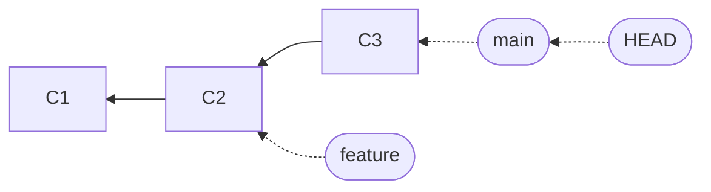

Git is expected in every job posting, either explicitly ("Git and PR workflow") or implicitly. Everyone knows the everyday commands. What makes the difference in an interview and during a real incident is knowing **how Git works**: bringing back an accidentally deleted commit, resolving a conflict that comes up during a rebase, finding which commit introduced a bug.

## The data model

Git is a database of **snapshots**, not a list of changes.

- **Blob:** the contents of a file.
- **Tree:** a directory: file names and pointers to blobs or trees.
- **Commit:** a pointer to a root tree, an author, a message and a pointer to the **parent commit(s)**.
- Each of these is named by the SHA hash of its contents. If the contents change, the hash changes. That's why commits are immutable: "changing" one actually creates a new commit.



- **Branch:** a movable **label** that points to a commit. Creating a branch means writing a 41-byte file. That's why branches are cheap in Git.
- **HEAD:** where you're working right now. It usually points to a branch. If it points directly to a commit, you're in a "detached HEAD" state.
- **Three areas:** the working directory (your files), the staging area (the index, via `git add`), the repository (commits).

## Merge and rebase

After the `feature` branch diverged from `main`, both branches got new commits.

**Merge** creates a new **merge commit** that joins the two histories:

```text
      A---B---C  feature
     /         \
D---E---F---G---M  main
```

**Rebase** **replays** `feature`'s commits on top of the tip of `main`. New commits (with different hashes) are created:

```text
D---E---F---G  main
             \
              A'--B'--C'  feature
```

| | Merge | Rebase |
| --- | --- | --- |
| History | Preserves what actually happened; the branching is visible | Linear and clean |
| Commit hashes | Unchanged | Changed (new commits) |
| On a shared branch | Safe | **Dangerous** |
| Conflicts | Resolved once | May be resolved separately for each commit |

**The golden rule of rebasing: don't rebase commits that others are working on (pushed, shared commits).** Because the hashes change, they no longer match other people's history. Rebasing your own local branch onto the latest `main` is a good habit.

There are three ways to merge a PR: a **merge commit** (history is preserved), a **squash merge** (all of the PR's commits become a single commit, keeping the main branch history clean) and a **rebase merge** (the commits are added linearly one by one). Most teams prefer squash merges.

## Resolving conflicts

```text
<<<<<<< HEAD
    var limit = Math.Min(pageSize, 100);
=======
    var limit = Math.Clamp(pageSize, 1, 50);
>>>>>>> feature/pagination
```

1. Understand the **intent** of both sides. One side set the upper bound to 100; the other added a lower bound and set the upper bound to 50. The right result is often a combination of both, not picking one.
2. Remove the markers, build the file and **run the tests**.
3. `git add` and `git merge --continue` (or `git rebase --continue`).
4. If things get messy, `git merge --abort` / `git rebase --abort` takes you back to the start.

The best way to reduce conflicts is small PRs and updating your branch often.

## Undoing history

| Command | What it does | On a shared branch |
| --- | --- | --- |
| `git restore <file>` | Discards the change in the working directory | — |
| `git restore --staged <file>` | Removes it from the staging area | — |
| `git commit --amend` | Changes the last commit (new hash) | Don't, if it was pushed |
| `git reset --soft HEAD~1` | Undoes the last commit; the changes stay staged | Don't |
| `git reset --mixed HEAD~1` | The changes stay in the working directory (the default) | Don't |
| `git reset --hard HEAD~1` | Throws away the commit **and the changes** | Don't |
| `git revert <commit>` | Creates a **new** commit that does the opposite of a commit | **Safe** |

The right way to undo a bad commit on a shared branch is `revert`: history isn't rewritten, and the undo itself is on record.

If you have to force push (on your own branch after a `rebase`), use `git push --force-with-lease`. The difference from `--force`: if the remote branch differs from the state you know about (someone else pushed), it refuses, so you don't overwrite their work.

## reflog: nothing is ever really lost

You deleted commits with `reset --hard`, or a rebase broke everything. Git records locally everywhere HEAD has been:

```bash
git reflog
# 3f9c2ab HEAD@{0}: reset: moving to HEAD~3
# a17e5d0 HEAD@{1}: commit: Add pagination       <- the commit you lost
# ...
git reset --hard a17e5d0       # or: git branch recovery a17e5d0
```

Anything that was committed can be brought back until its reflog entry is removed. For commits that no branch can reach, that's 30 days by default. Uncommitted changes, on the other hand, really are lost with `reset --hard`. So when in doubt, commit first or `git stash`.

## Handy tools

```bash
git stash push -m "half-done work"  # put changes aside
git stash pop                    # bring them back

git cherry-pick 4be1f2c          # apply a single commit from another branch here (e.g. a hotfix onto a release branch)

git log --oneline --graph --all  # visual history of the branches
git log -S "RetryCount"          # commits that added or removed this text
git blame -L 40,60 Order.cs      # who last changed these lines, and in which commit

git switch -c feature/x          # create a new branch and switch to it (old: checkout -b)
git worktree add ../hotfix main  # a second working directory from the same repository
```

### bisect: finding the commit that introduced a bug

A bug showed up in one of the last 200 commits. With binary search, you find it in at most 8 steps:

```bash
git bisect start
git bisect bad                   # it's broken now
git bisect good v2.3.0           # it worked in this version
# Git checks out the commit in the middle. Test it and tell Git:
git bisect good    # or: git bisect bad
# ... repeat ...
git bisect reset

# Automated: if a script reports the bug with a 0/1 exit code
git bisect run dotnet test --filter "FullyQualifiedName~PaginationTests"
```

## Branching strategies

| Strategy | Structure | Where it fits |
| --- | --- | --- |
| **Trunk-based** | A single main branch. Short-lived (hours, at most a few days) feature branches. Unfinished work behind feature flags | Teams doing continuous delivery. The approach of companies like Google and Meta |
| **GitHub Flow** | `main` + feature branches + PRs. `main` is always deployable | Most web applications |
| **GitFlow** | `main`, `develop`, `feature/*`, `release/*`, `hotfix/*` | Planned releases, products where multiple versions are supported (mobile, installed software) |

Long-lived branches mean big, painful merges. DORA research shows that short-lived branches and trunk-based development are associated with higher delivery performance.

## Good commits and PRs

**Commit message:**

```text
Add cursor pagination to the order list

Offset pagination took over 2 seconds above 100k rows.
The cursor seeks on the (CreatedAt, Id) pair and uses the index.
The old ?page= parameter is supported for one more release.

Refs: ORD-412
```

- The first line is short (~50 characters), in the imperative mood, and says what was done.
- The body explains the **why**. The "what" is already visible in the diff.
- **Conventional Commits** (`feat:`, `fix:`, `refactor:`, `docs:`) are used by some teams to generate changelogs and version numbers.
- Every commit should build and be a meaningful step. That's what makes `bisect` and `revert` possible.

**PR:**

- **Keep it small.** A 200-line PR gets reviewed carefully; a 2000-line PR gets waved through with "LGTM".
- In the description: what changed, why, how it was tested, screenshots (if it's UI), risks and the rollback plan.
- Split refactoring and behavior changes into separate PRs.
- Reply to review comments and mark the resolved ones. If a discussion drags on, talk it through out loud.

With `.gitignore`, build output (`bin/`, `obj/`), IDE files and **secrets** (`.env`, `appsettings.*.local.json`) stay out of the repository. A secret that was committed by mistake counts as compromised even if it's removed from history, and it gets rotated.

## Asked in interviews

- **"What's the difference between merge and rebase?"** Merge preserves history and adds a merge commit. Rebase replays commits and gives a linear history, but it changes the hashes. I don't rebase a shared branch.
- **"How do you undo a bad commit that's already been pushed?"** `git revert`. It doesn't rewrite history.
- **"I deleted my commits with `reset --hard`. Can I get them back?"** Yes, I find the commit with `git reflog` and create a branch from it.
- **"How do you find which commit introduced a bug?"** `git bisect`, automated with `bisect run` if possible.
- **"Why `--force-with-lease` instead of `--force`?"** So you don't accidentally overwrite a change someone else pushed.
- **"Which branching strategy do you prefer?"** For a web service with continuous delivery, trunk-based with short-lived branches and feature flags. For products with planned releases, something close to GitFlow.

## Summary

- Git is a content-addressed database made of snapshots. Branches are cheap labels pointing to commits.
- Merge preserves history, rebase linearizes it. Shared commits are not rebased.
- `revert` on a shared branch; `reset` and `--force-with-lease` on your own branch.
- Nothing committed is ever lost: `reflog`. The commit that introduced a bug is found with `bisect`.
- Short-lived branches, small PRs and commit messages that explain the "why".
