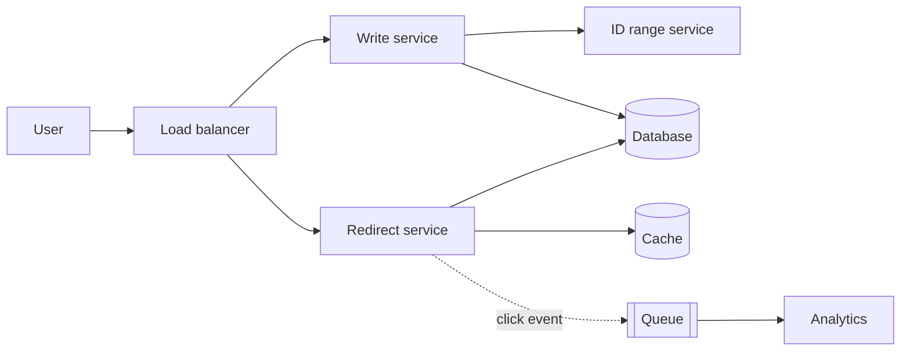

"Design a URL shortening service" (like bit.ly) looks small, but it touches on requirements gathering, capacity estimation, key generation, caching, and scaling. In this lesson, we solve the question using the steps of the [interview framework](/tracks/sistem-tasarimi/mulakat-cercevesi).

## 1. Requirements

**Functional:**

- Given a long URL, generate a short link.
- When the short link is visited, redirect to the original URL.
- Optional: a custom alias, an expiration date.

**Out of scope (say so explicitly):** user accounts, a detailed analytics dashboard.

**Non-functional:**

- Redirection must be **very fast** (tens of milliseconds) and **highly available**: if the service goes down, every link that has been handed out dies.
- Short codes must not be guessable (it must not be possible to collect every link by walking through them in order).
- The system is **read-heavy**.

## 2. Capacity estimation

Assumption: 100 million new links per month, a 100:1 read/write ratio.

- Writes: 100 million / (30 × 86,400) ≈ **40 / second**.
- Reads: ≈ **4,000 / second** (several times that at peak).
- Storage: ~500 bytes per record, 6 billion records in 5 years → **~3 TB**.

Takeaways: the write volume is small even for a single database; the real work is making the read path fast and resilient. The data size is close to the limit of a single machine; a model that's ready for sharding but doesn't require it is enough.

**Code length:** the `[a-zA-Z0-9]` alphabet has 62 characters. 7 characters give 62⁷ ≈ 3.5 trillion possibilities; that's more than enough for 6 billion records.

## 3. API

```http
POST /v1/links
{ "url": "https://example.com/a/very/long/path", "alias": null, "expiresAt": null }
-> 201 { "code": "aZ3kP9x", "shortUrl": "https://short.ly/aZ3kP9x" }

GET /{code}
-> 302 Location: https://example.com/a/very/long/path
```

**301 or 302?** A `301 Moved Permanently` is cached permanently by the browser: subsequent clicks never reach your server. That reduces load, but you can't count clicks and you can't change the link later. A `302 Found` brings every click to the server. If you need analytics or expiration, choose 302. This is a trade-off interviewers love to ask about.

To prevent abuse: rate limiting on the write endpoint and validation of the target URL (scheme check, a list of malicious domains).

## 4. Data model

| Field | Type | Note |
| --- | --- | --- |
| `code` | text, primary key | Short code |
| `long_url` | text | Original address |
| `created_at` | timestamp | |
| `expires_at` | timestamp, nullable | |

There's a single access pattern: **read one record by code**. There are no relationships, joins, or complex queries. This is a workload that fits a key–value store (DynamoDB, Cassandra) very well, and horizontal scaling is easy. At this volume, a well-indexed PostgreSQL would also be plenty; what matters is justifying the choice by the access pattern.

## 5. How to generate the short code

This is the most interesting decision in the design. Three approaches:

### A. Hashing the URL

Use the first 7 characters (base62) of the MD5 or SHA-256 hash of the long URL.

- Pro: the same URL always produces the same code; it's stateless.
- Con: **collisions** can happen; every write needs an "is this code taken?" check, plus a retry on collision.

### B. A random code

Generate 7 random characters and rely on a uniqueness constraint in the database; retry on collision.

- Pro: simple and unguessable.
- Con: it still needs a collision check. With 6 billion records in a space of 3.5 trillion, the chance of a collision is low but not zero, and it grows as the space fills up.

### C. Counter + base62

Generate a unique integer (1, 2, 3, …) and convert it to base62. Collisions are **impossible**.

```typescript
const ALPHABET = '0123456789abcdefghijklmnopqrstuvwxyzABCDEFGHIJKLMNOPQRSTUVWXYZ';

function toBase62(id: number): string {
  if (id === 0) return ALPHABET[0];

  let code = '';
  while (id > 0) {
    code = ALPHABET[id % 62] + code;
    id = Math.floor(id / 62);
  }

  return code;
}
```

- Con 1: consecutive codes are **guessable**. Fix: pass the number through a reversible scrambling step before encoding it.
- Con 2: a single counter is a bottleneck and a single point of failure. Fix: hand out an **ID range** to each application server (e.g., a thousand at a time). Each server consumes its own range in memory; coordination is needed only when the range runs out. If a server crashes, the rest of its range is wasted; that doesn't matter.

**Recommendation:** a counter with range allocation + scrambling + base62. It requires no collision check, a write is a single database operation, and it scales horizontally. In an interview, naming all three options and choosing one with a justification is much stronger than describing just one.

For custom aliases, a collision check is unavoidable: the uniqueness constraint in the database handles it atomically.

## 6. High-level design



The read and write paths are separate, because their load and requirements are very different: the redirect service is simple, stateless, and heavily replicated.

**Redirect flow:**

1. Is the `code` in the cache? If so, redirect immediately.
2. If not, read it from the database, write it to the cache, and redirect.
3. If the code isn't found or has expired, return 404 (and cache the "not found" result briefly).

## 7. Deep dive

**Caching.** Access is extremely skewed: a small fraction of links gets most of the clicks. That's the ideal situation for a cache. Since the mapping never changes, there's almost no invalidation problem; a long TTL and LRU eviction are enough. For the most popular links, a CDN or edge cache lowers latency even further.

**Scaling the database.** Read replicas first. When the data no longer fits on one machine, hash-based sharding on `code`: the keys spread evenly and every query goes to a single shard, so sharding is unusually painless here.

**Analytics.** Writing the click synchronously on the redirect path increases latency, and if the analytics system goes down, it takes redirection down with it. Instead, the click event is dropped into a queue and processed in batches by a separate consumer. If the queue goes down, redirection keeps working; losing a few clicks is acceptable.

**Expiration.** It's checked at read time (404 if expired); physically deleting the records is done by a batch job in the background.

**Availability.** Stateless services run in multiple availability zones, and the database is replicated. If the cache goes down, the system slows down but keeps working.

## General lessons from this question

- The read/write ratio drives the design: separate the paths and protect the read path with a cache.
- ID generation is a design decision in its own right in distributed systems.
- Separate the critical path (redirection) from non-critical work (analytics) with a queue.
- For every decision, name at least one alternative and the trade-off: 301/302, hash/counter, SQL/NoSQL.

To build this design with .NET, PostgreSQL, Redis, and Docker and measure it under load: [Project 1: Scalable URL Shortener and Load Testing](/tracks/sistem-tasarimi/proje-url-kisaltici-ve-yuk-testi).
