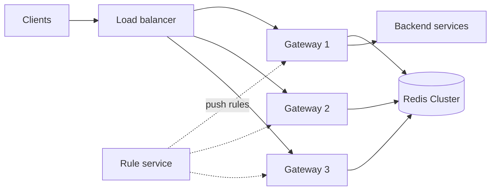

The question "Design a rate limiter" looks small, but it gets into deep topics: choosing an algorithm, race conditions in distributed counters, the latency budget, and "what happens if the limiter goes down?" Every major API, such as Stripe, Cloudflare, and GitHub, has a rate limiter in front of it.

## 1. Requirements

**Functional:**

- Limit a client by a **key**: user ID, API key, or IP address.
- Rules should be configurable: "free plan: 100 requests per minute," "login endpoint: 5 attempts per minute per IP."
- When the limit is exceeded, return `429 Too Many Requests` and tell the client when it can retry.

**Non-functional:**

- **Low latency:** since it's on the path of every request, it should add less than ~1 ms.
- **High availability:** if the limiter goes down, the API must not go down.
- **Distributed correctness:** even though requests are spread across dozens of servers, the limit must be enforced globally. A small overshoot (1–2%) is acceptable.
- Scale: 1 million requests per second, 100 million distinct keys.

## 2. Where it goes

| Location | Pro | Con |
| --- | --- | --- |
| Client | Cheap | Unreliable; a malicious client won't comply |
| **API gateway / middleware** | Centralized, independent of services, configured in one place | An extra component |
| Inside the service | Fine-tuning based on business logic (e.g., "10 exports per month") | Repeated in every service |

General rule: coarse limits (IP, API key) at the gateway; quotas that involve business rules inside the service. Volumetric attacks such as DDoS are handled even earlier, at the network edge (CDN/WAF).

## 3. Algorithms

### Token bucket

The bucket has a capacity of `b` tokens and refills at `r` tokens per second. Each request spends one token; if there are no tokens, it's rejected.

- **It allows bursts:** if the bucket is full, `b` requests go through immediately, and in the long run the average stays at `r`.
- Only two values are stored per key: the token count and the last refill time. Tokens are computed **lazily** on each request; no background timer is needed to refill them.
- It's the method Amazon and Stripe use; a safe default in an interview.

```typescript
interface Bucket { tokens: number; updatedAt: number }

function tryConsume(bucket: Bucket, capacity: number, ratePerSec: number, now: number): boolean {
  const elapsedSec = (now - bucket.updatedAt) / 1000;
  bucket.tokens = Math.min(capacity, bucket.tokens + elapsedSec * ratePerSec);
  bucket.updatedAt = now;

  if (bucket.tokens < 1) return false;

  bucket.tokens -= 1;
  return true;
}
```

### Leaky bucket

Requests enter a queue, and the queue is drained at a **constant rate**. The output rate is smooth; a burst waits in the queue, and if the queue is full, requests are rejected. It suits cases where the downstream system needs a constant rate (e.g., calls to a third-party API). The downside: during a burst, new requests wait behind old ones.

### Fixed window counter

One counter per minute: `counter:{key}:{minute}`. It's simple and cheap. Its problem is the **window boundary**: with a limit of 100 per minute, if 100 requests arrive at 12:00:59 and 100 at 12:01:00, 200 requests get through in two seconds.

### Sliding window log

The timestamp of every request is stored in a sorted set; the number of entries in the last 60 seconds is compared with the limit. It gives an **exact** result, but it uses memory proportional to the number of requests per key.

### Sliding window counter

A compromise between the cheapness of the fixed window and the accuracy of the sliding window: the previous window's count is weighted by how much it overlaps the current window.

```text
estimate = current_window_count + previous_window_count × (overlapping fraction of the previous window)

Example: limit 100/min; it's 12:01:15. The previous minute had 80 requests, this minute 30.
The sliding window is 12:00:15–12:01:15; 75% of the previous minute is inside it.
estimate = 30 + 80 × 0.75 = 90 → the request is accepted.
```

Two counters per key; it makes a small error because it assumes traffic is evenly distributed within the window. Cloudflare has published that it uses this method and that the error is very small.

| Algorithm | Memory | Accuracy | Allows bursts | Note |
| --- | --- | --- | --- | --- |
| Token bucket | 2 values | Good | Yes (controlled) | Default choice |
| Leaky bucket | Queue | Good | No | Constant output rate |
| Fixed window | 1 counter | 2× overshoot at the boundary | At the boundary | The simplest |
| Sliding window log | Per request | Exact | No | Expensive |
| Sliding window counter | 2 counters | Approximate | No | A good trade-off |

## 4. API

Tell the client its status with headers:

```http
HTTP/1.1 429 Too Many Requests
Retry-After: 12
RateLimit-Limit: 100
RateLimit-Remaining: 0
RateLimit-Reset: 12
```

Rule configuration (e.g., YAML, stored in a configuration service and pushed to the servers):

```yaml
- match: { plan: free }
  limit: { requests: 100, per: minute }
- match: { path: /v1/login, by: ip }
  limit: { requests: 5, per: minute }
```

## 5. Distributed design

There are dozens of API servers. If each server counts in its own memory, then because requests are spread out, the real limit becomes `limit × number of servers`. The counter must be kept in a **shared** place: Redis.



### Race conditions

If "read, check, write" is done with three separate Redis commands, two servers read `99` at the same time, both accept, and the limit is exceeded. The fix is to make the operation **atomic**. The simplest way for a fixed window is `INCR` + `EXPIRE`; for the token bucket and sliding window, use a **Lua script** (Redis runs a script in one go, without interruption):

```lua
-- KEYS[1] = bucket key; ARGV = capacity, rate per second, current time (ms)
local capacity = tonumber(ARGV[1])
local rate     = tonumber(ARGV[2])
local now      = tonumber(ARGV[3])

local bucket  = redis.call('HMGET', KEYS[1], 'tokens', 'ts')
local tokens  = tonumber(bucket[1]) or capacity
local ts      = tonumber(bucket[2]) or now

tokens = math.min(capacity, tokens + (now - ts) / 1000 * rate)

local allowed = 0
if tokens >= 1 then
  tokens = tokens - 1
  allowed = 1
end

redis.call('HSET', KEYS[1], 'tokens', tokens, 'ts', now)
redis.call('PEXPIRE', KEYS[1], math.ceil(capacity / rate * 1000))
return allowed
```

Taking the time from Redis's `TIME` command instead of the server's clock eliminates the effect of clock skew between servers.

### Scale and memory

- 100 million keys × ~100 bytes ≈ 10 GB: fits comfortably on a few Redis nodes. Keys expire on their own via TTL.
- 1 million checks per second: in Redis Cluster, they're distributed by key hash; at ~100,000 operations per node, that's ~10 primary nodes.
- Latency: a Redis round trip within the same availability zone is ~0.5 ms. To lower it further:
  - **A local pre-counter:** each server spends a small share of tokens locally and syncs with Redis in batches (you give up a little accuracy, but latency and load drop significantly).
  - Keep clearly blocked keys in local memory (for the `Retry-After` duration) and never ask Redis about them.

### Multi-region deployment

A single global Redis adds intercontinental latency. Options:

- Each region enforces its own limit (dividing the limit by the number of regions, or a separate quota per region).
- Asynchronous sync between regions: an approximate global limit; brief overshoots are accepted.

For most products, "exact per region, approximate globally" is enough; say so explicitly.

## 6. Failure modes

**What happens if Redis is unreachable?** This is the most important question in the interview.

- **Fail open:** let the request through without limiting. It preserves availability; you're unprotected for a short time. The right choice for most public APIs.
- **Fail closed:** reject the request. For endpoints where abuse is expensive, such as login attempts, sending SMS, or payments.
- In both cases, use a short timeout (~5–10 ms) and a circuit breaker; don't lock up the API waiting for Redis. Falling back to a local, in-process limiter while Redis is down is a good middle ground.

**Rule updates:** rules aren't read on every request; the servers keep them in memory, and the configuration service pushes changes (or the servers pull them periodically).

## 7. Deep-dive questions

- **Which key?** The user/API key for authenticated users; IP for anonymous traffic (thousands of users behind a NAT share the same IP; mention this).
- **Multiple rules:** 10 per second **and** 300 per minute **and** 10,000 per day; each is a separate bucket, and all are checked in the same Lua call.
- **Cost-based limiting:** each request spends not one token but as many tokens as it costs (an expensive search 10, a simple read 1).
- **Fair sharing:** reserving capacity for priority customers when the system as a whole is overloaded (together with load shedding).

## General lessons from this question

- Choosing an algorithm is a trade-off: the token bucket allows bursts; the sliding window counter is cheap and accurate enough.
- In a distributed counter, "read–check–write" must be atomic: Redis + Lua.
- For every component on the critical path, ask: "if this goes down, should it fail open or fail closed?"

**Further reading:** [Stripe: Scaling your API with rate limiters](https://stripe.com/blog/rate-limiters); [Cloudflare: How we built rate limiting capable of scaling to millions of domains](https://blog.cloudflare.com/counting-things-a-lot-of-different-things/); Alex Xu, *System Design Interview* Volume 1, Chapter 4.
