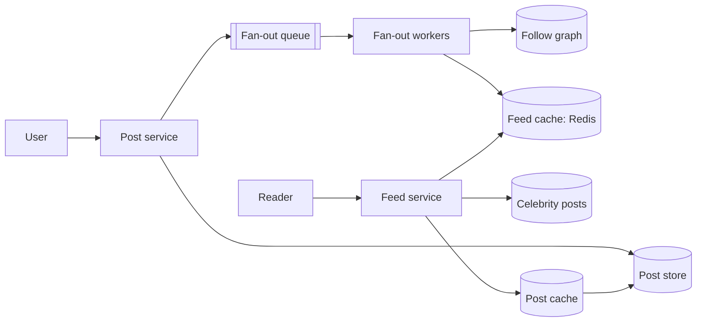

The news feed question contains the most classic trade-off in system design: will you do the work **at write time** or **at read time**? The Twitter/X home timeline, the Instagram feed, the Facebook News Feed, and the LinkedIn feed are all variations of the same problem.

## 1. Requirements

**Functional:**

- A user publishes posts (text + an optional image).
- A user follows other users.
- A user sees their feed, made up of posts from the people they follow, in **reverse chronological** order, with pagination.
- Out of scope (say so explicitly): search, the recommendation algorithm, ads, direct messages.

**Non-functional:**

- Fast feed loading: p99 < 500 ms.
- High availability; **eventual consistency is acceptable**: it's fine if a post shows up in followers' feeds a few seconds late.
- Scale: 500 million daily active users, 200 followed accounts on average, and some accounts have more than 100 million followers.

## 2. Capacity

- Posts: 500 million posts per day → **~6,000 / second** (~20,000 at peak).
- Feed reads: 10 feed opens per user per day → 5 billion / day → **~60,000 / second** (~200,000 at peak).
- Read-heavy (10:1), with a tight latency target for reads. **Conclusion:** computing the feed at read time will be expensive; preparing it in advance is attractive.
- Post metadata: 500 million × 1 KB = 500 GB / day. **Conclusion:** posts go in a sharded store; media goes in object storage.

## 3. API

```http
POST /v1/posts                      { "text": "...", "mediaIds": ["..."] }   -> 201 { "postId": "..." }
POST /v1/users/{id}/follow                                                    -> 204
GET  /v1/feed?cursor=...&limit=20                                             -> { "items": [...], "nextCursor": "..." }
```

The feed is infinite scroll: **cursor-based pagination** (the ID of the last post seen), not offsets. If post IDs are time-ordered, like Snowflake IDs, the cursor is simply the ID.

## 4. Data model

| Table | Key | Note |
| --- | --- | --- |
| `users` | `user_id` | Profile |
| `posts` | `post_id` (Snowflake) | `author_id`, text, media keys, timestamp; sharded by `author_id` |
| `follows` | `(follower_id, followee_id)` | Queries are needed in both directions: "who do I follow" and "who follows me"; two separate tables/indexes |
| `feed` (cache) | `user_id` → list of post IDs | In Redis, the last ~800 post IDs per user |

## 5. The key decision: when is the feed computed?

### Fan-out on read (pull)

When the feed is opened: find the 200 people followed, fetch each one's recent posts, merge, and sort.

- Pro: writes are cheap; there's no celebrity problem.
- Con: every feed open queries 200 shards (scatter-gather). 60,000 feeds per second × 200 = 12 million queries/second. Reads are slow and expensive.

### Fan-out on write (push)

When a post is published, its ID is prepended to the feed list of **every follower**. Opening the feed means reading a single list.

- Pro: reads are very fast and cheap (a single Redis read).
- Con: writes are amplified. With 200 followers on average, 6,000 posts/second → 1.2 million feed writes/second. And there's the **celebrity problem:** a single post from an account with 100 million followers means 100 million writes; the fan-out takes minutes.
- Updating the feeds of users who never sign in is also wasteful.

### The hybrid model

The approach Twitter uses:

- **Regular accounts** (e.g., < 10,000 followers): fan out on write.
- **Celebrity accounts:** don't fan out. When a follower opens their feed, the precomputed feed list and the recent posts of the (few) celebrity accounts they follow are **merged at read time**.
- Users who haven't signed in for the last 30 days get no fan-out; when they come back, their feed is rebuilt at read time.



### Feed read steps

1. Get the user's post IDs from the feed cache (the 20 after the cursor, plus a few extra).
2. Get the recent posts of the celebrity accounts the user follows and merge them (since the IDs are time-ordered, merging is cheap).
3. Resolve the IDs **in bulk** (`MGET`) from the post cache: text, author, media URLs, counters.
4. Filter out deleted posts and blocked users.
5. Return the response and the next cursor.

The feed cache holds only **IDs**, not the posts themselves: a single post appears in millions of lists; its content is stored once, in the post cache. That way, edits and deletions also happen in one place.

## 6. Deep dive

**Fan-out workers.** The post service only saves the post and drops an event into the queue; the user doesn't wait. Workers read the follower list in pages and write to Redis in batches (`pipeline`). The feed list is kept bounded (the last 800, with `LPUSH` + `LTRIM`). Posts with very many followers are split into chunks and processed in parallel.

**Counters (likes, comments, views).** A viral post gets tens of thousands of likes per second; updating a single database row creates a hot spot. Like events are written to a queue; the counter is kept in Redis with `INCR` and periodically written to the persistent store in batches. If needed, the counter key is salted (`likes:42:0..9`) and the parts are summed on read. It's acceptable for the displayed count to lag a few seconds behind. "Did this user like it?" is a separate `(post_id, user_id)` record.

**Ranking.** Moving from reverse chronological order to relevance ranking: candidate posts (feed cache + celebrities + recommendations) are gathered and ranked by a scoring model (probability of engagement). In an interview, it's enough to draw the architecture as "candidate generation → scoring → re-ranking (diversity, rules)."

**Media.** Images are uploaded directly to object storage with a presigned URL, the different sizes are generated asynchronously, and they're served from a CDN. The feed response contains only the CDN URLs.

**New follows / unfollows.** On a follow, the new account's last few posts can be added to the feed (or merged on the next read); on an unfollow, filtering at read time is cheaper than cleaning up the feed list.

**Losing the feed cache.** If a Redis node goes away, feeds can be rebuilt from the follow graph and the post store: the feed cache is **derived data**. On a cold start, the system falls back to merging at read time.

**Seeing your own post.** Since fan-out is asynchronous, a user might not see their own post in their feed right away. The client prepends the published post to the feed locally (optimistic UI), and the server also merges the author's own posts at read time.

## General lessons from this question

- In read-heavy systems, move the work to write time (precomputation), but handle the extremes of the fan-out cost (celebrity accounts, inactive users) separately.
- Keep lists of IDs in the cache and the content separately: this avoids large-scale copying and keeps updates in one place.
- Counters are hot spots: accumulate, write in batches, and split the key if needed.
- Separately address the user-facing side of eventual consistency (not being able to see your own post).

**Further reading:** [Twitter's timeline architecture (Raffi Krikorian, InfoQ)](https://www.infoq.com/presentations/Twitter-Timeline-Scalability/); [Scaling Memcache at Facebook (NSDI 2013)](https://www.usenix.org/conference/nsdi13/technical-sessions/presentation/nishtala); Alex Xu, *System Design Interview* Volume 1, Chapter 11.
