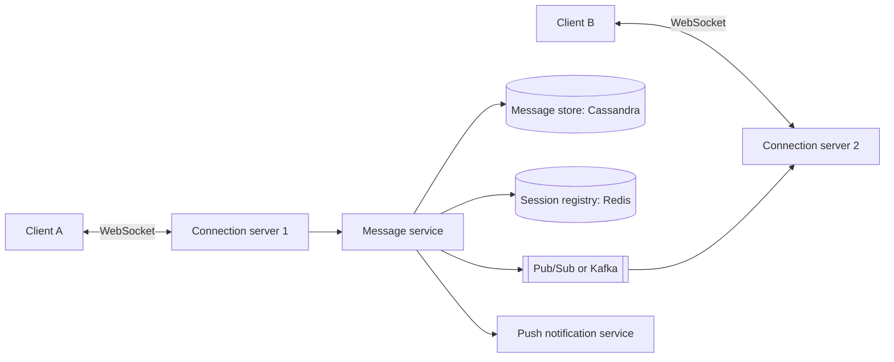

A chat application combines **real-time communication** with **high write volume**. The real challenges are managing millions of open connections, getting each message to the server the recipient is connected to, never losing a message, and preserving order.

## 1. Requirements

**Functional:**

- One-on-one chat and group chat (up to 500 people).
- Messages are delivered in real time; if the recipient is offline, they receive them when they reconnect.
- Delivered and read receipts (✓ / ✓✓).
- Online presence and "last seen".
- Multiple devices (phone + web).
- Out of scope: voice/video calls, details of end-to-end encryption (only touched on).

**Non-functional:**

- Low latency: < 200 ms within the same region.
- **No message loss**; order must be preserved within a chat.
- Scale: 500 million daily active users, 40 messages per person per day, ~100 million concurrent open connections.

## 2. Capacity

- Messages: 500 million × 40 = 20 billion / day → **~230,000 / second**, ~1 million at peak.
- Storage: ~200 bytes per message → 4 TB / day; with 3 replicas, ~4.5 PB per year (excluding media). **Conclusion:** a write-heavy store that scales horizontally.
- Connections: a (well-tuned) connection server can hold ~500,000–1 million idle WebSockets; for 100 million connections, with a safety margin, **a few hundred** connection servers.

## 3. Connection protocol

The server must push messages to the client instantly, and the client sends messages often: **WebSocket** (on mobile, the connection closes when the app is in the background; then use **push notifications**: APNs, FCM). The persistent connection is used in both directions: sending messages, receiving messages, delivered/read receipts, and the typing... indicator.

## 4. API (events over WebSocket)

```json
// Client → server
{ "type": "send", "clientMsgId": "c-7f3a", "chatId": "ch-91", "text": "Hello" }
{ "type": "ack", "chatId": "ch-91", "upToSeq": 1042 }
{ "type": "read", "chatId": "ch-91", "upToSeq": 1042 }

// Server → client
{ "type": "sent", "clientMsgId": "c-7f3a", "msgId": "m-88121", "seq": 1043 }
{ "type": "message", "chatId": "ch-91", "seq": 1043, "from": "u-12", "text": "Hello", "ts": 1763650000000 }
```

`clientMsgId` is a unique ID generated by the client; if the network drops and the client resends the message, the server does not store the same message twice (**idempotency**).

Request–response operations such as message history and the chat list use plain HTTP:

```http
GET /v1/chats/ch-91/messages?beforeSeq=1000&limit=50
```

## 5. High-level design



**Connection servers** only hold connections and carry messages; they contain no business logic. That way, deployments and crashes have minimal impact on the connection layer. The **session registry** tracks which user (and which of their devices) is connected to which connection server.

### Message send flow

1. A sends a `send` event to connection server 1.
2. The message service gets the next **sequence number** for the chat and writes the message to the store.
3. If the write succeeds, `sent` (✓) is returned to A. **Durable store first, then acknowledge:** if the server crashes, an acknowledged message is not lost.
4. The service looks up which server B is on in the session registry and publishes the message to that server's channel (or to B's personal channel; the connection server subscribes to the channels of its connected users).
5. Connection server 2 pushes the message to B. B sends an `ack`; the delivered (✓✓) receipt travels back to A the same way.
6. If B is offline, a push notification is sent; the message waits in the store.

## 6. Ordering and delivery guarantees

**Order.** Client clocks are unreliable, and server clocks drift from each other too. Ordering uses a **per-chat increasing sequence number** (`seq`). A single place assigns the sequence number: the owner of the chat's partition (e.g., Redis `INCR` keyed by `chat_id`, or a single partition/worker that processes all of a chat's messages in order). In Kafka, using the chat ID as the partition key ensures a chat's messages are processed in order.

**Delivery.** The network can lose or duplicate a message. The model: **at-least-once delivery + deduplication on the client**.

- The server treats a message as "undelivered" until the client sends an `ack`.
- For each chat, the client knows **the latest sequence number it has received**. When it reconnects, it says "for ch-91 I have everything up to 1042"; the server sends everything after 1043. If the same `seq` arrives twice, the client ignores it.
- If it sees a gap in the sequence numbers (1045 after 1043), the client requests the missing range.

In this design, offline delivery does not need a separate "inbox": **sync means pulling everything after the last seen sequence number**. Multiple devices sync with the same mechanism, each device tracking its own position.

## 7. Message store

Access pattern: "the N messages before/after a given point in a chat". Write volume is very high, updates are nearly nonexistent, and recent messages are read very often.

This is an ideal workload for a wide-column store (Cassandra, ScyllaDB, HBase):

```sql
CREATE TABLE messages (
  chat_id    text,
  bucket     int,       -- e.g., monthly or a sequence number range; keeps the partition from growing without bound
  seq        bigint,
  sender_id  text,
  body       text,
  created_at timestamp,
  PRIMARY KEY ((chat_id, bucket), seq)
) WITH CLUSTERING ORDER BY (seq DESC);
```

Partition key `(chat_id, bucket)`: a chat's messages are stored together, sorted by sequence number; "the last 50 messages" is a sequential read from a single partition. `bucket` keeps a very active chat's partition from growing without bound. Discord and Facebook Messenger (HBase) use similar models.

## 8. Group chat

The message must be delivered to the connection of every member of the group. In a 500-person group, one message means 500 deliveries.

- The message is stored **once** (in the chat's partition); it is not copied to each member.
- Fan-out: find the servers the group members are connected to and send the message **once per server**; each server distributes it to its own connected members.
- The group size limit (hundreds on WhatsApp, millions on Discord servers) changes the design: very large channels use a pull-on-read model and a "push only to active members" strategy.
- In large groups, read receipts are stored per member as `(chat_id, user_id) → last read seq`; no separate read record is kept for each message.

## 9. Online presence

- While the connection is open, the client sends a periodic **heartbeat** (e.g., every 30 seconds); the status is stored in Redis as a key with a TTL. When the heartbeats stop, the key expires: "last seen" = the last heartbeat.
- Broadcasting a status change to all friends instantly is expensive (a user can have thousands of contacts). It is broadcast only to people who **currently have the chat screen open** or are viewing the list; others pull it when they open the screen.
- To prevent the status from flickering "offline ↔ online" during short disconnects (a tunnel), it is published with a delay of a few seconds.

## 10. Deep dives

- **If a connection server crashes:** clients reconnect (with a random delay; otherwise all clients stampede at once) and sync from their last sequence number. No messages are lost, because messages were written to the durable store before being acknowledged.
- **Media:** photos and videos are uploaded to object storage with a presigned URL; the message carries only the media key.
- **End-to-end encryption:** with the Signal protocol, messages are encrypted on the client; the server cannot see the content and carries only the encrypted payload. That is why server-side search and content moderation are not possible; this is a trade-off.
- **Multi-region:** a user connects to the nearest region; messages between users in different regions travel through a cross-region queue. A single "home region" assigns the chat's sequence numbers.

## General lessons from this question

- Separate the layer that holds connections from business logic; keep the user → server mapping in a registry.
- Durable store first, then acknowledge; deliver at least once and deduplicate on the client.
- Build ordering on a per-chat sequence number, not on clocks; sync is "everything after what I last saw".
- For write-heavy data that is read sequentially within a partition, use a wide-column store.

**Further reading:** [Discord: How Discord stores trillions of messages](https://discord.com/blog/how-discord-stores-trillions-of-messages); [Slack: Real-time messaging](https://slack.engineering/real-time-messaging/); Alex Xu, *System Design Interview* Volume 1, Chapter 12.
