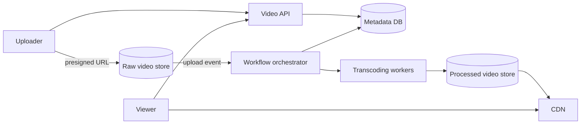

The video platform question combines three different subsystems: **large file uploads**, **long-running processing**, and **massive read traffic**. Most of the cost is bandwidth, which is why the CDN sits at the center of the design.

## 1. Requirements

**Functional:**

- Users upload videos (up to a few GB).
- Users watch videos on different devices and under different network conditions.
- Video title, description, thumbnail; view count.
- Out of scope: recommendations, comments, live streaming, ads.

**Non-functional:**

- Playback starts fast (< 2 seconds), with little buffering.
- Uploads are reliable; they must be able to resume even if they drop on a weak network.
- An uploaded video must be watchable within minutes (it doesn't need to be instant).
- Scale: 1 billion views per day, 500,000 uploads per day.

## 2. Capacity

- Uploads: 500,000 × an average of 300 MB = 150 TB / day of raw video. Each video is stored in ~5 resolutions and several formats → roughly several times the raw size. **Conclusion:** object storage growing by close to a petabyte a day.
- Viewing: 10⁹ views / 10⁵ seconds = **~10,000 playback starts / second**. With an average 5 Mbit/s stream, ~2 million concurrent viewers → ~10 Tbit/s of egress. **Conclusion:** this cannot be served from the origin; a CDN is mandatory and makes up most of the cost.

## 3. High-level design



There are two separate paths: the **upload and processing path** (writes, slow, asynchronous) and the **viewing path** (reads, fast, from the CDN).

## 4. Upload

1. The client creates a metadata record with `POST /v1/videos` (status = `uploading`) and gets presigned URLs for a **multipart upload**.
2. The client uploads the file in 5–100 MB parts, in parallel, **directly to object storage**; the application server never touches the data.
3. If the connection drops, the client asks which parts are complete and uploads only the missing ones.
4. When all parts are done, the upload is complete; the object store publishes an event and processing begins.

## 5. Transcoding pipeline

Raw video can't be played directly: different devices need different resolutions, codecs and bitrates. The pipeline consists of these steps:

1. **Validation and scanning:** format, duration, harmful content.
2. **Splitting:** the video is split into **segments** a few seconds long. Segments can be transcoded independently, **in parallel**; a 2-hour movie is processed in minutes across hundreds of workers.
3. **Transcoding:** each segment is converted into multiple resolutions and bitrates (240p … 4K) and codecs (H.264, VP9, AV1).
4. **Packaging:** HLS/DASH manifest files are generated.
5. **Thumbnails, subtitles, audio tracks.**
6. Metadata is updated: status = `ready`.

This is a **directed acyclic graph** (DAG) workflow: some steps run in parallel, others in sequence. An orchestrator (Temporal, Step Functions, or queues + a state table) tracks the state of each step; if a worker crashes, only that step is retried. Every step must be **idempotent**: transcoding the same segment twice produces the same output. Transcoding is CPU/GPU-intensive; workers autoscale based on queue length and can run on cheap preemptible (spot) machines, because jobs can be retried.

## 6. Viewing: adaptive bitrate

The video is not downloaded as a single file. With **HLS** or **MPEG-DASH**:

```text
manifest.m3u8                 → which resolutions exist
  1080p/playlist.m3u8         → list of 1080p segments
    1080p/seg_00001.ts  (4 s)
    1080p/seg_00002.ts
  480p/playlist.m3u8
    480p/seg_00001.ts
```

The player first downloads the manifest, then the segments in order. After each segment, it measures network speed and **chooses the quality** of the next segment: if speed drops, it goes down to 480p; if it rises, it goes up to 1080p. The result: a brief drop in quality instead of buffering. Because segments are ordinary HTTP files, they **cache perfectly on a CDN**.

## 7. CDN and cost

- Popular videos (a small percentage, but most of the traffic) stay cached on edge servers; the hit rate is very high.
- **The long tail:** millions of rarely watched videos aren't worth keeping in the edge cache; they are served from a regional cache or from the origin. Some platforms store rarely watched videos in fewer resolutions, or transcode them on demand.
- Services like Netflix, with a limited catalog and predictable viewing, **preload** content overnight onto their own cache servers inside internet service providers (Open Connect).
- The first segments of a video are cached more aggressively, because a significant share of viewers leave in the first few seconds and time to start playback is the most important metric.

## 8. Metadata and view count

- **Metadata** (title, owner, status, duration, manifest location): a read-heavy, cached database (PostgreSQL/MySQL, sharded by video ID). YouTube scaled MySQL by sharding it with Vitess.
- **View count:** tens of thousands of increments per second. View events are written to a queue, a stream processor aggregates them per video, and the counter is updated periodically. A displayed count lagging by minutes is acceptable; filtering out fake views also happens in this pipeline.
- **Watch position** ("continue where you left off"): a small record written every few seconds per user; a key-value store.

## 9. Deep dives

- **Duplicate uploads:** by taking the file's hash, the same video is not processed twice.
- **Copyright:** an audio/video fingerprint is extracted and compared against a database of known content (a step in the pipeline).
- **Live streaming:** the same segment logic, but segments are produced in real time; the latency target shortens the segment duration (low-latency HLS).
- **Access control:** signed CDN URLs or signed cookies for private videos; DRM for paid content.

## General lessons from this question

- Large files don't pass through the application server: presigned URLs, multipart uploads, object storage.
- Split long-running jobs into small, parallelizable pieces and manage them with a durable workflow.
- Adaptive bitrate turns video into small, CDN-friendly HTTP files.
- In read-heavy systems with large egress, the CDN and cost are at the center of the design.

**Further reading:** [Netflix Tech Blog](https://netflixtechblog.com/) (posts on transcoding and Open Connect); [Vitess](https://vitess.io/) (YouTube's MySQL scaling layer); Alex Xu, *System Design Interview* Volume 1, Chapter 14.
