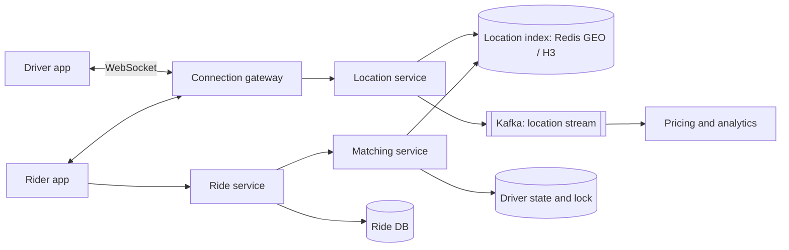
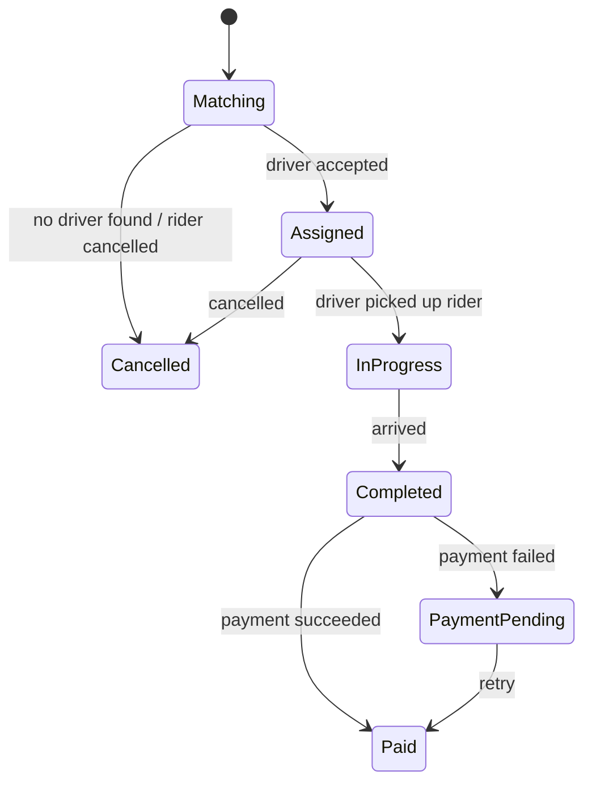

An Uber/Lyft/BiTaksi-style service combines **write-heavy location data**, **geospatial queries**, **contention** (two riders must not be assigned the same driver), and **a multi-step process** in a single question.

## 1. Requirements

**Functional:**

- The rider enters a pickup and drop-off point, sees a fare estimate, and requests a ride.
- The system finds a suitable nearby driver and sends an offer; the driver accepts or declines.
- The rider watches the driver's location on the map in real time.
- Payment is collected when the trip ends.
- Out of scope: ratings, pooled rides, driver onboarding.

**Non-functional:**

- Fast matching: request → driver offer in a few seconds.
- **Strong consistency in matching:** a driver must never be assigned two trips at the same time.
- **Eventual consistency** is enough for location tracking; a few seconds of location lag is fine.
- Scale: 10 million drivers (2 million online at once), 20 million trips per day.

## 2. Capacity

- Location updates: 2 million online drivers, one every 4 seconds → **~500,000 writes / second**. This is the dominant load on the system.
- Ride requests: 20 million / day → ~230 / second, a few thousand at peak (Friday evening, rain).
- The location data itself is small: ~100 bytes per driver × 2 million = 200 MB. **Conclusion:** all current locations fit in memory; the problem is not size but **write rate**.

## 3. API

```http
POST /v1/fare-estimates   { "pickup": {...}, "dropoff": {...} }          -> { "estimateId": "...", "price": 145.0 }
POST /v1/rides            { "estimateId": "..." }                        -> 202 { "rideId": "...", "status": "matching" }
POST /v1/drivers/location { "lat": 41.04, "lng": 29.00, "ts": ... }      -> 204   (or over WebSocket)
POST /v1/rides/{id}/accept                                               -> 200 | 409 (someone else took it)
```

The fare estimate is stored on the server and requested by ID; the client does not send the price itself (it can't be tampered with, and it expires). The driver app sends its location over a persistent connection (WebSocket/gRPC stream); opening a new HTTP request for every update is expensive.

## 4. High-level design



## 5. Location updates and nearby drivers

Writing 500,000 updates per second to a relational database and updating a geospatial index on top of that is needlessly expensive. Only the **latest value** of a location matters, and a lost update is corrected by a new one 4 seconds later. So:

- Current locations are kept **in memory**: Redis GEO (`GEOADD drivers:ist 29.00 41.04 d-881`) or an H3/geohash cell → set of drivers mapping.
- The in-memory index is partitioned by city/region; Istanbul's drivers and Ankara's don't have to live on the same node.
- The raw location stream is also written to Kafka: trip route recording, arrival time estimation models, pricing, and analytics consume this stream.
- If no update arrives from a driver for a certain time (TTL), they drop out of the available drivers list.

**Finding nearby drivers:** scan the rider's cell and its neighboring cells (8 neighbors with geohash, a ring with H3), filter drivers down to those **with status "idle"**, and sort them not by distance but by **estimated time of arrival** (a driver 500 m away on the other side of the river might be 20 minutes away). If there aren't enough drivers, widen the search radius.

## 6. Matching and preventing double assignment

The ride request arrives at the matching service:

1. The best candidate drivers are selected.
2. The selected driver is **locked**: their status is atomically changed from `idle` → `offer_pending`. A conditional atomic update guarantees this:

```text
SET driver:d-881:offer ride-77 NX PX 15000
```

Thanks to `NX`, no concurrent second offer can be made to the same driver; `PX 15000` ensures that if the driver doesn't respond, the lock expires on its own after 15 seconds.

3. The offer is pushed to the driver. If they accept, the ride record becomes `assigned` and the driver's status becomes `on_trip`. If they decline or the time runs out, the lock is released and the next candidate is tried.

Matching itself is a **multi-step process** (offer → wait → timeout → next candidate); the most robust implementation is a durable workflow, or a state machine that writes each step to persistent state. If the matching service crashes, the process must resume from the step where it stopped; otherwise the rider stays on the "searching" screen forever.

**Matching at scale:** instead of giving each request to the nearest driver one by one, doing **batch matching** (an assignment problem) at short intervals (e.g., 2 seconds) between accumulated requests and drivers lowers total wait time across the city. Uber does this per region (cell).

**Handling contention:** matching work is partitioned by city/region; requests for the same region go to the same matching instance. That way, a race over a driver is resolved by a single owner processing sequentially rather than by a distributed lock.

## 7. Trip state machine



The ride record needs strong consistency (money and cancellation rules): a relational database, sharded by `ride_id` or by city. Transitions are made with conditional updates (`UPDATE rides SET status = 'in_progress' WHERE id = ... AND status = 'assigned'`); invalid transitions are rejected. Payment is collected with an idempotency key, in a step separate from the trip.

## 8. Real-time tracking

During the trip, the driver's location is pushed to the rider: the location service publishes updates from drivers with an active trip to the rider's connection (pub/sub channel `ride:77`). Updates arrive every 4 seconds; the client smooths the movement in between with **interpolation**.

## 9. Dynamic pricing

From the location and request streams, supply (idle drivers) and demand (requests in the last few minutes) are counted per H3 cell. In cells with a high demand/supply ratio, the multiplier rises. The calculation runs with stream processing every few minutes, and the result is handed to the fare estimate service as a cache. Hexagonal cells are preferred for this kind of regional aggregation because all neighbors are equidistant.

## 10. Deep dives

- **Region outage:** cities are mapped to regions (data centers); if a region goes down, the city moves to another region. Even if current locations are lost, drivers resend them within a few seconds; persistent data (trips) is replicated.
- **If the driver app's connection drops:** location updates stop and the driver drops out of the available drivers via the TTL; an active trip is not affected, and the app syncs its state when it reconnects.
- **Arrival time estimation:** a road graph + real-time traffic; precomputed road segments and a machine learning model.

## General lessons from this question

- Keep very frequently updated data, where only the latest value matters, in memory; write the raw stream to a log separately.
- For geospatial search, use cells (geohash, H3) and scan neighboring cells; sort by arrival time, not distance.
- Resolve contention with conditional atomic updates, locks with a TTL, and single ownership per region.
- Tie multi-step processes with timeouts to a persistent state machine.

**Further reading:** [Uber H3](https://www.uber.com/blog/h3/); [Uber Engineering Blog](https://www.uber.com/blog/engineering/); Alex Xu and Sahn Lam, *System Design Interview* Volume 2, Chapters 1–3 (proximity service, nearby friends, Google Maps).
