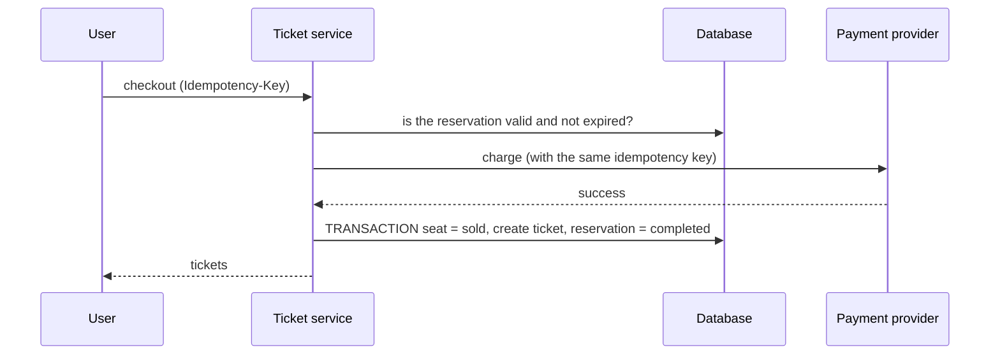
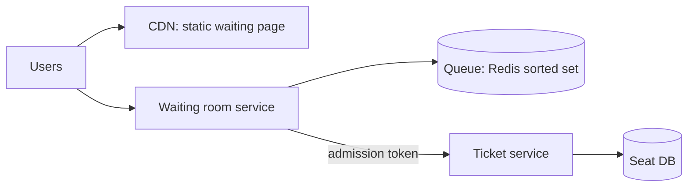

When tickets for a popular concert go on sale, millions of people want the same few thousand seats in the same second. This question is the purest form of the **contention** pattern: the same seat must not be sold to two people, and the system must not collapse under load.

## 1. Requirements

**Functional:**

- View and search events.
- See an event's seat map and the available seats.
- Select seats, **reserve** them for a short time (e.g., 10 minutes), and pay.
- Out of scope: ticket transfers, resale, dynamic pricing.

**Non-functional:**

- **No double selling:** strong consistency for seat assignment.
- High availability for browsing and search; eventual consistency is enough (the seat map can lag by a few seconds).
- Sudden load: millions of users within a few minutes for a popular event.
- Read-heavy: browsing far outweighs buying.

## 2. API

```http
GET  /v1/events?query=...&city=...&date=...          -> event list
GET  /v1/events/{id}                                  -> event details
GET  /v1/events/{id}/seats                            -> seat statuses
POST /v1/reservations   { "eventId": "...", "seatIds": ["A-12", "A-13"] }
                                                      -> 201 { "reservationId": "...", "expiresAt": "..." } | 409
POST /v1/reservations/{id}/checkout
     Idempotency-Key: ...
                                                      -> 200 { "ticketIds": [...] } | 402 | 410 (expired)
```

## 3. Data model

| Table | Fields |
| --- | --- |
| `events` | `id`, `venue_id`, `name`, `starts_at`, ... |
| `seats` | `event_id`, `seat_id`, `status` (`available` / `reserved` / `sold`), `reservation_id`, `reserved_until`, `version` |
| `reservations` | `id`, `user_id`, `event_id`, `status`, `expires_at` |
| `tickets` | `id`, `event_id`, `seat_id`, `user_id`, `order_id` |

Because money and double selling are at stake, seat and ticket data is kept in a **relational database** (with transactions and constraints). The **unique constraint** on `tickets (event_id, seat_id)` is the last line of defense that prevents double selling even if everything else goes wrong.

## 4. The core problem: reserving a seat

The user selects a seat and spends a few minutes on the payment screen. During that time the seat must not be visible to anyone else, but if the user gives up, the seat must come back.

### Option A: a long-held database lock

Lock the seat with `SELECT ... FOR UPDATE` and keep the transaction open until payment finishes. **Bad idea:** transactions stay open for minutes, the connection pool runs dry, and if the user closes the tab, it's unclear when the lock will be released.

### Option B: reserve with status + expiry (recommended)

The seat status is changed with a **conditional atomic update**:

```sql
UPDATE seats
SET status = 'reserved', reservation_id = :rid, reserved_until = now() + interval '10 minutes'
WHERE event_id = :eid
  AND seat_id = ANY(:seat_ids)
  AND (status = 'available' OR (status = 'reserved' AND reserved_until < now()));
-- If the number of affected rows doesn't equal the number of requested seats, the transaction is rolled back -> 409
```

- A short transaction; the lock is held only while this row is updated.
- Expired reservations count as free **in the query**, with no need for a separate cleanup job; a background job still flips the status back to `available` regularly (so the seat map displays correctly).
- Multiple seats in the same transaction: all or nothing.

### Option C: a lock with a TTL in Redis

```text
SET seat:{event}:{A-12} {reservationId} NX EX 600
```

It is very fast and expires on its own when the time is up. But it creates two sources of truth, Redis and the database; if the Redis lock is lost (failover), a double reservation can happen. That's why the Redis lock is used as a **pre-filter**, and the final decision is still made by the conditional update and the unique constraint in the database.

## 5. Payment



- Calls to the payment provider carry an **idempotency key**; if the user presses the button twice or the network drops, they aren't charged twice.
- What if the payment went through, but at that exact moment the reservation expired and the seat went to someone else? Before payment, the reservation is extended by a small margin; if a race still happens, an **automatic refund** (a compensating action). Calling out this rare case explicitly signals seniority.
- If the payment result is unknown (timeout), reconcile with the provider using a status query; show the user "processing".

## 6. Sudden load: the virtual waiting room

In a popular sale, 2 million people arrive at the same time for 20,000 seats. Letting everyone go straight to seat selection:

- Creates massive contention on the same rows in the database,
- Means most users find that the seat they picked was "just taken" (bad experience),
- Brings the system down.

The solution is a **virtual waiting room:** users are put into a queue before the sale starts, and their order (or a random order) is determined. Only as many users as there is capacity for (e.g., 5,000 at a time) are let into the purchase area with an **admission token**; as someone leaves or their time runs out, the next person in line gets in. Users see their position in line and the estimated wait time in real time (SSE/WebSocket or polling).



The waiting room keeps the load on the system behind it constant at what it can handle; it is a form of **admission control** and rate limiting. CAPTCHAs against bots, per-account ticket limits, and verified fan programs are applied in the same layer.

## 7. Scaling the read path

- **Event pages:** almost static; CDN and cache. At sale time, hundreds of thousands of people refresh the same page.
- **Seat map:** read a lot, changes often. The map itself (the venue layout) is static and on the CDN; seat **statuses** are in a cache with a short TTL (1–2 seconds), or delivered via a real-time stream only to users admitted from the waiting room. The map lagging by a few seconds is acceptable; the final decision is made at reservation time.
- **Search:** events live in Elasticsearch (name, artist, city, date, category), fed from the primary database via CDC. Popular searches are cached.

## 8. Deep dives

- **Sharding:** seat data is sharded by `event_id`; since all of an event's seats are in a single shard, a reservation is a single-shard transaction. A single giant event still makes one shard hot; the waiting room limits that load.
- **General admission (unseated) tickets:** a counter instead of seats: `UPDATE inventory SET remaining = remaining - :n WHERE event_id = :e AND remaining >= :n`. For very hot counters, inventory can be split into pieces (10 sub-counters, each holding a tenth of the stock).
- **Notifications:** the post-purchase email and ticket PDF go asynchronously through a queue; they don't slow down the critical path.

## General lessons from this question

- For long-running user operations, use **time-limited state** (a reservation), not a database lock.
- The final decision is made in the database by a conditional update and a unique constraint; fast layers like Redis are pre-filters.
- If demand far exceeds capacity, solve the problem with a queue **before requests enter the system**: a virtual waiting room.
- Payment: an idempotency key, reconciliation on an uncertain result, compensation (a refund) on a race.

**Further reading:** Hello Interview, [Design Ticketmaster](https://www.hellointerview.com/learn/system-design/problem-breakdowns/ticketmaster); [Stripe: Designing robust and predictable APIs with idempotency](https://stripe.com/blog/idempotency).
