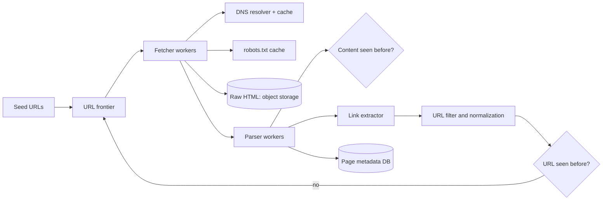

A web crawler is the foundation of search engines and of data pipelines for large language models. The question is built on **large-scale batch processing**, **queue design**, **deduplication**, and **fault tolerance**. There is no user-facing latency; what matters is throughput, politeness, and correctness.

## 1. Requirements

**Functional:**

- Starting from seed URLs, download pages, extract the links in them, and crawl those too.
- Store the downloaded HTML for later processing (indexing, model training).
- Out of scope: pages rendered with JavaScript (touched on), images and video.

**Non-functional:**

- **Scale:** crawl 1 billion pages in 5 days.
- **Politeness:** never overload any site; respect `robots.txt` rules.
- **Resilience:** broken HTML, slow servers, traps, and crashed workers must not stop the crawl.
- **Extensibility:** new content types and processing steps can be added.

## 2. Capacity

- 10⁹ pages / (5 × 10⁵ seconds) ≈ **2,000 pages / second**.
- A page averages ~100 KB (uncompressed HTML) → 2,000 × 100 KB = **200 MB/s** of downloads ≈ 1.6 Gbit/s.
- Storage: 10⁹ × 100 KB = **100 TB** (~20–30 TB with compression).
- If a download takes ~1 second, you need ~2,000+ open requests at once: with asynchronous I/O, a few dozen machines handle this.

## 3. High-level design



Fetching and parsing are **separate stages** with a queue between them: fetching is network-bound, parsing is CPU-bound; they scale separately, and if a parser crashes, the downloaded page is not lost (it stays in object storage).

## 4. The URL frontier

The heart of the design is the structure that decides **when** each URL gets downloaded. It has two goals:

**Priority:** important pages (high PageRank, news sites, frequently updated ones) first. URLs are placed into several **priority queues** by priority; the selector pulls from higher-priority queues more often.

**Politeness:** only one connection to the same domain at a time, with a wait between requests (or the `Crawl-delay` in `robots.txt`). The solution: a **separate queue for each domain (host)**, and for each queue a "when can it next be pulled" time. Workers pull from queues whose time has come; a min-heap gives "the host that is ready earliest".

```text
Priority queues (P1 > P2 > P3)
        ↓ (weighted selection by priority)
Host queues:  example.com → [url, url, ...]  ready: 12:00:03.2
              haber.com.tr → [url, ...]       ready: 12:00:02.9
              ...
        ↓ (min-heap: host ready earliest)
Fetcher workers
```

Billions of URLs don't fit in memory: the frontier is kept **on disk** (Kafka partitions, RocksDB, or a database), and only the head of each queue is in memory. The frontier is partitioned by host: all URLs for a host go to the same group of workers, so the politeness rule is enforced locally and no coordination is needed.

## 5. The fetcher

- **DNS** resolution can be slow (tens of ms) and becomes a bottleneck for the crawler: a local DNS cache and an asynchronous resolver.
- **robots.txt** is downloaded per host and cached (e.g., for 24 hours); the rules are checked before each URL is downloaded.
- Timeouts (connection and total), a maximum page size (e.g., 10 MB), a redirect limit.
- Errors: `5xx` and timeouts are retried with exponential backoff; `4xx` is not retried. A host that keeps returning errors gets its priority lowered.

## 6. Deduplication

**URL deduplication:** there are thousands of links pointing to the same page. First the URL is **normalized** (lowercase host, default port, drop the `#` fragment and tracking parameters, relative → absolute), then it is checked against "seen before?".

- 10 billion URLs × an average of 100 bytes = 1 TB: a full set is expensive. Storing an 8-byte hash of each URL brings it down to ~80 GB.
- Cheaper still: a **Bloom filter.** 10 billion URLs with a 1% false positive rate take ~12 GB. A false positive = an uncrawled URL mistaken for "seen"; a small loss is acceptable. Since there are no false negatives, no URL is crawled twice.

**Content deduplication:** different URLs can serve the same content (mirrors, `http`/`https`, parameter variants). A hash of the page body is stored; if it matches, the page's links are not extracted again. For **near-duplicate** pages (differing only in a date or an ad), similarity hashes such as **SimHash** or MinHash are used: hashes of similar documents differ by only a few bits.

## 7. Traps and quality

- **Spider traps:** infinite calendar pages (`/calendar/2026/12/...`), infinitely deep directories, URLs containing session IDs. Defenses: a maximum URL length and depth, a per-host page limit, detecting repeated path patterns.
- **Low-quality and spam content:** content scoring; lowering the priority of low-scoring sites.
- **Pages rendered with JavaScript:** rendering with a headless browser (headless Chrome) is 10–100 times more expensive; it is done in a separate processing pipeline, only for sites where it is necessary and valuable.

## 8. Fault tolerance and recrawling

- Workers are stateless; state lives in the frontier and in object storage. If a worker crashes, its queue messages pass to another worker (once the visibility timeout expires). Parsing is idempotent: processing the same page twice causes no problems.
- The frontier itself is durable and replicated; the crawl resumes from where it left off (checkpoints).
- **Recrawling (freshness):** the web changes. Each page's change frequency is estimated from its history; a news homepage is crawled hourly, a static document monthly. Conditional requests are made with `If-Modified-Since` / `ETag`; if the page hasn't changed, the server returns `304` and no bandwidth is wasted.

## 9. Geographic distribution

Crawlers are distributed across multiple regions, and each host is assigned to the crawler in the region geographically closest to it: latency drops and throughput rises.

## General lessons from this question

- Separate the stages (fetching, parsing, extraction) with queues; let each scale independently and isolate failures.
- Scheduler design balances two goals: priority and politeness (a queue per host + a ready time).
- For "have I seen this?" over billions of items, use a Bloom filter; for near-duplicate content, SimHash.
- Keep state in a durable queue and store, not in the workers; process idempotently.

**Further reading:** Alex Xu, *System Design Interview* Volume 1, Chapter 9; Heydon and Najork, *Mercator: A Scalable, Extensible Web Crawler* (1999; the origin of the per-host queue idea); [Common Crawl](https://commoncrawl.org/) (open web crawl data and its architecture).
