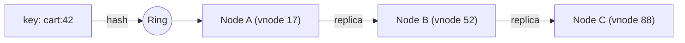
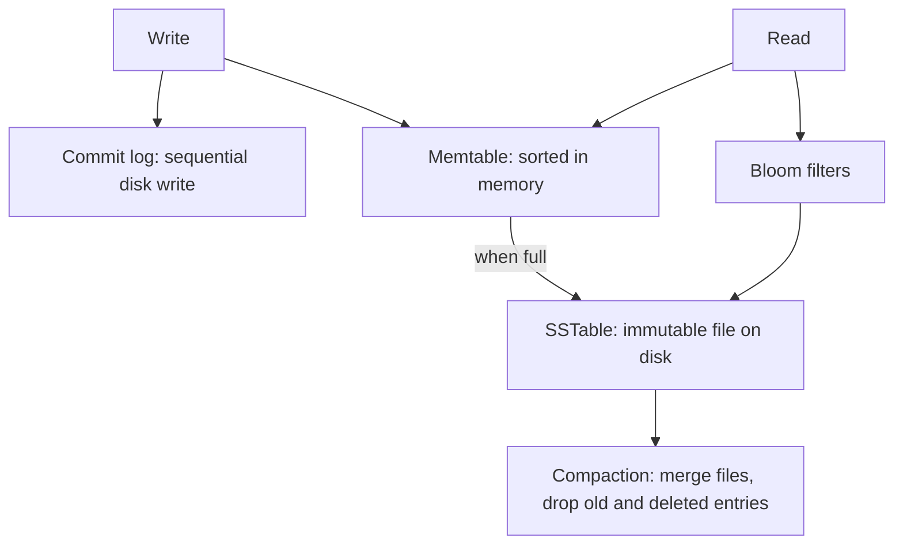

"Design a distributed key–value store" is an **infrastructure** question, not a product question, and it tests the core techniques of distributed systems in one place. In this lesson we build up, step by step, the design from Amazon's 2007 Dynamo paper (not DynamoDB, but the system that was the ancestor of Cassandra and Riak). Each step solves one problem and gives rise to the next.

## 1. Requirements

- Operations: `put(key, value)` and `get(key)`. Values are small (< 1 MB).
- **Always writable:** adding an item to a shopping cart must never be rejected, even during a network partition. (This is an **AP** choice.)
- Horizontal scale: adding nodes should increase capacity, and nodes are peers (no leader).
- Low latency: p99.9 < 10 ms.
- Tunable consistency.

## 2. Start with a single node

An in-memory hash table on a single server + a write-ahead log (WAL) on disk + periodic snapshots. This is Redis's basic model. Its limits: capacity is bounded by a single machine, and if the machine crashes there is no service. The solution: **partition** and **replicate**.

## 3. Partitioning: consistent hashing

If you distribute with `hash(key) % N`, almost every key moves when a node is added or removed. **Consistent hashing:** both nodes and keys are hashed onto a ring over the range `0 … 2¹²⁸`; each key belongs to the first node it meets going clockwise around the ring. When a node is added, only the keys in the neighboring range move.

**Virtual nodes:** each physical node is placed on the ring not at a single point but at hundreds of points (vnodes). This way:

- Load is spread more evenly (the imbalance of random placement averages out).
- When a node goes down, its load spreads across **all** other nodes instead of piling onto a single neighbor.
- A more powerful machine gets more virtual nodes, reflecting the difference in capacity.



## 4. Replication and the preference list

Each key is replicated to the **N distinct physical nodes** that follow it on the ring (usually N = 3). This list is called the **preference list**. Replicas are placed on different racks or availability zones so that a single failure doesn't take out all of them.

There is no leader: any node can be the **coordinator** for a request. The client either goes through a load balancer, or keeps the ring information itself and goes directly to the relevant node (saving a network hop).

## 5. Tunable consistency: quorum

- Write: the coordinator sends to N replicas and reports success once **W** acknowledgments arrive.
- Read: the coordinator asks N replicas and returns the newest version once **R** responses arrive.
- If `W + R > N`, the read and write sets overlap in at least one node: a read sees the latest acknowledged write.

| N, W, R | Behavior |
| --- | --- |
| 3, 2, 2 | Balanced default; reads and writes keep working even if one node goes down |
| 3, 3, 1 | Fast reads; writes stop if a single node goes down |
| 3, 1, 3 | Fast writes; slow reads |
| 3, 1, 1 | Fastest and most available; stale reads possible |

Note: even quorum does not provide full linearizability (there are edge cases with concurrent writes and reads, and with half-finished writes). Dynamo accepts this, because its goal is availability.

## 6. Version conflicts

During a network partition, two users (or two devices of the same user) update the same cart on different nodes. When the partition heals, there are two different versions. Which one is right?

**Last write wins** (by timestamp): simple, and Cassandra's default. But since clocks drift, a write can be silently lost.

**Vector clocks:** each version carries a list of `[(node, counter), ...]`.

```text
D1: [(A,1)]                    written on A
D2: [(A,2)]                    updated on A           → descendant of D1, D1 can be discarded
D3: [(A,2), (B,1)]             updated on B
D4: [(A,2), (C,1)]             updated on C during the partition
D3 and D4: neither is an ancestor of the other → CONCURRENT, conflict
```

If one subsumes the other, the older version is discarded. If not, both are kept and returned to the **client** on read; the client merges them with application logic (for a cart, the union of the two carts) and writes the merged version. Dynamo's famous side effect, "a deleted item came back into the cart", comes from this. The modern alternative is **CRDTs**: data types whose merge is mathematically defined.

## 7. Temporary failures: sloppy quorum and hinted handoff

If one of the replicas is temporarily unreachable, rejecting the write breaks the "always writable" goal. **Sloppy quorum:** the write goes to the first N reachable **healthy** nodes in the preference list. A node that accepts the write in place of the real owner stores the data with a **hint** ("this actually belongs to C"); when C comes back, it hands the data over (hinted handoff).

The cost: with a sloppy quorum, `W + R > N` temporarily no longer guarantees overlap; one more concession of consistency for availability.

## 8. Permanent failures: repair with Merkle trees

Hints can be lost too; replicas drift apart over time. To find the differences in the range they share, two nodes don't compare millions of keys one by one. A **Merkle tree** is kept for each range: the leaves are hashes of groups of keys, and each internal node is the hash of its children's hashes.

- If the roots match, the range is identical; no data is transferred.
- If they differ, you descend only into the differing branches; the data transferred is proportional to the difference.

In addition, **read repair:** during a read, the new version is written to any replica that returned an old version.

## 9. Membership and failure detection: gossip

There is no central coordinator; nodes learn the state of the ring through a **gossip protocol**: every second, each node shares the membership list it knows (with a heartbeat counter for each node) with a random node. Information spreads to the whole cluster in logarithmic time. If a node's counter hasn't increased for a certain time, the others mark it as **suspect**. Permanent additions/removals, on the other hand, are made by operator decision; redistributing data because of a temporary network problem is expensive.

## 10. The write and read path (within a single node)

Cassandra's LSM-based engine:



- **Write:** append to the commit log (durability) + write to the memtable. No random disk writes, which is why writes are very fast.
- **Read:** first the memtable, then the SSTables (newest to oldest). Each SSTable's Bloom filter rules out files that don't contain the key without a disk read.
- **Delete:** data is not deleted right away; a **tombstone** is written and cleaned up during compaction. Tombstones must be kept for the length of the repair period so that the delete doesn't come back.

## 11. Summary table

| Problem | Technique | Benefit |
| --- | --- | --- |
| Partitioning | Consistent hashing + virtual nodes | Incremental scaling, even load |
| High availability | N replicas, leaderless | No single point of failure |
| Tunable consistency | Quorum (N, W, R) | Latency–consistency trade-off chosen by the client |
| Version conflicts | Vector clocks / LWW / CRDT | Detecting and merging conflicts |
| Temporary failure | Sloppy quorum + hinted handoff | Always writable |
| Permanent failure, drift | Merkle trees + read repair | Cheap synchronization |
| Membership | Gossip | No central coordinator |
| Write speed | Commit log + memtable + SSTable | Sequential disk writes |

Building this table step by step in an interview shows **which problem each technique solves**; that is far stronger than a list of techniques recited from memory.

## The CP alternative

If the requirement were "always correct" instead of "always writable" (a configuration store, a lock service), the design would change completely: a **Raft group** per range, linearizable reads and writes through the leader, and during a partition the minority side does not accept writes. etcd, TiKV, and CockroachDB take this route. Being able to compare the two designs shows that you really understand CAP/PACELC.

**Further reading:** [Dynamo: Amazon's Highly Available Key-value Store (SOSP 2007)](https://www.allthingsdistributed.com/files/amazon-dynamo-sosp2007.pdf); [Cassandra architecture documentation](https://cassandra.apache.org/doc/latest/cassandra/architecture/overview.html); Alex Xu, *System Design Interview* Volume 1, Chapter 6.
