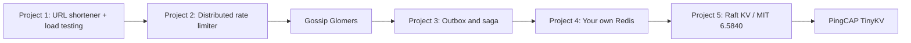

In a system design interview, saying "I'd add a cache" is easy. Having **measured** how much a cache actually lowers p99 latency, having **debugged** how a Raft leader behaves during a network partition, having **seen with your own eyes** how two concurrent requests double-sell the same seat, gives you a completely different kind of confidence. Interviewers notice the difference immediately: a memorized sentence and lived experience sound different.

This module offers two things: five projects you'll build step by step on Zirve, and a roadmap drawn from the world's best open practice resources.

## Projects in this module

| # | Project | What it teaches | Time | Level |
| --- | --- | --- | --- | --- |
| 1 | [Scalable URL shortener and load testing](/tracks/sistem-tasarimi/proje-url-kisaltici-ve-yuk-testi) | Measuring: p50/p99, cache hit rate, read replicas, finding bottlenecks | 1–2 weekends | Intermediate |
| 2 | [Distributed rate limiter](/tracks/sistem-tasarimi/proje-dagitik-hiz-sinirlayici) | Race conditions, atomicity with Redis + Lua, fail-open/fail-closed | 1 weekend | Intermediate |
| 3 | [Event-driven order system: outbox and saga](/tracks/sistem-tasarimi/proje-outbox-ve-saga) | The dual-write problem, at-least-once delivery, idempotent consumers, compensation | 2 weekends | Advanced |
| 4 | [Write your own Redis](/tracks/sistem-tasarimi/proje-kendi-redisini-yaz) | TCP server, protocol, TTL, persistence (AOF), replication | 2–3 weekends | Advanced |
| 5 | [A key–value store replicated with Raft](/tracks/sistem-tasarimi/proje-raft-anahtar-deger-deposu) | Consensus, leader election, log replication, partition tests | 3–4 weeks | Advanced |

The projects get harder in order, and each one puts part of the earlier lessons into practice. The first two use the technologies that appear most often in job postings (.NET, PostgreSQL, Redis, Docker) and can go straight onto your résumé and GitHub profile. The last two go down to the core of distributed systems and prepare you for the deep-dive questions in senior/staff interviews.

## The best practice resources out there

### Fly.io Gossip Glomers: the best place to start

[fly.io/dist-sys](https://fly.io/dist-sys/) — A free series of distributed systems puzzles, built together with Kyle Kingsbury, the author of Jepsen. Your code runs in a simulator called **Maelstrom**; Maelstrom delays messages, partitions the network, and at the end automatically checks the consistency guarantees.

| Puzzle | What it teaches |
| --- | --- |
| Echo | Warming up with Maelstrom, the message protocol |
| Unique ID Generation | Unique IDs without coordination (the Snowflake idea) |
| Broadcast | Gossip, not losing data during a partition, optimizing message count and latency |
| Grow-Only Counter | CRDTs and eventual consistency |
| Kafka-Style Log | A partitioned log, offset management, using a linearizable store |
| Totally-Available Transactions | Transaction isolation levels, availability |

The official examples are in Go, but you can write it in any language (C#, TypeScript, Python, Rust): Maelstrom speaks JSON over standard input/output. **This is the recommended first resource:** small, fun, and with instant feedback.

### MIT 6.5840 (formerly 6.824): the gold standard

[pdos.csail.mit.edu/6.824](https://pdos.csail.mit.edu/6.824/) — MIT's distributed systems course. The lecture notes, video recordings, paper questions, and labs are open to everyone (including the spring 2026 term). The labs are in Go and come with comprehensive automated tests:

1. **MapReduce:** distributed MapReduce with a coordinator and workers; resilience to crashing workers.
2. **Key–value server:** a single server, exactly-once semantics under network failures.
3. **Raft:** leader election, log replication, persistence, snapshots. The most talked-about distributed systems assignment in the world.
4. **A fault-tolerant key–value store on top of Raft.**
5. **A sharded key–value store:** moving shards between Raft groups.

The paper list (MapReduce, GFS, Raft, Spanner, Zookeeper, Chain Replication, Aurora, …) is a reading program in its own right. Running the tests hundreds of times without a single failure is real distributed systems debugging experience.

### CodeCrafters: write real systems from scratch

[codecrafters.io](https://codecrafters.io/) — A platform where you write small but working copies of real software such as Redis, Kafka, SQLite, Git, an HTTP server, and a DNS server step by step, with every step tested automatically. C#, TypeScript, Go, Rust, and many other languages are supported. Some content is paid; a different challenge is free each month. The most valuable ones for system design: **Build your own Redis** (including the replication and persistence stages) and **Build your own Kafka**.

A related free list: [build-your-own-x](https://github.com/codecrafters-io/build-your-own-x) — a collection of guides for writing dozens of systems from scratch, such as databases, network stacks, Docker, and search engines.

### PingCAP talent-plan: the distributed database journey

[github.com/pingcap/talent-plan](https://github.com/pingcap/talent-plan) — The TiDB/TiKV team's training program. The **TinyKV** project has you build, step by step in Go, a Raft-based key–value store split into regions (multi-raft) with distributed transaction support. It is the next step after MIT 6.5840.

### Jepsen analyses: how systems break

[jepsen.io/analyses](https://jepsen.io/analyses) — Detailed reports on cases where real databases (PostgreSQL, MongoDB, Redis, etcd, Kafka, …) break the guarantees they promise under network partitions and clock skew. They are as instructive as writing a project: they show what the word "consistent" means in practice.

## Recommended order

- **Your interview is 1–2 months away:** Projects 1 and 2 + the first four Gossip Glomers puzzles. These feed directly into the deep-dive questions in the sample designs.
- **Targeting senior/staff or an infrastructure team:** the whole sequence. Having written Raft yourself makes you unbeatable on consensus questions.

## Working rules for every project

1. **Design first, then write code.** Start each project with a one-page design document: requirements, capacity, API, data model, trade-offs. This is the same framework you use in the interview.
2. **Measure.** Not "fast", but "p99 = 14 ms at 2,000 requests/second". Measure before and after every optimization.
3. **Break it.** Stop a component, slow down the network, send the same request twice. Write down what happens.
4. **Write it up.** At the end of each project, add a "what I learned and the trade-offs" section to the README. Your answer to the interview question "tell me about a time you scaled something" will be ready right there.
