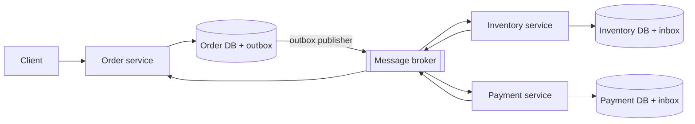
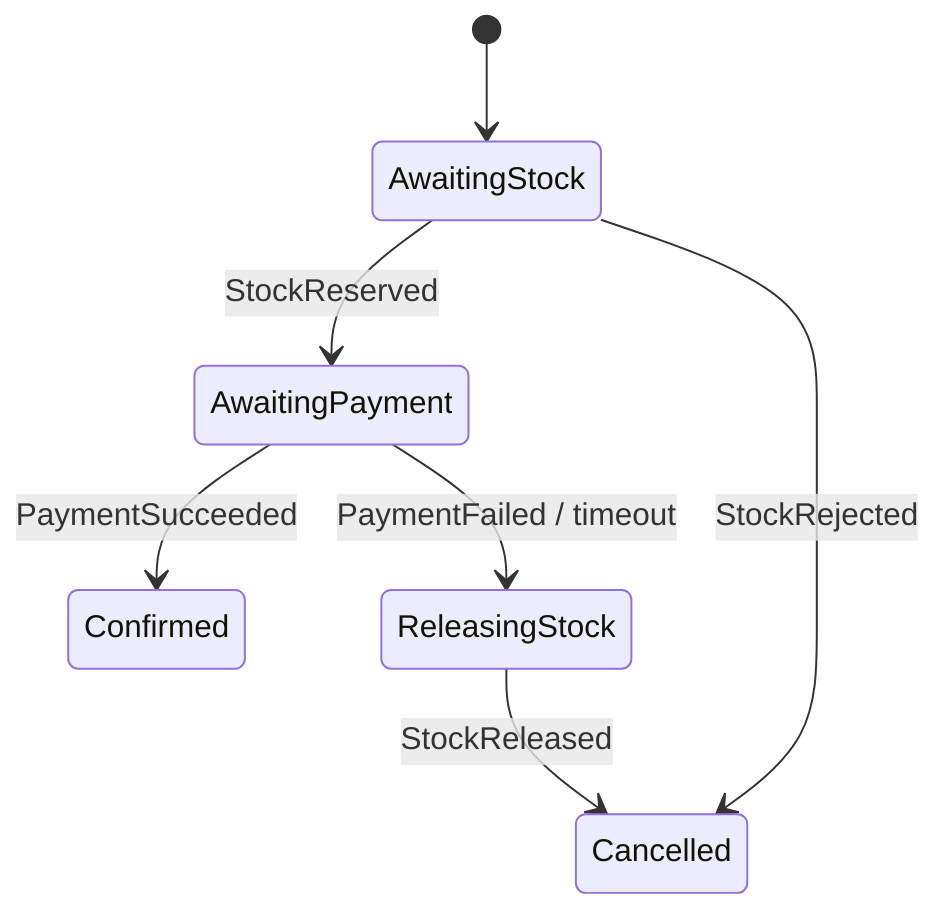

The most common deep-dive question in microservice interviews is: "The order was created, but the payment service crashed; what happens?" In this project you'll answer that question **with code**. You'll implement the outbox, idempotent consumer, and saga patterns from the [Consistency, Consensus, and Distributed Transactions](/tracks/sistem-tasarimi/tutarlilik-uzlasma-ve-dagitik-islemler) lesson, then deliberately break the system and prove that it stays consistent.

## The system



| Service | Responsibility | Database |
| --- | --- | --- |
| Order | Accepts the order, runs the saga (orchestrator) | PostgreSQL `orders` |
| Inventory | Reserves and releases product stock | PostgreSQL `inventory` |
| Payment | Takes and refunds payments (fake provider) | PostgreSQL `payments` |

Each service has **its own** database (or schema); services never touch each other's tables. Use RabbitMQ or Kafka as the message broker (Redpanda is practical locally because it is Kafka-compatible and a single binary).

## Stage 1: reproduce the dual-write problem

First write the order service the naive way:

```csharp
await db.Orders.AddAsync(order);
await db.SaveChangesAsync();
// If the process dies right here, the event is never published.
await publisher.PublishAsync(new OrderCreated(order.Id, order.Items));
```

Put a fault injection point between the two lines (`if (chaos.ShouldCrash("after-save")) Environment.FailFast(...)`) and crash with 10% probability. Create 1,000 orders. Then count: how many orders got stuck in the "pending" state forever? Reverse the order (publish first, then save) and observe the opposite: stock was reserved for orders that don't exist.

## Stage 2: transactional outbox

Write the event to an `outbox` table **in the same transaction** as the business data:

```sql
CREATE TABLE outbox (
    id            uuid PRIMARY KEY,
    aggregate_id  uuid NOT NULL,
    type          text NOT NULL,
    payload       jsonb NOT NULL,
    created_at    timestamptz NOT NULL DEFAULT now(),
    published_at  timestamptz
);
CREATE INDEX outbox_unpublished ON outbox (created_at) WHERE published_at IS NULL;
```

A separate **publisher** (a background service) reads unpublished rows, sends them to the broker, and marks them. If multiple publisher instances will run, to share rows without conflicts:

```sql
SELECT * FROM outbox
WHERE published_at IS NULL
ORDER BY created_at
LIMIT 100
FOR UPDATE SKIP LOCKED;
```

`SKIP LOCKED` skips rows locked by another instance: two publishers don't send the same event at the same time. Still, if the publisher "sent it but crashed before marking it", it sends the event **a second time**: delivery is at least once.

Repeat the fault injection test from Stage 1. There should be no more stuck orders.

**Alternative:** instead of a publisher, read the outbox table's WAL with CDC (Debezium). Try it as a bonus and compare the two approaches in terms of latency and operational complexity.

## Stage 3: idempotent consumer (inbox)

If the inventory service receives the same `OrderCreated` event twice, it must not decrement stock twice:

```csharp
await using var tx = await db.Database.BeginTransactionAsync();

// The event ID is the primary key: it can't be inserted a second time.
var inserted = await db.Database.ExecuteSqlAsync(
    $"INSERT INTO inbox (message_id, received_at) VALUES ({message.Id}, now()) ON CONFLICT DO NOTHING");

if (inserted == 0)
{
    return; // already processed
}

await ReserveStockAsync(message);
await tx.CommitAsync();
```

The work and the "processed" record are in the same transaction: either both happen or neither does. Test: deliberately send the same message from the broker 3 times; stock should drop only once.

## Stage 4: orchestrated saga

The order service keeps the saga's state and drives the steps:



Rules:

- Each state transition and the next command to send are recorded **in the same transaction** (the outbox again).
- Transitions are conditional: `UPDATE orders SET status = 'awaiting_payment' WHERE id = ... AND status = 'awaiting_stock'`. A late or duplicate event can't cause a wrong transition.
- **Compensating actions** (`ReleaseStock`, `RefundPayment`) must be idempotent too.
- **Timeout:** what if the payment service never responds? Write a deadline on the order; have a background job push expired sagas onto the compensation path.

Observe that the saga **does not provide isolation**: while stock is reserved but payment is pending, another user sees the product as "sold out". Is that acceptable? Discuss it in the README.

## Stage 5: fault injection and invariants

Add fault injection at every point in the system: have a consumer crash after processing but before acknowledging, have the broker delay messages, have the payment service return a random `500` or wait 30 seconds. Then write an **invariant checker** and run it after a load test of 10,000 orders:

- Every order ends up in `Confirmed` or `Cancelled` (none stuck).
- For each `Confirmed` order, there is exactly one successful payment and one stock reservation.
- For `Cancelled` orders, the net payment is 0 (refunded if paid) and the stock has been released.
- Total stock + reserved stock = initial stock.

If the invariants hold on every run, your system is consistent. If they don't, find the bug; this is the most instructive part.

## Stage 6: observability

See an order's journey through the three services and the broker as **a single trace**: carry the trace context (`traceparent`) in message headers with OpenTelemetry. How much easier is it to find a stuck saga from the trace than by searching the logs?

## Bonus tasks

- Rewrite the same flow with **choreography** (no orchestrator; each service reacts to events) and compare: in which one is it easier to change the flow?
- Write the orchestrator with **Temporal** (a .NET SDK is available): timeouts, retries, and state persistence live in the engine. Compare the amount of code with the state machine you wrote yourself.
- Add an idempotency key to the client's `POST /orders` request; write a test that sends the same request 5 times.
- Dead letter queue: set aside a message that keeps failing after 5 attempts; reprocess it from an admin endpoint.

## Completion criteria

- [ ] A measurement showing the dual-write problem from Stage 1, and the fix after the outbox.
- [ ] The duplicate message test (inbox) and the compensation flow tests.
- [ ] A load test with fault injection + the invariant checker report.
- [ ] README: the trade-offs of orchestration vs. choreography, and of an outbox publisher vs. CDC.
