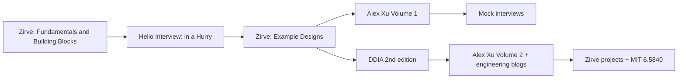

There are hundreds of system design resources, and most of them repeat each other. This list orders proven, complementary resources **by what you want to use them for**. In each section the free ones come first.

## Quick start: if your interview is 2–4 weeks away

| Resource | What it gives you | Cost |
| --- | --- | --- |
| [Hello Interview: System Design in a Hurry](https://www.hellointerview.com/learn/system-design/in-a-hurry/introduction) | A delivery framework, core concepts, key technologies and patterns; the most up-to-date and most focused free guide, based on interview data | Free (extra content is paid) |
| [System Design Primer](https://github.com/donnemartin/system-design-primer) | The most comprehensive open source collection: concepts, trade-offs, sample questions, Anki cards | Free |
| [ByteByteGo System Design 101](https://github.com/ByteByteGoHq/system-design-101) | One-page visual explanations of hundreds of concepts; ideal for quick review | Free |
| Alex Xu, *System Design Interview – An Insider's Guide*, Volume 1 | Chapters on scaling and the framework, followed by step-by-step solutions to 12 classic questions (rate limiter, consistent hashing, key-value store, unique ID generator, URL shortener, web crawler, notification system, news feed, chat, autocomplete, YouTube, Google Drive) | Book |

These four resources plus the lessons in this track are enough for most mid-level interviews. Suggested order: Zirve fundamentals → Hello Interview "in a hurry" → 6–8 questions from Alex Xu Volume 1 → a self-run mock interview.

## Depth: senior and above

| Resource | What it gives you |
| --- | --- |
| Martin Kleppmann and Chris Riccomini, *Designing Data-Intensive Applications*, 2nd edition (O'Reilly, 2026) | The "bible" of the field. Storage engines, replication, partitioning, transactions, the trouble with distributed systems, consensus, batch and stream processing. The 2nd edition was updated with topics such as cloud-native architectures, stream engines and data regulation. The single most recommended book for senior interviews. |
| Alex Xu and Sahn Lam, *System Design Interview*, Volume 2 | 13 more advanced questions: proximity service, nearby friends, Google Maps, distributed message queue, metrics monitoring, ad click aggregation, hotel reservation, email, S3-like object storage, real-time leaderboard, payment system, digital wallet, stock exchange |
| Roberto Vitillo, *Understanding Distributed Systems* | A short, practical introduction before DDIA; communication, coordination, scalability, resilience, operations |
| Alex Petrov, *Database Internals* | The internals of B-trees, LSM trees, replication and consensus algorithms |
| Michael Nygard, *Release It!* | Staying alive in production: circuit breakers, bulkheads, timeouts; real outage stories |
| [Google SRE books](https://sre.google/books/) | SLOs, error budgets, monitoring, incident management, load balancing and overload; all three books are free online |
| [Amazon Builders' Library](https://aws.amazon.com/builders-library/) | Short, very valuable articles by Amazon engineers on timeouts, retries, load shedding, caching, queue backlogs and deployment; free |

## Courses and videos

- [MIT 6.5840 Distributed Systems](https://pdos.csail.mit.edu/6.824/): lecture notes, recordings, paper questions and labs.
- Martin Kleppmann, Cambridge **Concurrent and Distributed Systems** lecture series: free on YouTube; one of the clearest explanations of logical clocks, replication, consensus and CRDTs.
- The ByteByteGo and Hello Interview YouTube channels: solutions to sample questions in visual and mock interview formats.

## Foundational papers worth reading

Each is the ancestor of a family of systems we use today. For an interview it's enough to know their names and main ideas; reading them gives you a different level of depth.

| Paper | Year | Main idea |
| --- | --- | --- |
| Google File System | 2003 | Large files, a single master + chunk servers, fault tolerance on cheap hardware |
| MapReduce | 2004 | Massively parallel batch processing with a simple programming model |
| Bigtable | 2006 | Wide-column, sorted, partitioned store (the data model of HBase and Cassandra) |
| [Dynamo](https://www.allthingsdistributed.com/files/amazon-dynamo-sosp2007.pdf) | 2007 | Leaderless, always-writable key-value store: consistent hashing, quorums, vector clocks |
| Kafka | 2011 | Distributed, partitioned, durable log |
| Spanner | 2012 | External consistency at global scale; TrueTime |
| [Scaling Memcache at Facebook](https://www.usenix.org/conference/nsdi13/technical-sessions/presentation/nishtala) | 2013 | Caching for billions of requests: leases, cross-region consistency |
| [Raft](https://raft.github.io/raft.pdf) | 2014 | An understandable consensus algorithm |
| Zanzibar | 2019 | Google's global authorization system |

## Real-world architecture write-ups

Posts in which companies explain how they scaled their own systems let you say "this is how it's actually done" in an interview:

- Discord: [How Discord stores trillions of messages](https://discord.com/blog/how-discord-stores-trillions-of-messages) — the move from Cassandra to ScyllaDB, hot partitions, request coalescing.
- Figma: [How Figma's databases team lived to tell the scale](https://www.figma.com/blog/how-figmas-databases-team-lived-to-tell-the-scale/) — horizontally sharding PostgreSQL.
- Notion: [Sharding Postgres at Notion](https://www.notion.com/blog/sharding-postgres-at-notion) — choosing a shard key and migrating.
- Slack: [Real-time messaging](https://slack.engineering/real-time-messaging/) — channel servers and the gateway architecture.
- Stripe: [Idempotency](https://stripe.com/blog/idempotency) and [Rate limiters](https://stripe.com/blog/rate-limiters).
- Instagram: [Sharding & IDs at Instagram](https://instagram-engineering.com/sharding-ids-at-instagram-1cf5a71e5a5c) — time-sortable IDs with PostgreSQL.
- Uber: [H3](https://www.uber.com/blog/h3/) — a hexagonal geospatial index.
- Cloudflare: [Counting things, a lot of different things](https://blog.cloudflare.com/counting-things-a-lot-of-different-things/) — sliding window rate limiting.
- [Netflix Tech Blog](https://netflixtechblog.com/) — video transcoding, CDN, resilience, chaos engineering.
- [Jepsen analyses](https://jepsen.io/analyses) — the gaps between what databases promise and how they actually behave.

## Reference pages

- [Latency numbers (interactive, by year)](https://colin-scott.github.io/personal_website/research/interactive_latency.html)
- [Raft visualization](https://raft.github.io/)
- [Awesome Scalability](https://github.com/binhnguyennus/awesome-scalability) — a collection of architecture write-ups organized by company and topic.

## Practice and mock interviews

Reading isn't enough; you need to practice **explaining a design out loud**.

1. **On your own:** pick one of the example designs in this track, set a 45-minute timer, draw it in Excalidraw and record yourself. Then compare with the lesson: which requirement didn't you ask about, which trade-off didn't you mention?
2. **With a friend:** one is the interviewer, the other the candidate; the interviewer picks deep-dive questions from the lessons in this track.
3. **Professional mock interview:** Hello Interview, interviewing.io and Exponent offer paid mock interviews with engineers who interview at big tech companies. Doing one 1–2 weeks before the real interview is the fastest way to get feedback.

## In what order?

The upper path is for interview preparation; the lower path is for lasting expertise. The two feed each other: every problem you run into in the projects becomes a story you can tell in an interview.
