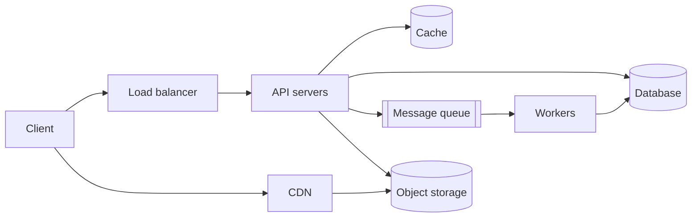

There is no "right answer" in a system design interview. The interviewer measures this: can you clarify an ambiguous problem, can you see the trade-offs and make reasoned decisions, do you know where your design will break? The most common mistake is to start drawing boxes as soon as you hear the question.

The framework below helps you manage your time. The minutes are for a 45-minute interview.

## 1. Clarify the requirements (5 min)

"Design Twitter" is not a requirement. Narrow the scope first.

**Functional requirements:** what does the system do? Pick the two or three most important features and explicitly put the rest out of scope.

> "Users can post, follow others and see posts from the people they follow in a feed. I'm leaving search, notifications and messaging out of scope; is that OK?"

**Non-functional requirements:** how does the system do it? These are what really shape the design.

| Question | Why it matters |
| --- | --- |
| How many users, how many requests per second? | Single server or distributed |
| Read-heavy or write-heavy? | Caching and replication strategy |
| What is the latency target? | Synchronous or via a queue |
| How critical is consistency? | Strong or eventual consistency |
| Availability target? | Level of redundancy |
| How long is data retained? | Storage and archiving |

The interviewer will often say "you decide." Then make a reasonable assumption and **say it out loud**.

## 2. Roughly estimate capacity (3–5 min)

The goal is not an exact number but the **order of magnitude**: is a single database enough, or do you need sharding?

Example: 100 million daily active users, 2 posts and 50 feed views per person per day.

- Writes: 200 million / day ≈ **2,300 / second** (a day has ~86,400 ≈ 10⁵ seconds).
- Reads: 5 billion / day ≈ **58,000 / second**. The read/write ratio is 25:1; the system is read-heavy.
- Storage: ~1 KB per post → 200 GB per day, ~365 TB in five years. It won't fit on a single machine.

Numbers worth memorizing:

| Quantity | Value |
| --- | --- |
| Seconds in a day | ~86,400 ≈ 10⁵ |
| 1 million requests per day | ~12 requests / second |
| Read from memory | ~100 nanoseconds |
| Network round trip within the same data center | ~0.5 milliseconds |
| Random read from SSD | ~0.1 milliseconds |
| Intercontinental network round trip | ~150 milliseconds |

Assume peak load is several times the average. Don't spend too much time on estimation; a calculation that doesn't affect a design decision earns no points. The full set of numbers you should know, with worked examples, is in the [Capacity Estimation](/tracks/sistem-tasarimi/kapasite-tahmini) lesson.

## 3. Define the API (3 min)

Write down the system's contract with the outside world. This makes the scope concrete and lays the groundwork for the data model.

```http
POST /v1/posts                    { "text": "..." }        -> 201 { "id": "..." }
GET  /v1/feed?cursor=...&limit=20                           -> { "items": [...], "nextCursor": "..." }
POST /v1/users/{id}/follow                                  -> 204
```

Points worth highlighting: using a **cursor** for pagination, an **idempotency key** so writes are safe to resend, and where authentication happens.

## 4. Sketch the data model (3–5 min)

Write down the main entities, their fields and the **access patterns**. The database choice follows from the access patterns, not the other way around.

- Relational data, transaction requirements, flexible queries → relational database (PostgreSQL).
- Very high write volume, simple key access, horizontal scaling → wide-column or key-value store (Cassandra, DynamoDB).
- Large files (images, video) → object storage (S3) with a CDN in front.

"I'll use NoSQL because it scales" is not a sufficient justification. Say which query you'll run, with which key, at which consistency level.

## 5. Draw the high-level design (10 min)

Show the request's journey through the system from start to finish. Every box should correspond to a requirement.



First build **the simplest design that works**, then ask where it will break under the load you estimated. Ask the interviewer which part they want you to go deep on; steering toward what interests them shows collaboration and makes you use the time well.

## 6. Go deep and remove bottlenecks (15 min)

This is the part where your seniority shows. Typical deep-dive topics:

- **Hot spot:** what happens if a post by a user with many followers has to be written to millions of feeds? (The trade-off between fan-out on write and aggregation on read.)
- **Database scaling:** read replicas, choosing a shard key, rebalancing.
- **Caching:** what, for how long, and with what invalidation?
- **Consistency:** should users see their own writes immediately?
- **Failure cases:** what happens if a component crashes? Do retries lead to duplicate writes?

State the **trade-off** for every decision:

> "If I precompute the feed at write time, reads will be very fast, but the write cost explodes for celebrity accounts. So I'm going hybrid: fan-out on write for ordinary accounts, merging at read time for accounts with many followers."

## 7. Wrap up (2–3 min)

Summarize the design in two sentences, and mention the known weak points and what you'd do "if I had more time": monitoring and alerting, rate limiting, multi-region deployment, data retention policy.

## Common mistakes

- **Starting to draw without asking about requirements.**
- **Piling up buzzwords.** Saying "Kafka, Redis, Kubernetes" is not a design; if you can't explain why each component is there, don't add it.
- **Defending a single solution.** Mention at least one alternative and why you ruled it out.
- **Premature optimization.** Talking about sharding for a system that gets a thousand requests a day shows you didn't estimate the load.
- **Staying silent.** Think out loud so the interviewer can give you hints.

## Summary

1. Requirements (functional and non-functional) → 2. capacity → 3. API → 4. data model → 5. high-level design → 6. deep dives → 7. wrap-up.
2. Requirements and numbers drive the design; every component is added for a reason.
3. What earns points isn't the drawing but your ability to see the trade-offs and make decisions.

## Expectations by level

| Level | What the interviewer expects |
| --- | --- |
| Mid-level | A working, reasonable high-level design; using the basic building blocks in the right places; going deep on one or two topics with the interviewer's guidance |
| Senior | **You** drive the interview; you find the bottlenecks yourself, compare alternatives and go deep on at least two topics (consistency, failure cases, scale) |
| Staff and above | Narrowing down ambiguity, operations and cost (monitoring, deployment, team boundaries) and how the system evolves over the years; real-world experience in the deep dives |

## What's next in this track

- Numbers: [Capacity Estimation](/tracks/sistem-tasarimi/kapasite-tahmini) and [Networking, Communication and API Design](/tracks/sistem-tasarimi/ag-ve-api-tasarimi).
- Building blocks: caching, queues, databases, consistency, resilience, search and location, stream processing, and [Recurring Design Patterns](/tracks/sistem-tasarimi/tekrarlayan-tasarim-kaliplari), which ties them all together.
- Nine classic questions solved end to end with this framework: from a URL shortener to a distributed key-value store.
- Five projects for learning by building: [Project Roadmap](/tracks/sistem-tasarimi/proje-yol-haritasi).
