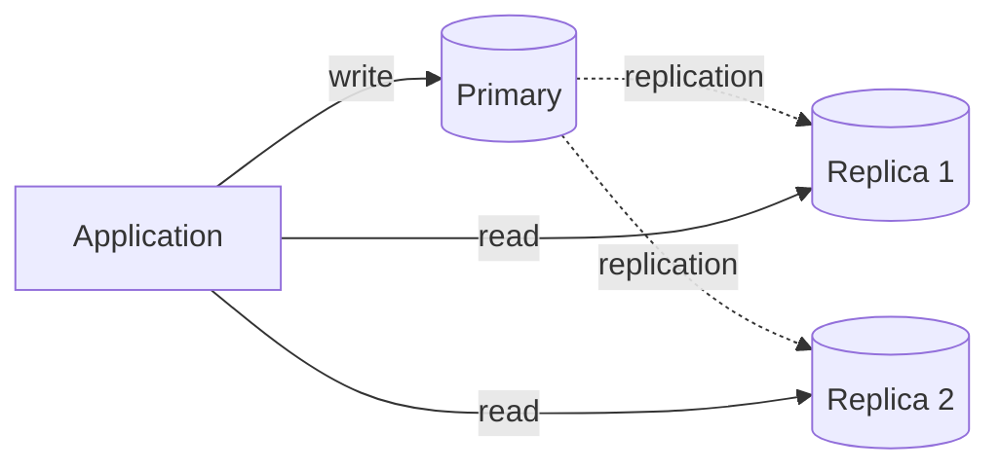

Every large system starts with a single server. Scaling means removing the bottlenecks that appear as load grows, **one at a time**. The order in this lesson is the order you'll follow when you grow your design step by step in an interview.

## Vertical and horizontal scaling

**Vertical scaling:** making the same machine bigger (more CPUs, more memory). It's simple and needs no code changes; but it has a ceiling, it's expensive, and the machine remains a single point of failure.

**Horizontal scaling:** adding machines. In theory it's unlimited and it provides redundancy; but the system has to be designed for it.

Rule of thumb: grow vertically first (cheap and simple), and go horizontal when you hit the ceiling or an availability requirement. Most systems get by with a single powerful database for much longer than people think.

## Stateless services and load balancing

The precondition for horizontally scaling application servers is that they are **stateless**: a server keeps no user-specific data in memory between requests. Session data lives in a shared store (a database, Redis) or in a signed cookie. That way any request can go to any server, and servers can be added and removed with no effort.

A **load balancer** distributes incoming requests across servers and takes unresponsive ones out of rotation using health checks.

| Algorithm | How it works | When |
| --- | --- | --- |
| Round robin | Distributes requests in turn | Servers are identical, requests are similar |
| Least connections | Sends to the server with the fewest open connections | Request durations vary widely |
| Consistent hashing | Routes by the hash of a key (e.g. user ID) | The same key must go to the same server (caching, sharding) |

The load balancer itself must not be a single point of failure either; it is run redundantly.

## Caching and CDNs

In read-heavy systems the cheapest scaling is to **not do the work at all**.

- **CDN:** serves static content such as images, video and JavaScript from servers geographically close to the user. It lowers both latency and the load on the origin server.
- **Application cache** (Redis, Memcached): keeps frequently read, rarely changing data in memory; it greatly reduces the reads that reach the database.

The hard part of caching is invalidation; the next lesson covers it in detail.

## Scaling the database

Application servers are easy to replicate because they're stateless; **the state lives in the database**, and that's where the real difficulty is. The steps, in order of difficulty:

### 1. Fix queries and indexes

Before scaling, find the slow queries. A missing index solves in one line a problem that a hundred servers can't.

### 2. Read replicas (replication)

Writes go to the **primary** node; changes are propagated to the **replicas**, and reads are spread across the replicas. For read-heavy load this multiplies capacity, and if the primary crashes a replica can take its place.

The price is **replication lag**. Replication is usually asynchronous; a replica can be milliseconds or seconds behind the primary. A user can save something and immediately afterwards see the old version. Solutions: read the user's **own** writes from the primary for a short time, or route critical reads to the primary.

Replicas do **not** increase write capacity; every write still goes through a single node.

### 3. Sharding

When the data or write volume doesn't fit on a single machine, the data is split across multiple databases according to a **shard key**. Each shard holds a subset of the data.

Choosing the key is the most critical decision:

- **It should distribute evenly.** A bad key turns one shard into a hot spot (e.g. splitting by country code).
- **It should serve frequent queries from a single shard.** Queries that span multiple shards are slow and complex.

The cost of sharding is heavy: cross-shard joins and transactions become hard, rebalancing adds operational load, and hot keys cause trouble. Treat it as a **last resort**, and say so in the interview.

### Consistent hashing

If you distribute keys with `hash(key) % N`, then when the number of servers `N` changes, almost **all** keys move. With consistent hashing, servers and keys are placed on the same ring; each key belongs to the first server after it on the ring. When a server is added or removed, only the keys in the neighboring range move (on average `1/N`). That's why it's used in distributed caches and sharded databases.

## The CAP theorem

During a **network partition**, a distributed data store cannot provide both of these at once:

- **Consistency (C):** every read sees the most recently written value.
- **Availability (A):** every request receives a (non-error) response.

Network partitions are unavoidable in the real world; so the real choice is: **during a partition, will you give up consistency or availability?**

| Choice | Behavior during a partition | Example use |
| --- | --- | --- |
| CP | Rejects the request rather than give an inconsistent answer | Bank balance, inventory, lock service |
| AP | May return stale data but responds | Social feed, like counts, shopping cart |

Note two subtleties: the choice is made **separately for each type of data**, not for the whole system; and when there's no partition, the real trade-off is between consistency and **latency**.

**Eventual consistency:** once writes stop, all replicas eventually converge to the same value; in the meantime different replicas may give different answers. It's acceptable for many features, and it's the price of availability and speed at large scale.

## Removing single points of failure

The availability target determines the level of redundancy:

| Target | Downtime per year |
| --- | --- |
| 99% | ~3.65 days |
| 99.9% | ~8.8 hours |
| 99.99% | ~53 minutes |
| 99.999% | ~5 minutes |

The availability of components connected in series **multiplies**: a request that passes through three components, each at 99.9%, is about 99.7% available. For every box in your design, ask "what happens if this crashes?"

## Summary

- Application tier: scales horizontally with stateless services + a load balancer.
- Read load: handled with CDNs, caches and read replicas; the price is the possibility of stale data.
- Write load and data volume: require sharding; it's expensive and a last resort.
- CAP: during a partition you choose between consistency and availability, per type of data.
- Every scaling step pays a complexity cost; don't add it if there's no requirement.

Replication models (single-leader, multi-leader, leaderless), quorums, sharding strategies and hot keys are covered in detail in the [Data Storage](/tracks/sistem-tasarimi/veri-depolama-ve-veritabani-secimi) lesson; consistency models and PACELC in the [Consistency, Consensus and Distributed Transactions](/tracks/sistem-tasarimi/tutarlilik-uzlasma-ve-dagitik-islemler) lesson.
