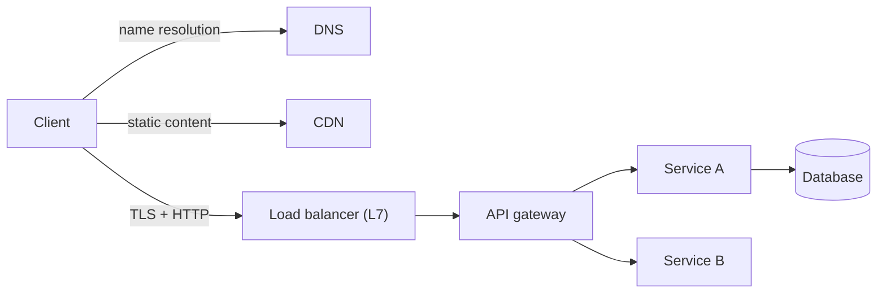

In system design, every box connects to another through a network call. The protocol you choose directly determines latency, scaling and failure behavior. This lesson gathers the networking knowledge expected in interviews and the essentials of API design.

## The journey of a request



1. **DNS** translates the domain name into an IP address. Responses are cached for the TTL; that's why load distribution and regional failover via DNS can take minutes. Geographic DNS (GeoDNS) and **anycast** route the user to the nearest region.
2. The **CDN** serves static content (and increasingly dynamic content) from edge servers close to the user.
3. The **TCP + TLS handshake** adds several round trips for a new connection. Keeping connections open (keep-alive, connection pools) and using HTTP/2–HTTP/3 means you pay this cost only once.
4. The **load balancer** distributes requests to healthy servers.
5. The **API gateway** handles cross-cutting concerns such as authentication, rate limiting, routing and observability in one place.

## TCP, UDP and HTTP versions

| | TCP | UDP |
| --- | --- | --- |
| Connection | Yes (handshake) | No |
| Delivery and ordering | Guaranteed | No guarantee |
| Use | Web, APIs, databases | Live audio/video, games, DNS, underneath QUIC |

- **HTTP/1.1:** one request at a time per connection; browsers work around this with multiple connections.
- **HTTP/2:** multiplexing over a single connection, header compression. gRPC is built on top of it. If a packet is lost at the TCP layer, all streams wait (head-of-line blocking).
- **HTTP/3 (QUIC):** runs over UDP; streams don't block each other, connection setup is faster, and the connection survives for clients that switch networks (Wi-Fi → mobile).

## Load balancing: L4 and L7

| | L4 (transport layer) | L7 (application layer) |
| --- | --- | --- |
| What it looks at | IP and port | HTTP path, headers, cookies |
| Speed | Very fast, doesn't read the content | Slower, parses the request |
| Capabilities | Simple distribution | Path-based routing, TLS termination, retries, A/B routing |
| Example | AWS NLB, LVS | AWS ALB, nginx, Envoy, HAProxy |

**Long-lived connections** (WebSocket) break the distribution: a connection stays on the server where it was opened. When you add a new server, existing connections don't move; that's why real-time systems need distribution by connection count (least connections) and gradual rebalancing of connections.

## API styles

| | REST | gRPC | GraphQL |
| --- | --- | --- | --- |
| Format | JSON, HTTP verbs | Protobuf (binary), HTTP/2 | JSON, single endpoint |
| Contract | OpenAPI (optional) | `.proto` file (mandatory, typed) | Schema (mandatory, typed) |
| Strength | Simple, works everywhere, compatible with HTTP caching | Fast, small payloads, streaming, code generation | The client fetches exactly the data it needs, combined data in a single request |
| Weakness | Over-/under-fetching, many requests | Limited browser support, not human-readable | Hard to cache, expensive queries, N+1 risk |
| Typical use | Public APIs | Internal service-to-service communication | Rich clients (mobile, web) |

A safe default in an interview: **REST for the external API, gRPC for high-volume internal service-to-service communication.** Only propose GraphQL if the variety of clients really calls for it.

## Real-time communication

When the server needs to send data to the client **on its own** (chat, notifications, live scores, location tracking), there are four options:

| Method | How | Pros | Cons |
| --- | --- | --- | --- |
| Short polling | The client asks every N seconds | The simplest | Wasted empty requests, up to N of latency |
| Long polling | The server holds the response until there's data | Nearly instant, plain HTTP | A new request after every message, connection overhead |
| **SSE** (Server-Sent Events) | A one-way HTTP response streaming from server to client | Simple, automatic reconnection, compatible with HTTP infrastructure | Server → client only, text |
| **WebSocket** | A bidirectional, persistent TCP connection | Low latency, two-way | Stateful connection: scaling, load balancing and reconnection are your job |

Selection rule:

- If updates are infrequent and latency tolerance is high → **polling** is enough (e.g. order status).
- If the stream is one-way (notifications, live scores, streaming LLM responses) → **SSE**.
- If there's frequent two-way messaging (chat, multiplayer games, collaborative editing) → **WebSocket**.
- Audio and video → **WebRTC** (peer-to-peer, UDP-based).

The key to scaling with WebSocket is that **the server holding the connection** and **the server where the message is produced** are different. The common solution: each connection server subscribes to a publish/subscribe (pub/sub) channel (Redis Pub/Sub, Kafka); a message reaches the server the recipient is connected to through this channel. Details are in the [chat application](/tracks/sistem-tasarimi/sohbet-uygulamasi) lesson.

## REST API design essentials

### Resource-oriented endpoints

```http
GET    /v1/users/42/orders?status=paid&limit=20   # list
POST   /v1/orders                                 # create
GET    /v1/orders/981                             # read
PATCH  /v1/orders/981                             # partial update
DELETE /v1/orders/981                             # delete
POST   /v1/orders/981/cancel                      # state-changing action
```

Names are plural nouns (not verbs); actions are written as sub-resources when needed. Status codes should be meaningful: `201` created, `204` no content, `400` bad request, `401` not authenticated, `403` not authorized, `404` not found, `409` conflict, `422` validation error, `429` rate limited, `503` temporarily unavailable.

### Pagination

| Method | How | Problem |
| --- | --- | --- |
| Offset | `?offset=40&limit=20` | Slow for large offsets (the database also reads the skipped rows); duplicates or skips if records are inserted in between |
| **Cursor** | `?cursor=eyJpZCI6OTgxfQ&limit=20` | You can't jump to an arbitrary page |

The cursor carries the sort key of the last record seen (e.g. `(created_at, id)`), and the query becomes `WHERE (created_at, id) < (:c, :i) ORDER BY created_at DESC, id DESC LIMIT 20`. With an index it runs in constant time, and it's the right choice for infinite scrolling (feeds).

### Idempotency

On a network error, the client retries the request. `GET`, `PUT` and `DELETE` are idempotent by definition; `POST` is not. For `POST` requests that create money movements or orders, the client sends an **idempotency key**:

```http
POST /v1/payments
Idempotency-Key: 5f1c2a9e-7b3d-4e0a-9c11-2d6f8e4b7a10
```

The server stores the key and its result; if the same key arrives again, it returns **the first response** without repeating the operation. The key must be saved in the same database transaction as the operation; otherwise a crash after the operation runs but before the key is written leads to double processing.

### Versioning and compatibility

- Versioning via the path (`/v1/...`) is the most common and most visible method; via a header (`Accept: application/vnd.api.v2+json`) is cleaner but harder to discover.
- **Backward-compatible changes** (a new optional field, a new endpoint) don't require a new version. Removing a field or changing its meaning does.
- Clients should ignore unknown fields; in gRPC/Protobuf, field numbers are never reused.

### Authentication and security

- `HttpOnly` + `Secure` + `SameSite` cookies for browser sessions; a short-lived access token (JWT/opaque) + refresh token for services and mobile clients.
- OAuth 2.0 for third-party access; mutual TLS (mTLS) for service-to-service communication.
- Authentication and rate limiting happen at the gateway; **authorization** (can this user see this record?) happens inside the service.

## API gateways, service meshes and service discovery

- **API gateway** (Kong, Envoy, AWS API Gateway): the single entry point to the outside world; authentication, rate limiting, request transformation, routing.
- **BFF** (Backend for Frontend): a thin layer per client type (web, mobile) that combines responses specifically for that client.
- **Service discovery:** services find each other not by fixed IPs but through a registry (DNS, Consul, Kubernetes Service).
- **Service mesh** (Istio, Linkerd): provides mTLS, retries, timeouts and tracing for service-to-service traffic, without writing code, through a proxy (sidecar) placed next to each service.

## Synchronous and asynchronous communication

| | Synchronous (HTTP/gRPC call) | Asynchronous (queue, event) |
| --- | --- | --- |
| Does the caller wait? | Yes | No |
| Coupling | Temporal coupling: the other side must be up | Loose: the other side can process later |
| Failure propagation | Risk of cascading failures | The queue acts as a buffer |
| Consistency | Immediate | Eventual |
| When | Reads and short operations where the user waits for the response | Long-running jobs, side effects (email, notifications, analytics) |

Rule: do synchronously the work the user **really** has to wait for, and leave the rest to events.

## Summary

- DNS → CDN → load balancer → API gateway → service: know the job of each layer.
- REST for the external API, gRPC for internal communication, SSE or WebSocket for real-time streams.
- Cursor pagination for infinite lists; an idempotency key for money and orders.
- Long-lived connections are stateful: use pub/sub to carry the message to the right server.
