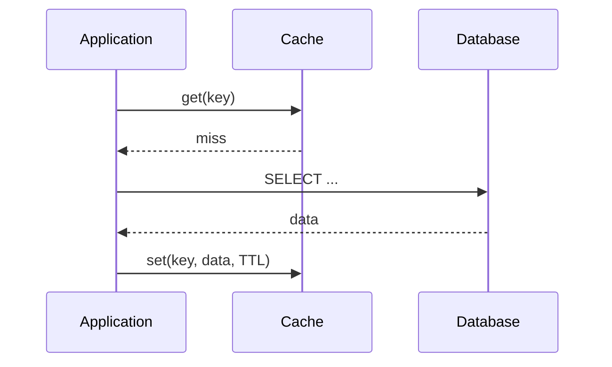
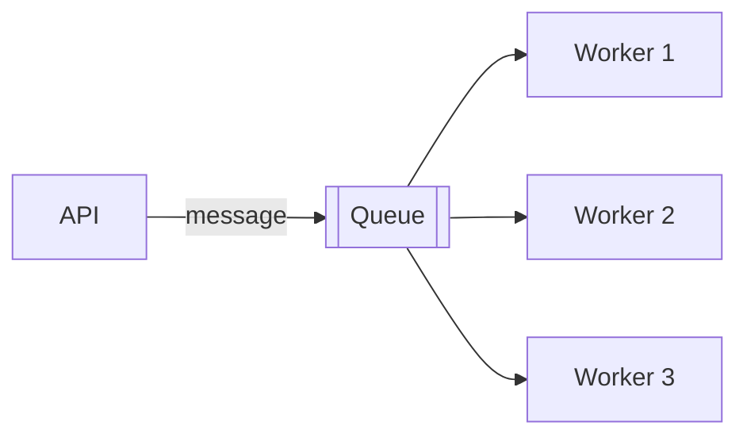

## Caching

Caching means storing the result of an expensive operation and reusing it. A read from memory takes microseconds, a database query takes milliseconds; a well-built cache greatly reduces both latency and database load.

Data suited to caching: data that is **read often, changes rarely**, and can acceptably be stale for a while. Data that is different on every read, or that can't tolerate any staleness (e.g. an account balance), is not a good fit.

### Read strategy: cache-aside

The most common pattern. The application checks the cache first; on a miss it reads from the database and writes to the cache.



```csharp
async Task<Product?> GetProductAsync(int id)
{
    var key = $"product:{id}";

    var cached = await cache.GetAsync<Product>(key);
    if (cached is not null) return cached;

    var product = await db.Products.FindAsync(id);
    if (product is not null)
    {
        await cache.SetAsync(key, product, TimeSpan.FromMinutes(10));
    }

    return product;
}
```

If the cache goes down, the system slows down but keeps working; that's the biggest advantage of this pattern.

### What happens when data changes

"There are only two hard things in computer science: cache invalidation and naming things." The options:

| Method | How | Trade-off |
| --- | --- | --- |
| **TTL** (time to live) | The entry expires on its own after a set time | The simplest; stale data for the duration |
| **Delete on write** | Update the database, then **delete** the cache key | The next read loads fresh data; the common choice |
| **Write-through** | Write the cache together with the database | The cache is always current; writes are slower and prone to race conditions |
| **Write-behind** | Write to the cache first, then flush to the database in batches, with a delay | Very fast writes; data loss if the cache crashes |

Practical advice: **delete on write + a reasonable TTL**. Deleting is safer against race conditions than updating (with two concurrent writes, there's less chance of the old value staying in the cache); the TTL is a safety net for cases where the delete fails.

### When memory fills up: eviction policies

- **LRU** (least recently used): the general-purpose default.
- **LFU** (least frequently used): better when access frequency is heavily skewed.
- **FIFO / TTL:** by age only.

Designing an LRU cache is a classic coding question: with a hash table + a doubly linked list, `get` and `put` run in O(1).

### Three classic problems

- **Cache stampede:** a heavily read key expires and thousands of requests hit the database at once. Solution: a per-key lock that lets only one request recompute the value, or refreshing in the background before expiry.
- **Mass expiration:** thousands of keys written at the same time expire at the same time. Solution: add a random amount to the TTL (jitter).
- **Non-existent key attack:** IDs that don't exist in the database are queried; the cache never fills and every request goes down to the database. Solution: also cache the "not found" result for a short time, or use a Bloom filter.

Cache layers: browser → CDN → in-process memory → distributed cache (Redis) → the database's own cache. In an interview it's not enough to say "I'm adding a cache": say **what** you store, **with which key**, **for how long** and **how you invalidate it**.

## Message queues

A queue sits between the producer of the work and the consumer that does it. The producer drops off a message and moves on without waiting; the consumer processes the message at its own pace.



What you gain:

- **Response time.** The user doesn't wait until the email is sent or the video is transcoded.
- **Smoothing out spikes.** The queue acts as a buffer; workers aren't overwhelmed, work piles up and then drains.
- **Decoupling.** The producer doesn't need to know whether the consumer is up or how many there are.
- **Durability.** If a worker crashes, the message isn't lost; it gets reprocessed.

The price: the system becomes **eventually consistent**, debugging gets harder, and you need a separate mechanism to answer "is the job done?"

### Queues and logs

| | Message queue (RabbitMQ, SQS) | Distributed log (Kafka) |
| --- | --- | --- |
| Message lifetime | Deleted once processed and acknowledged | Kept for the retention period |
| Consumption | Each message goes to one worker | Each consumer group reads from its own offset |
| Replay | No | Yes |
| Ordering guarantee | Usually weak | Strict within a partition |
| Typical use | Background jobs, work distribution | Event streams, many independent consumers, analytics |

### Delivery guarantees

| Guarantee | Meaning | Consequence |
| --- | --- | --- |
| At most once | A message may be lost, never duplicated | When loss is acceptable (e.g. metrics) |
| **At least once** | A message is never lost but **may be duplicated** | The default in practice |
| Exactly once | Neither lost nor duplicated | Very hard and expensive to provide end to end |

Over a network, guaranteeing "exactly once" delivery is impossible in the general case: if a worker processes a message and crashes before it can send the acknowledgment, the message is redelivered. That's why real systems are designed with **at-least-once delivery + idempotent consumers**.

### Idempotency

An operation is **idempotent** if applying it once or a hundred times gives the same result. `balance = 100` is idempotent; `balance += 100` is not.

Ways to make an operation idempotent:

- Give each message a unique ID and store the IDs you've processed; if the same ID arrives a second time, skip it.
- Use a uniqueness constraint in the database (e.g. `(order_id, operation_type)`).
- Write the operation so it's naturally idempotent: something like "set status to PAID."

The same idea applies to APIs: the client sends an **idempotency key**; when it retries a request after a network error, the server doesn't charge a second time.

### Poison messages

A message that fails on every attempt can block the queue. Solution: a limited number of retries (with increasing intervals), then moving the message to a **dead-letter queue** for inspection.

## Summary

- Caching is for data that's read often and changes rarely. Default pattern: cache-aside, delete on write, TTL.
- Know the cache stampede, mass expiration and non-existent key problems and their solutions.
- A queue shortens response time, smooths out load and decouples components; in return it brings eventual consistency.
- Assume at-least-once delivery and write idempotent consumers.

The role of queues in operations that span multiple services (outbox, saga) is covered in the [Consistency, Consensus and Distributed Transactions](/tracks/sistem-tasarimi/tutarlilik-uzlasma-ve-dagitik-islemler) lesson; stream processing with Kafka in the [Batch and Stream Processing](/tracks/sistem-tasarimi/akis-isleme-ve-olasiliksal-yapilar) lesson. To see caching and persistence from the inside: [Project 4: Build Your Own Redis](/tracks/sistem-tasarimi/proje-kendi-redisini-yaz).
