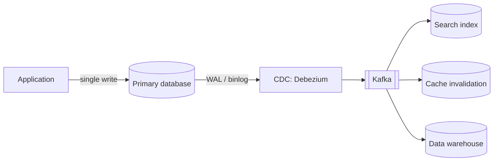

The data layer is the most lasting decision in system design: you can replace application servers in an afternoon, but you'll carry the database for years. This lesson picks up where [Scaling Fundamentals](/tracks/sistem-tasarimi/olcekleme-temelleri) left off, and it's an interview-ready summary of the ideas in the first half of Martin Kleppmann's *Designing Data-Intensive Applications*.

## Choose the database by access pattern

Don't choose based on a technology's reputation; choose based on these questions:

1. **Which key** will I use to access the data? A single record, a range, or ad hoc queries?
2. Are there **relationships** and joins between entities?
3. Do I need to update multiple records **atomically**?
4. Do the write volume and data size fit on a single machine?
5. Is consistency the priority, or availability and latency?

| Type | Examples | Strong at | Weak at |
| --- | --- | --- | --- |
| Relational | PostgreSQL, MySQL | Transactions, joins, flexible queries, constraints | Horizontal scaling is laborious |
| Distributed SQL (NewSQL) | Spanner, CockroachDB, YugabyteDB | SQL + transactions + horizontal scale | Latency, cost, operational complexity |
| Key-value | Redis, DynamoDB | Very fast access by key, easy to scale | No or limited querying other than by key |
| Wide-column | Cassandra, ScyllaDB, Bigtable | Very high write volume, time series, sorted reads within a partition | No joins, queries are designed up front per table |
| Document | MongoDB, DynamoDB | Flexible schema, nested data, single-document atomicity | Weak at cross-document relationships and joins |
| Graph | Neo4j | Multi-hop relationship queries (friend of a friend) | General-purpose workloads |
| Search | Elasticsearch, OpenSearch | Full-text search, filtering, aggregation | Not reliable as the primary system of record |
| Time series | TimescaleDB, InfluxDB, Prometheus | Metrics, sensor data, aggregation by time | General-purpose queries |
| Object storage | S3, GCS, Azure Blob | Unlimited large files, cheap | No querying inside files, high latency |

The safe default in an interview is **PostgreSQL**: it offers transactions, indexes, JSON columns, full-text search and a geospatial extension (PostGIS), and it works at a much larger scale than people think. If you're moving to another store, say which requirement PostgreSQL can't meet.

## Storage engines: B-trees and LSM trees

| | B-tree | LSM tree |
| --- | --- | --- |
| Who uses it | PostgreSQL, MySQL/InnoDB, SQL Server | Cassandra, RocksDB, ScyllaDB, LevelDB |
| Writes | Updates pages in place (random I/O) | Appends to an in-memory table and a log first, flushes to disk as sorted files |
| Reads | A search in a single tree, predictable | May check multiple files; Bloom filters help |
| Background work | Little | Compaction runs continuously |
| Suited workload | Read-heavy, mixed | Write-heavy, high-volume inserts |

The idea: **sequential writes are much faster than random writes.** LSM trees multiply write throughput by making writes sequential; they pay for it with read and compaction costs.

Both models follow the **write-ahead log** (WAL) principle: a change is first written to a sequential log; after a crash, the state is rebuilt from this log. Replication and change data capture (CDC) also read this log.

## Indexes

- An index speeds up reads, **slows down every write** (each index must be updated too) and takes up space.
- In a composite index, column order matters: a `(user_id, created_at)` index serves the "a user's latest posts" query, but not the "all posts in the last hour" query.
- If a covering index contains all the columns of a query, the table is never touched.
- In sharded systems a **secondary index** comes in two kinds: a local index per shard (easy writes, reads ask every shard: *scatter-gather*), or a global index partitioned by key (reads go to a single shard, writes update multiple shards and are usually asynchronous).

## Replication

Replication has three goals: availability (if one node crashes, another serves), read scaling, and latency (bringing data closer to users).

### Single-leader

All writes go to the leader; followers apply the change log. PostgreSQL, MySQL, MongoDB and Kafka partitions use this model.

- **Synchronous replication:** the leader doesn't acknowledge a write until at least one follower confirms it. No data loss, higher write latency.
- **Asynchronous replication:** the leader acknowledges immediately. Fast; if the leader crashes, the latest writes may be lost.
- **Semi-synchronous:** one follower is synchronous, the rest asynchronous; a common trade-off.

**Failover** is the hard part: who decides the leader is really dead? If the old leader comes back and still thinks it's the leader, you end up with two leaders (**split brain**). That's why leader election is done with consensus algorithms (Raft) or an external coordinator (etcd, ZooKeeper).

### Problems caused by replication lag

| Problem | Symptom | Solution |
| --- | --- | --- |
| Not reading your own writes | A user updates their profile and sees the old one after refreshing | Read the user's own data from the leader for a while |
| Going back in time | Two refreshes hit different replicas; a new comment appears and then disappears | Always route the user to the same replica (monotonic reads) |
| Cause and effect mixed up | An answer appears before its question | Put related writes in the same partition, causal ordering |

### Multi-leader

A leader in each region accepts writes, and the leaders replicate to each other. It lowers cross-region latency, and if one region goes down the others keep accepting writes. The price is **write conflicts**: if the same record changes in two regions at the same time, which one wins?

- **Last write wins:** simple but loses data; clocks aren't synchronized.
- **Merging:** an application-specific rule or **CRDTs** (conflict-free replicated data types: counters, sets, text). Collaborative editing tools and offline-capable apps use these.

### Leaderless (Dynamo-style)

The model born from Amazon's Dynamo paper: Cassandra, ScyllaDB, Riak. The client (or a coordinator node) sends the write to all **N** replicas; the write succeeds when **W** of them acknowledge. A read asks **R** replicas and picks the newest version.

**Quorum condition:** if `W + R > N`, at least one of the replicas read contains the latest write. A typical setting: `N = 3, W = 2, R = 2`.

| Setting | Effect |
| --- | --- |
| `W = N, R = 1` | Very fast reads; writes stop if a single node goes down |
| `W = 1, R = N` | Very fast writes, slow reads |
| `W = 1, R = 1` | Fastest and most available; high chance of stale reads |

To bring replicas in sync: **read repair** (a stale replica is updated during a read), **anti-entropy** (finding differences in the background with Merkle trees) and **hinted handoff** (another node temporarily holds the writes for a node that's down).

## Partitioning (sharding)

| Strategy | How | Pros | Cons |
| --- | --- | --- | --- |
| By range | `A–F` on one shard, `G–M` on another | Efficient range queries | Hot spot risk (timestamp key → all writes go to the last shard) |
| By hash | Ranges of `hash(key)` | Even distribution | Range queries go to every shard |
| Compound | Hashed partition key + sorted key within the partition | The best of both | Ties the design to the access pattern |
| Directory-based | A separate lookup table records which key is where | Flexible, easy to migrate | The lookup table can become a bottleneck and a single point of failure |

The compound key is the model of Cassandra and DynamoDB: `PRIMARY KEY ((channel_id), message_id)`. All messages of a channel live in the same partition, sorted by message ID; "the channel's last 50 messages" is a sorted read from a single partition. Discord scaled its messages to trillions of records with this model.

### Rebalancing

- Don't use `hash % N`: when `N` changes, almost everything moves.
- **A fixed number of virtual partitions:** create many logical partitions up front (e.g. 1,024) and spread them across nodes; when a node is added, only some partitions move. Elasticsearch, Cassandra (vnodes) and Redis Cluster (16,384 slots) use this idea.
- **Consistent hashing:** on the ring, keys move only to the neighboring node.

### Hot keys

Even a hash that distributes evenly can't save you from a single famous key (an account with millions of followers, a viral product). Solutions:

- **Salting the key:** `product:42:0` … `product:42:9` instead of `product:42`; writes spread across 10 shards, reads merge the 10 shards. Apply it only to known hot keys.
- **Caching** hot reads, even keeping them close in in-process memory.
- **Batching writes** for cumulative values such as counters: instead of writing every increment separately, accumulate them in memory and write once per second.

## Distributed ID generation

In a sharded system you can't use `AUTO_INCREMENT`: each shard has its own counter. The options:

| Method | Size | Sortable? | Coordination | Note |
| --- | --- | --- | --- | --- |
| UUID v4 | 128 bits | No | None | Random inserts into the B-tree index, takes up space |
| **UUID v7** | 128 bits | By time | None | Time-prefixed; the index-friendly modern default |
| **Snowflake** | 64 bits | By time | Machine ID assignment | Twitter's method |
| Range-allocating counter | 64 bits | Roughly | When a range runs out | In the [URL shortener](/tracks/sistem-tasarimi/url-kisaltici) lesson |
| Database sequence, different step | 64 bits | Roughly | None | Shard 1: 1, 3, 5…; shard 2: 2, 4, 6… |

The structure of a Snowflake ID:

```text
| 1-bit sign | 41-bit millisecond timestamp | 10-bit machine ID | 12-bit sequence number |
```

A 41-bit timestamp lasts ~69 years from a custom epoch; 10 bits means 1,024 machines; 12 bits means 4,096 IDs per millisecond on each machine. IDs are **roughly sorted by time**, which makes "newest N records" queries and cursor pagination easy. Watch out: if the clock goes backwards (an NTP correction), duplicate IDs can be generated; the generator should wait if it sees the clock go backwards.

## Change data capture (CDC) and derived data

Writing a record to the database, the cache and the search index at the same time **from application code** is prone to inconsistency: one succeeds, another doesn't. A more robust pattern:



The primary database is **the single source of truth**; the search index, the cache and the analytics store are derived from it and can be rebuilt from scratch if needed.

## Summary

- Choose the database by access pattern; the default is PostgreSQL, and any deviation should be justified.
- B-trees shine on read-heavy workloads, LSM trees on write-heavy ones.
- Single-leader replication is simple and common; multi-leader and leaderless models gain availability but require conflict resolution.
- Quorum: `W + R > N`.
- The shard key should distribute evenly and serve frequent queries from a single shard; salting and caching for hot keys.
- Distributed IDs: UUID v7 or Snowflake.

**Further reading:** *Designing Data-Intensive Applications* (2nd edition, 2026) chapters 4–7; [the Dynamo paper](https://www.allthingsdistributed.com/files/amazon-dynamo-sosp2007.pdf); [How Discord stores trillions of messages](https://discord.com/blog/how-discord-stores-trillions-of-messages); [Figma's database scaling](https://www.figma.com/blog/how-figmas-databases-team-lived-to-tell-the-scale/); [Sharding PostgreSQL at Notion](https://www.notion.com/blog/sharding-postgres-at-notion).
