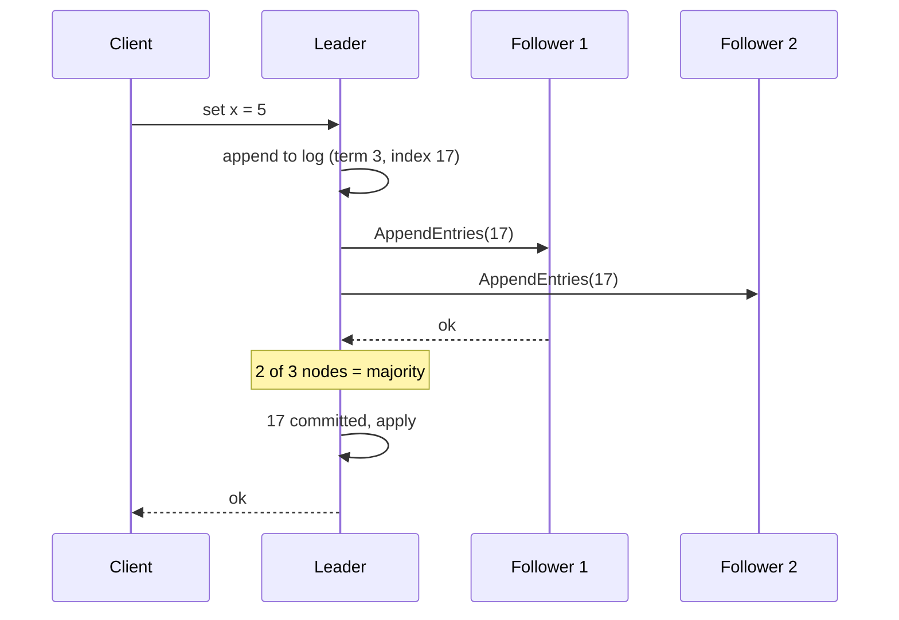
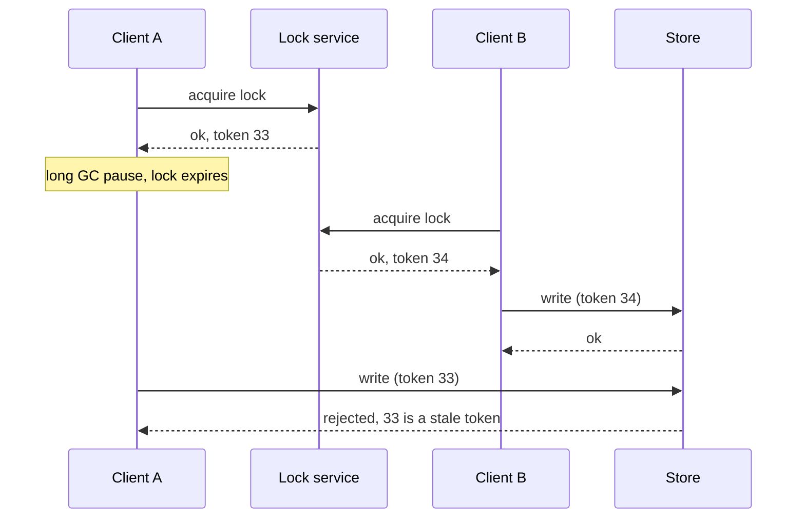

On a single machine it's easy to say "this happened first, then that." Across multiple machines, network messages are delayed, lost and reordered; clocks drift apart; nodes die silently, or come back after a long garbage collection pause as if nothing happened. This lesson gathers the concepts you need to answer "but is this consistent?" confidently in an interview.

## The eight fallacies of distributed computing

Eight assumptions that beginners silently make and that break systems: the network is reliable, latency is zero, bandwidth is infinite, the network is secure, topology doesn't change, there is one administrator, transport cost is zero, the network is homogeneous. For every arrow in your design, ask "what happens if this message is lost, arrives late or arrives twice?"

When you get no response to a request, **you can't know what happened**: the request may never have arrived, the other side may have processed it and lost the response, or it may still be processing. A timeout only means "I don't know." That's why retries must be idempotent.

## Consistency models

From strongest to weakest:

| Model | Guarantee | Example need |
| --- | --- | --- |
| **Linearizability** | The system behaves as if there were a single copy; once a write completes, every read sees it | Locks, leader election, unique usernames, the last item in stock |
| Sequential consistency | Everyone sees operations in the same order, but it may not match real time | |
| **Causal consistency** | A cause is seen before its effect (an answer never appears before its question) | Comment threads, chat |
| Read your writes | Users see their own writes immediately | Profile updates |
| Monotonic reads | You never go back in time | Feed refreshes |
| **Eventual consistency** | If writes stop, replicas eventually become identical | Like counts, feeds, analytics |

Strong consistency requires **coordination** (quorums, consensus, locks); and coordination means latency and unavailability during a partition. A good design chooses consistency per type of data: payments and inventory strong, like and view counts eventual.

## From CAP to PACELC

CAP only describes the moment of a network partition. **PACELC** completes the picture:

> If there is a partition (**P**), choose between **A**vailability and **C**onsistency; **E**lse (in normal operation), choose between **L**atency and **C**onsistency.

| System | During a partition | Normally | Note |
| --- | --- | --- | --- |
| DynamoDB, Cassandra (default) | A | L | Fast, eventually consistent; strong reads on request |
| Spanner, CockroachDB | C | C | Every write goes through consensus; accepts the latency |
| PostgreSQL (asynchronous replica) | — | L | Reads from a replica may be stale |

In an interview, answering "CP or AP?" together with the **latency cost** in normal operation shows seniority.

## Clocks and ordering

The clocks of different machines can drift by milliseconds to seconds, and with an NTP correction they can **even go backwards**. Therefore:

- If a "last write wins" rule relies on the wall clock, data can be lost silently.
- For timeouts and measuring durations, use a **monotonic clock** (`Stopwatch`, `performance.now()`), not the wall clock.

Logical clocks for ordering events without relying on physical clocks:

- **Lamport clock:** each node keeps a counter, increments it on every event and sends it with messages; the receiver takes `max(own, received) + 1`. It preserves causal order but can't tell concurrent events apart.
- **Vector clock:** one counter per node. It tells you whether two events are in a cause–effect relationship or **concurrent** (conflicting); Dynamo-style stores detect conflicts this way.
- **Hybrid logical clock (HLC):** timestamps that stay close to physical time but preserve causality; used by CockroachDB.
- Google **Spanner** bounds clock uncertainty with atomic clocks and GPS (TrueTime) and waits out that uncertainty at commit.

## Consensus and Raft

Consensus is a group of nodes agreeing on **a single value** despite crashes: who is the leader, is this log entry committed, who holds this lock? Leader election, linearizable storage, distributed locks and configuration management all rely on consensus. You don't write it yourself; you use ready-made services such as **etcd, ZooKeeper, Consul**, or systems with embedded Raft (CockroachDB, TiKV, Kafka KRaft). But you're expected to be able to explain how it works.

**The essence of Raft:**

1. Nodes are in one of three states: **follower**, **candidate**, **leader**. Time is divided into **terms**.
2. **Leader election:** if a follower hears nothing from the leader for a certain (random) time, it becomes a candidate, increments the term and requests votes. The one that gets a majority of votes becomes leader. Random timeouts keep candidates from colliding over and over.
3. **Log replication:** a client request arrives at the leader; the leader appends the entry to its own log and sends it to the followers. Once a **majority** has stored the entry, it is committed and applied to the state machine.
4. **Safety:** only a node that contains all committed entries can be elected leader; a leader from an old term steps down to follower as soon as it sees a message with a higher term.



**Why an odd number of nodes?** 2f + 1 nodes tolerate f node failures: 3 nodes tolerate 1, 5 nodes tolerate 2. 4 nodes tolerate no more failures than 3, but wait for more acknowledgments to reach a majority.

**The cost:** every write makes a round trip to a majority; in a cross-region Raft cluster that's tens to hundreds of milliseconds per write. The side left in the minority (during a partition) can't accept writes: Raft is a **CP** system.

## Distributed locks and fencing tokens

When only one worker at a time may do a job (a scheduled task, exclusive access to a resource), you use a distributed lock. A simple Redis lock:

```text
SET lock:report <random-value> NX PX 30000
```

`NX` writes only if the key doesn't exist, and `PX` releases the lock automatically after 30 seconds. When releasing, you must check atomically (with a Lua script) that the value is still yours; otherwise you'll delete a lock that expired and passed to someone else.

**The real danger:** the process holding the lock enters a long garbage collection pause, the lock expires, another process acquires the lock, and **both** write. The lock service can't prevent this, because the first process doesn't know its lock has expired.

The solution is a **fencing token**: the lock service returns a number that increases with every grant (33, 34, …). The protected store checks the token on every write and rejects writes whose token is **smaller than the largest it has seen**. The old owner (33), returning from its pause, is rejected after the new owner has written with 34.



If correctness really matters, get the lock from a consensus-based service (etcd, ZooKeeper) and use fencing tokens. If the lock is only for efficiency (doing the same work twice is merely wasteful), a simple Redis lock is enough.

Often simpler tools are enough instead of a lock:

- **Optimistic concurrency:** `UPDATE ... SET stock = stock - 1, version = version + 1 WHERE id = 42 AND version = 7` — if no row was affected, someone got in first; retry.
- **Conditional atomic update:** `UPDATE seat SET status = 'reserved' WHERE id = 12 AND status = 'free'`.
- **Uniqueness constraint:** if two inserts race, one gets a constraint violation.

## Transactions that span multiple services

An order: inventory is decremented, payment is taken, a shipment is created. If each lives in a different service and database, there is no single database transaction.

### Two-phase commit (2PC)

A coordinator first asks all participants "are you ready?" (prepare); if they all say yes, it says "commit"; if any says no, it tells them all to "roll back."

- Pro: atomicity.
- Con: if the coordinator crashes between "prepare" and "commit," the participants **wait** while holding locks (blocking); every transaction is as slow as the slowest participant; all participants must support 2PC. It's rarely used between microservices; it is used, together with consensus, inside a single distributed database (Spanner, CockroachDB).

### Saga

A long transaction is split into steps, each with its own local transaction. If a step fails, the previous steps are undone with **compensating transactions**: refunding the payment, adding the stock back.

| | Choreography | Orchestration |
| --- | --- | --- |
| How | Each service publishes events, the others listen and react | A central orchestrator calls the steps in order |
| Pro | No central component, loosely coupled | The flow is visible in one place, easy error handling |
| Con | The flow is hard to follow and change | The orchestrator is an extra component |
| Tools | Kafka, message queues | Temporal, AWS Step Functions, Durable Functions |

Sagas **don't provide isolation**: intermediate states are visible to others (stock decremented but payment not yet taken). You manage this with intermediate states such as "pending" and with semantic locks. Compensating transactions must be idempotent too.

### Transactional outbox

A classic mistake: write to the database, then send an event to Kafka. If you crash in between, the event is never published; if the order is reversed, the event is published but the record doesn't exist (**the dual write problem**).

The solution: write the event to an `outbox` table **in the same transaction** as the business data. A separate publisher (or CDC) reads this table, sends to the queue and marks what was sent.

```sql
BEGIN;
INSERT INTO orders (id, user_id, total) VALUES (981, 42, 250.00);
INSERT INTO outbox (id, aggregate_id, type, payload)
VALUES (gen_random_uuid(), 981, 'OrderCreated', '{"orderId": 981, "total": 250.00}');
COMMIT;
```

The publisher sends at least once; consumers must be **idempotent** by event ID (an inbox table). Outbox + idempotent consumers + sagas are the standard recipe for consistency in microservices.

## Summary

- A timeout means "I don't know"; retries must be idempotent.
- Choose consistency per type of data; strong consistency means coordination and latency (PACELC).
- Don't trust the wall clock; use logical clocks or consensus for ordering.
- Raft: leader election with random timeouts, a log committed by majority; 2f + 1 nodes tolerate f failures.
- If a lock is for correctness, fencing tokens are mandatory; often optimistic concurrency or a conditional update is enough.
- Cross-service transactions: sagas instead of 2PC; the outbox for publishing events.

**Further reading:** [Raft visualization and paper](https://raft.github.io/); Martin Kleppmann, [How to do distributed locking](https://martin.kleppmann.com/2016/02/08/how-to-do-distributed-locking.html); [Jepsen analyses](https://jepsen.io/analyses); *Designing Data-Intensive Applications* chapters 8–10.
