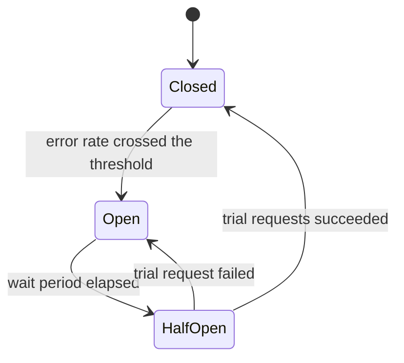

At large scale, something being broken is not the exception but **the normal state**: out of thousands of machines a few die every day, the network drops for a moment, a dependency slows down. A resilient system doesn't try to prevent failures but to **contain** them: a single slow service must not take down the whole system. In the deep-dive part of an interview, the question "what happens if this service slows down?" comes up almost every time.

## How cascading failures happen

The payment service slows down and its response time goes from 50 ms to 5 seconds. The threads and connections of the order service that calls it run out while waiting for responses; the order service can no longer respond to any request, not even ones unrelated to payment. The gateway that calls it gets stuck too. A single slow dependency has taken down **the whole system**.

All of the patterns below exist to cut off this spread.

## Timeouts

Every network call must have a timeout. Clients whose default is "infinite" or 100 seconds are the number one cause of cascading failures.

- Set the timeout **a little above the dependency's p99 latency**, not based on the average.
- **Deadline propagation:** if the user request has a budget of 2 seconds and 1.5 seconds have been spent, there's no point giving a downstream service more than 500 ms. gRPC carries this built in.

## Retries: exponential backoff and jitter

Transient errors (network blips, `503`, timeouts) usually go away with a retry. But badly written retries **finish off** a struggling service: if every client retries immediately and repeatedly, the load multiplies (a retry storm).

Rules:

1. Retry only **transient** and **idempotent** operations (`400 Bad Request` is never retried).
2. Increase the wait exponentially: 100 ms, 200 ms, 400 ms, 800 ms…
3. Add **randomness (jitter)** to the wait; otherwise all clients retry at the same moment.
4. Limit the number of attempts and the total time.
5. Watch out for multiplication across layers: if each of three layers retries 3 times, the bottom service sees 27 times the requests. Retry in a single layer, or keep a **retry budget** (e.g. at most 10% of requests may be retries).

```typescript
async function withRetry<T>(op: () => Promise<T>, maxAttempts = 4, baseMs = 100, capMs = 2_000): Promise<T> {
  for (let attempt = 1; ; attempt++) {
    try {
      return await op();
    } catch (error) {
      if (attempt >= maxAttempts || !isTransient(error)) throw error;

      // "Full jitter": wait a random time between 0 and the exponential ceiling.
      const ceiling = Math.min(capMs, baseMs * 2 ** (attempt - 1));
      await sleep(Math.random() * ceiling);
    }
  }
}
```

In .NET, instead of writing this by hand, you use the standard resilience pipeline from `Microsoft.Extensions.Http.Resilience` (based on Polly): timeouts, retries, a circuit breaker and a concurrency limit come in a single line.

## Circuit breaker

If a dependency has clearly crashed, making every request wait until the timeout is a waste of resources. When the error rate crosses a threshold, a circuit breaker fails calls immediately **without making them at all**, giving the dependency a chance to recover.



- **Closed:** requests pass through, errors are counted.
- **Open:** requests are rejected instantly (or a fallback response is returned).
- **Half-open:** a few trial requests are let through; if they succeed, the circuit closes.

## Bulkheads

Like a ship's watertight compartments: give each dependency a **separate**, limited pool of resources (threads, connections, a quota of concurrent requests). If the payment service slows down, only the payment pool fills up; product listing isn't affected. The same idea applies to tenants: a noisy customer must not consume everyone else's resources.

## Load shedding, backpressure and graceful degradation

- **Load shedding:** when a server exceeds its capacity, it quickly rejects the excess with `503`. Serving some requests fast is better than serving everyone slowly and timing out. Shed by priority: a payment request comes before a recommendation request.
- **Backpressure:** if the consumer can't keep up, slow down the producer. There are no unbounded queues; a queue that looks unbounded is a bomb that keeps growing latency until memory runs out. Bound your queues and decide what happens when they fill up.
- **Graceful degradation:** if the recommendation service is down, the home page shows a cached list of popular products; if reviews can't be loaded, the product page opens without reviews. The critical path must not fail because of non-critical dependencies.
- **Rate limiting:** prevents abuse and a single client consuming all the capacity. The algorithms are in the [Rate Limiter](/tracks/sistem-tasarimi/hiz-sinirlayici) lesson.

## Health checks and deployment

- **Liveness** check: is the process alive? If it fails, the process is restarted. Don't check dependencies; restarting every server because the database slowed down is a disaster.
- **Readiness** check: is it ready to receive requests? If it fails, the load balancer stops sending it traffic.
- **Canary deployment:** the new version is first exposed to 1–5% of traffic; the error rate and latency are watched, and if there's no problem it's gradually increased.
- **Blue-green deployment:** two identical environments; traffic switches to the new one in a single step, and switches back in a single step if there's a problem.
- **Feature flags:** deploying the code is separated from turning on the feature; a problematic feature is switched off without a deployment.

A large share of major outages come from **changes** (deployments, configuration); gradual rollouts and fast rollbacks are the most effective resilience measures.

## Observability

You can't operate a system you can't see. The three basic signals:

| Signal | What it tells you | Tools |
| --- | --- | --- |
| **Metrics** | How much? Numeric, cheap, time series: request count, error rate, latency percentiles | Prometheus, Grafana |
| **Logs** | What happened? Per-event detail; should be structured (JSON) and include a request ID | Loki, Elasticsearch |
| **Traces** | Where? A request's journey across services and the duration of each step | OpenTelemetry, Jaeger, Tempo |

Key metrics to monitor:

- **RED** (for request-driven services): **R**ate (request rate), **E**rrors (error rate), **D**uration (latency).
- **USE** (for resources): **U**tilization, **S**aturation (queue length), **E**rrors.
- Google's **four golden signals:** latency, traffic, errors, saturation.

**Average latency lies.** Use percentiles: p50, p95, **p99**. If a page makes 50 backend calls, the p99 of each call is felt by most requests for that page (*tail latency*). A common technique for reducing tail latency: if no response arrives within a set time, send the same request to a second replica as well (a **hedged request**).

## SLIs, SLOs and error budgets

- **SLI** (indicator): the measured value. "The fraction of requests that succeed and are answered in under 300 ms."
- **SLO** (objective): the internal target for that value. "99.9% over a 30-day window."
- **SLA** (agreement): a promise to the customer with penalties if it's broken; kept looser than the SLO.
- **Error budget:** a 99.9% SLO allows ~43 minutes of errors per month. While there's budget, the team ships fast; when the budget runs out, the team focuses on reliability instead of new features.

Alerts should be based on **symptoms** (errors and latency the user experiences), not on causes (CPU at 80%); otherwise the team gets used to the noise and misses the real alert.

## How to use this in an interview

For every arrow in your design, state:

1. The timeout and retry policy (is it idempotent?).
2. What does the user see if the dependency crashes (graceful degradation)?
3. What happens under a sudden spike (queue, load shedding, rate limit)?
4. How would I notice (which metric, which SLO)?

## Summary

- A timeout on every call; exponential backoff, jitter and a budget for retries.
- A circuit breaker isolates a crashed dependency, bulkheads isolate a slow one.
- Shed load when capacity is exceeded; bound your queues; sacrifice what isn't critical.
- Metrics, logs and traces; look at p99, not the average; manage with SLOs and error budgets.

**Further reading:** [Amazon Builders' Library](https://aws.amazon.com/builders-library/) (especially "Timeouts, retries, and backoff with jitter" and "Using load shedding to avoid overload"); [Google SRE books](https://sre.google/books/) (free); Michael Nygard, *Release It!*
