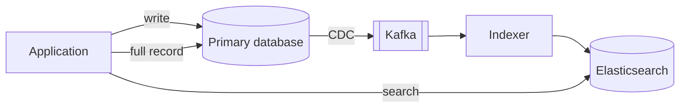
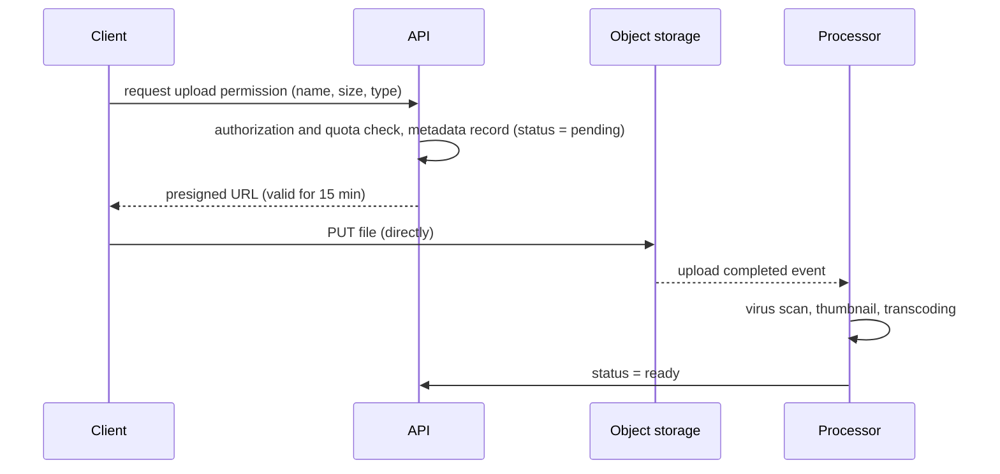

Many design questions depend on a job that a general-purpose database does poorly: "search the text," "find drivers near me," "upload a 2 GB video." This lesson covers the standard solutions to these three jobs.

## Full-text search

`WHERE title LIKE '%headphone%'` scans the whole table, doesn't recognize word stems (headphone / headphones) and doesn't rank results by relevance.

### Inverted index

Search engines use an **inverted index**: a mapping from each term to the list of documents that contain it.

```text
"wireless"  → [doc 3, doc 8, doc 21]
"headphone" → [doc 3, doc 5, doc 8]
"bluetooth" → [doc 8, doc 13]

search "wireless headphone" = [3, 8, 21] ∩ [3, 5, 8] = [3, 8]
```

Before indexing, the text is **analyzed**: lowercasing, splitting into words, dropping stop words (and, with), **stemming** ("headphones" → "headphone"), synonyms. In agglutinative languages such as Turkish, stemming has a large effect on relevance.

Results are ranked by **relevance score** (BM25: how often the term appears in the document, how rare it is across all documents), then re-ranked with business rules (popularity, freshness, personalization).

### Architecture



- The primary database is the single source of truth; the search index is **derived** from it and can be rebuilt from scratch when needed.
- The index is updated asynchronously via CDC or events; it can take seconds for a new record to show up in search (Elasticsearch's default refresh interval is one second). Say this in the interview.
- Elasticsearch indexes are split into shards; a search goes to every shard (scatter-gather) and the results are merged.
- At small and medium scale, PostgreSQL's own full-text search (`tsvector`, GIN index) can be a better choice than operating a separate cluster.

### Autocomplete (typeahead)

When you need results on every keystroke, you use **prefix** structures instead of full-text search: a trie (prefix tree) or a precomputed "prefix → top 10 queries" table. Popularity is computed offline (hourly/daily), results are cached aggressively at the client and CDN levels, and requests are thinned out on the client with **debounce**.

### Vector search

For semantic search and recommendations, text or images are turned into an **embedding vector**; a search is a "the k vectors closest to this vector" query. Because exact search is expensive, **approximate nearest neighbor** indexes (HNSW, IVF) are used: pgvector, Elasticsearch/OpenSearch, dedicated vector databases. Most production systems combine keyword search with vector search (hybrid search).

## Location: proximity queries

The query "restaurants within 5 km" is two-dimensional; two separate B-tree indexes on latitude and longitude can't serve it efficiently (one returns the whole latitude band, the other the whole longitude band). The solution is to reduce the two dimensions to **a single indexable value**, or to use a spatial index.

### Geohash

The world is recursively split in two, and a location is encoded as a base32 string. **Points that share a longer common prefix are close to each other.**

| Length | Cell size (approx.) |
| --- | --- |
| 4 | 39 km × 20 km |
| 5 | 4.9 km × 4.9 km |
| 6 | 1.2 km × 0.6 km |
| 7 | 153 m × 153 m |

Query: find the user's cell and its **8 neighboring cells** (if the point is near a cell edge, the nearest place may be in a neighboring cell), fetch the points in those cells, then filter and sort by actual distance. Because a geohash is an ordinary string, it can be indexed in any database or in Redis (`GEOADD`, `GEOSEARCH`).

### Quadtree

The map is split into four whenever a cell holds more than a certain number of points (e.g. 100). Dense city centers end up in small cells, empty areas in large cells; compared with fixed-size geohashes, this **adapts** to density. It's usually kept in memory and suits rarely changing data (restaurants, businesses).

### H3 and S2

- **H3** (Uber): divides the world into hierarchical **hexagons**. All of a hexagon's neighbors are the same distance from its center; this removes the corner problem of squares in calculations such as demand/supply density and pricing.
- **S2** (Google): divides the sphere into hierarchical cells and reduces them to one dimension with a Hilbert curve.

### Which one when

| Data | Recommendation |
| --- | --- |
| Rarely changing points (restaurants, hotels) | PostGIS or Elasticsearch geo queries; a quadtree if density varies a lot |
| Points updated thousands of times per second (drivers) | In memory: geohash/H3 cell → set of points (Redis GEO), with no or infrequent writes to durable storage |
| Aggregation by area (demand density) | H3 cells |

The details of high-frequency location updates are in the [Nearby Drivers](/tracks/sistem-tasarimi/yakindaki-suruculer) lesson.

## Large files: object storage

Large binary data such as images, video, documents and backups doesn't go into the database: it bloats the database, slows down backups and replication, and is expensive. Instead you use **object storage** (S3, GCS, Azure Blob): a flat key → object space, nearly unlimited capacity, high durability (99.999999999% for S3) and low cost. The database holds only the **metadata** (owner, size, type, object key, status).

### Direct upload with presigned URLs

Passing the file through the application server wastes the server's bandwidth and memory. Instead:



A presigned URL is a signed link that grants permission to perform a specific operation (PUT or GET) on a specific object for a specific period. Private files are downloaded the same way.

### Multipart and resumable uploads

Large files are uploaded in **parts** (e.g. 5–100 MB) (multipart upload):

- Parts are uploaded in parallel; the total time drops.
- If the connection drops, only the missing parts are re-uploaded; the client can ask which parts are complete.
- When all parts are done, a "complete" call assembles the object.

File sync services (Dropbox, Google Drive) go a step further: they split the file into blocks (4 MB each at Dropbox), take a hash of each block and upload only the **changed blocks**. If a block with the same hash already exists, it isn't uploaded at all (deduplication).

### Distribution with a CDN

On the read path, files are served through a CDN: the edge server closest to the user keeps the file in its cache, and the origin is called only on a cache miss. Things to watch:

- For files that change, use **content-hashed names** (`logo.3f9a1c.png`); that way no invalidation is needed and you can set a near-infinite TTL.
- Signed CDN URLs or signed cookies for private content.
- For large, popular content such as video, CDN cost and hit rate are at the center of the design; Netflix places its own CDN (Open Connect) inside internet service providers.

## Summary

- Full-text search: inverted index, analysis, BM25; the index is derived from the primary database via CDC and is eventually consistent.
- Autocomplete: a trie or precomputed prefix tables, and aggressive caching.
- Proximity: geohash (+ 8 neighbors), quadtree, H3; frequently updated locations live in memory.
- Large files: object storage + metadata in the database; direct, multipart uploads with presigned URLs; distribution from a CDN.
