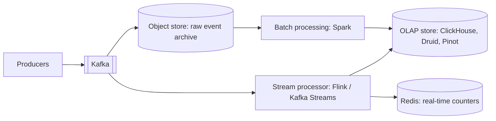

"The 10 most-watched videos in the last hour", "aggregate ad clicks per minute", "how many distinct users visited today?" These questions are not about accessing a single record; they are about **summarizing billions of events**. This lesson covers the processing models behind such questions and the probabilistic structures that cut memory use by hundreds of times.

## Batch processing

Batch processing takes a bounded dataset (yesterday's logs), processes it from start to finish, and produces a result. The classic model is Google's **MapReduce**:

1. **Map:** each record is turned into `(key, value)` pairs: `("video:42", 1)`.
2. **Shuffle:** pairs with the same key are gathered on the same machine.
3. **Reduce:** the values for each key are combined: `("video:42", 18_204)`.

Today the same idea is applied with in-memory engines such as **Spark**, and with SQL in data warehouses (BigQuery, Snowflake). Batch processing is simple, correct and re-runnable, but its results are hours late.

## Stream processing

Stream processing handles an unbounded stream of events **as they arrive**; results update within seconds. A typical pipeline:

Kafka plays two roles here: it stores events **durably** (if the processor crashes, it resumes from its last offset), and it serves the same stream to several independent consumers. Archiving the raw events lets you **reprocess** history when you later discover a faulty calculation.

### Lambda and Kappa architectures

- **Lambda:** a fast stream layer that gives approximate results + a slow batch layer that gives exact results; queries merge the two. The cost is writing the same logic twice.
- **Kappa:** a stream layer only; when you need to reprocess, you replay the stream from the beginning. It is increasingly common thanks to the exactly-once guarantees of modern stream engines.

### Windows

In an infinite stream, a "total" only makes sense for a **time window**:

| Window | Definition | Example |
| --- | --- | --- |
| Tumbling | Non-overlapping, equal intervals | Clicks per minute |
| Sliding/hopping | Overlapping intervals | Last 5 minutes, updated every minute |
| Session | Intervals separated by a gap of inactivity | Length of a user's visit |

### Event time and late events

A click's **event time** (the moment the user clicked) differs from its **processing time** (the moment it reached the server): a phone goes offline in a tunnel and the event arrives 10 minutes later. Correct aggregation is based on event time. Stream processors use a **watermark** for this: "a 12:05 watermark means that events before 12:05 have mostly arrived." A window closes once the watermark passes it; events that arrive even later are either dropped or processed separately as corrections.

### Exactly-once processing

If a stream processor crashes and restarts from its last checkpoint, it processes some events **a second time**. Ways to achieve an "exactly-once" effect:

- The processor's state and the Kafka offset are saved together in atomic checkpoints (Flink).
- The output is written **idempotently**, e.g. `UPSERT (ad_id, minute) = count`; if the same window is written twice, the result does not change.
- Or the output is written transactionally (Kafka transactions).

For money matters such as billing, stream results are usually recomputed with batch processing for **reconciliation**.

## Probabilistic data structures

An exact answer can be very expensive in memory and time. If you accept a small, known margin of error, memory drops by hundreds of times.

### Bloom filter: "is this element in the set?"

An array of `m` bits and `k` hash functions. When you add an element, `k` bits are set to 1; when you query, if all `k` bits are 1 the answer is "**probably present**", and if even one is 0 the answer is "**definitely absent**".

- False positives are possible; **false negatives are not**.
- About 10 bits per element gives a false positive rate of about 1%.
- It does not support deletion (the counting variant does).

Uses: "does this file contain this key?" in LSM trees (avoids unnecessary disk reads), "have I seen this URL?" in a web crawler, blocking attacks that query nonexistent keys against a cache, "is this password in a leaked list?".

### HyperLogLog: "how many distinct elements are there?"

How many **distinct** users visited in a day? An exact answer requires keeping every ID in a set: 100 million users × 16 bytes ≈ 1.6 GB. HyperLogLog estimates it from the number of leading zeros in the hash values, using **~12 KB** with ~0.8% error.

- Mergeable: you get the daily unique count by merging hourly HLLs.
- Built into Redis with `PFADD` and `PFCOUNT`.

### Count-Min Sketch: "how many times has this element been seen?"

A table of counters with `d` rows × `w` columns, and `d` hash functions. Each event increments one counter in each row; the estimate is the **minimum** of the `d` counters. Because of collisions the estimate can be larger than the true value, but **never smaller**. It estimates the frequency of millions of distinct elements with fixed memory.

### Top-K (the K most popular elements)

For the question "the 10 most-searched terms in the last hour":

- **Exact approach:** a counter per term + a min-heap of size K. If the number of distinct terms is very large, memory becomes a problem.
- **Approximate approach:** frequency estimation with a Count-Min Sketch + a heap of size K; or heavy-hitter algorithms such as Space-Saving.
- **Distributed:** each processor computes the top-K for its own partition, and an aggregator merges them. Careful: merging local top-Ks may not give the global top-K **exactly**; asking each processor for more than K (e.g. 10K) reduces the error. Routing the same key to the same processor (partitioning by key) makes the merge exact.

A common trade-off is an approximate stream result for a short window (the last minute) and an exact batch result for a long window (yesterday).

## Example: ad click aggregation

Requirements: 1 million clicks per second, per-minute click counts for the advertiser dashboard, exactness for billing.

1. Clicks are written to Kafka with an idempotent ID (partitioned by `ad_id`).
2. Flink counts per `ad_id` in 1-minute tumbling windows based on event time; it filters out duplicate click IDs with short-lived state.
3. Results are **upserted** into the OLAP store with the key `(ad_id, minute)`; the dashboard reads from there.
4. Raw events are archived in the object store; a nightly batch job does the same calculation exactly, and billing uses that result. If there is a discrepancy, an alert fires.
5. For hot ads (a single ad with 100,000 clicks per second), the key is salted and aggregated in two stages.

## Summary

- Batch processing: exact, simple, delayed. Stream processing: fast, complex.
- Window by event time; use watermarks for late events.
- Exactly-once effect: checkpoints + idempotent or transactional output.
- Bloom: membership (no false negatives). HyperLogLog: unique counts (~12 KB). Count-Min: frequency (never underestimates). Top-K: counter + heap, or sketch + heap.
