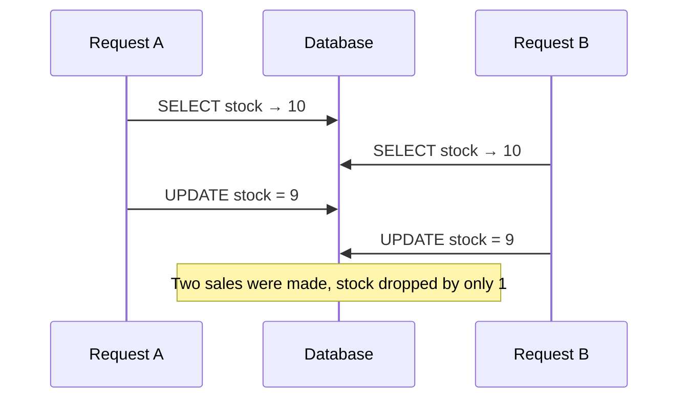

In a single-user application, the database is simple. The difficulty starts the moment two requests touch the same row at the same time: two people buy the last item at once, two transfers withdraw money from the same account at once. This lesson covers how to recognize these situations and choose the right tool.

## Transactions

A transaction is a group of operations that must either all succeed together or all be rolled back together.

```sql
BEGIN;
UPDATE accounts SET balance = balance - 100 WHERE id = 1;
UPDATE accounts SET balance = balance + 100 WHERE id = 2;
COMMIT;   -- or ROLLBACK if an error occurs
```

If the server crashes after the first `UPDATE`, the money doesn't vanish into thin air: because the transaction was not committed, the first change is void as well.

## ACID

| Letter | Meaning | How it is achieved |
| --- | --- | --- |
| **A**tomicity | All or nothing | Changes are written to the log (WAL) first; the effects of an uncommitted transaction are not visible |
| **C**onsistency | A transaction moves the database from one valid state to another valid state | Constraints (`NOT NULL`, `UNIQUE`, `CHECK`, foreign keys) **and** the application's own rules |
| **I**solation | Concurrent transactions don't see each other's half-finished work | Isolation levels, MVCC, locks |
| **D**urability | Committed data is not lost in a crash | The WAL is written to disk (`fsync`) before `COMMIT` returns |

Two subtleties make a difference in an interview:

- The "C" in ACID is **not the same thing** as the "C" in the CAP theorem. Consistency in CAP means distributed replicas show the same data; in ACID it means business rules are preserved.
- The "I" is not an on/off switch but a **level**. Some anomalies are possible even at the default level.

## Concurrency anomalies

| Anomaly | What happens |
| --- | --- |
| **Dirty read** | You read another transaction's not-yet-committed change (which may be rolled back) |
| **Non-repeatable read** | The same row is read twice and returns a different value because someone else changed and committed it in between |
| **Phantom read** | The same query with the same condition runs twice and returns a different **set** because rows were inserted or deleted in between |
| **Lost update** | Two transactions read the same value and both write over it; one of the changes is lost |
| **Write skew** | Two transactions read the same rule and change **different** rows; two changes that are each correct on their own break the rule together |

### Lost update

This is the most common and the most insidious one. The application reads a value, computes in memory and writes it back:



The default isolation level does **not prevent** this.

### Write skew

Rule: at least one doctor must stay on call. Right now two doctors are on call, and both request leave at the same time:

```sql
-- Runs simultaneously for both doctors (one with id = 1, the other with id = 2)
BEGIN;
SELECT count(*) FROM doctors WHERE on_call;          -- sees 2, says "I can leave"
UPDATE doctors SET on_call = false WHERE id = 1;
COMMIT;
```

Because the two transactions change different rows, they don't block each other; in the end no doctor is left on call. Similar examples: two people taking the same username at the same time (if there is no unique constraint), the same meeting room being booked twice for the same time slot.

## Isolation levels

The SQL standard defines four levels and states which anomalies each one **allows**:

| Level | Dirty read | Non-repeatable read | Phantom read |
| --- | --- | --- | --- |
| Read Uncommitted | Possible | Possible | Possible |
| Read Committed | Not possible | Possible | Possible |
| Repeatable Read | Not possible | Not possible | Possible |
| Serializable | Not possible | Not possible | Not possible |

The standard only sets a lower bound; databases can offer something stronger. PostgreSQL's actual behavior:

| Level | In PostgreSQL |
| --- | --- |
| Read Uncommitted | Behaves like Read Committed; dirty reads never happen in PostgreSQL |
| **Read Committed** (default) | Each **statement** sees a snapshot of the data committed as of the moment that statement started. Lost updates and write skew are possible |
| Repeatable Read | The whole transaction sees the snapshot from its **first query** (snapshot isolation). Phantom reads don't happen either. A transaction that tries to update the same row concurrently gets an error; lost updates are prevented. Write skew is **still possible** |
| Serializable | The result is as if the transactions had run one after another. Write skew is prevented too; if a conflict is detected, one of the transactions gets an error |

Defaults in other databases: Read Committed in SQL Server and Oracle, Repeatable Read in MySQL (InnoDB). That's why the assumption "my default level protects me" is dangerous.

The cost of a higher level: more transactions are aborted with a **serialization failure** (`SQLSTATE 40001`), and the application has to **rerun the transaction from the start**. An application that uses Serializable doesn't work correctly without retry logic.

## MVCC: readers don't wait for writers

PostgreSQL (as well as Oracle and MySQL InnoDB) uses multi-version concurrency control (MVCC):

- `UPDATE` doesn't modify the row in place; it writes a **new version** of the row. The old version stays around until the transactions that need to see it have finished.
- Each transaction sees a **snapshot** from the moment it started (or the moment the statement started). Reading requires no locks.
- The result: **readers don't block writers, and writers don't block readers.** Only two transactions writing to the same row wait for each other.

The cost: old row versions pile up. `VACUUM` (and the automatically running autovacuum) cleans up versions that no transaction can see anymore. A transaction left open for hours blocks this cleanup and tables bloat. This is one more reason to keep transactions short.

## Three solutions to lost updates

### 1. Let the database do the calculation (atomic update)

```sql
UPDATE products
SET stock = stock - 1
WHERE id = 7 AND stock > 0;
```

The read and the write are in a single statement; the database applies it by locking the row. If the affected row count is 0, the item is out of stock. Whenever possible, this is the **first choice**.

### 2. Pessimistic locking: SELECT … FOR UPDATE

If the calculation has to happen in the application, the row is locked when it is read:

```sql
BEGIN;
SELECT stock FROM products WHERE id = 7 FOR UPDATE;   -- others that want to lock the same row wait
-- the application does the calculation
UPDATE products SET stock = 9 WHERE id = 7;
COMMIT;                                                -- the lock is released here
```

It is simple and exact, but other requests wait while the lock is held. It fits when conflicts are frequent. For queue-like work, `FOR UPDATE SKIP LOCKED` skips locked rows so that multiple workers can take jobs from the same table.

### 3. Optimistic concurrency: a version column

No lock is held; at write time you check "has it changed since I read it?":

```sql
-- When reading: SELECT stock, version FROM products WHERE id = 7;   → 10, 3
UPDATE products
SET stock = 9, version = version + 1
WHERE id = 7 AND version = 3;
-- if 0 rows were affected, someone got in between: read again and retry (or notify the user)
```

It is ideal for scenarios where conflicts are rare, or where there is a long gap between the read and the write while the user thinks (e.g. editing a form). The concurrency token in EF Core does this automatically and throws `DbUpdateConcurrencyException` on a conflict.

| Method | When |
| --- | --- |
| Atomic `UPDATE` | When the change can be written as a single SQL statement |
| `SELECT … FOR UPDATE` | Conflicts are frequent, transactions are short |
| Version column | Conflicts are rare, or there is user interaction between the read and the write |

For write skew, you need to either lock the rows read by the rule-checking query with `FOR UPDATE`, express the rule as a constraint (uniqueness, an `EXCLUDE` constraint), or use the Serializable level.

## Deadlock

Two transactions each wait for a lock the other one holds:

```text
A: locks account 1  →  waits for account 2
B: locks account 2  →  waits for account 1
```

The database detects this cycle and aborts one of the transactions with a `deadlock detected` error (`SQLSTATE 40P01`). To prevent it:

- Acquire locks **always in the same order**: in a transfer, the account with the smaller ID first.
- Keep transactions short; the less time locks are held, the fewer conflicts there are.
- Retry the aborted transaction; deadlocks can still happen occasionally.

## Practical rules

1. **Keep transactions short.** No HTTP calls, sending emails or waiting for user input inside them. If an external call slows down, locks and connections are held for nothing.
2. **Retry serialization failures and deadlocks**; make retries bounded and spaced out. The work being retried must be idempotent.
3. **Entrust rules to the database.** "Check if it exists first, insert if it doesn't" inserts both rows with two concurrent requests. The right approach is to add a unique constraint and catch the violation error.
4. **A transaction is confined to a single database.** Writing to the database and then sending a message to a queue is not atomic; a crash in between loses one of the two. Patterns such as the outbox are needed for this.

## Summary

- ACID: atomicity, consistency, isolation, durability. Isolation is a level, not an absolute.
- PostgreSQL's default is Read Committed; it doesn't prevent lost updates or write skew.
- Thanks to MVCC, readers and writers don't wait for each other; long transactions, however, block cleanup.
- Against lost updates: an atomic `UPDATE`, `SELECT … FOR UPDATE` or a version column.
- Acquire locks in a consistent order, keep transactions short, and retry on serialization failures and deadlocks.
