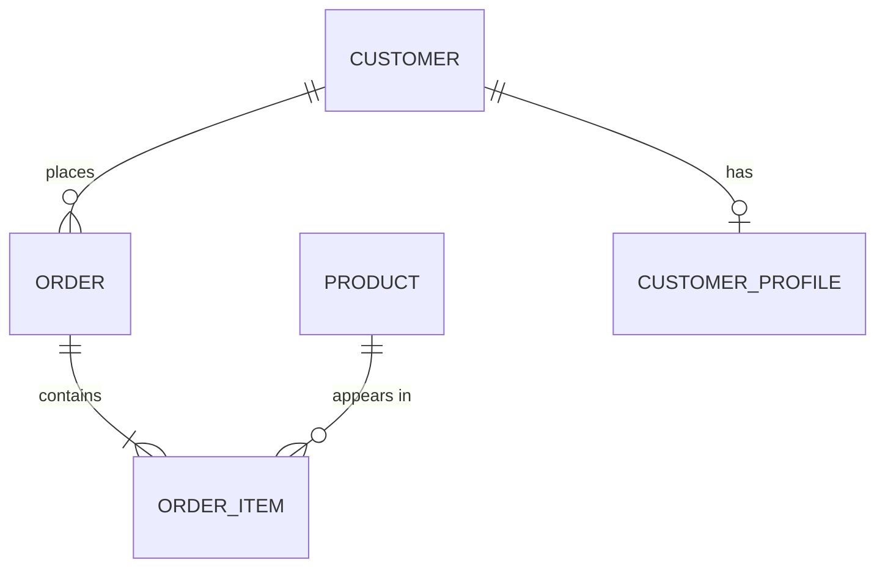

The "let's draw the data model" step comes up in almost every system design interview. A good model answers today's queries quickly and doesn't fall apart when requirements change tomorrow. This lesson covers how to build a schema and how to justify your decisions.

## Access patterns first

Before you start drawing tables, ask two questions:

1. **Which entities exist, and what are the relationships between them?** (customer, order, product)
2. **Which queries will run most often?** ("A user's last 20 orders", "a product's stock level")

In the relational model, the first question determines the schema and the second determines the indexes. In NoSQL models, the second question determines the schema itself; we'll come back to this difference below.

## Relationship types

An e-commerce schema:



| Relationship | Example | How to build it |
| --- | --- | --- |
| One-to-one | Customer – profile | Foreign key + `UNIQUE`; keeping it in the same table is often enough |
| One-to-many | Customer – order | A foreign key on the "many" side: `orders.customer_id` |
| Many-to-many | Order – product | A junction table: `order_items (order_id, product_id, quantity, unit_price)` |

The junction table in a many-to-many relationship is often an entity in its own right, with its own columns: the quantity of the order line and the unit price **at that moment**, for example.

```sql
CREATE TABLE order_items (
    order_id   bigint NOT NULL REFERENCES orders (id) ON DELETE CASCADE,
    product_id bigint NOT NULL REFERENCES products (id),
    quantity   int    NOT NULL CHECK (quantity > 0),
    unit_price numeric(12, 2) NOT NULL,
    PRIMARY KEY (order_id, product_id)
);

-- PostgreSQL doesn't create an index on a foreign key column automatically
CREATE INDEX order_items_product_idx ON order_items (product_id);
```

If you forget the index on a foreign key, deleting a row from the parent table or running the query "orders that contain this product" scans the entire table.

## Choosing keys

| | Natural key | Surrogate key |
| --- | --- | --- |
| Example | Email, ISBN, national ID number | `bigint` counter, UUID |
| Pros | Meaningful, no extra column needed | Never changes, small, independent of business rules |
| Cons | Can change (emails change), sometimes large, may be confidential | Meaningless; natural uniqueness needs a separate `UNIQUE` |

The practical approach: a **surrogate key** as the primary key, plus a separate **unique constraint** for natural uniqueness.

The type of surrogate key:

- **`bigint` identity column:** small, fast, sequential. When exposed externally, it reveals the number and order of records (`/orders/1042` → "there are 1041 other orders").
- **UUID:** unpredictable, can be generated on the client without asking the database, doesn't collide when systems are merged. But it is 16 bytes, and a random UUID (v4) writes to a random page of the B-tree on every insert; in large tables the index no longer fits in the cache. **Time-ordered UUIDv7** solves this problem: new values are appended to the end of the index. PostgreSQL 18 offers a built-in `uuidv7()` function for this.

## Normalization

The goal of normalization: **every piece of information should live in exactly one place.** If the same information lives in several places, three kinds of anomalies arise:

- **Update anomaly:** if a customer's address is repeated in 50 order rows, you have to update all 50 rows when the address changes; miss one and the data contradicts itself.
- **Insertion anomaly:** you can't record a customer who doesn't have an order yet.
- **Deletion anomaly:** deleting a customer's last order deletes the customer as well.

A badly designed table:

| order_id | customer_name | customer_city | products |
| --- | --- | --- | --- |
| 1 | Ada | Izmir | Keyboard, Mouse |
| 2 | Ada | Izmir | Monitor |

Normal forms remove these problems step by step:

| Form | Rule | The violation in this table |
| --- | --- | --- |
| **1NF** | Each cell holds a single value; no repeating groups | A comma-separated list in the `products` column |
| **2NF** | Every non-key column depends on the **whole** key | In a table keyed by `(order_id, product_id)`, the product name depends only on `product_id` |
| **3NF** | No non-key column depends on another non-key column | `customer_city` depends on the customer, not on the order key |

A memorable summary: **every non-key column must depend on the key, the whole key, and nothing but the key.** Most applications aim for 3NF.

The corrected version is the schema above: `customers`, `orders`, `products`, `order_items`.

## Deliberate denormalization

Normalization makes writes safe; reads, on the other hand, require more joins. In read-heavy systems, it makes sense to repeat some information **on purpose**:

- **Counters:** keeping a `comment_count` for each post is cheaper than running `COUNT(*)` on every view.
- **Summary tables and materialized views:** daily sales reports.
- **Read models:** a search index or a cache is a copy derived from the primary database.

The cost: **keeping the copies consistent** is now your job. Options: update them within the same transaction, use a trigger, or update them asynchronously with events and accept brief inconsistency. When you propose denormalization in an interview, always state this cost and the method you chose.

A subtlety: `order_items.unit_price` is **not** denormalization. A product's current price and its price at the time of the order are different pieces of information; storing the price at order time is mandatory. The same applies to the shipping address: when a customer changes their address, the address on old orders must not change.

## Constraints: let the database protect the rules

Validation in application code is necessary but not sufficient. Two concurrent requests pass the "is this email already registered?" check at the same time, and both get registered. Only the database can enforce the rule **atomically**.

```sql
CREATE TABLE users (
    id         bigint GENERATED ALWAYS AS IDENTITY PRIMARY KEY,
    email      text NOT NULL,
    balance    numeric(12, 2) NOT NULL DEFAULT 0 CHECK (balance >= 0),
    created_at timestamptz NOT NULL DEFAULT now()
);

CREATE UNIQUE INDEX users_email_key ON users (lower(email));
```

| Constraint | Protects |
| --- | --- |
| `NOT NULL` | Required fields |
| `UNIQUE` | Uniqueness, even with concurrent inserts |
| `CHECK` | Row-level rules (`quantity > 0`) |
| `FOREIGN KEY` | That no nonexistent record is referenced; deletion behavior with `ON DELETE CASCADE / RESTRICT / SET NULL` |

## The right data type

| Data | Use | Avoid |
| --- | --- | --- |
| Money | `numeric(12, 2)` or an integer in the smallest unit (cents) | `float`, `double`: `0.1 + 0.2` is not exactly `0.3` |
| Timestamp | `timestamptz` (stored as UTC) | `timestamp` without a time zone: which zone it is in stays ambiguous |
| Text | `text` in PostgreSQL; `CHECK (length(x) <= n)` if needed | An arbitrary `varchar(255)`: there is no performance difference in PostgreSQL |
| Status | `text` + `CHECK`, or a separate lookup table | Magic numbers with undocumented meaning |
| Semi-structured data | `jsonb` (with a GIN index if needed) | Putting everything in `jsonb`; fields that are queried or need constraints should be columns |

## Deletion strategy

- **Hard delete** (`DELETE`): simple, but irreversible, and history is lost.
- **Soft delete** (`deleted_at timestamptz`): reversible, and an audit trail remains. The cost: **every** query must include `WHERE deleted_at IS NULL` (forget it and deleted data shows up), and unique constraints must be written as partial indexes: `CREATE UNIQUE INDEX ... ON users (email) WHERE deleted_at IS NULL`.

For personal data, legal erasure obligations (KVKK, GDPR) mean soft delete alone is not enough; the data must actually be deleted or anonymized.

## Relational or NoSQL?

| Type | Examples | Strength | Weakness |
| --- | --- | --- | --- |
| **Relational** | PostgreSQL, MySQL, SQL Server | Flexible queries, joins, transactions, constraints | Horizontal scaling (sharding) is laborious |
| **Document** | MongoDB | Nested data comes back in a single read, flexible schema | Weak at relationships and joins across documents |
| **Key-value** | Redis, DynamoDB | Very fast access by key, easy scaling | No queries other than by key, or very limited ones |
| **Wide-column** | Cassandra, ScyllaDB | Very high write volume, multi-region | Queries must be designed up front; no joins |
| **Graph** | Neo4j | Multi-hop relationship queries ("friend of a friend") | Not suited to general-purpose workloads |

A defensible default in an interview: **start with a relational database.** A single PostgreSQL instance, with good indexes and read replicas, carries very large loads. Move to NoSQL with a concrete reason:

- The write volume exceeds the capacity of a single node, and the access pattern is simple (e.g. everything is read by `user_id`).
- The data is naturally a document or a graph.
- Multi-region, low-latency writes are a must, and eventual consistency is acceptable.

In NoSQL modeling the thinking is reversed: first you list the **queries**, then you lay out the data (repeating it if necessary) so that each query is answered in a single read. A new query often means a new table or index.

## Summary

- Start modeling with the entities and the most frequent queries.
- In one-to-many, the foreign key goes on the "many" side; in many-to-many, into a junction table; add indexes on foreign keys.
- A surrogate primary key + a natural unique constraint. If you need UUIDs on large tables, use UUIDv7.
- Keep each piece of information in one place with 3NF; denormalize deliberately for read performance and say how you'll keep things consistent.
- Have the database enforce rules with constraints; `numeric` for money, `timestamptz` for time.
- The default is relational; choose NoSQL with a concrete scale or access-pattern reason.
