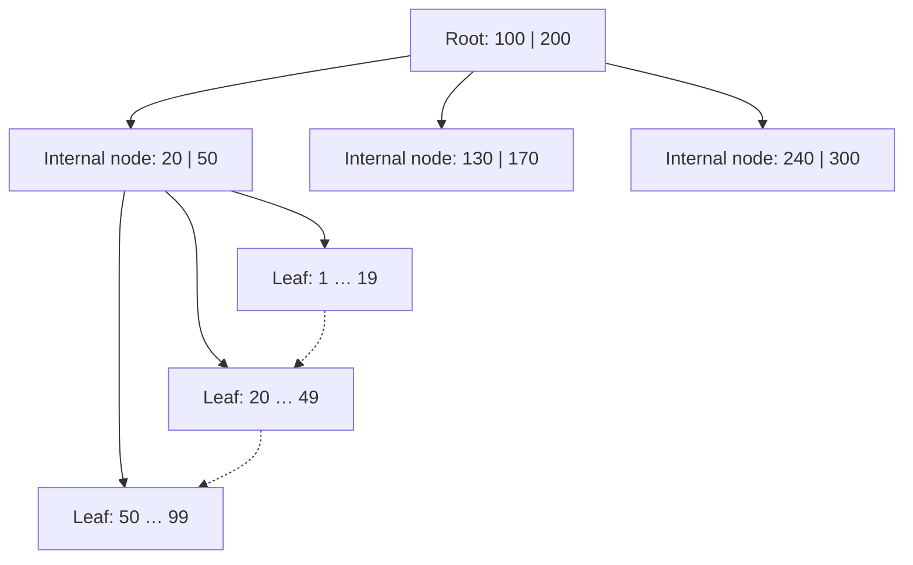

The first answer to "the query is slow, what do you do?" is usually "I add an index." What the interviewer really wants to hear is the next sentence: **on which columns, in what order, and at what cost?** This lesson answers that question. The examples are written for PostgreSQL; the concepts are the same in all relational databases.

## Without an index

Without an index, the query `WHERE customer_id = 42` reads **every row** of the table (a sequential scan): O(n). To find 12 matching rows in a table of one million rows, 999,988 rows are read for nothing.

An index is a separate data structure that keeps column values **sorted** and points to where each value lives in the table. It's like the index at the back of a book: you find the topic in an alphabetical list and go straight to the page.

## B-tree

The default index type in relational databases is the B-tree (in PostgreSQL, a variant of the B+ tree). It is a balanced, wide and shallow tree:



- Each node is a disk page (8 KB in PostgreSQL) and holds hundreds of keys. That's why, even for millions of rows, the height of the tree is usually **3–4**; a lookup finishes after reading a few pages: O(log n).
- The leaves are sorted and linked to each other. Thanks to this, a B-tree supports not only equality but also **ranges**: `=`, `<`, `>`, `BETWEEN`, `IN`, `ORDER BY` and `IS NULL`.
- A leaf doesn't hold the row itself but its **location** in the table. For each row found through the index, there is a separate trip to the table (a "heap fetch" in PostgreSQL).

## The cost of an index

An index isn't free:

- **Writes get slower.** Every `INSERT` adds a new entry to **all** indexes on the table; an `UPDATE` that changes an indexed column updates the indexes too. Writing to a table with ten indexes is noticeably more expensive than writing to one with a single index.
- **It takes up space.** Indexes occupy space on disk and in memory (the cache); large indexes can push hot data out of memory.
- **An unused index is pure harm.** In PostgreSQL, the `idx_scan` column in the `pg_stat_user_indexes` view shows indexes that are never used.

Rule: add indexes **based on queries**, not on columns. "An index on every column" is not a design.

## Composite indexes and column order

An index on multiple columns sorts values **by the first column, then by the second column for ties**, like a phone book sorted first by last name and then by first name.

```sql
CREATE INDEX orders_customer_created_idx ON orders (customer_id, created_at);
```

| Query condition | Is the index used efficiently? |
| --- | --- |
| `customer_id = 42` | Yes (leftmost prefix) |
| `customer_id = 42 AND created_at > '2026-01-01'` | Yes, with both columns |
| `customer_id = 42 ORDER BY created_at DESC` | Yes; the ordering also comes from the index, no separate `Sort` |
| `created_at > '2026-01-01'` | Usually not |
| `customer_id > 40 AND created_at = '2026-01-01'` | Partially: the lookup uses only the `customer_id` range, and `created_at` is filtered separately on each row |

To find "everyone whose first name is Ada" in a phone book, you have to scan the whole book; a composite index is the same. This is called the **leftmost prefix rule**. (The "skip scan" introduced in PostgreSQL 18 can use a composite index even when there is no condition on the first column, but it is only efficient if the first column has few distinct values. Don't base your design on it.)

A practical rule for column order:

1. Columns queried with **equality** first,
2. then the column queried with a **range** or used for **sorting**.

Once a range condition starts on a column, the columns after it can no longer be used for the lookup, only for filtering.

## Covering indexes

If all the columns a query needs are inside the index, the database can answer without going to the table at all (an **index-only scan** in PostgreSQL):

```sql
CREATE INDEX orders_customer_created_total_idx
    ON orders (customer_id, created_at) INCLUDE (total);

-- Can be answered without going to the table
SELECT created_at, total FROM orders WHERE customer_id = 42;
```

Columns added with `INCLUDE` are not used for searching; they are only carried in the leaf. In PostgreSQL, an index-only scan truly skips the table only when the table's visibility map is up to date (that is, when `VACUUM` runs regularly).

## Why the index isn't used

If an index exists but the plan still shows a `Seq Scan`, the reason is usually one of these:

| Reason | Example | Solution |
| --- | --- | --- |
| The column is wrapped in a function | `WHERE lower(email) = 'ada@example.com'` | An expression index: `CREATE INDEX ON users (lower(email))` |
| A leading wildcard | `WHERE name LIKE '%can'` | A trigram index (`pg_trgm` + GIN) or full-text search |
| A date function | `WHERE date(created_at) = '2026-11-15'` | Write a range: `created_at >= '2026-11-15' AND created_at < '2026-11-16'` |
| Low selectivity | `WHERE status = 'active'` and 90% of rows are active | Correct behavior; reading most of the table is cheaper with a full scan |
| Stale statistics | After a bulk load the planner misestimates row counts | `ANALYZE orders` |
| The first column of a composite index is missing | A `(customer_id, created_at)` index with only a `created_at` condition | A separate index that fits the query |

The selectivity point is important: going to each row individually through an index means **random** reads. If the result is a large part of the table, reading the table **sequentially** from start to finish is faster. The planner makes this decision based on table statistics. Between the two extremes is the **bitmap scan**: first the pages of the matching rows are collected from the index, then the pages are read in disk order.

## Other index types

| Type | For |
| --- | --- |
| **B-tree** | The default; equality, ranges, sorting |
| **Hash** | Equality only; a B-tree is usually enough |
| **GIN** | Multiple values in one row: `jsonb`, arrays, full-text search |
| **GiST** | Geometry, range types, nearest neighbor |
| **BRIN** | Very large tables whose physical order is naturally ordered (time series); very small |

Two more useful forms:

```sql
-- Partial index: only non-deleted records; small and fast
CREATE INDEX users_active_email_idx ON users (email) WHERE deleted_at IS NULL;

-- Unique index: the database enforces the rule
CREATE UNIQUE INDEX users_email_key ON users (lower(email));
```

## Reading EXPLAIN ANALYZE

`EXPLAIN` shows the planner's **estimate**; `EXPLAIN ANALYZE` **actually runs** the query and shows the measured values. (`ANALYZE` really runs `UPDATE` and `DELETE` queries as well; when experimenting, do it inside a transaction and roll back.)

```sql
EXPLAIN ANALYZE SELECT * FROM orders WHERE customer_id = 42;
```

Without an index (output shortened):

```text
Seq Scan on orders  (cost=0.00..21846.00 rows=10 width=48) (actual time=0.51..61.20 rows=12 loops=1)
  Filter: (customer_id = 42)
  Rows Removed by Filter: 999988
Execution Time: 61.23 ms
```

After `CREATE INDEX ON orders (customer_id);`:

```text
Index Scan using orders_customer_id_idx on orders  (cost=0.42..44.61 rows=10 width=48) (actual time=0.03..0.05 rows=12 loops=1)
  Index Cond: (customer_id = 42)
Execution Time: 0.07 ms
```

How to read it:

- **Node type:** `Seq Scan`, `Index Scan`, `Index Only Scan`, `Bitmap Heap Scan`, `Sort`, `Hash Join`… The plan is a tree; the innermost (most indented) nodes run first.
- **`cost=startup..total`:** the planner's unitless cost estimate. It isn't milliseconds; it is only useful for comparing plans.
- **`rows` (estimate) and `actual … rows` (actual):** if there's a big gap between them (10 estimated, 100,000 actual), the planner is deciding on wrong information. The first suspect is stale statistics.
- **`Rows Removed by Filter`:** rows read and then discarded. If this is large, an index is missing or wrong.
- **`loops`:** how many times the node ran. Time and row values are per loop; an inner node with `loops=10000` may look fast on its own but be slow in total.

### Join algorithms

| Algorithm | How | When it's good |
| --- | --- | --- |
| **Nested Loop** | A lookup on the inner side for each outer row | The outer side is small and the inner side has an index |
| **Hash Join** | A hash table is built in memory from the smaller side, and the larger side is scanned | Large, unsorted sets; equality conditions |
| **Merge Join** | Both sides are merged like a zipper while sorted | Both sides are already sorted (e.g. from an index) |

## Pagination: the OFFSET trap

```sql
SELECT * FROM orders ORDER BY created_at DESC LIMIT 20 OFFSET 100000;
```

`OFFSET 100000` means the database finds 100,020 rows and **throws away** the first 100,000; the query gets slower as you page further. On top of that, if new records are inserted between pages, rows shift and the same record shows up on two pages.

The solution is **keyset** ("seek") pagination: you continue from the last row of the previous page.

```sql
SELECT * FROM orders
WHERE (created_at, id) < ('2026-11-14 18:30:00+00', 812345)
ORDER BY created_at DESC, id DESC
LIMIT 20;
```

With an index on `(created_at, id)`, every page comes back at the same speed. The cost: you can't "jump to page 47"; you can only go forward and backward. It's ideal for infinite scrolling and API pagination. `id` is added to break ties, so two rows with the same timestamp aren't lost.

## The slow query question in an interview

1. **Measure:** get the plan with `EXPLAIN ANALYZE`; compare the estimated and actual row counts.
2. **Find the bottleneck:** which node takes the most time? A scan that reads and discards many rows, a large sort, a loop that runs thousands of times?
3. **An index that fits the query:** equality columns first, the range or sort column after; `INCLUDE` if needed.
4. **Fix the query:** don't wrap the column in a function, select the columns you need instead of `SELECT *`, use keyset pagination instead of `OFFSET`.
5. **State the cost:** mention the write cost of the new index and the space it will take.

## Summary

- A B-tree index is sorted and shallow: it handles equality, ranges and sorting in O(log n).
- Every index slows down writes and takes up space; add indexes based on queries.
- The leftmost prefix rule applies to composite indexes: equality columns first, the range column after.
- Wrapping a column in a function, leading wildcards and low selectivity prevent index use.
- In `EXPLAIN ANALYZE`, compare estimated and actual row counts; a big gap means stale statistics.
- For deep pagination, use keyset pagination instead of `OFFSET`.
