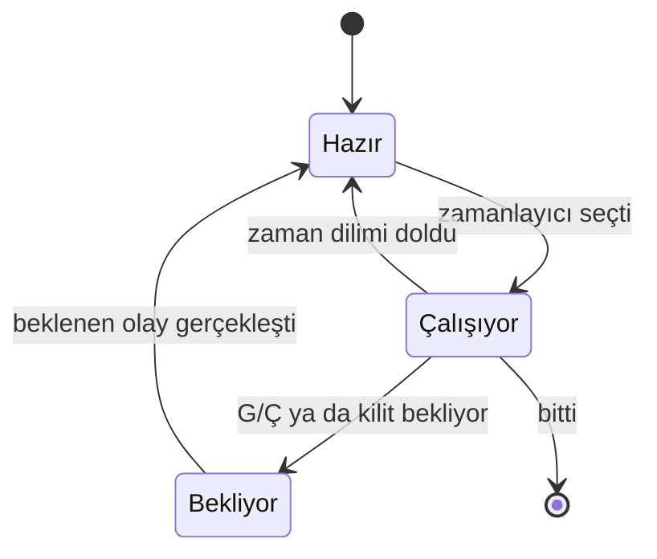

"Süreç ile thread arasındaki fark nedir?" sorusu stajyerden kıdemli mühendise kadar her seviyede sorulur. Kıdem arttıkça beklenen yanıt derinleşir: bellek nasıl paylaşılır, bağlam değiştirmenin bedeli nedir, eşzamanlı kod neden yanlış sonuç üretir. Bu ders bu zinciri baştan sona kurar.

## Süreç ve thread

**Süreç** (process), çalışan bir programın örneğidir. İşletim sistemi her sürece kendi **sanal adres alanını**, açık dosyalarını ve diğer kaynaklarını verir. Bir süreç başka bir sürecin belleğini doğrudan okuyamaz; biri çöktüğünde diğerleri etkilenmez.

**Thread**, bir süreç içindeki yürütme birimidir. Her süreçte en az bir thread vardır. Aynı sürecin thread'leri belleği **paylaşır**; her thread'in yalnızca kendine ait yığını (stack), yazmaçları ve program sayacı vardır.

| | Süreç | Thread |
| --- | --- | --- |
| Bellek | Kendi adres alanı | Sürecin öbeğini (heap) ve global verisini paylaşır |
| Kendine ait | Adres alanı, dosya tanıtıcıları, ortam | Yığın, yazmaçlar, program sayacı |
| Oluşturma maliyeti | Yüksek | Düşük |
| Haberleşme | Süreçler arası iletişim (pipe, soket, paylaşılan bellek) | Doğrudan paylaşılan bellek (senkronizasyon gerekir) |
| Yalıtım | Güçlü: biri çökerse diğeri yaşar | Zayıf: bir thread'in hatası bütün süreci düşürebilir |

Bu fark mimari kararlara yansır. Tarayıcılar her sekmeyi ayrı bir süreçte çalıştırır: bir sayfa çöktüğünde ya da saldırıya uğradığında diğer sekmeler korunur. Bir web sunucusu ise istekleri aynı süreçteki thread'lerle karşılar: paylaşılan önbellek ve bağlantı havuzu ucuzdur.

## Zamanlama ve bağlam değiştirme

Bir işlemci çekirdeği aynı anda tek bir thread çalıştırır. İşletim sisteminin zamanlayıcısı (scheduler) çekirdekleri thread'ler arasında paylaştırır ve her thread şu durumlardan birindedir:



Çekirdeğin bir thread'den diğerine geçmesine **bağlam değiştirme** (context switch) denir: yazmaçlar kaydedilir, diğer thread'inkiler yüklenir. Geçiş farklı süreçler arasındaysa sanal bellek eşlemesi de değişir ve adres çevirisi önbelleği (TLB) büyük ölçüde boşa çıkar; bu yüzden süreçler arası geçiş daha pahalıdır. Tek bir geçiş mikrosaniyeler mertebesindedir, ama binlerce thread'li bir sistemde işlemci zamanının kayda değer bir kısmı iş yapmak yerine geçişe harcanabilir.

### Eşzamanlılık ve paralellik

- **Eşzamanlılık** (concurrency): birden çok işin aynı zaman diliminde **ilerlemesi**. Tek çekirdekte bile mümkündür; işler sırayla dilimlenir.
- **Paralellik** (parallelism): birden çok işin aynı **anda** çalışması. Birden çok çekirdek gerektirir.

### İşlemciye bağlı ve G/Ç'ye bağlı iş

| | İşlemciye bağlı (CPU-bound) | G/Ç'ye bağlı (I/O-bound) |
| --- | --- | --- |
| Örnek | Görüntü işleme, sıkıştırma, şifreleme | Veritabanı sorgusu, HTTP çağrısı, dosya okuma |
| Darboğaz | İşlemci | Bekleme süresi |
| Doğru araç | Çekirdek sayısı kadar thread ile paralellik | Asenkron G/Ç: bekleyen iş thread tutmaz |

Bir web sunucusu zamanının çoğunu veritabanını ve diğer servisleri bekleyerek geçirir. Her istek için bir thread ayırıp bekletmek pahalıdır: her thread'in genellikle megabaytlarla ölçülen bir yığın alanı ayrılır ve binlerce thread'in zamanlanması bağlam değiştirme maliyetini artırır. C#'taki `async/await`, JavaScript'in event loop'u, Go'nun goroutine'leri ve Java'nın sanal thread'leri bu sorunun farklı çözümleridir: beklemedeki iş bir işletim sistemi thread'ini meşgul etmez.

## Sanal bellek

Her süreç, sanki makinenin bütün belleği kendisininmiş gibi büyük ve kesintisiz bir **sanal adres alanı** görür. İşletim sistemi ve işlemcideki bellek yönetim birimi (MMU) bu adresleri fiziksel belleğe çevirir.

- Bellek, genellikle 4 KB'lık **sayfalara** bölünür. Her sürecin bir **sayfa tablosu** vardır; sanal sayfayı fiziksel çerçeveye eşler.
- Çeviriyi hızlandırmak için işlemci son çevirileri **TLB** adlı küçük bir önbellekte tutar.
- Süreç, fiziksel bellekte olmayan bir sayfaya eriştiğinde **sayfa hatası** (page fault) oluşur. İşletim sistemi sayfayı bulur (ilk kez kullanılıyorsa sıfırlanmış bir sayfa ayırır, takas alanındaysa diskten okur) ve süreç kaldığı yerden devam eder. Diskten okuma gerektiren sayfa hataları çok yavaştır.

Sanal belleğin kazandırdıkları:

- **Yalıtım:** bir süreç başka bir sürecin sayfalarını adresleyemez.
- **Paylaşım:** aynı kütüphane, birçok sürecin adres alanına tek bir fiziksel kopya olarak eşlenir.
- **Yazınca kopyala** (copy-on-write): Unix'te `fork()` ile oluşan alt süreç, üst sürecin sayfalarını kopyalamadan paylaşır; sayfa ancak biri yazdığında kopyalanır.
- **Fiziksel bellekten büyük adres alanı:** az kullanılan sayfalar diske taşınabilir (swap). Bellek gerçekten yetmediğinde sistem sürekli sayfa taşımaya başlar ve neredeyse durur (thrashing).

### Süreç belleğinin düzeni

| Bölge | İçerik |
| --- | --- |
| Kod (text) | Programın makine kodu; salt okunur |
| Veri | Global ve statik değişkenler |
| Öbek (heap) | Dinamik olarak ayrılan nesneler (`new`); çöp toplayıcı ya da programcı yönetir |
| Yığın (stack) | Her thread için ayrı: fonksiyon çağrı çerçeveleri, yerel değişkenler, dönüş adresleri |

Yığın her çağrıda büyür ve dönüşte küçülür; boyutu sınırlıdır (genellikle 1–8 MB). Sonlanmayan ya da çok derin özyineleme bu sınırı aşar: **stack overflow**. Çok derin olabilecek bir ağaçta özyinelemeli DFS yerine açık bir yığınla yinelemeli DFS yazmanın sebebi budur.

## Bellek hiyerarşisi

Hız ile kapasite ters orantılıdır. Yaklaşık mertebeler:

| Erişim | Süre |
| --- | --- |
| L1 önbellek | ~1 ns |
| L2 önbellek | ~4 ns |
| L3 önbellek | ~10–40 ns |
| Ana bellek (RAM) | ~100 ns |
| NVMe SSD'den rastgele okuma | ~20–100 µs |
| Aynı veri merkezinde ağ gidiş-dönüşü | ~0,5 ms |
| Dönen diskte arama | ~10 ms |
| Kıtalar arası ağ gidiş-dönüşü | ~150 ms |

İki sonucu vardır:

- **Bellekten okumak, ağdan okumaktan binlerce kat hızlıdır.** Önbelleğin, sistem tasarımında neden bu kadar merkezi olduğu buradan gelir.
- **Yerellik önemlidir.** İşlemci bellekten tek tek bayt değil, 64 baytlık **önbellek satırları** getirir. Bir diziyi sırayla dolaşmak, aynı sayıda elemanı olan bir bağlı listeyi dolaşmaktan genellikle çok daha hızlıdır: dizi elemanları ardışıktır; bağlı liste düğümleri ise belleğe dağılmıştır ve her adım bir önbellek ıskalamasına yol açabilir. Büyük-O aynı olsa da gerçek süre farklıdır.

## Yarış durumu

Paylaşılan veriye birden çok thread aynı anda eriştiğinde ve en az biri yazdığında sonuç, thread'lerin hangi sırayla çalıştığına bağlı hale gelir. Buna **yarış durumu** (race condition) denir.

```csharp
int counter = 0;
Parallel.For(0, 1_000_000, _ => counter++);
Console.WriteLine(counter);   // genellikle 1.000.000'dan küçük
```

`counter++` tek bir işlem gibi görünür ama üç adımdır: **oku, bir ekle, geri yaz**. İki thread aynı değeri (ör. 41) okur, ikisi de 42 yazar; bir artış kaybolur. Bu, veritabanındaki kayıp güncelleme sorununun bellekteki karşılığıdır.

Düzeltmenin yolları:

```csharp
// 1) Atomik işlem: işlemcinin tek adımda yaptığı artırma
Parallel.For(0, 1_000_000, _ => Interlocked.Increment(ref counter));

// 2) Kilit: kritik bölgeye aynı anda tek thread girer
var gate = new Lock();
Parallel.For(0, 1_000_000, _ => { lock (gate) { counter++; } });
```

En iyi çözüm çoğu zaman **paylaşmamaktır**: her thread kendi yerel toplamını hesaplar, sonunda toplamlar birleştirilir. Değişmez (immutable) veri de yarış durumunu baştan ortadan kaldırır.

## Senkronizasyon araçları

| Araç | Ne yapar | Örnek kullanım |
| --- | --- | --- |
| **Kilit / mutex** | Kritik bölgeye aynı anda tek thread | Paylaşılan bir sözlüğü güncellemek |
| **Semafor** | Aynı anda en fazla N thread | Bir servise en fazla 10 eşzamanlı istek |
| **Okuma-yazma kilidi** | Çok okuyucu ya da tek yazar | Sık okunan, seyrek değişen yapılandırma |
| **Koşul değişkeni / sinyal** | Bir koşul gerçekleşene kadar bekle | Üretici-tüketici kuyruğunda "kuyruk boş değil" |
| **Atomik işlemler** | Tek bir değişkeni kilitsiz güncelle | Sayaçlar, bayraklar |

Kilit tutulan süre kısa olmalıdır. Kilit içinde G/Ç beklemek, bütün diğer thread'leri o G/Ç'ye bağlar.

## Deadlock

İki ya da daha fazla thread, her biri diğerinin tuttuğu kaynağı bekleyerek sonsuza dek kilitlenir:

```text
Thread A: kilit 1'i alır  →  kilit 2'yi bekler
Thread B: kilit 2'yi alır →  kilit 1'i bekler
```

Deadlock için **dört koşulun aynı anda** sağlanması gerekir (Coffman koşulları):

1. **Karşılıklı dışlama:** kaynak aynı anda tek bir thread tarafından tutulabilir.
2. **Tut ve bekle:** thread bir kaynağı tutarken başka bir kaynağı bekler.
3. **Zorla geri alınamama:** tutulan kaynak thread'den zorla alınamaz.
4. **Döngüsel bekleme:** thread'ler bir döngü oluşturacak şekilde birbirini bekler.

Birini kırmak deadlock'u önler. Pratikte en çok kullanılan yöntemler:

- **Kilitleri her zaman aynı sırayla alın** (döngüsel beklemeyi kırar). İki hesap arasında transferde önce kimliği küçük olan hesabı kilitlemek gibi.
- **Zaman aşımıyla kilit deneyin** (`Monitor.TryEnter`, `SemaphoreSlim.WaitAsync(timeout)`): alınamazsa tuttuklarınızı bırakıp yeniden deneyin.
- **Aynı anda birden fazla kilit tutmaktan kaçının;** gerekiyorsa hepsini tek seferde alın.

İki yakın kavram:

- **Livelock:** thread'ler bloke olmaz ama birbirine yol vermeye çalışırken hiç ilerlemez; koridorda karşılaşıp ikisi de aynı yöne çekilen iki kişi gibi.
- **Açlık** (starvation): bir thread, diğerleri sürekli önceliği kaptığı için kaynağa hiç erişemez.

## Özet

- Süreçlerin adres alanı ayrıdır; thread'ler sürecin belleğini paylaşır, yalnızca yığınları kendilerinindir.
- Bağlam değiştirme bedavaya değildir; G/Ç'ye bağlı işte thread çoğaltmak yerine asenkron G/Ç kullanılır.
- Sanal bellek yalıtım, paylaşım ve yazınca kopyalama sağlar; sayfa hatası diskten okuma gerektirirse çok pahalıdır.
- Bellek hiyerarşisinde her basamak bir mertebe yavaşlar; yerellik gerçek performansı belirler.
- `counter++` atomik değildir; atomik işlem, kilit ya da paylaşmamak gerekir.
- Deadlock'un dört koşulu vardır; kilitleri tutarlı sırayla almak döngüsel beklemeyi kırar.
