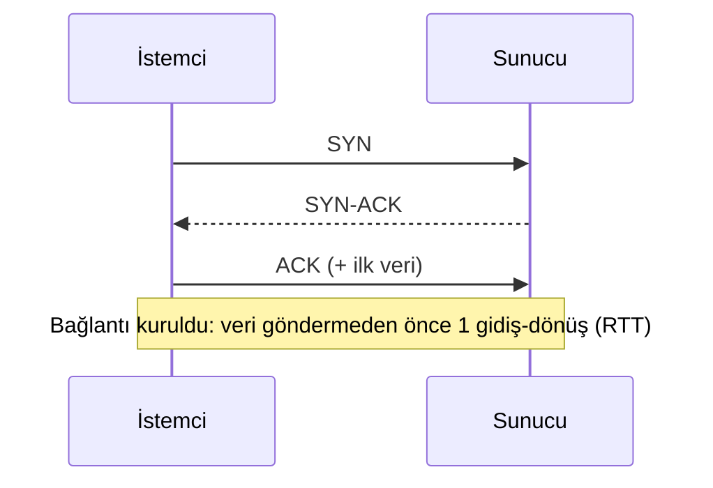

Backend mühendisinin yazdığı hemen her şey ağın üzerinde çalışır: API'ler, veritabanı bağlantıları, servisler arası çağrılar. Gecikmenin nereden geldiğini, bir bağlantının neden yavaş açıldığını ya da 502 ile 504 arasındaki farkı bilmek hem mülakatta hem üretimde hata ayıklarken işe yarar.

## Katmanlar

Ağ, her biri bir alttakinin üzerine kurulan katmanlardan oluşur. Pratikte kullanılan model TCP/IP modelidir:

| Katman | Görevi | Örnekler | Adres |
| --- | --- | --- | --- |
| Uygulama | Uygulamaya özgü protokol | HTTP, DNS, SMTP, gRPC | URL, alan adı |
| Taşıma | Süreçten sürece iletim | TCP, UDP, QUIC (UDP üzerinde) | Port |
| Ağ (internet) | Makineden makineye, ağlar arası yönlendirme | IP (IPv4, IPv6) | IP adresi |
| Bağlantı | Aynı fiziksel ağ içinde iletim | Ethernet, Wi-Fi | MAC adresi |

Yedi katmanlı OSI modeli kavramsal bir başvurudur; "L4 yük dengeleyici" (taşıma katmanında, TCP bağlantılarını dağıtır) ya da "L7 yük dengeleyici" (uygulama katmanında, HTTP yoluna ve başlıklarına bakar) gibi terimler oradan gelir.

**IP** paketleri "elinden geleni yaparak" iletir: paketler kaybolabilir, yinelenebilir ya da sırası karışabilir. Güvenilirlik bir üst katmanın işidir.

## TCP ve UDP

| | TCP | UDP |
| --- | --- | --- |
| Bağlantı | Var (el sıkışma) | Yok |
| Güvenilirlik | Kaybolan paket yeniden gönderilir | Garanti yok |
| Sıra | Korunur | Korunmaz |
| Akış ve tıkanıklık denetimi | Var | Yok |
| Ek yük ve gecikme | Daha yüksek | Düşük |
| Kullanım | Web, veritabanı, e-posta, dosya aktarımı | DNS sorguları, görüntülü görüşme, oyunlar, QUIC |

### TCP üçlü el sıkışma



Bu yüzden yeni bağlantı açmak pahalıdır, özellikle istemci ile sunucu arasındaki mesafe büyükse. **Bağlantı havuzu** ve **keep-alive** (bağlantıyı yeniden kullanmak) bu maliyeti ortadan kaldırır. Uygulamada her istek için yeni bir `HttpClient` oluşturmamanın bir sebebi de budur.

TCP'nin diğer mekanizmaları:

- **Akış denetimi:** alıcı, ne kadar veri alabileceğini (pencere boyutu) bildirir; hızlı gönderici yavaş alıcıyı boğmaz.
- **Tıkanıklık denetimi:** gönderici ağın kapasitesini yoklar; yeni bağlantı yavaş başlar ve hızını giderek artırır (slow start). Paket kaybını tıkanıklık işareti sayıp yavaşlar.
- **Sıra başı tıkanması** (head-of-line blocking): bir paket kaybolursa, arkasındaki paketler gelmiş olsa bile uygulamaya kayıp paket yeniden gelene kadar iletilmez.
- **Bağlantı kapatma:** FIN ile kapatılır. Kapatmayı başlatan taraf bağlantıyı bir süre `TIME_WAIT` durumunda tutar; çok kısa ömürlü binlerce bağlantı açan istemcilerde port tükenmesinin sebebi budur.

UDP bu garantilerin hiçbirini vermez. Görüntülü görüşmede gecikmiş bir ses paketini yeniden göndermenin anlamı yoktur; o an geçmiştir. Bu tür uygulamalar için düşük gecikme, güvenilirlikten değerlidir.

## DNS

DNS, alan adını IP adresine çevirir. `www.ornek.com` için:

1. Tarayıcı ve işletim sistemi önbelleğine bakılır.
2. Yoksa yapılandırılmış **çözümleyiciye** (internet sağlayıcısının ya da 1.1.1.1 gibi bir genel çözümleyicinin) sorulur.
3. Çözümleyici, önbelleğinde yoksa sırayla **kök sunuculara** (`.com` kimde?), **TLD sunucularına** (`ornek.com` kimde?) ve alanın **yetkili sunucusuna** sorar.
4. Yanıt, kayıttaki **TTL** süresince her katmanda önbelleğe alınır.

| Kayıt | Anlamı |
| --- | --- |
| `A` / `AAAA` | Alan adı → IPv4 / IPv6 adresi |
| `CNAME` | Alan adı → başka bir alan adı (takma ad) |
| `MX` | Alanın e-posta sunucuları |
| `TXT` | Serbest metin; alan doğrulama, SPF |
| `NS` | Alanın yetkili ad sunucuları |

TTL'in pratik sonucu: DNS kaydını değiştirdiğinizde dünya genelinde yayılması TTL kadar sürebilir. Planlı bir taşıma öncesinde TTL'i birkaç gün önceden düşürmek bu yüzden yaygın bir uygulamadır. DNS, coğrafi yük dağıtımı için de kullanılır: kullanıcıya en yakın veri merkezinin adresi döndürülür.

## TLS

TLS (HTTPS'teki "S") üç şey sağlar:

- **Gizlilik:** aradaki kimse içeriği okuyamaz.
- **Bütünlük:** içerik yolda değiştirilemez; değiştirilirse fark edilir.
- **Kimlik doğrulama:** konuştuğunuz sunucu gerçekten `ornek.com`'dur. Sunucu, güvenilir bir sertifika otoritesinin (CA) imzaladığı bir **sertifika** sunar; tarayıcı imza zincirini kendi güvendiği kök sertifikalara kadar doğrular.

TLS 1.3 el sıkışması kabaca şöyledir:

1. İstemci, desteklediği şifre takımlarını ve bir anahtar değişimi parçasını gönderir.
2. Sunucu kendi anahtar değişimi parçasını, sertifikasını ve el sıkışmanın imzasını döndürür.
3. İki taraf, ağdan hiç geçmeyen ortak bir **oturum anahtarı** türetir; bundan sonra bütün veri bu anahtarla şifrelenir.

Neden iki tür şifreleme birlikte kullanılır? **Asimetrik** şifreleme (açık/özel anahtar) güvenli olmayan bir kanalda anahtar üzerinde anlaşmayı ve kimlik doğrulamayı mümkün kılar ama yavaştır. **Simetrik** şifreleme (AES-GCM, ChaCha20) çok hızlıdır ama iki tarafın aynı anahtarı bilmesini gerektirir. TLS asimetrik yöntemi yalnızca el sıkışmada kullanır, veriyi simetrik anahtarla şifreler.

Her bağlantı için yeni geçici anahtarlar üretildiğinden (ECDHE), sunucunun özel anahtarı ileride çalınsa bile geçmişte kaydedilmiş trafik çözülemez. Buna **ileriye dönük gizlilik** (forward secrecy) denir.

TLS 1.3 el sıkışması 1 RTT sürer (TLS 1.2'de 2 RTT). Daha önce konuşulmuş bir sunucuya **0-RTT** ile ilk istekte veri gönderilebilir; ama bu veri tekrar oynatılabilir (replay), bu yüzden yalnızca idempotent istekler için kullanılmalıdır.

## HTTP

HTTP bir istek-yanıt protokolüdür ve **durumsuzdur**: her istek kendi başına anlaşılabilir olmalıdır. Oturum gibi durumlar çerez ya da belirteçlerle taşınır.

```http
GET /api/problems/iki-sayinin-toplami HTTP/1.1
Host: zirve.example
Accept: application/json
Cookie: session=...

HTTP/1.1 200 OK
Content-Type: application/json
Cache-Control: no-store

{ "slug": "iki-sayinin-toplami", ... }
```

### Yöntemler

| Yöntem | Amaç | Güvenli | Idempotent |
| --- | --- | --- | --- |
| `GET` | Kaynağı oku | Evet | Evet |
| `HEAD` | Yalnızca başlıkları al | Evet | Evet |
| `POST` | Yeni kaynak oluştur ya da işlem başlat | Hayır | **Hayır** |
| `PUT` | Kaynağı bütünüyle değiştir (ya da verilen adreste oluştur) | Hayır | Evet |
| `PATCH` | Kaynağı kısmen değiştir | Hayır | Garanti değil |
| `DELETE` | Kaynağı sil | Hayır | Evet |

- **Güvenli:** sunucuda durum değiştirmez. Tarayıcılar ve tarayıcı eklentileri güvenli istekleri önceden getirebilir; `GET` ile silme yapan bir bağlantı bu yüzden tehlikelidir.
- **Idempotent:** aynı istek bir kez de on kez de gönderilse sunucudaki **son durum** aynıdır. `DELETE /orders/5` ikinci kez çağrıldığında 404 dönebilir; yanıt farklıdır ama durum aynıdır. Ağ hatasında güvenle **yeniden denenebilen** istekler bunlardır. `POST`'u güvenle yeniden denemek için istemcinin bir **idempotency anahtarı** göndermesi gerekir.

### Durum kodları

| Kod | Anlamı | Ne zaman |
| --- | --- | --- |
| `200 OK` | Başarılı | Okuma ya da güncelleme |
| `201 Created` | Oluşturuldu | `POST` ile yeni kaynak; `Location` başlığıyla |
| `204 No Content` | Başarılı, gövde yok | Silme |
| `301` / `308` | Kalıcı yönlendirme | Adres kalıcı olarak değişti; tarayıcı önbelleğe alır |
| `302` / `307` | Geçici yönlendirme | Her seferinde sunucu karar verir |
| `304 Not Modified` | Önbellekteki kopya hâlâ geçerli | Koşullu istek (`If-None-Match`) eşleşti |
| `400 Bad Request` | İstek hatalı | Bozuk JSON, geçersiz alan |
| `401 Unauthorized` | **Kimlik doğrulanmadı** | Oturum yok ya da belirteç geçersiz |
| `403 Forbidden` | **Yetki yok** | Kim olduğunuz biliniyor ama bu işleme izniniz yok |
| `404 Not Found` | Kaynak yok | |
| `409 Conflict` | Mevcut durumla çakışma | Eşzamanlı güncelleme, zaten var olan kayıt |
| `422 Unprocessable Content` | Biçim doğru, içerik geçersiz | İş kuralı doğrulaması |
| `429 Too Many Requests` | Hız sınırı | `Retry-After` başlığıyla |
| `500 Internal Server Error` | Sunucuda beklenmeyen hata | |
| `502 Bad Gateway` | Vekil, arkadaki servisten geçersiz yanıt aldı | Arka servis çöktü ya da bağlantıyı kopardı |
| `503 Service Unavailable` | Servis geçici olarak hizmet veremiyor | Aşırı yük, bakım |
| `504 Gateway Timeout` | Vekil, arkadaki servisten zamanında yanıt alamadı | Arka servis yavaş |

Kural: **4xx istemcinin, 5xx sunucunun** sorunudur. 4xx hatalarını aynen yeniden denemek işe yaramaz (istisna: `429`, `Retry-After` süresi beklendikten sonra yeniden denenebilir); 503 ve 504 gibi geçici 5xx hataları ise aralıklı yeniden denemeyle düzelebilir.

### Önbellek ve çerez başlıkları

- `Cache-Control: max-age=3600` yanıtın bir saat boyunca yeniden sorulmadan kullanılabileceğini söyler; `no-store` hiç saklanmamasını ister.
- `ETag` yanıtın sürüm etiketidir. İstemci sonraki istekte `If-None-Match` ile etiketi gönderir; içerik değişmediyse sunucu gövdesiz `304` döndürür ve bant genişliği kazanılır.
- Oturum çerezleri `HttpOnly` (JavaScript okuyamaz, XSS'e karşı), `Secure` (yalnızca HTTPS) ve `SameSite` (başka sitelerden gelen isteklerde gönderilmez, CSRF'e karşı) ile işaretlenmelidir.

## HTTP sürümleri

| | HTTP/1.1 | HTTP/2 | HTTP/3 |
| --- | --- | --- | --- |
| Taşıma | TCP | TCP | QUIC (UDP üzerinde) |
| Biçim | Metin | İkili çerçeveler | İkili çerçeveler |
| Bir bağlantıda eşzamanlı istek | Pratikte bir; tarayıcılar alan başına ~6 bağlantı açar | Çoklama: tek bağlantıda çok sayıda akış | Çoklama |
| Başlık sıkıştırma | Yok | HPACK | QPACK |
| Sıra başı tıkanması | İstek düzeyinde | Uygulama düzeyinde çözüldü, **TCP düzeyinde sürüyor** | Akışlar birbirinden bağımsız; çözüldü |
| Bağlantı kurulumu | TCP + TLS | TCP + TLS | TLS 1.3 QUIC'e gömülü: tek gidiş-dönüş |

HTTP/2'de tek bir TCP bağlantısı üzerinde çok sayıda istek akar. Ama TCP'de kaybolan tek bir paket, o bağlantıdaki **bütün** akışları bekletir; kayıplı mobil ağlarda bu belirgin bir yavaşlamadır. HTTP/3 bu yüzden TCP'yi bırakıp UDP üzerinde çalışan QUIC'e geçti: kayıp yalnızca ilgili akışı bekletir. QUIC bağlantıları IP adresine değil bağlantı kimliğine bağlı olduğu için telefon Wi-Fi'dan mobil ağa geçtiğinde bağlantı kopmadan devam edebilir.

## Gerçek zamanlı iletişim

| Yöntem | Nasıl | Ne zaman |
| --- | --- | --- |
| Kısa yoklama (polling) | İstemci belirli aralıklarla sorar | Basit; gecikme ve boş istek maliyeti var |
| Uzun yoklama (long polling) | Sunucu yeni veri olana kadar yanıtı bekletir | Eski altyapılarla uyumlu gerçek zamanlılık |
| Server-Sent Events | Sunucudan istemciye tek yönlü, sürekli akış | Bildirimler, canlı skor, ilerleme durumu |
| WebSocket | Tek bağlantı üzerinde çift yönlü, sürekli kanal | Sohbet, çok oyunculu oyunlar, ortak düzenleme |

## Tarayıcıya adres yazınca ne olur

Klasik mülakat sorusu. Kısa ve katmanlı bir yanıt:

1. **Ayrıştırma:** tarayıcı girdiyi URL olarak yorumlar (şema, alan adı, yol). Alan adı HSTS listesindeyse doğrudan HTTPS kullanılır.
2. **DNS:** alan adı IP adresine çevrilir (önbellekler, çözümleyici, kök → TLD → yetkili sunucu).
3. **TCP bağlantısı:** sunucunun 443 numaralı portuna üçlü el sıkışma. (HTTP/3'te bunun yerine QUIC.)
4. **TLS el sıkışması:** sertifika doğrulanır, oturum anahtarı türetilir.
5. **HTTP isteği:** `GET /` isteği başlıklar ve çerezlerle gönderilir.
6. **Sunucu tarafı:** istek CDN'e, yük dengeleyiciye ve uygulama sunucusuna ulaşır; uygulama önbellek ya da veritabanıyla yanıtı hazırlar.
7. **Yanıt:** durum kodu, başlıklar ve HTML döner.
8. **Görüntüleme:** tarayıcı HTML'i ayrıştırıp DOM'u kurar, CSS'i yükler, JavaScript'i çalıştırır, alt kaynaklar için (aynı bağlantıyı yeniden kullanarak) yeni istekler yapar ve sayfayı çizer.

Mülakatçı genellikle bir adımda derinleşmenizi ister: DNS önbellekleri, TLS el sıkışması ya da sunucu tarafındaki mimari. Hepsini yüzeysel geçmek yerine sorulan adımda derine inebilecek kadar hazırlıklı olun.

## Özet

- TCP güvenilir ve sıralı iletim sağlar ama bağlantı kurmak bir gidiş-dönüş sürer; bağlantıları yeniden kullanın. UDP garantisizdir ve düşük gecikme gerektiren işler içindir.
- DNS yanıtları TTL süresince önbellekte kalır; kayıt değişikliklerinin yayılması zaman alır.
- TLS kimlik doğrulama ve anahtar anlaşması için asimetrik, veri için simetrik şifreleme kullanır.
- `GET`, `PUT`, `DELETE` idempotenttir; `POST` değildir. 401 kimlik yok, 403 yetki yok; 4xx istemcinin, 5xx sunucunun hatasıdır.
- HTTP/2 tek bağlantıda çoklama getirdi ama TCP'nin sıra başı tıkanması sürdü; HTTP/3 bunu QUIC ile çözdü.
