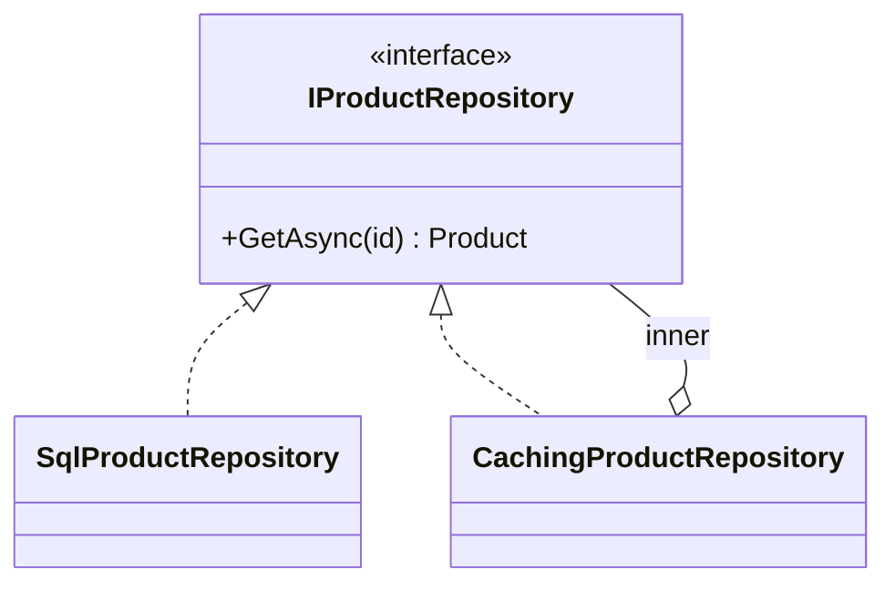

Tasarım desenleri, tekrar tekrar karşılaşılan tasarım sorunlarına verilmiş, adı konmuş çözümlerdir. En büyük faydaları **ortak bir sözlük** sağlamalarıdır: "buraya bir decorator koyalım" cümlesi, birkaç paragraflık açıklamanın yerini tutar. Mülakatta beklenen, desenleri ezbere saymak değil; bir sorunu görünce hangi desenin işe yarayacağını ve bedelini söyleyebilmektir.

Desenler üç gruba ayrılır:

| Grup | Soru | Bu dersteki desenler |
| --- | --- | --- |
| Oluşturucu (creational) | Nesneler nasıl oluşturulur? | Factory, Builder, Singleton |
| Yapısal (structural) | Nesneler nasıl bir araya getirilir? | Adapter, Decorator |
| Davranışsal (behavioral) | Nesneler sorumluluğu nasıl paylaşır? | Strategy, Observer, Command, Chain of Responsibility |

## Strategy

**Sorun:** aynı işin birden çok yapılış biçimi var ve hangisinin kullanılacağı çalışma zamanında belirleniyor. Hepsini `if/switch` ile tek metoda gömmek, her yeni seçenekte o metodu değiştirmeyi gerektirir.

**Çözüm:** her algoritmayı ortak bir arayüzün arkasında ayrı bir sınıfa koymak.

```csharp
public interface IShippingCostStrategy
{
    decimal Calculate(Parcel parcel);
}

public sealed class StandardShipping : IShippingCostStrategy
{
    public decimal Calculate(Parcel parcel) => 30m + parcel.WeightKg * 5m;
}

public sealed class ExpressShipping : IShippingCostStrategy
{
    public decimal Calculate(Parcel parcel) => 80m + parcel.WeightKg * 8m;
}

public sealed class Checkout(IShippingCostStrategy shipping)
{
    public decimal Total(Cart cart) => cart.Subtotal + shipping.Calculate(cart.Parcel);
}
```

.NET'te her yerdedir: `List<T>.Sort(IComparer<T>)` sıralama stratejisini, `StringComparer.OrdinalIgnoreCase` karşılaştırma stratejisini dışarıdan alır. Strateji yalnızca tek bir metotsa bir delege (`Func<Parcel, decimal>`) çoğu zaman sınıftan daha yalındır. ASP.NET Core'da birden çok uygulama arasından anahtarla seçmek için **anahtarlı servisler** kullanılabilir (`AddKeyedSingleton<IShippingCostStrategy, ExpressShipping>("express")`).

## Factory

**Sorun:** hangi somut sınıfın oluşturulacağı bir koşula bağlı ya da oluşturma işi karmaşık. Bu bilgiyi kullanıcı koduna dağıtmak, her yeni tür eklendiğinde birçok yeri değiştirmeyi gerektirir.

**Çözüm:** oluşturma kararını tek bir yerde toplamak.

```csharp
public sealed class PaymentGatewayFactory(IServiceProvider services)
{
    public IPaymentGateway Create(PaymentMethod method) => method switch
    {
        PaymentMethod.Card         => services.GetRequiredService<CardGateway>(),
        PaymentMethod.BankTransfer => services.GetRequiredService<BankTransferGateway>(),
        _ => throw new ArgumentOutOfRangeException(nameof(method)),
    };
}
```

Kullanıcı kod yalnızca `IPaymentGateway` görür; yeni bir ödeme yöntemi eklemek tek bir yeri değiştirir.

.NET'teki en bilinen örnek `IHttpClientFactory`'dir. Her istek için `new HttpClient()` oluşturmak, kapanan bağlantıların soketleri bir süre tutması yüzünden soket tükenmesine yol açabilir; tek bir `HttpClient`'ı sonsuza dek kullanmak ise DNS değişikliklerinin fark edilmemesine sebep olur. Fabrika, alttaki bağlantı işleyicilerini havuzlayıp belirli aralıklarla yenileyerek iki sorunu da çözer. Oluşturma mantığını bir fabrikaya almanın değeri tam olarak budur: karmaşıklık tek yerde kalır.

## Builder

**Sorun:** bir nesnenin çok sayıda isteğe bağlı parçası var. Onlarca parametreli yapıcılar okunmaz; adım adım değiştirilen bir nesne ise yarım kalmış, geçersiz bir durumda kullanılabilir.

**Çözüm:** nesneyi adım adım yapılandıran ayrı bir oluşturucu; son adımda (`Build`) kurallar doğrulanır ve **değişmez** nesne üretilir.

```csharp
var builder = WebApplication.CreateBuilder(args);   // oluşturucu
builder.Services.AddProblemDetails();               // adım adım yapılandırma
builder.Logging.AddConsole();

var app = builder.Build();                          // değişmez uygulama nesnesi
```

ASP.NET Core'un açılışı bu desenin kendisidir: yapılandırma aşaması bittikten sonra servis kayıtları artık değiştirilemez.

Modern C#'ta küçük nesneler için builder çoğu zaman gereksizdir: nesne başlatıcıları, `required` ve `init` üyeleri aynı okunabilirliği sağlar.

```csharp
var options = new RetryOptions
{
    MaxAttempts = 5,                     // required
    Delay = TimeSpan.FromSeconds(1),     // init
};
```

Builder, oluşturmanın gerçekten çok adımlı olduğu ya da parçalar arasında doğrulanması gereken kuralların bulunduğu durumlar içindir.

## Singleton

**Sorun:** bir sınıftan uygulama boyunca tek bir örnek olmalı (yapılandırma, önbellek, bağlantı havuzu).

Klasik uygulaması:

```csharp
public sealed class AppSettings
{
    private static readonly Lazy<AppSettings> instance = new(() => new AppSettings());
    public static AppSettings Instance => instance.Value;    // iş parçacığı güvenli, tembel
    private AppSettings() { }
}
```

Singleton en çok eleştirilen desendir; çünkü:

- **Gizli küresel durumdur.** `AppSettings.Instance` her yerden çağrılabilir; bir metodun neye bağımlı olduğu imzasından anlaşılmaz.
- **Test etmeyi zorlaştırır.** Testlerde sahte bir örnekle değiştirilemez; testler paylaşılan durum yüzünden birbirini etkiler.
- **Eşzamanlılık sorunu taşır.** Tek örnek bütün thread'ler arasında paylaşılır; içindeki değişebilir durum senkronizasyon gerektirir.

Modern uygulamada "tek örnek" ihtiyacı DI kapsayıcısıyla karşılanır: `services.AddSingleton<IClock, SystemClock>()`. Örnek yine tektir; ama sınıf bunu bilmez, bağımlılığı yapıcısından alır ve testte kolayca değiştirilir. Örneğin zamanı doğrudan `DateTime.UtcNow` ile okumak yerine .NET'in `TimeProvider` soyutlamasını enjekte etmek, zamana bağlı kodu test edilebilir kılar.

## Adapter

**Sorun:** kullanmak istediğiniz bir sınıfın (genellikle üçüncü taraf bir kütüphanenin) arayüzü, kodunuzun beklediği arayüze uymuyor ve o sınıfı değiştiremiyorsunuz.

**Çözüm:** iki arayüz arasında çeviri yapan ince bir sarmalayıcı.

```csharp
// Değiştiremediğimiz SDK
public class AcmeSmsClient
{
    public AcmeResponse SendText(string msisdn, string body, bool unicode) { /* ... */ }
}

// Bizim arayüzümüz
public interface INotifier
{
    Task NotifyAsync(User user, string message);
}

public sealed class AcmeSmsNotifier(AcmeSmsClient client) : INotifier
{
    public Task NotifyAsync(User user, string message)
    {
        var response = client.SendText(user.PhoneNumber, message, unicode: true);
        if (!response.Ok) throw new NotificationFailedException(response.ErrorCode);
        return Task.CompletedTask;
    }
}
```

Kazanç: uygulamanın geri kalanı SDK'yı hiç tanımaz. Sağlayıcı değiştiğinde yalnızca adaptör yeniden yazılır; testlerde `INotifier` kolayca sahtelenir. Dış sistemlerle her entegrasyonda bu "yolsuzluk önleyici katman" alışkanlığı işe yarar.

## Decorator

**Sorun:** var olan bir nesneye, onu ve onu kullananları değiştirmeden yeni davranış eklemek (önbellek, günlükleme, yeniden deneme, ölçüm).

**Çözüm:** aynı arayüzü uygulayan ve asıl nesneyi içinde tutan bir sarmalayıcı. İşini yapar ve çağrıyı içteki nesneye iletir.



```csharp
public sealed class CachingProductRepository(IProductRepository inner, IMemoryCache cache)
    : IProductRepository
{
    public Task<Product?> GetAsync(int id) =>
        cache.GetOrCreateAsync($"product:{id}", entry =>
        {
            entry.AbsoluteExpirationRelativeToNow = TimeSpan.FromMinutes(5);
            return inner.GetAsync(id);
        });
}

// Kayıt: kullanıcı kod IProductRepository ister, önbellekli sürümü alır
builder.Services.AddScoped<SqlProductRepository>();
builder.Services.AddScoped<IProductRepository>(sp => new CachingProductRepository(
    sp.GetRequiredService<SqlProductRepository>(),
    sp.GetRequiredService<IMemoryCache>()));
```

Decorator'lar üst üste dizilebilir: günlükleme → önbellek → yeniden deneme → asıl nesne. .NET'teki klasik örnek akışlardır: `new GZipStream(new BufferedStream(fileStream), CompressionMode.Compress)`; her katman bir `Stream`'dir ve bir öncekine yetenek ekler.

Kalıtımla farkı: alt sınıf yazmak davranışı derleme zamanında ve tek bir sınıf için ekler; decorator ise davranışı çalışma zamanında ve arayüzü uygulayan **her** nesneye ekleyebilir.

## Observer

**Sorun:** bir nesnede bir şey olduğunda başka nesnelerin haberdar olması gerekiyor; ama olayı yayan nesnenin onları tek tek tanıması istenmiyor.

**Çözüm:** yayıncı, abonelerin bir listesini tutar ve olay olduğunda hepsine bildirir. C#'ta bu dilin içindedir: `event`.

```csharp
public sealed class Order
{
    public event EventHandler<OrderShippedEventArgs>? Shipped;

    public void Ship()
    {
        Status = OrderStatus.Shipped;
        Shipped?.Invoke(this, new OrderShippedEventArgs(Id));
    }
}

order.Shipped += (_, e) => emails.SendShippingNotice(e.OrderId);
order.Shipped += (_, e) => analytics.Track("order_shipped", e.OrderId);
```

Sipariş sınıfı e-postadan da analitikten de habersizdir; yeni bir tepki eklemek siparişi değiştirmez.

Bilinmesi gereken tuzak: yayıncı, abonelerine referans tutar. Uzun ömürlü bir yayıncıya (ör. bir singleton) abone olan kısa ömürlü bir nesne, aboneliği `-=` ile kaldırılmadıkça **çöp toplayıcı tarafından temizlenmez**. Bu, .NET'te klasik bir bellek sızıntısı kaynağıdır.

Aynı fikir sistem düzeyinde **yayınla-abone ol** (pub/sub) olarak karşımıza çıkar: servisler bir mesaj aracısı üzerinden olay yayınlar, ilgilenen servisler abone olur.

## Command

**Sorun:** bir işlemi hemen çalıştırmak yerine saklamak, kuyruğa koymak, günlüklemek ya da geri almak istiyoruz.

**Çözüm:** isteği, çalıştırılması için gereken her şeyi taşıyan bir nesneye dönüştürmek.

```csharp
public interface IEditorCommand
{
    void Execute();
    void Undo();
}

public sealed class InsertText(Document document, int position, string text) : IEditorCommand
{
    public void Execute() => document.Insert(position, text);
    public void Undo() => document.Delete(position, text.Length);
}

// Geri al: çalıştırılan komutları bir yığında tut
var history = new Stack<IEditorCommand>();
```

Metin düzenleyicilerdeki geri al/yinele, arka plan iş kuyruklarına konan işler (serileştirilmiş komutlardır) ve CQRS'teki "komut" kavramı bu desenin uygulamalarıdır.

## Chain of Responsibility

**Sorun:** bir istek, sırayla birden çok işleyiciden geçmeli; her işleyici isteği işleyebilir, değiştirebilir ya da zinciri kesebilir.

**Çözüm:** işleyicileri bir zincir halinde bağlamak; her biri bir sonrakini çağırıp çağırmamaya karar verir.

ASP.NET Core'un middleware hattı bu desenin ta kendisidir:

```csharp
app.Use(async (context, next) =>
{
    if (!context.Request.Headers.ContainsKey("X-Api-Key"))
    {
        context.Response.StatusCode = StatusCodes.Status401Unauthorized;
        return;                       // zinciri kes
    }

    await next(context);              // sıradakine ilet
});
```

`HttpClient` tarafında aynı rolü `DelegatingHandler` üstlenir: yeniden deneme, günlükleme ve kimlik doğrulama başlığı ekleme, giden isteklerin geçtiği işleyici zincirine eklenir.

## Bir bakışta

| Desen | Çözdüğü sorun | .NET'teki örnek |
| --- | --- | --- |
| Strategy | Algoritmayı çalışma zamanında seçmek | `IComparer<T>`, `StringComparer` |
| Factory | Hangi sınıfın oluşturulacağını tek yerde karar vermek | `IHttpClientFactory`, `ILoggerFactory` |
| Builder | Çok adımlı oluşturma, sonunda değişmez nesne | `WebApplication.CreateBuilder`, `UriBuilder` |
| Singleton | Tek örnek | DI'da `AddSingleton`, `TimeProvider.System` |
| Adapter | Uyumsuz arayüzü uyarlamak | Üçüncü taraf SDK sarmalayıcıları |
| Decorator | Nesneyi değiştirmeden davranış eklemek | `GZipStream`, `BufferedStream` |
| Observer | Olayı bilinmeyen sayıda aboneye bildirmek | `event`, `IObservable<T>` |
| Command | İsteği nesneye çevirip saklamak, kuyruğa koymak, geri almak | Arka plan işleri, geri al yığınları |
| Chain of Responsibility | İsteği sıralı işleyicilerden geçirmek | Middleware, `DelegatingHandler` |

## Desenleri ne zaman kullanmamalı

- **Desen bir hedef değil, bir araçtır.** Sorun yoksa desen de olmamalı. Tek bir uygulaması olan stratejiler, yalnızca bir sınıf üreten fabrikalar, gereksiz dolaylılıktır.
- **Dilin kendisi çoğu deseni hafifletir.** Tek metotlu bir strateji bir lambda, iterator `yield return`, observer `event` ile yazılabilir. Java'da sınıf gerektiren pek çok desen C#'ta bir satıra iner.
- **Mülakatta** bir deseni önerirken onu hangi değişime karşı koyduğunuzu söyleyin: "Ödeme sağlayıcısı değişebileceği için adaptör arkasına aldım" cümlesi, desen adını tek başına söylemekten çok daha değerlidir.

## Özet

- Desenler ortak bir sözlüktür; her biri belirli bir değişim türüne karşı esneklik sağlar.
- Strategy algoritmayı, Factory oluşturmayı, Builder çok adımlı kurulumu soyutlar.
- Singleton'ın küresel durum ve test edilebilirlik sorunları vardır; tek örnek ihtiyacını DI ile karşılayın.
- Adapter dış sistemleri kendi arayüzünüze uydurur; Decorator nesneyi değiştirmeden davranış ekler.
- Observer (C#'ta `event`) yayıncıyı abonelerden ayırır; aboneliği kaldırmayı unutmak bellek sızıntısıdır.
- Command isteği nesneye çevirir; Chain of Responsibility isteği bir işleyici hattından geçirir. ASP.NET Core middleware'i bunun örneğidir.
