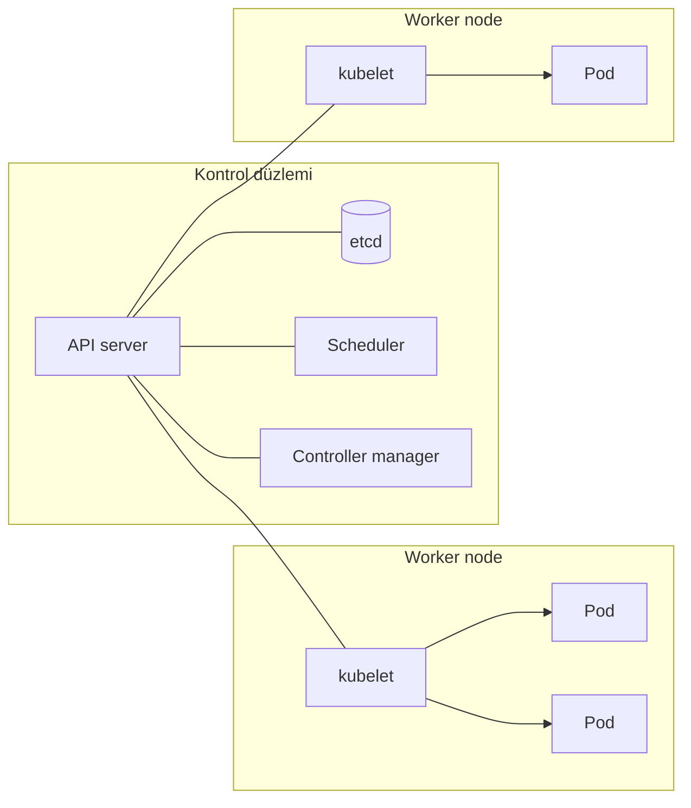

18 ilanın 6'sı Kubernetes'i doğrudan ister (çoğu zaman Azure'da AKS olarak). Backend geliştiricisinden küme yöneticisi olması beklenmez. Beklenen şudur: servisinin Kubernetes'te nasıl çalıştığını anlaması, manifest'lerini okuyup yazabilmesi ve servisini bu ortama uygun tasarlaması.

## Çözdüğü sorun

Docker bir makinede konteyner çalıştırır. Üretimde ise şunlar gerekir:

- 20 makineye dağılmış 300 konteyner.
- Bir konteyner çökünce yeniden başlatılması, makine ölünce başka makineye taşınması.
- Trafik artınca örnek sayısının artması.
- Yeni sürümün kesintisiz dağıtılması, sorun çıkarsa geri alınması.
- Konteynerlerin birbirini değişen IP adreslerine rağmen bulabilmesi.

Kubernetes bunları **istenen durum (desired state)** modeliyle çözer: "Bu imajdan 3 örnek çalışsın" dersiniz. Kontrol döngüleri gerçek durumu sürekli izler ve istenen duruma yaklaştırır. Bir örnek ölürse yenisini açar. Siz "nasıl"ı değil, "ne"yi tarif edersiniz (bildirimsel, declarative).

## Küme mimarisi



- **API server:** her şeyin konuştuğu kapı. `kubectl` de buraya istek atar.
- **etcd:** kümenin bütün durumunun saklandığı dağıtık anahtar-değer deposu (Raft ile kopyalanır).
- **Scheduler:** yeni pod'u hangi node'a yerleştireceğine karar verir.
- **Controller manager:** istenen durumla gerçek durumu eşitleyen döngüler.
- **kubelet:** her node'da pod'ları çalıştıran ajan.

Yönetilen servislerde (AKS, EKS, GKE) kontrol düzlemini bulut sağlayıcı işletir.

## Temel nesneler

| Nesne | Ne işe yarar |
| --- | --- |
| **Pod** | En küçük birim. Bir (bazen birkaç) konteyner, ortak IP ve depolama. Geçicidir |
| **Deployment** | İstenen sayıda pod'u ve güncellemelerini yönetir (arka planda ReplicaSet) |
| **Service** | Değişen pod'ların önünde sabit bir DNS adı ve sanal IP, yük dengeleme |
| **Ingress** / **Gateway API** | Dışarıdan gelen HTTP trafiğini host ve yola göre servislere yönlendirir |
| **ConfigMap** | Gizli olmayan yapılandırma |
| **Secret** | Gizli yapılandırma (varsayılan olarak yalnızca base64, şifreli değil) |
| **Namespace** | Kaynakları mantıksal olarak ayırır (takım, ortam) |
| **StatefulSet** | Sabit kimlik ve kalıcı disk gerektiren uygulamalar (veritabanları) |
| **Job / CronJob** | Tamamlanıp biten ya da zamanlanmış işler |

## Bir .NET servisinin manifest'i

```yaml
apiVersion: apps/v1
kind: Deployment
metadata:
  name: orders-api
spec:
  replicas: 3
  selector:
    matchLabels: { app: orders-api }
  strategy:
    type: RollingUpdate
    rollingUpdate: { maxUnavailable: 0, maxSurge: 1 }
  template:
    metadata:
      labels: { app: orders-api }
    spec:
      containers:
        - name: api
          image: myregistry.azurecr.io/orders-api:1.4.2
          ports: [{ containerPort: 8080 }]
          env:
            - name: ConnectionStrings__Db
              valueFrom: { secretKeyRef: { name: orders-secrets, key: db } }
          envFrom:
            - configMapRef: { name: orders-config }
          resources:
            requests: { cpu: 250m, memory: 256Mi }
            limits: { memory: 512Mi }
          readinessProbe:
            httpGet: { path: /health/ready, port: 8080 }
            periodSeconds: 5
          livenessProbe:
            httpGet: { path: /health/live, port: 8080 }
            periodSeconds: 10
            failureThreshold: 3
          startupProbe:
            httpGet: { path: /health/live, port: 8080 }
            failureThreshold: 30
            periodSeconds: 2
---
apiVersion: v1
kind: Service
metadata:
  name: orders-api
spec:
  selector: { app: orders-api }
  ports: [{ port: 80, targetPort: 8080 }]
```

Küme içindeki diğer servisler bu servise `http://orders-api` (başka namespace'ten `orders-api.<namespace>.svc.cluster.local`) adresiyle ulaşır.

## Probe'lar

| Probe | Başarısız olursa | Ne kontrol etmeli |
| --- | --- | --- |
| **startup** | Diğer probe'lar başlamaz, süre dolunca yeniden başlatılır | Uygulama açıldı mı (yavaş açılan uygulamalar için) |
| **readiness** | Pod, Service'in arkasından çıkarılır (trafik almaz) | Trafik almaya hazır mı, kritik bağımlılıklar erişilebilir mi |
| **liveness** | Konteyner **yeniden başlatılır** | Süreç kilitlenmiş mi. Bağımlılıkları kontrol **etmemeli** |

Klasik hata: liveness probe'u veritabanını kontrol eder. Veritabanı 30 saniye yanıt vermez ve Kubernetes **bütün** pod'ları yeniden başlatır. Veritabanı geri geldiğinde ayakta servis kalmamıştır.

## Kaynak istekleri ve limitleri

- **requests:** zamanlayıcının pod'u yerleştirirken ayırdığı garanti kaynak.
- **limits:** üst sınır. **Bellek** limitini aşan konteyner öldürülür (`OOMKilled`). **CPU** limitini aşan konteyner öldürülmez, yavaşlatılır (throttling).

İyi uygulama: bellek için gerçekçi istek ve limit. CPU için istek koyup limiti dikkatle ya da hiç koymamak, çünkü CPU throttling açıklanması zor gecikme artışları üretir. .NET çalışma zamanı konteyner limitlerini okur ve GC yığın boyutunu buna göre ayarlar.

## Ölçekleme ve güncelleme

**Horizontal Pod Autoscaler (HPA)** pod sayısını metriğe göre değiştirir:

```yaml
apiVersion: autoscaling/v2
kind: HorizontalPodAutoscaler
metadata: { name: orders-api }
spec:
  scaleTargetRef: { apiVersion: apps/v1, kind: Deployment, name: orders-api }
  minReplicas: 3
  maxReplicas: 20
  metrics:
    - type: Resource
      resource: { name: cpu, target: { type: Utilization, averageUtilization: 70 } }
```

Kuyruk uzunluğu gibi olay tabanlı ölçekleme için **KEDA** kullanılır (RabbitMQ, Kafka, Service Bus kuyruklarını okuyabilir).

**Rolling update:** yeni sürüm pod'ları teker teker açılır, hazır olunca eskiler kapatılır. `maxUnavailable: 0` kapasitenin hiç düşmemesini sağlar. Sorun çıkarsa `kubectl rollout undo deployment/orders-api` önceki sürüme döner.

**Düzgün kapanış:** pod kapatılırken önce `SIGTERM` gelir ve pod Service'ten çıkarılır. Ama bu ikisi eşzamanlı yayılır: bir süre daha trafik gelebilir. Yaygın çözüm kısa bir `preStop` beklemesi ve uygulamanın `SIGTERM`'de mevcut istekleri bitirmesidir. Varsayılan bekleme süresi 30 saniyedir (`terminationGracePeriodSeconds`).

## Temel kubectl komutları

```bash
kubectl get pods -n orders                       # pod'ları listele
kubectl describe pod orders-api-7d9f -n orders   # olaylar: neden açılmıyor?
kubectl logs -f deploy/orders-api -n orders      # loglar
kubectl apply -f k8s/                            # manifest'leri uygula
kubectl rollout status deploy/orders-api         # dağıtım ilerlemesi
kubectl port-forward svc/orders-api 5000:80      # yerelden servise eriş
kubectl exec -it orders-api-7d9f -- sh           # içine gir
```

Sık görülen pod durumları: `ImagePullBackOff` (imaj adı ya da registry yetkisi yanlış), `CrashLoopBackOff` (uygulama açılıp hemen çöküyor, loglara bakın), `OOMKilled` (bellek limiti aşıldı), `Pending` (yerleştirecek kaynak yok).

## Helm ve GitOps

- **Helm:** Kubernetes paket yöneticisi. Manifest'leri şablonlar (`values.yaml` ile ortam başına değerler) ve sürümler halinde yönetir.
- **Kustomize:** şablonsuz, katmanlı yamalarla ortam farklarını yönetir (`kubectl` içinde yerleşik).
- **GitOps (Argo CD, Flux):** kümenin istenen durumu bir Git deposunda tutulur. Araç kümeyi depoyla sürekli eşitler. Dağıtım bir PR birleştirmesidir ve her değişiklik denetlenebilir.

## Servisini Kubernetes'e hazırlamak

- Durumsuz ol: oturum ve dosyalar pod'da tutulmaz (Redis, blob depolama).
- Yapılandırmayı ortam değişkenlerinden ve dosyalardan oku (12-factor).
- Liveness ve readiness uç noktalarını ayrı yaz.
- `SIGTERM`'de düzgün kapan.
- Logları stdout'a yaz, izleri OpenTelemetry ile gönder.
- Migration'ı pod açılışında değil, ayrı bir Job ya da dağıtım hattı adımı olarak çalıştır.

## Mülakatta sorulur

- **"Pod ile Deployment farkı?"** Pod tek bir çalışan örnektir ve geçicidir. Deployment istenen sayıda pod'u ve güncellemelerini yönetir.
- **"Service neden gerekli?"** Pod IP'leri değişir. Service sabit bir ad ve yük dengeleme sağlar.
- **"Liveness ile readiness farkı?"** Liveness başarısızsa yeniden başlatılır. Readiness başarısızsa trafik kesilir. Bağımlılık kontrolü readiness'a aittir.
- **"Pod CrashLoopBackOff'ta. Ne yaparsın?"** `kubectl logs --previous` ve `describe` ile önceki çökmenin logunu ve olaylarını okurum. Genellikle eksik yapılandırma ya da açılışta erişilemeyen bağımlılıktır.
- **"Secret güvenli mi?"** Varsayılan olarak yalnızca base64'tür. etcd şifrelemesi, RBAC ve harici kasa entegrasyonu (Key Vault CSI sürücüsü, External Secrets) gerekir.

## Özet

- Kubernetes istenen durumu tarif etmenizi ve kontrol döngülerinin onu korumasını sağlar.
- Pod geçicidir. Deployment pod'ları yönetir, Service onlara sabit ad verir, Ingress dışarı açar.
- Startup, readiness ve liveness probe'ları farklı soruların cevabıdır. Liveness bağımlılıkları kontrol etmez.
- Bellek limiti aşılınca konteyner ölür, CPU limiti aşılınca yavaşlar.
- HPA ve KEDA ölçekler, rolling update kesintisiz dağıtır, Helm ve GitOps yönetimi sadeleştirir.
