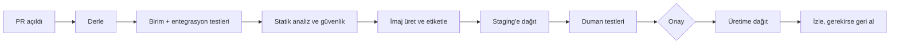

18 ilanın 9'u CI/CD ister: GitHub Actions, GitLab CI, Azure DevOps ya da Jenkins. Hangi araç olduğu ikincildir. Kavramlar ve iyi uygulamalar aynıdır. Zirve deposunun `.github/workflows` klasöründe gerçek bir örnek de var.

## Üç kavram

- **Sürekli entegrasyon (CI):** Her değişiklik ana dala sık (en az günde bir) birleştirilir. Her birleştirmede kod otomatik derlenir ve testler çalışır. Amaç, entegrasyon sorunlarını küçükken yakalamak.
- **Sürekli teslim (Continuous Delivery):** Ana daldaki her commit **her an üretime çıkabilir** durumdadır. Üretime çıkış bir düğmeyle (insan onayıyla) yapılır.
- **Sürekli dağıtım (Continuous Deployment):** Testlerden geçen her commit **otomatik** olarak üretime gider. İnsan onayı yoktur.

## Tipik bir hat



Temel ilkeler:

- **Bir kez derle, her yerde aynı artefaktı dağıt.** Staging'de test edilen imaj ile üretime giden imaj **aynı** olmalıdır. Ortam farkı yalnızca yapılandırmadadır.
- **Hızlı geri bildirim.** PR hattı 10 dakikanın altında kalmalı. Yavaş testler paralelleştirilir ya da ayrı bir gece hattına taşınır.
- **Kırmızı hat önceliklidir.** Ana dal kırıldıysa ekip yeni iş yapmadan önce onu düzeltir.
- **Hat da koddur.** Depoda sürümlenir ve review edilir.

## GitHub Actions ile .NET hattı

```yaml
name: ci
on:
  pull_request:
  push:
    branches: [main]

jobs:
  build-test:
    runs-on: ubuntu-latest
    steps:
      - uses: actions/checkout@v4
      - uses: actions/setup-dotnet@v4
        with:
          global-json-file: global.json
      - uses: actions/cache@v4
        with:
          path: ~/.nuget/packages
          key: nuget-${{ hashFiles('**/Directory.Packages.props', '**/*.csproj') }}
      - run: dotnet restore
      - run: dotnet build --no-restore -c Release -warnaserror
      - run: dotnet format --verify-no-changes
      - run: dotnet test --no-build -c Release --collect:"XPlat Code Coverage"
      - run: dotnet list package --vulnerable --include-transitive

  image:
    needs: build-test
    if: github.ref == 'refs/heads/main'
    runs-on: ubuntu-latest
    permissions:
      contents: read
      packages: write
    steps:
      - uses: actions/checkout@v4
      - uses: docker/login-action@v3
        with:
          registry: ghcr.io
          username: ${{ github.actor }}
          password: ${{ secrets.GITHUB_TOKEN }}
      - uses: docker/build-push-action@v6
        with:
          push: true
          tags: ghcr.io/acme/orders-api:${{ github.sha }}
```

Dikkat edilecekler:

- **İmaj etiketi commit hash'idir.** Hangi kodun çalıştığı her zaman bellidir. `latest` kullanılmaz.
- **İzinler en dar tutulur** (`permissions:`). Hat token'ı ele geçirilirse etkisi sınırlı kalır.
- **Gizli değerler** depo ya da ortam secret'larında durur, loglarda maskelenir. Bulut erişimi için uzun ömürlü anahtar yerine **OIDC federasyonu** tercih edilir: hat, her çalışmada kısa ömürlü bir kimlik alır.
- **Üçüncü taraf action'lar** bir tedarik zinciri riskidir. Güvenilir yayıncılar seçilir, kritik olanlar commit SHA'sına sabitlenir.

Azure DevOps Pipelines ve GitLab CI'da sözdizimi farklı, kavramlar aynıdır: tetikleyici, aşama (stage), iş (job), adım (step), artefakt, ortam ve onay.

## Kalite kapıları

PR'ın birleştirilebilmesi için geçmesi gereken kontroller (branch protection kuralları):

| Kapı | Araç örnekleri |
| --- | --- |
| Derleme ve uyarılar | `-warnaserror`, analizörler, nullable uyarıları |
| Biçim | `dotnet format`, `.editorconfig` |
| Testler | xUnit, kapsam raporu |
| Statik analiz | SonarQube / SonarCloud, Roslyn analizörleri |
| Güvenlik | CodeQL (kod), Dependabot ya da `dotnet list package --vulnerable` (bağımlılık), gitleaks (sızan gizli bilgi), Trivy (imaj) |
| Review | En az bir onay, CODEOWNERS |

SonarQube'un "quality gate"i yeni kodda kapsam, tekrar ve hata eşiği tanımlar. Kapı eski kodun tamamına değil **yeni koda** uygulanırsa ekip eski borçla boğulmadan kaliteyi artırır.

## Ortamlar

Tipik zincir: **dev → test/staging → üretim**. Staging üretime ne kadar benzerse o kadar değerlidir (aynı altyapı türü, benzer veri hacmi, aynı yapılandırma mekanizması).

- Ortam başına yapılandırma depoda değil, ortamın kendisinde (secret, Key Vault, ConfigMap) durur.
- Üretime dağıtım için onay ve dağıtım penceresi kuralları ortam düzeyinde tanımlanır.
- **Veritabanı migration'ları** hattın ayrı bir adımıdır ve geriye uyumlu yazılır (genişlet-daralt). Böylece uygulama geri alınsa bile şema onu çalıştırabilir.

## Güvenli dağıtım stratejileri

| Strateji | Nasıl | Getiri | Maliyet |
| --- | --- | --- | --- |
| **Rolling** | Örnekler teker teker yenilenir | Ek altyapı yok | Bir süre iki sürüm birlikte çalışır |
| **Blue-green** | Yeni sürüm (green) eskisinin (blue) yanında tam kurulur, trafik bir anda çevrilir | Anında geri alma: trafiği geri çevir | İki kat kaynak |
| **Canary** | Trafiğin küçük bir kısmı (%1, %5, %25...) yeni sürüme gider, metrikler izlenir | Hata küçük bir kitleyi etkiler | Metrik ve otomasyon gerektirir |
| **Feature flag** | Kod dağıtılır ama özellik kapalıdır, bayrakla açılır | Dağıtım ile yayını ayırır, anında kapatma | Bayrak borcu: eski bayraklar temizlenmeli |

İki sürümün birlikte çalıştığı her stratejide **geriye uyumluluk** şarttır: yeni sürümün yazdığı veriyi eski sürüm okuyabilmeli, API ve mesaj sözleşmeleri kırılmamalıdır.

**Feature flag** ayrıca trunk-based geliştirmeyi mümkün kılar: yarım kalmış özellik ana dalda kapalı bayrak arkasında durur, uzun ömürlü dallar gerekmez. .NET'te `Microsoft.FeatureManagement` kütüphanesi ve Azure App Configuration, LaunchDarkly ya da açık kaynak Unleash gibi servisler kullanılır.

## Geri alma ve ölçüm

- Her dağıtım **geri alınabilir** olmalı. Geri alma provası yapılmamış bir hat, gerçek bir olayda işe yaramaz.
- Dağıtım sonrası otomatik kontroller: hata oranı, gecikme, iş metrikleri. Eşik aşılırsa canary otomatik durdurulur.
- **DORA metrikleri** ekibin teslim performansını ölçer: dağıtım sıklığı, değişiklik için geçen süre (commit'ten üretime), değişiklik hata oranı ve hizmeti geri getirme süresi. Yüksek performanslı ekipler hem daha sık dağıtır hem de daha az hata üretir. Sık ve küçük dağıtım, seyrek ve büyük dağıtımdan daha güvenlidir.

## Mülakatta sorulur

- **"Continuous delivery ile continuous deployment farkı?"** İlkinde her commit üretime çıkabilir ama çıkış onayla yapılır. İkincisinde otomatik çıkar.
- **"Staging'de çalıştı, üretimde çalışmadı. Neden olabilir?"** Farklı artefakt, farklı yapılandırma, farklı veri hacmi ya da altyapı farkı. Aynı imajı dağıtır, ortam farklarını en aza indiririm.
- **"Blue-green ile canary farkı?"** Blue-green trafiği bir anda çevirir ve anında geri alınır. Canary kademeli çevirir ve hatanın etkisini sınırlar.
- **"Feature flag neden?"** Dağıtımı yayından ayırır. Kapalı özellik ana dalda bekleyebilir ve sorun çıkınca dağıtım yapmadan kapatılır.
- **"Hattına hangi güvenlik kontrollerini koyarsın?"** Bağımlılık taraması, statik kod analizi, gizli bilgi taraması, imaj taraması, en dar izinler ve kısa ömürlü bulut kimliği.

## Özet

- CI her değişikliği derleyip test eder. Continuous delivery her commit'i çıkışa hazır tutar, continuous deployment otomatik çıkarır.
- Bir kez derlenen aynı artefakt bütün ortamlara gider. Fark yalnızca yapılandırmadadır.
- Kalite kapıları: derleme, biçim, test, statik analiz, güvenlik taramaları ve review.
- Rolling, blue-green, canary ve feature flag farklı risk ve maliyet dengeleridir. Hepsi geriye uyumluluk ister.
- Geri alma prova edilir. DORA metrikleri teslim performansını ölçer.
