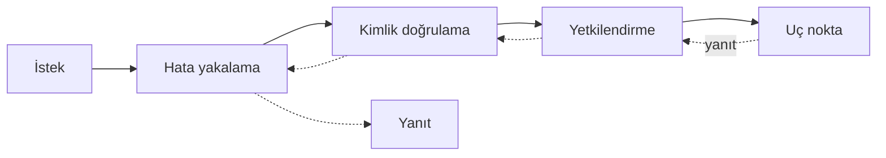

ASP.NET Core iki temel fikir üzerine kuruludur: istekler bir **middleware hattından** geçer ve bağımlılıklar bir **DI kapsayıcısı** tarafından sağlanır. .NET backend mülakatlarında bu ikisi neredeyse kesin sorulur.

## İstek hattı

Her HTTP isteği, sırayla dizilmiş bileşenlerden (middleware) geçer. Her middleware üç şeyden birini yapar: isteği işleyip **sonrakine devreder**, yanıtı kendisi üretip hattı **kısa devre** eder ya da sonraki bileşen döndükten sonra **yanıt üzerinde** çalışır.



İstek içeri doğru, yanıt dışarı doğru aynı bileşenlerden **ters sırayla** geçer. Bu yüzden hata yakalama en dışta durur: içerideki her şeyin fırlattığı istisnayı yakalayabilsin diye.

```csharp
var app = builder.Build();

app.UseExceptionHandler();     // en dışta: içerideki bütün hataları yakalar
app.UseHttpsRedirection();
app.UseRateLimiter();
app.UseAuthentication();       // "kimsin?"  -> HttpContext.User doldurulur
app.UseAuthorization();        // "yetkin var mı?"  -> User'a bakar

app.MapGet("/orders/{id}", GetOrder).RequireAuthorization();

app.Run();
```

**Sıra davranışı belirler.** `UseAuthorization`, `UseAuthentication`'dan önce gelirse yetkilendirme henüz doldurulmamış bir kullanıcıya bakar ve her isteği reddeder. Statik dosya middleware'i kimlik doğrulamadan önceyse dosyalar herkese açık sunulur.

Kendi middleware'inizi yazmak basittir:

```csharp
app.Use(async (context, next) =>
{
    var watch = Stopwatch.StartNew();

    await next(context);                         // hattın geri kalanı

    logger.LogInformation("{Method} {Path} -> {Status} ({Elapsed} ms)",
        context.Request.Method, context.Request.Path,
        context.Response.StatusCode, watch.ElapsedMilliseconds);
});
```

`next` çağrılmazsa hat orada biter. Yanıt gönderilmeye başladıktan sonra başlıkları ve durum kodunu değiştiremezsiniz.

### Middleware ve filtre farkı

Middleware her istek için ve uç noktadan bağımsız çalışır (günlükleme, CORS, kimlik doğrulama). **Filtreler** (endpoint filter, MVC'de action filter) belirli uç noktalara bağlanır ve model bağlama sonuçlarına erişebilir (doğrulama, uç noktaya özel yetki).

## Dependency Injection

Bir sınıf bağımlılıklarını kendisi **oluşturmak** yerine dışarıdan **alır**. Kazançlar: bağımlılıklar testte sahtesiyle değiştirilebilir, sınıflar somut tiplere değil soyutlamalara bağlanır ve nesnelerin ömrü tek yerden yönetilir.

```csharp
public interface IOrderRepository
{
    Task<Order?> FindAsync(int id, CancellationToken cancellationToken);
}

public class OrderService(IOrderRepository orders, ILogger<OrderService> logger)
{
    public async Task<Order> GetAsync(int id, CancellationToken cancellationToken)
    {
        logger.LogDebug("Sipariş okunuyor: {OrderId}", id);
        return await orders.FindAsync(id, cancellationToken) ?? throw new OrderNotFoundException(id);
    }
}

builder.Services.AddScoped<IOrderRepository, SqlOrderRepository>();
builder.Services.AddScoped<OrderService>();
```

Kapsayıcı, `OrderService` istendiğinde kurucu parametrelerine bakar ve bağımlılıkları zincirleme çözer.

### Servis ömürleri

| Ömür | Ne zaman yeni örnek oluşur | Tipik kullanım |
| --- | --- | --- |
| **Singleton** | Uygulama boyunca **bir kez** | Yapılandırma, önbellek, `HttpClient` fabrikası; durumsuz ve thread güvenli servisler |
| **Scoped** | **Her HTTP isteği** için bir kez | `DbContext`, istek bağlamı, iş birimi |
| **Transient** | **Her istendiğinde** | Hafif, durumsuz yardımcılar |

Singleton servisler aynı anda birçok istek tarafından kullanılır; **thread güvenli** olmak zorundadır. İçinde değiştirilebilir, paylaşılan durum tutuyorsanız eşzamanlılık hatası kaçınılmazdır.

### Tutsak bağımlılık

En sık sorulan DI hatası: **uzun ömürlü bir servisin kısa ömürlü bir servisi tutması.**

```csharp
builder.Services.AddSingleton<ReportCache>();     // singleton
builder.Services.AddScoped<AppDbContext>();       // scoped

public class ReportCache(AppDbContext db) { }     // HATA
```

Singleton bir kez oluşturulur ve aldığı `DbContext`'i uygulama boyunca elinde tutar. O `DbContext` thread güvenli değildir, isteğin sonunda atılmış (dispose) olabilir ve bayat veri taşır. ASP.NET Core, geliştirme ortamında bunu **kapsam doğrulamasıyla** yakalar ve açılışta hata verir.

Kural: bir servis yalnızca **kendisiyle aynı ya da daha uzun** ömürlü servislere bağımlı olabilir.

Singleton'ın gerçekten scoped bir servise ihtiyacı varsa (ör. arka plan servisi), kendi kapsamını açar:

```csharp
public class CleanupService(IServiceScopeFactory scopeFactory) : BackgroundService
{
    protected override async Task ExecuteAsync(CancellationToken stoppingToken)
    {
        while (!stoppingToken.IsCancellationRequested)
        {
            await using (var scope = scopeFactory.CreateAsyncScope())
            {
                var db = scope.ServiceProvider.GetRequiredService<AppDbContext>();
                await db.ExpiredSessions.ExecuteDeleteAsync(stoppingToken);
            }

            await Task.Delay(TimeSpan.FromHours(1), stoppingToken);
        }
    }
}
```

### Diğer yaygın hatalar

- **Servis bulucu** (service locator): sınıfın içine `IServiceProvider` enjekte edip servisleri oradan çekmek. Bağımlılıkları gizler ve testi zorlaştırır; kurucu enjeksiyonunu tercih edin.
- **`HttpClient`'ı her kullanımda `new` ile oluşturmak.** Soket tükenmesine yol açar. `IHttpClientFactory` (`AddHttpClient`) kullanın; bağlantıları havuzlar ve DNS değişikliklerini izler.
- **Kurucuda iş yapmak.** Kurucular yalnızca bağımlılıkları saklamalıdır; ağ ya da veritabanı çağrısı yapmamalıdır.
- **Çok fazla bağımlılık.** Yedi sekiz parametreli bir kurucu, sınıfın çok fazla iş yaptığının işaretidir.

## Yapılandırma: Options deseni

Ayarları `IConfiguration`'dan dizgi anahtarlarla okumak yerine tipli sınıflara bağlayın ve açılışta doğrulayın:

```csharp
public sealed class SmtpOptions
{
    [Required] public string Host { get; set; } = "";
    [Range(1, 65535)] public int Port { get; set; } = 587;
}

builder.Services.AddOptions<SmtpOptions>()
    .BindConfiguration("Smtp")
    .ValidateDataAnnotations()
    .ValidateOnStart();           // hatalı ayarla uygulama hiç açılmaz
```

Yapılandırma kaynakları katmanlıdır ve sonraki öncekini ezer: `appsettings.json` → `appsettings.{Ortam}.json` → kullanıcı gizlileri (geliştirmede) → ortam değişkenleri → komut satırı. Gizli değerleri (parola, anahtar) depoya koymayın; ortam değişkeni ya da bir gizli deposu kullanın.

## Hata yönetimi

İstisnaları her uç noktada tek tek yakalamak yerine merkezî olarak ele alın ve istemciye standart bir biçimde (`ProblemDetails`, RFC 9457) yanıt verin. İç ayrıntıları (yığın izi, SQL) üretimde asla sızdırmayın; günlüğe yazın.

```csharp
builder.Services.AddProblemDetails();
builder.Services.AddExceptionHandler<GlobalExceptionHandler>();
app.UseExceptionHandler();
```

## Mülakatta sorulur

- **"Middleware sırası neden önemli?"** İstek sırayla, yanıt ters sırayla geçer; kimlik doğrulama yetkilendirmeden, hata yakalama her şeyden önce gelmelidir.
- **"Scoped ile transient farkı?"** Scoped istek başına bir örnek; transient her çözümlemede yeni örnek. Aynı istekte iki sınıf aynı scoped servisi isterse **aynı** örneği alır.
- **"DbContext neden scoped?"** Thread güvenli değildir ve bir iş birimini temsil eder; istek başına bir tane olması hem güvenli hem doğaldır.
- **"Singleton içinde scoped kullanmam gerekirse?"** `IServiceScopeFactory` ile kapsam açarım.

## Özet

- İstek middleware hattından sırayla, yanıt ters sırayla geçer; sıra bir doğruluk meselesidir.
- DI: bağımlılıkları kurucudan alın, soyutlamalara bağlanın.
- Ömürler: singleton (uygulama), scoped (istek), transient (her seferinde). Uzun ömürlü servis kısa ömürlüyü tutmamalıdır.
- Ayarları Options deseniyle tipli ve doğrulanmış okuyun; hataları merkezî olarak `ProblemDetails`'e çevirin.
