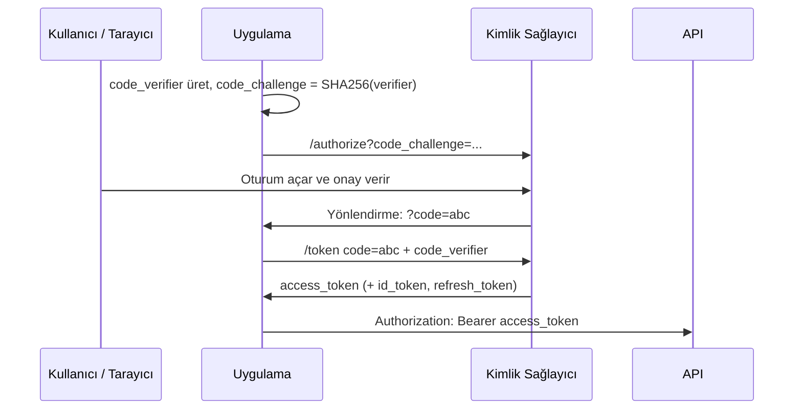

Güvenlik soruları senior ilanlarda ve özellikle finans, ödeme ve sağlık alanlarında neredeyse kesin gelir. Görüşmeci iki şeye bakar: kavramları karıştırmıyor musun (kimlik doğrulama ile yetkilendirme, OAuth ile OIDC) ve yaygın açıkları kod yazarken önlüyor musun.

## İki ayrı soru

- **Kimlik doğrulama (authentication):** "Sen kimsin?" Sonucu bir kimliktir (`ClaimsPrincipal`). Başarısızlık `401` döner.
- **Yetkilendirme (authorization):** "Bunu yapmaya iznin var mı?" Kimliğe bakarak karar verir. Başarısızlık `403` döner.

ASP.NET Core'da kimlik doğrulama bir **şema** (cookie, JWT bearer, OpenID Connect) ile yapılır. Şemanın işi isteği okuyup `HttpContext.User`'ı doldurmaktır.

## Çerez mi, JWT mi?

| | Oturum çerezi | JWT (bearer token) |
| --- | --- | --- |
| Durum nerede? | Sunucuda ya da şifreli çerezin içinde | Token'ın kendisinde (imzalı) |
| Geri alma (revoke) | Kolay: oturumu sil | Zor: token süresi dolana kadar geçerlidir |
| Tarayıcıda saklama | `HttpOnly` çerez, JavaScript okuyamaz | Genellikle bellekte ya da depolamada |
| CSRF riski | Var, `SameSite` ve anti-forgery token ile önlenir | Başlıkta gönderilirse yok |
| XSS riski | Çerez çalınamaz (`HttpOnly`) | `localStorage`'daki token XSS ile çalınır |
| En uygun olduğu yer | Aynı kökenden sunulan web uygulaması | Servisler arası çağrılar, mobil istemciler, üçüncü taraf API'leri |

Mülakatta "JWT'yi `localStorage`'da saklamak doğru mu?" sorusu sık gelir. Cevap: XSS'e açık olduğu için tarayıcı uygulamalarında önerilmez. Tarayıcı için **BFF (Backend for Frontend)** deseni tercih edilir: token'ları sunucu tarafı tutar, tarayıcıya yalnızca `HttpOnly`, `Secure`, `SameSite=Strict` bir çerez verilir.

### JWT'nin yapısı

`header.payload.signature`, üçü de Base64Url kodlu. Payload **şifreli değildir**, herkes okuyabilir. İmza yalnızca içeriğin değiştirilmediğini kanıtlar. Bu yüzden token'a parola, kart numarası gibi gizli veri konmaz.

```csharp
builder.Services.AddAuthentication(JwtBearerDefaults.AuthenticationScheme)
    .AddJwtBearer(options =>
    {
        options.Authority = "https://login.example.com";   // OIDC sağlayıcısı: anahtarlar buradan çekilir
        options.Audience = "orders-api";
        options.TokenValidationParameters = new TokenValidationParameters
        {
            ValidateIssuer = true,
            ValidateAudience = true,
            ValidateLifetime = true,
            ClockSkew = TimeSpan.FromSeconds(30),
        };
    });
```

Doğrulanması gerekenler: **imza**, **issuer** (kim verdi), **audience** (kimin için verildi), **süre** (`exp`, `nbf`). Audience doğrulanmazsa başka bir servis için verilmiş token sizin API'nizde de geçerli olur.

### Kısa ömürlü access token ve refresh token

Access token kısa ömürlüdür (5–15 dakika), çünkü geri alınamaz. Süresi dolunca istemci uzun ömürlü **refresh token** ile yenisini alır. Refresh token sunucuda saklanır ve geri alınabilir. İyi uygulama **refresh token rotasyonudur**: her kullanımda yenisi verilir, eskisi geçersiz olur. Eski bir refresh token tekrar kullanılırsa çalındığı anlaşılır ve o oturumun bütün token'ları iptal edilir.

## OAuth 2.0 ve OpenID Connect

En sık karıştırılan iki kavram:

- **OAuth 2.0 bir yetki devri protokolüdür.** "Bu uygulama benim adıma takvimime erişebilir" der. Sonucu bir **access token**'dır. Kullanıcının kim olduğunu standart bir biçimde söylemez.
- **OpenID Connect (OIDC), OAuth 2.0'ın üzerine kurulmuş kimlik katmanıdır.** Bir de **ID token** (JWT) verir: kullanıcının kim olduğunu, ne zaman ve nasıl oturum açtığını söyler.

"Google ile giriş yap" OIDC'dir. "Bu uygulama Drive'ıma dosya yükleyebilir" OAuth'tur.

### Hangi akış ne zaman?

| Akış | Kim kullanır |
| --- | --- |
| **Authorization Code + PKCE** | Kullanıcının oturum açtığı her şey: web, SPA, mobil |
| **Client Credentials** | Kullanıcı olmadan servisten servise çağrı |
| **Device Code** | Klavyesi olmayan cihazlar (TV, CLI) |
| ~~Implicit~~, ~~Resource Owner Password~~ | Kullanılmaz. OAuth 2.1 bunları kaldırır |



**PKCE** (Proof Key for Code Exchange), yönlendirme sırasında çalınan `code`'un işe yaramamasını sağlar: token almak için yalnızca uygulamanın bildiği `code_verifier` gerekir.

Kimlik sağlayıcıyı kendiniz yazmazsınız. Yaygın seçenekler: Microsoft Entra ID, Auth0/Okta, Keycloak (açık kaynak), Duende IdentityServer ve OpenIddict (.NET).

## Yetkilendirme

### Rol tabanlı

```csharp
app.MapDelete("/api/users/{id}", DeleteUser).RequireAuthorization(p => p.RequireRole("Admin"));
```

Basittir ama rol sayısı büyüdükçe dağınıklaşır.

### Policy tabanlı

Kuralı bir isim altında toplar. Uç nokta yalnızca policy adını bilir:

```csharp
builder.Services.AddAuthorizationBuilder()
    .AddPolicy("CanRefund", policy => policy
        .RequireAuthenticatedUser()
        .RequireClaim("permission", "payments:refund"));

app.MapPost("/api/payments/{id}/refunds", Refund).RequireAuthorization("CanRefund");
```

### Kaynak tabanlı: IDOR'u önlemek

En sık görülen gerçek açık şudur: kullanıcı doğrulanmış, uç nokta korunmuş, ama `GET /api/orders/123` çağrısında siparişin **o kullanıcıya ait olup olmadığı** kontrol edilmemiş. URL'deki numarayı değiştiren başkasının siparişini görür. Buna **IDOR** (Insecure Direct Object Reference) denir ve OWASP listesinin birinci maddesi olan *Broken Access Control*'ün parçasıdır.

```csharp
public sealed class OrderOwnerHandler : AuthorizationHandler<SameOwnerRequirement, Order>
{
    protected override Task HandleRequirementAsync(
        AuthorizationHandlerContext context, SameOwnerRequirement requirement, Order order)
    {
        if (order.CustomerId == context.User.FindFirstValue(ClaimTypes.NameIdentifier))
        {
            context.Succeed(requirement);
        }

        return Task.CompletedTask;
    }
}

// Uç noktada:
var result = await authorization.AuthorizeAsync(user, order, "SameOwner");
if (!result.Succeeded) return TypedResults.NotFound();   // varlığını da sızdırmamak için 404
```

Daha basit ve çoğu zaman yeterli yöntem: sorguyu baştan kullanıcıya göre filtrelemek (`Where(o => o.CustomerId == userId)`). Çok kiracılı (multi-tenant) sistemlerde bu filtre EF Core'un **global query filter** özelliğiyle her sorguya otomatik eklenir.

## OWASP Top 10 ve .NET karşılıkları

| Risk | .NET'te önlem |
| --- | --- |
| **Broken Access Control** | Her uç noktada yetki. Kaynak sahipliği kontrolü. Varsayılan olarak her şeyi kapatın (`FallbackPolicy`) |
| **Injection (SQL, komut)** | EF Core ve Dapper parametreli sorgu üretir. `FromSqlRaw` ile dizgi birleştirmeyin, `FromSql($"... {id}")` kullanın |
| **Cryptographic Failures** | Parolaları ASP.NET Core Identity'nin `PasswordHasher`'ı ya da Argon2/bcrypt ile hash'leyin. Kendi şifrelemenizi yazmayın. TLS zorunlu |
| **Security Misconfiguration** | Üretimde ayrıntılı hata sayfası ve OpenAPI arayüzü kapalı. CORS'ta `AllowAnyOrigin` + kimlik bilgisi yok |
| **Vulnerable Components** | `dotnet list package --vulnerable`, Dependabot, düzenli güncelleme |
| **Authentication Failures** | Hesap kilitleme, MFA, oturum açmada hız sınırı, kısa ömürlü token |
| **Software and Data Integrity Failures** | İmzalı paketler, CI'da bağımlılık doğrulama, güvenilmeyen veriyi `BinaryFormatter` ile açmamak (kaldırıldı) |
| **Logging and Monitoring Failures** | Başarısız girişleri ve yetki reddini loglayın. Token ve parolayı **loglamayın** |
| **SSRF** | Kullanıcının verdiği URL'ye istek atıyorsanız izinli alan listesi kullanın, iç ağ adreslerini engelleyin |

**XSS:** Razor ve React çıktıyı varsayılan olarak kodlar (encode). Açık, bunu bilerek atlatınca doğar: Razor'da `Html.Raw`, React'te `dangerouslySetInnerHTML`. Ek koruma olarak `Content-Security-Policy` başlığı kullanılır.

**CSRF:** Çerezle kimlik doğrulayan uygulamalarda başka bir site kullanıcının tarayıcısından istek gönderebilir. Önlem: `SameSite=Lax/Strict` çerez ve durum değiştiren isteklerde anti-forgery token.

**Toplu atama (mass assignment / over-posting):** Domain varlığını doğrudan istek gövdesine bağlarsanız istemci `IsAdmin: true` gönderebilir. İstek için ayrı DTO kullanın.

## Gizli bilgi yönetimi

- Bağlantı dizgisi, API anahtarı ve sertifika **depoya girmez**. Geliştirmede `dotnet user-secrets`, üretimde Azure Key Vault, AWS Secrets Manager ya da HashiCorp Vault kullanılır.
- Bulutta en iyisi **parolasız** çalışmaktır: Azure'da *Managed Identity*, AWS'de *IAM Role*. Uygulama kimliğini platformdan alır, saklanacak bir parola yoktur.

```csharp
builder.Configuration.AddAzureKeyVault(
    new Uri("https://orders-kv.vault.azure.net/"),
    new DefaultAzureCredential());   // yerelde geliştirici hesabı, bulutta Managed Identity
```

- Yanlışlıkla commit edilen bir gizli bilgi geçmişten silinse de **ele geçmiş sayılır** ve hemen değiştirilir (rotate).

## Mülakatta sorulur

- **"OAuth ile OpenID Connect farkı?"** OAuth yetki devridir ve access token verir. OIDC onun üzerine kimlik ekler ve ID token verir.
- **"SPA'da token'ı nerede saklarsın?"** Mümkünse hiç saklamam. BFF deseniyle token sunucuda kalır, tarayıcıda `HttpOnly` çerez olur.
- **"JWT'yi nasıl iptal edersin?"** Doğrudan edemem. Kısa ömür, refresh token rotasyonu ve gerekirse bir iptal listesi (`jti` kara listesi) kullanırım.
- **"Kullanıcı başkasının siparişini görüyor. Ne yanlış?"** Kaynak sahipliği kontrol edilmemiş (IDOR). Sorguyu kullanıcıya göre filtrelerim ya da kaynak tabanlı yetkilendirme eklerim.
- **"Servisten servise çağrıda hangi akış?"** Client Credentials. Bulutta mümkünse Managed Identity.

## Özet

- Kimlik doğrulama "kimsin", yetkilendirme "iznin var mı" sorusudur. İlki `401`, ikincisi `403` üretir.
- Tarayıcıda `HttpOnly` çerez ve BFF, servisler arasında JWT kullanılır. JWT'nin içi şifreli değildir.
- Kullanıcı girişi için Authorization Code + PKCE, servisler için Client Credentials.
- Policy ve kaynak tabanlı yetkilendirme rol kontrolünden daha esnektir. IDOR en sık rastlanan gerçek açıktır.
- Parametreli sorgu, hazır parola hash'leme, güncel paketler ve parolasız bulut kimliği OWASP risklerinin çoğunu kapatır.
