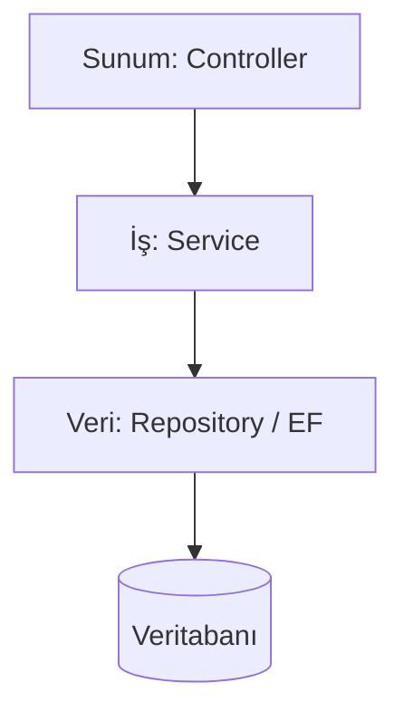
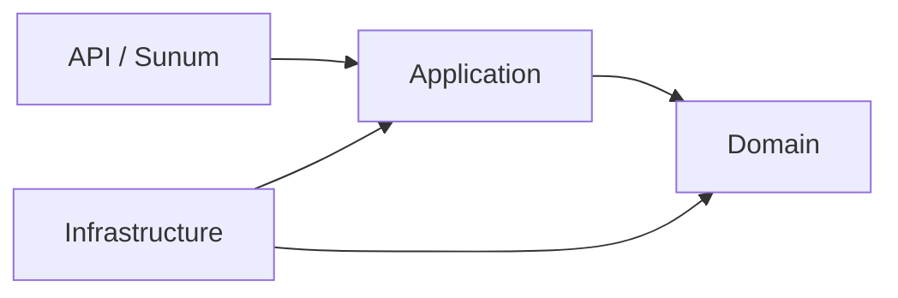

Türkiye'deki .NET ilanlarının büyük kısmı "Clean Architecture", "katmanlı mimari", "CQRS/MediatR" ister. Avrupa ilanları buna "Vertical Slices" ekler. Kütüphane API projesinde Clean Architecture'ı adım adım uyguladın. Bu ders kavramları bir araya getirir ve mülakatta "neden bu yapıyı seçtin?" sorusuna cevap vermeni sağlar.

## Klasik katmanlı mimari



Basit ve tanıdıktır. Sorunu: bağımlılık **veritabanına doğru** akar. İş katmanı veri katmanına bağımlıdır. Veri erişimini değiştirmek iş katmanına dokunmayı gerektirebilir ve iş kuralları veritabanı olmadan test edilemez.

## Clean Architecture

Robert C. Martin'in önerdiği yapı (Hexagonal ve Onion mimarileriyle aynı fikir): **bağımlılıklar daima içe doğru akar.** İç katmanlar dış katmanları bilmez.



| Katman | İçerik | Neye bağımlı |
| --- | --- | --- |
| **Domain** | Varlıklar, value object'ler, domain olayları, iş kuralları | Hiçbir şeye |
| **Application** | Kullanım senaryoları (komut ve sorgu işleyicileri), arayüzler (`IOrderRepository`, `IEmailSender`) | Domain |
| **Infrastructure** | EF Core, e-posta, mesaj kuyruğu, dış API istemcileri: Application'daki arayüzlerin uygulamaları | Application, Domain |
| **API** | Uç noktalar, DI kurulumu, kimlik doğrulama | Application (ve kurulum için Infrastructure) |

Anahtar fikir **bağımlılığın tersine çevrilmesidir** (SOLID'deki D). Application "bir e-posta göndericiye ihtiyacım var" diye `IEmailSender` arayüzünü tanımlar. Infrastructure onu SMTP ile uygular. Böylece iş mantığı altyapıdan bağımsız kalır ve sahte uygulamalarla test edilir.

**Ödünleşimler:**

- Proje ve dosya sayısı artar. Basit bir CRUD özelliği dört projeye dokunur.
- Aşırı soyutlama riski: her şeye arayüz, her varlık için ayrı DTO ve eşleme kodu.
- Küçük servislerde maliyeti getirisinden fazla olabilir.

## Vertical Slice mimarisi

Jimmy Bogard'ın popülerleştirdiği yaklaşım: kodu **teknik katmana göre değil, özelliğe göre** düzenle. Bir özelliğin uç noktası, doğrulaması, işleyicisi ve veri erişimi tek klasörde, çoğu zaman tek dosyada durur.

```text
Features/
  Orders/
    PlaceOrder.cs        // istek, doğrulayıcı, işleyici, uç nokta
    CancelOrder.cs
    GetOrderById.cs
  Products/
    ...
```

```csharp
public static class PlaceOrder
{
    public sealed record Command(Guid ProductId, int Quantity);
    public sealed record Result(Guid OrderId);

    public static void Map(IEndpointRouteBuilder app) =>
        app.MapPost("/api/orders", async (Command command, Handler handler, CancellationToken ct) =>
        {
            var result = await handler.HandleAsync(command, ct);
            return TypedResults.Created($"/api/orders/{result.OrderId}", result);
        });

    public sealed class Handler(AppDbContext db, TimeProvider clock)
    {
        public async Task<Result> HandleAsync(Command command, CancellationToken ct)
        {
            var product = await db.Products.FindAsync([command.ProductId], ct)
                ?? throw new NotFoundException("Ürün bulunamadı");

            var order = Order.Place(product, command.Quantity, clock.GetUtcNow());
            db.Orders.Add(order);
            await db.SaveChangesAsync(ct);
            return new Result(order.Id);
        }
    }
}
```

**Getirisi:** bir özelliği değiştirmek tek yere dokunmaktır. Özellikler arasında bağlılık azdır. Her dilim kendi ihtiyacına göre basit (doğrudan EF Core) ya da karmaşık (domain modeli) olabilir.

**Riski:** dilimler arasında kod tekrarı ve tutarsızlık. Paylaşılan iş kuralları yine domain modelinde toplanmalıdır.

Pratikte ikisi sıkça birleştirilir: Domain katmanı ayrı kalır, Application ve API katmanları dikey dilimlere göre düzenlenir.

## CQRS

**Command Query Responsibility Segregation:** durumu değiştiren işlemler (komutlar) ile okuyan işlemler (sorgular) farklı modellerle yazılır.

**Basit hali (aynı veritabanı):**

- Komut tarafı domain modelini yükler, iş kurallarını uygular ve EF Core ile kaydeder.
- Sorgu tarafı domain modelini atlar. Doğrudan ekranın ihtiyaç duyduğu DTO'ya projeksiyon yapar (EF Core `Select`, Dapper ya da ham SQL).

Bu hali neredeyse her projeye uygundur ve maliyeti düşüktür. Okuma tarafının karmaşık domain nesnelerini yüklemesi gerekmez.

**Tam hali (ayrı okuma modeli):**

- Komutlar yazma veritabanını günceller ve olay yayımlar.
- Olaylar, okuma için optimize edilmiş ayrı bir depoyu (Elasticsearch, denormalize tablo, Redis) günceller.
- Okuma modeli **nihai tutarlıdır** (eventually consistent): yazma ile okumada görünme arasında gecikme vardır.

Tam CQRS ancak okuma ve yazma yükü ya da şekli çok farklıysa değer. Çoğu zaman Event Sourcing ile birlikte anılır, ama ikisi bağımsızdır: CQRS, event sourcing olmadan da uygulanır.

## MediatR ve pipeline davranışları

MediatR, isteği işleyicisine yönlendiren süreç içi bir aracıdır (mediator). Uç nokta yalnızca `sender.Send(command)` der:

```csharp
public sealed record PlaceOrderCommand(Guid ProductId, int Quantity) : IRequest<Guid>;

public sealed class PlaceOrderHandler(AppDbContext db) : IRequestHandler<PlaceOrderCommand, Guid>
{
    public async Task<Guid> Handle(PlaceOrderCommand request, CancellationToken ct) { /* ... */ }
}
```

Asıl gücü **pipeline davranışlarıdır**: her isteğin etrafına kesişen kaygıları (cross-cutting) bir kez eklemek.

```csharp
public sealed class ValidationBehavior<TRequest, TResponse>(IEnumerable<IValidator<TRequest>> validators)
    : IPipelineBehavior<TRequest, TResponse> where TRequest : notnull
{
    public async Task<TResponse> Handle(TRequest request, RequestHandlerDelegate<TResponse> next, CancellationToken ct)
    {
        var failures = (await Task.WhenAll(validators.Select(v => v.ValidateAsync(request, ct))))
            .SelectMany(r => r.Errors).ToList();

        if (failures.Count > 0) throw new ValidationException(failures);
        return await next();
    }
}
```

Doğrulama, loglama, transaction ve performans ölçümü bu şekilde tek yerde tanımlanır.

**Eleştiriler ve bilmen gerekenler:**

- MediatR ek bir dolaylılık katmanıdır: "Bu uç nokta hangi kodu çalıştırıyor?" sorusunun cevabı bir dosya uzaktadır. IDE'de "tanıma git" çalışmaz.
- Aynı kesişen kaygılar ASP.NET Core endpoint filter'ları ya da basit dekoratörlerle de yapılabilir.
- MediatR, 2025'te sürüm 13 ile ticari lisans modeline geçti (küçük şirketler için ücretsiz topluluk lisansı var). AutoMapper da aynı yolu izledi. Bu yüzden bazı ekipler kendi küçük mediator'larını yazıyor ya da doğrudan işleyici sınıflarını enjekte ediyor.

Mülakatta "MediatR kullanır mısın?" sorusunun iyi cevabı ödünleşimi anlatır: pipeline davranışlarının getirisini ve dolaylılık ile lisans maliyetini.

## Hangi yapı ne zaman?

| Durum | Öneri |
| --- | --- |
| Küçük servis, çoğu CRUD | Dikey dilimler, doğrudan EF Core. Katman sayısını az tutun |
| Zengin iş kuralları, uzun ömürlü ürün | Ayrı Domain katmanı (DDD) + Clean Architecture ya da dilimlerle birleşimi |
| Okuma ve yazma yükü çok farklı | CQRS, gerekirse ayrı okuma modeli |
| Ekip yeni ve tutarlılık önemli | Net katman kuralları ve mimari testleri |

En kötü seçim, ihtiyaç duymadan en karmaşık yapıyı kurmaktır. Mimari, bugünkü ve yakın gelecekteki ihtiyaçla orantılı olmalıdır.

## Mülakatta sorulur

- **"Clean Architecture'da bağımlılık kuralı nedir?"** Bağımlılıklar içe doğru akar. Domain hiçbir şeye bağımlı değildir. Altyapı arayüzleri iç katmanda tanımlanır, dış katmanda uygulanır.
- **"Vertical Slice ile Clean Architecture farkı?"** Biri kodu teknik katmanlara, diğeri özelliklere göre düzenler. Birlikte de kullanılabilir.
- **"CQRS kullanmak için ayrı veritabanı gerekir mi?"** Hayır. Basit hali aynı veritabanında komut ve sorgu modellerini ayırmaktır.
- **"MediatR'ın getirisi ve maliyeti?"** Getirisi pipeline davranışlarıyla kesişen kaygıları tek yerde toplamak. Maliyeti dolaylılık, keşfedilebilirlik ve artık lisans.
- **"Bu proje için hangi mimariyi seçerdin?"** İhtiyacı sorarım: iş kuralı yoğunluğu, ekip büyüklüğü, ömür. Sonra en basit yeterli yapıyı seçerim.

## Özet

- Katmanlı mimari basittir ama bağımlılık veritabanına doğru akar.
- Clean Architecture bağımlılığı içe çevirir: iş mantığı altyapıdan bağımsız ve test edilebilir olur.
- Vertical Slice kodu özelliğe göre düzenler. Değişiklikler tek yerde kalır.
- CQRS'in basit hali (ayrı okuma ve yazma modelleri) ucuz ve yaygındır. Tam hali nihai tutarlılık getirir.
- MediatR pipeline davranışları güçlüdür ama dolaylılık ve lisans maliyeti vardır.
