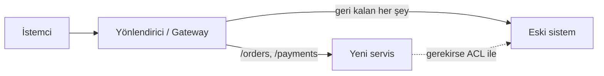

"Mikroservis mimarisi deneyimi" Türkiye'deki .NET ilanlarının en sık maddelerinden biridir. Logvance'in ilanı daha da nettir: "modüler monolit ve mikroservis ile üretim deneyimi". GlobalPBX ise "eski sistemleri refactor etme ve modernleştirme" ister. Bu ders üç soruya cevap verir: Ne zaman bölmeli? Nereden bölmeli? Bölünen parçalar nasıl konuşmalı?

## Üç seçenek

| | Monolit | Modüler monolit | Mikroservisler |
| --- | --- | --- | --- |
| Dağıtım birimi | Tek | Tek | Servis başına bir |
| İç yapı | Çoğu zaman karışık | Net sınırlı modüller | Ayrı kod tabanları |
| Veritabanı | Ortak | Ortak sunucu, modül başına şema | Servis başına ayrı |
| Modüller arası çağrı | Metot çağrısı | Modülün genel arayüzü ya da süreç içi olay | Ağ üzerinden (HTTP, gRPC, mesaj) |
| Transaction | Kolay | Kolay (aynı veritabanı) | Dağıtık: saga, outbox |
| Bağımsız ölçekleme ve dağıtım | Yok | Yok | Var |
| Operasyon maliyeti | Düşük | Düşük | Yüksek: gözlemlenebilirlik, ağ, dağıtım hattı |

### Mikroservisin gerçek gerekçeleri

Mikroservis bir **organizasyon ölçekleme** aracıdır, performans aracı değil. Haklı gerekçeler:

- **Ekiplerin bağımsız dağıtım yapması gerekiyor.** 50 geliştiricinin tek kod tabanına aynı gün dağıtım yapması darboğaz olmuştur.
- **Bir parçanın ölçekleme ihtiyacı diğerlerinden çok farklı.** Arama servisi 100 örnek, yönetim paneli 2 örnek istiyor.
- **Bir parçanın hata yalıtımı gerekiyor.** Raporlama çökünce ödeme etkilenmemeli.
- **Bir parça farklı teknoloji istiyor.**

Bunların hiçbiri yoksa mikroservis yalnızca maliyet ekler. Amazon Prime Video ekibinin 2023'te bir izleme hizmetini mikroservislerden monolite döndürüp maliyeti %90 azalttığını anlatan yazısı bu tartışmanın sık atıf yapılan örneğidir.

### Modüler monolit: makul varsayılan

Yeni bir ürün için en güvenli başlangıç genellikle modüler monolittir:

```text
src/
  Modules/
    Ordering/      Ordering.Api (genel arayüz), Ordering.Core, Ordering.Infrastructure
    Inventory/
    Billing/
  Host/            hepsini tek süreçte ayağa kaldırır
```

Kurallar:

- Her modül **kendi şemasına** sahiptir (`ordering.orders`, `inventory.stock`). Bir modül başka modülün tablolarını sorgulamaz.
- Modüller birbirine yalnızca **genel arayüz** (ör. `IInventoryModule.ReserveAsync`) ya da **süreç içi olaylar** üzerinden erişir. `internal` erişim belirleyicisi ve mimari testleri bu sınırı korur.
- Bir modül ileride ayrı servise çıkarılacaksa yapılacak iş, süreç içi çağrıyı ağ çağrısına, süreç içi olayı mesaj kuyruğuna çevirmektir. Bu yüzden modüler monolit, mikroservise giden **geri alınabilir** bir yoldur.

## Servis sınırlarını belirlemek

Yanlış sınır, mikroservislerin en pahalı hatasıdır. İpuçları:

- **Bounded context'leri izleyin** (DDD dersi). Sınır, kendi diline ve kurallarına sahip bir iş yeteneğinin etrafına çizilir: Sipariş, Ödeme, Stok, Sevkiyat.
- **Teknik katmana göre bölmeyin.** "Veritabanı servisi", "doğrulama servisi" gibi bölünmeler her özelliği birden fazla servise yayar.
- **Birlikte değişen şeyler birlikte durur.** Her özellik değişikliği üç servisi aynı anda güncellemeyi gerektiriyorsa sınır yanlıştır.
- **Konuşkan servisler** (tek bir istek için birbirine onlarca çağrı yapanlar) yanlış bölünmüştür.

### Dağıtık monolit

En kötü sonuç: bağımsız dağıtılamayan, birbirine senkron zincirlerle bağlı, ortak veritabanını paylaşan "mikroservisler". Monolitin bütün sıkılığına dağıtık sistemin bütün zorluklarını ekler. İşaretleri:

- Bir servisi dağıtmak için ötekilerin de aynı anda dağıtılması gerekiyor.
- Servisler aynı tabloları okuyup yazıyor.
- Bir servisin çökmesi zincirleme olarak hepsini çökertiyor.

## İletişim

### Senkron (HTTP/gRPC)

Basittir ve anında cevap verir. Ama **zamansal bağlılık** yaratır: çağrılan servis ayakta değilse çağıran da başarısız olur. Zincir uzadıkça erişilebilirlik çarpılarak düşer: %99,9 erişilebilir beş servisin zinciri yaklaşık %99,5'tir.

Kullanım yeri: anında cevap gereken sorgular ("bu ürünün fiyatı ne?"). Her çağrıda zaman aşımı, retry ve circuit breaker.

### Asenkron (mesaj ve olay)

Çağıran mesajı kuyruğa bırakır ve devam eder. Alıcı o an çalışmıyorsa mesaj bekler. Bağlılık azalır, ama sistem **nihai tutarlı** olur ve hata ayıklama zorlaşır.

- **Komut** (`ReserveStock`): belirli bir alıcıdan bir iş ister. Tek alıcısı vardır.
- **Olay** (`OrderPlaced`): bir şeyin olduğunu duyurur. Yayımlayan kimin dinlediğini bilmez. Sıfır ya da çok alıcısı olabilir.

Olay güdümlü mimaride servisler birbirini çağırmaz, birbirinin olaylarına tepki verir. Ödünleşim: "sipariş verildiğinde tam olarak ne oluyor?" sorusunun cevabı tek bir yerde yazılı değildir. Dağıtık iz bunun için şarttır.

## Veri

**Servis başına veritabanı** kuralı, servislerin birbirinin şemasına bağımlı olmamasını sağlar. Sonuçları:

- **JOIN yok.** Başka servisin verisi API ile istenir ya da olaylarla yerel bir kopyada tutulur (Sipariş servisi müşteri adını kendi tablosunda saklar ve `CustomerRenamed` olayıyla günceller).
- **Dağıtık transaction yok.** İki fazlı commit (2PC) mikroservislerde pratik değildir. Yerine **saga** kullanılır: her adım kendi yerel transaction'ını yapar, başarısızlıkta önceki adımlar **telafi işlemleriyle** geri alınır.
- **Veritabanı yazma ve mesaj yayımlama tutarlı olmalı.** Çözüm **transactional outbox**: mesaj, iş verisiyle aynı transaction'da bir outbox tablosuna yazılır ve ayrı bir süreç onu kuyruğa iletir.

Saga ve outbox'ı Sistem Tasarımı yolundaki "Olay Güdümlü Sipariş Sistemi" projesinde uygulamalı olarak kurabilirsin.

## Dış kapı: API gateway ve BFF

İstemcilerin onlarca servisin adresini bilmesi istenmez. **API gateway** tek giriş noktasıdır: yönlendirme, kimlik doğrulama, hız sınırlama, TLS sonlandırma. .NET dünyasında **YARP** (Yet Another Reverse Proxy) Microsoft'un kütüphanesidir. Bulutta Azure API Management ya da AWS API Gateway kullanılır.

**BFF (Backend for Frontend)**: her istemci türü (web, mobil) için ayrı, ince bir gateway. Mobil uygulamanın ihtiyaç duyduğu veriyi tek çağrıda birleştirir.

## Strangler fig: eski sistemi modernleştirmek

Martin Fowler'ın adlandırdığı desen, adını bir ağacı zamanla saran ve yerine geçen incir türünden alır. Eski sistemi bir kerede yeniden yazmak (big bang rewrite) yüksek risklidir. Yeni sistem yıllarca yetişemez, iş durmaz ve eski sistem değişmeye devam eder.



Adımlar:

1. Eski sistemin önüne bir yönlendirici koy. Başta bütün trafik eskiye gider.
2. Bir yeteneği seç (iyi sınırlı, değeri yüksek, riski makul). Yeni sistemde yaz.
3. O yeteneğin trafiğini yeniye yönlendir. Gerekirse önce gölge trafikle (yeni sistem de çalışır ama cevabı kullanılmaz) karşılaştır.
4. Eski koddaki ilgili parçayı sil. Tekrarla.

Yeni sistemin eski sistemin modeliyle kirlenmemesi için aradaki çeviriyi bir **anti-corruption layer** yapar. Veri tarafında genellikle bir dönem iki yönlü senkronizasyon ya da CDC (değişiklik verisi yakalama) gerekir.

## Mülakatta sorulur

- **"Yeni bir projeye mikroservisle mi başlarsın?"** Genellikle hayır. Modüler monolitle başlar, sınırları netleştirir, gerçek bir gerekçe doğunca modülü servise çıkarırım.
- **"Servis sınırlarını nasıl belirlersin?"** İş yeteneklerine ve bounded context'lere göre. Birlikte değişen şeyleri birlikte tutarım.
- **"Mikroservislerde iki servisi kapsayan transaction nasıl yapılır?"** Saga ile. Her adım yerel transaction, başarısızlıkta telafi. Mesajları outbox ile güvenilir yayımlarım.
- **"Dağıtık monolit nedir?"** Ayrı dağıtılan ama birlikte dağıtılmak zorunda olan, veritabanı ve senkron zincirlerle sıkı bağlı servisler.
- **"20 yıllık bir sistemi nasıl modernleştirirsin?"** Strangler fig: önüne yönlendirici, yetenek yetenek yeni sisteme taşıma, anti-corruption layer ve her adımda eskiyi silme.

## Özet

- Mikroservis organizasyonel bir ölçekleme aracıdır ve operasyon maliyeti yüksektir. Gerekçesi yoksa modüler monolit makul varsayılandır.
- Sınırlar iş yeteneklerine ve bounded context'lere göre çizilir. Teknik katmana göre bölünmez.
- Senkron çağrı zamansal bağlılık, asenkron mesaj nihai tutarlılık getirir.
- Servis başına veritabanı: JOIN yerine API ya da yerel kopya, dağıtık transaction yerine saga ve outbox.
- Eski sistemler strangler fig ve anti-corruption layer ile parça parça değiştirilir.
