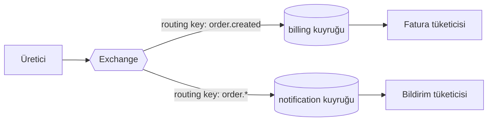
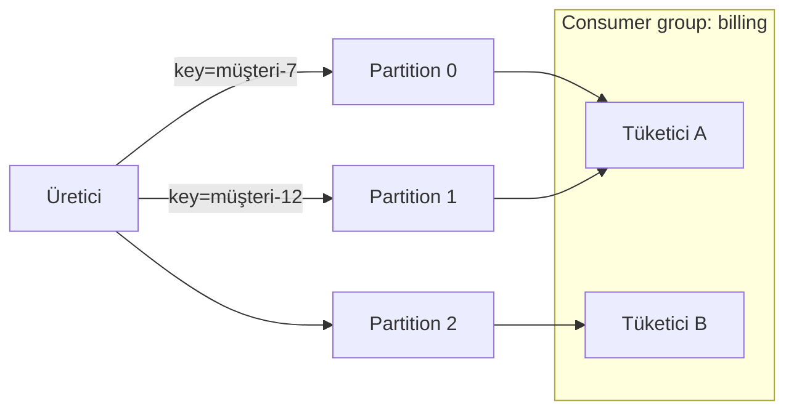

İlanlarda en sık geçen altyapı beklentisi mesaj kuyruklarıdır: 18 ilanın 9'unda RabbitMQ, Kafka ya da Azure Service Bus adı geçer. Logvance'in ilanı doğrudan mülakat sorusunu yazar: "mesaj kaybı, retry ve dead-letter queue yönetimi". Sistem Tasarımı'nda kuyrukların neden kullanıldığını gördük. Bu ders üç ürünün nasıl çalıştığını ve .NET'te nasıl doğru kullanıldığını anlatır.

## Teslim garantileri

| Garanti | Anlamı | Nasıl olur |
| --- | --- | --- |
| **En fazla bir kez** | Mesaj kaybolabilir, ama asla iki kez işlenmez | İşlemeden önce onay (ack) |
| **En az bir kez** | Mesaj kaybolmaz, ama iki kez işlenebilir | İşledikten sonra onay |
| **Tam olarak bir kez** | Ne kayıp ne tekrar | Uçtan uca pratikte yok. "En az bir kez + idempotent tüketici" ile **etkisi** sağlanır |

Gerçek sistemlerin neredeyse hepsi **en az bir kez** çalışır. Neden tekrar olur? Tüketici mesajı işler, veritabanına yazar, tam onay göndermeden önce çöker. Broker onay almadığı için mesajı tekrar teslim eder. Bu yüzden **her tüketici idempotent yazılmalıdır.** Bu dersin en önemli cümlesi budur.

## RabbitMQ

RabbitMQ klasik bir **mesaj aracısıdır** (broker). Mesajı tüketiciye iter, tüketici onaylayınca mesaj kuyruktan silinir.



Üretici mesajı doğrudan kuyruğa değil **exchange**'e gönderir. Exchange, **binding** kurallarına göre mesajı kuyruklara dağıtır.

| Exchange türü | Yönlendirme |
| --- | --- |
| **Direct** | Routing key tam eşleşirse |
| **Topic** | Desenle: `order.*` (tek kelime), `order.#` (sıfır ya da daha çok kelime) |
| **Fanout** | Bağlı bütün kuyruklara, anahtara bakmadan (yayın) |
| **Headers** | Başlık değerlerine göre |

### Güvenilirlik ayarları

- **Kalıcı kuyruk ve mesaj:** `durable: true` kuyruk ve kalıcı (persistent) mesaj. Yoksa broker yeniden başlayınca mesajlar kaybolur. Yüksek erişilebilirlik için **quorum queue** (Raft tabanlı kopyalama) kullanılır.
- **Publisher confirms:** üretici, broker'ın mesajı gerçekten aldığını doğrular.
- **Manuel onay:** `autoAck: false`. Tüketici işi bitirince `BasicAck`, başarısızsa `BasicNack` gönderir.
- **Prefetch (QoS):** tüketiciye aynı anda onaylanmamış en fazla kaç mesaj verileceği. Sınırsız bırakılırsa tek tüketici bütün kuyruğu belleğine çeker.
- **Dead-letter exchange (DLX):** reddedilen (`requeue: false`), süresi dolan ya da kuyruk sınırını aşan mesajlar başka bir exchange'e ve oradan "ölü mektup" kuyruğuna gider. Böylece **zehirli mesaj** (her seferinde hata veren) kuyruğu sonsuza kadar tıkamaz.

```csharp
// RabbitMQ.Client 7: API tamamen async
var factory = new ConnectionFactory { HostName = "localhost" };
await using var connection = await factory.CreateConnectionAsync();
await using var channel = await connection.CreateChannelAsync();

await channel.ExchangeDeclareAsync("orders", ExchangeType.Topic, durable: true);
await channel.QueueDeclareAsync("billing", durable: true, exclusive: false, autoDelete: false,
    arguments: new Dictionary<string, object?>
    {
        ["x-queue-type"] = "quorum",
        ["x-dead-letter-exchange"] = "orders.dlx",
    });
await channel.QueueBindAsync("billing", "orders", routingKey: "order.created");
await channel.BasicQosAsync(prefetchSize: 0, prefetchCount: 20, global: false);

var consumer = new AsyncEventingBasicConsumer(channel);
consumer.ReceivedAsync += async (_, delivery) =>
{
    try
    {
        var message = JsonSerializer.Deserialize<OrderCreated>(delivery.Body.Span)!;
        await billing.HandleAsync(message);                                       // idempotent olmalı
        await channel.BasicAckAsync(delivery.DeliveryTag, multiple: false);
    }
    catch (Exception)
    {
        await channel.BasicNackAsync(delivery.DeliveryTag, multiple: false, requeue: false);  // DLX'e git
    }
};
await channel.BasicConsumeAsync("billing", autoAck: false, consumer);
```

**Yeniden deneme:** Hata alan mesajı hemen `requeue: true` ile geri koymak, onu saniyede yüzlerce kez yeniden işleyen sıcak bir döngü yaratır. Doğrusu **gecikmeli yeniden denemedir**: mesaj TTL'li bir bekleme kuyruğuna gider, süre dolunca asıl kuyruğa döner. Belirli sayıda denemeden sonra DLQ'ya düşer ve oradan bir alarm ve elle inceleme süreci başlar.

## Kafka

Kafka bir kuyruk değil, **dağıtık, kalıcı bir log**'dur. Mesajlar okunduktan sonra silinmez. Belirlenen süre (retention) boyunca diskte kalır ve her tüketici kendi okuma konumunu tutar.



| Kavram | Anlamı |
| --- | --- |
| **Topic** | Mesaj kategorisi (`orders`) |
| **Partition** | Topic'in sıralı, yalnızca sona eklenen parçası. Paralelliğin birimi |
| **Offset** | Mesajın partition içindeki sıra numarası |
| **Key** | Aynı anahtarlı mesajlar **aynı partition'a** gider |
| **Consumer group** | Bir partition, grup içinde **yalnızca bir** tüketiciye atanır. Farklı gruplar aynı mesajları bağımsız okur |

Mülakatta sorulan sonuçlar:

- **Sıralama yalnızca partition içinde garantilidir.** Bir siparişin olaylarının sırası önemliyse anahtar sipariş kimliği olmalıdır.
- **Paralellik partition sayısıyla sınırlıdır.** 6 partition'lı topic'i 10 tüketiciyle okursanız 4'ü boşta bekler.
- **Partition sayısını sonradan artırmak** anahtar–partition eşlemesini değiştirir ve sıralama varsayımlarını bozar. Baştan ihtiyaca göre seçin.
- **Yeniden oynatma (replay):** tüketici offset'ini geriye alarak geçmiş olayları tekrar işleyebilir. Yeni bir servisi geçmiş verilerle doldurmak ya da hatalı işlemeyi düzeltmek için güçlü bir özelliktir.
- **Rebalance:** gruba tüketici eklenince ya da çıkınca partition'lar yeniden dağıtılır. Bu sırada tüketim kısa süre durur.

```csharp
var config = new ConsumerConfig
{
    BootstrapServers = "localhost:9092",
    GroupId = "billing",
    EnableAutoCommit = false,              // offset'i işledikten sonra kendimiz yazarız
    AutoOffsetReset = AutoOffsetReset.Earliest,
};

using var consumer = new ConsumerBuilder<string, string>(config).Build();
consumer.Subscribe("orders");

while (!stoppingToken.IsCancellationRequested)
{
    var result = consumer.Consume(stoppingToken);
    await billing.HandleAsync(result.Message.Key, result.Message.Value);   // idempotent
    consumer.Commit(result);                                                // en az bir kez
}
```

Üretici tarafında `Acks = Acks.All` ve `EnableIdempotence = true` ayarları, broker'a yazılan mesajın kopyalara da ulaştığını ve üreticinin yeniden denemelerinin tekrar üretmediğini garanti eder.

Kafka'da DLQ yerleşik değildir. Hatalı mesaj ayrı bir `orders.dlq` topic'ine yazılır ve tüketici offset'i ilerletir. Aksi halde tek bir zehirli mesaj partition'ın tamamını durdurur.

## RabbitMQ mı, Kafka mı?

| | RabbitMQ | Kafka |
| --- | --- | --- |
| Model | Broker mesajı iter, onaylanınca siler | Kalıcı log, tüketici çeker ve konumunu tutar |
| Yönlendirme | Zengin (exchange türleri) | Basit (topic + key) |
| Sıralama | Kuyruk başına (tek tüketicide) | Partition başına |
| Yeniden oynatma | Yok (silinmiş mesaj gider) | Var (retention süresince) |
| Verim | Yüksek | Çok yüksek (milyonlarca mesaj/sn) |
| Uygun olduğu yer | Görev kuyrukları, komutlar, karmaşık yönlendirme | Olay akışı, olay kaynağı, analitik, CDC, çok tüketicili akış |

## Azure Service Bus

Azure'un yönetilen kurumsal mesaj aracısı. Microsoft'un ve Azure kullanan şirketlerin ilanlarında geçer.

- **Queue:** noktadan noktaya. **Topic + subscription:** yayın-abone, her subscription'ın kendi filtresi olabilir.
- **Peek-lock:** mesaj okununca kilitlenir ama silinmez. Tüketici `Complete` derse silinir, `Abandon` derse tekrar görünür olur, kilit süresi dolarsa yine görünür olur.
- **Max delivery count:** bu sayı aşılınca mesaj otomatik olarak **yerleşik dead-letter alt kuyruğuna** taşınır.
- **Session'lar:** aynı `SessionId`'ye sahip mesajlar sırayla ve tek tüketiciye teslim edilir (FIFO). Sipariş başına sıralama için kullanılır.
- **Duplicate detection:** belirli bir zaman penceresinde aynı `MessageId` ile gelen tekrarları atar.
- **Zamanlanmış mesajlar:** ileri bir tarihte görünür olacak mesaj.

```csharp
await using var client = new ServiceBusClient("orders-ns.servicebus.windows.net", new DefaultAzureCredential());
await using var processor = client.CreateProcessor("orders", "billing",
    new ServiceBusProcessorOptions { AutoCompleteMessages = false, MaxConcurrentCalls = 10 });

processor.ProcessMessageAsync += async args =>
{
    var order = args.Message.Body.ToObjectFromJson<OrderCreated>();
    await billing.HandleAsync(order);
    await args.CompleteMessageAsync(args.Message);
};
processor.ProcessErrorAsync += args => { logger.LogError(args.Exception, "Service Bus hatası"); return Task.CompletedTask; };
await processor.StartProcessingAsync();
```

Yakın akrabaları: **Azure Event Hubs** Kafka benzeri olay akışı içindir (Kafka protokolünü de konuşur). **Azure Storage Queues** basit ve ucuz kuyruktur. AWS'deki karşılıkları SQS (kuyruk), SNS (yayın) ve Kinesis ya da MSK (akış) servisleridir.

## MassTransit ve benzerleri

Ham istemci kütüphaneleriyle yeniden deneme, DLQ, serileştirme, outbox, saga ve dağıtık izi her seferinde elle yazmak gerekir. **MassTransit** bunları RabbitMQ, Azure Service Bus, Amazon SQS ve Kafka üzerinde tek bir soyutlamayla sağlar:

```csharp
builder.Services.AddMassTransit(x =>
{
    x.AddConsumer<OrderCreatedConsumer>();
    x.AddEntityFrameworkOutbox<AppDbContext>(o => o.UsePostgres().UseBusOutbox());
    x.UsingRabbitMq((context, cfg) =>
    {
        cfg.UseMessageRetry(r => r.Exponential(5, TimeSpan.FromSeconds(1), TimeSpan.FromMinutes(1), TimeSpan.FromSeconds(5)));
        cfg.ConfigureEndpoints(context);
    });
});

public sealed class OrderCreatedConsumer(AppDbContext db) : IConsumer<OrderCreated>
{
    public async Task Consume(ConsumeContext<OrderCreated> context) { /* ... */ }
}
```

Lisans notu: MassTransit 9 sürümüyle ticari lisansa geçti. 8.x sürümü açık kaynak olarak kalıyor. Alternatifler: **Wolverine**, **Rebus**, **NServiceBus** (ticari). Mülakatta en az birini adıyla bilmek ve "ham istemci yerine neden kütüphane" sorusunu cevaplayabilmek yeterlidir.

## İdempotent tüketici

Aynı mesaj iki kez geldiğinde sonucun bir kez gelmiş gibi olmasını sağlamanın yolları:

1. **İşlenmiş mesaj tablosu:** mesaj kimliğini, iş verisiyle **aynı transaction'da**, benzersiz indeksli bir tabloya yazın. İkinci gelişte benzersizlik ihlali olur ve mesaj atlanır.

```csharp
await using var tx = await db.Database.BeginTransactionAsync(ct);
if (await db.ProcessedMessages.AnyAsync(m => m.Id == messageId, ct)) return;   // zaten işlendi
db.ProcessedMessages.Add(new ProcessedMessage(messageId, DateTime.UtcNow));
db.Invoices.Add(Invoice.For(order));
await db.SaveChangesAsync(ct);    // benzersiz indeks yarışta ikinciyi durdurur
await tx.CommitAsync(ct);
```

2. **Doğal olarak idempotent işlem:** `SET status = 'Paid'` iki kez çalışsa da sonuç aynıdır. `SET balance = balance - 100` değildir.
3. **İş anahtarıyla benzersizlik:** bir sipariş için yalnızca bir fatura olabilir. `Invoices(OrderId)` üzerinde benzersiz indeks.

## Outbox: veritabanı ve mesajı birlikte tutarlı yazmak

```csharp
db.Orders.Add(order);
await db.SaveChangesAsync(ct);
await bus.Publish(new OrderCreated(order.Id));   // burada çökersek: sipariş var, olay yok
```

Ters sırada yazarsak bu kez olay var, sipariş yok. **Transactional outbox** çözümü: olay, siparişle **aynı transaction'da** `outbox` tablosuna yazılır. Ayrı bir arka plan süreci tabloyu okuyup mesajları broker'a gönderir ve gönderilenleri işaretler. Gönderim en az bir kezdir, bu yüzden tüketici yine idempotent olmalıdır. MassTransit ve Wolverine outbox'ı hazır sunar. Mantığını Sistem Tasarımı › Proje 3'te kendin kurabilirsin.

## Mülakatta sorulur

- **"Mesaj kaybını nasıl önlersin?"** Kalıcı kuyruk ve mesaj, publisher confirms, manuel ack (işledikten sonra), veritabanı ve mesaj tutarlılığı için outbox.
- **"Aynı mesaj iki kez gelirse?"** En az bir kez teslimde bu normaldir. Tüketiciyi idempotent yazarım: işlenmiş mesaj tablosu ya da iş anahtarında benzersiz indeks.
- **"Zehirli mesaj kuyruğu tıkıyor. Ne yaparsın?"** Sınırlı ve gecikmeli yeniden deneme, sonra DLQ. DLQ için alarm ve yeniden işleme aracı.
- **"Kafka'da sıralama nasıl sağlanır?"** Yalnızca partition içinde. Sıralaması önemli mesajlara aynı anahtarı veririm.
- **"Tüketici sayısını artırdım ama Kafka'da hız artmadı. Neden?"** Partition sayısı tüketici sayısından azdır. Fazla tüketiciler boşta bekler.
- **"RabbitMQ mı, Kafka mı?"** Görev kuyruğu ve yönlendirme için RabbitMQ. Yüksek hacimli olay akışı, yeniden oynatma ve çok tüketicili okuma için Kafka.

## Özet

- Pratikte teslim en az bir kezdir. Her tüketici idempotent olmalıdır.
- RabbitMQ: exchange ile yönlendirme, kalıcılık, manuel ack, prefetch, DLX ve gecikmeli yeniden deneme.
- Kafka: partition'lı kalıcı log. Sıralama partition içinde, paralellik partition sayısıyla sınırlı, offset ile yeniden oynatma.
- Azure Service Bus: peek-lock, yerleşik DLQ, session ile FIFO ve tekrar tespiti.
- MassTransit gibi kütüphaneler yeniden deneme, outbox ve saga'yı hazır sunar. Lisanslarını kontrol edin.
- Veritabanı yazma ile mesaj yayımlamayı outbox ile tutarlı hale getirin.
