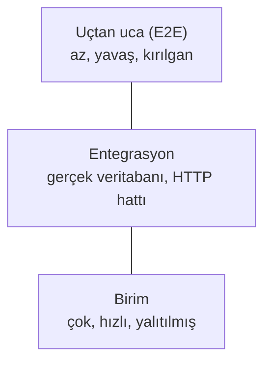

"Unit ve entegrasyon testi deneyimi" iş ilanlarında en sık geçen maddelerden biridir. Trendyol'un ilanı açıkça "testable design, CI as a quality gate" der. Mülakatta genellikle ya bir sınıfın testini yazmanız ya da "bunu nasıl test ederdin?" sorusuna cevap vermeniz istenir.

## Test piramidi



| Katman | Ne test eder | Hız | Sayı |
| --- | --- | --- | --- |
| Birim | Tek sınıf ya da fonksiyon, dış bağımlılık olmadan | Milisaniye | Çok |
| Entegrasyon | Bileşenlerin birlikte çalışması: API + veritabanı + serileştirme | Saniye | Orta |
| Uçtan uca | Kullanıcı senaryosu, gerçek arayüzden | Dakika | Az |

Piramidin mesajı: hataları en ucuz yakalayan katmana en çok yatırım yapın. Son yıllarda backend servisleri için "test kupası" (testing trophy) görüşü de yaygınlaştı: Testcontainers ile entegrasyon testleri o kadar ucuzladı ki, iş mantığı az olan CRUD servislerinde en çok güveni entegrasyon testleri verir. İkisi de savunulabilir. Önemli olan seçimin gerekçesidir.

## İyi bir birim testi

**FIRST**: Fast (hızlı), Isolated (birbirinden bağımsız), Repeatable (her ortamda aynı sonuç), Self-validating (geçti/kaldı kendisi söyler), Timely (kodla birlikte yazılır).

Yapı olarak **Arrange-Act-Assert**:

```csharp
public sealed class OrderTests
{
    [Fact]
    public void Cancel_refunds_when_order_is_paid()
    {
        // Arrange
        var order = OrderBuilder.Paid(total: 250m);

        // Act
        var result = order.Cancel(reason: "müşteri isteği");

        // Assert
        Assert.True(result.IsSuccess);
        Assert.Equal(OrderStatus.Cancelled, order.Status);
        Assert.Contains(order.DomainEvents, e => e is RefundRequested { Amount: 250m });
    }

    [Theory]
    [InlineData(OrderStatus.Shipped)]
    [InlineData(OrderStatus.Delivered)]
    public void Cancel_fails_after_shipping(OrderStatus status)
    {
        var order = OrderBuilder.WithStatus(status);

        var result = order.Cancel("geç kaldı");

        Assert.False(result.IsSuccess);
    }
}
```

- **Test adı davranışı anlatır:** `Cancel_refunds_when_order_is_paid`. Test kırıldığında ne bozulduğu adından anlaşılmalı.
- **Uygulama ayrıntısını değil davranışı test edin.** Özel metotları test etmek ya da "şu metot çağrıldı mı" diye her adımı doğrulamak, kodu her refactor'da testleri de kıran kırılgan testler üretir.
- **Test başına tek bir davranış.** Birden fazla `Assert` olabilir, ama hepsi aynı davranışı doğrulamalıdır.
- `[Theory]` ve `[InlineData]` aynı davranışı farklı girdilerle tekrar eder.

xUnit'te her test için **sınıfın yeni bir örneği** oluşturulur. Ortak kurulum kurucuya, temizlik `IDisposable`/`IAsyncLifetime`'a yazılır. Pahalı ve paylaşılan kaynaklar (veritabanı konteyneri) `IClassFixture<T>` ya da collection fixture ile paylaşılır.

## Test çiftleri

| Tür | Ne yapar | Örnek |
| --- | --- | --- |
| **Dummy** | Yalnızca parametre doldurur, kullanılmaz | `null` olamayan bir logger |
| **Stub** | Sabit cevap döner | Saat servisi hep `2026-01-01` döner |
| **Fake** | Çalışan ama basit bir uygulama | Bellekte çalışan repository |
| **Mock** | Hangi çağrıların yapıldığını doğrular | "E-posta servisi bir kez çağrıldı mı?" |
| **Spy** | Gerçek nesne gibi çalışır ama çağrıları kaydeder | |

**NSubstitute** ile:

```csharp
[Fact]
public async Task Placing_an_order_sends_confirmation()
{
    var clock = Substitute.For<TimeProvider>();
    clock.GetUtcNow().Returns(new DateTimeOffset(2026, 11, 24, 10, 0, 0, TimeSpan.Zero));
    var email = Substitute.For<IEmailSender>();
    var service = new OrderService(new InMemoryOrderRepository(), email, clock);

    await service.PlaceAsync(new PlaceOrder("ada@example.com", [new("SKU-1", 2)]), CancellationToken.None);

    await email.Received(1).SendAsync(
        Arg.Is<Email>(e => e.To == "ada@example.com"), Arg.Any<CancellationToken>());
}
```

Kural: **sahibi olmadığınız tipleri mock'lamayın.** `DbContext`'i ya da `HttpClient`'ı mock'lamak, gerçekte nasıl davrandıklarını taklit etmeye çalışan kırılgan testler üretir. Bunun yerine kendi soyutlamanızı (`IOrderRepository`) mock'layın ya da entegrasyon testi yazın. EF Core'un InMemory sağlayıcısı da gerçek veritabanı gibi davranmaz (transaction, kısıt ve SQL çevirisi yok). Microsoft da onu test için önermez.

Moq kütüphanesi de yaygındır. 2023'te bir sürümüne eklenen ve derleme sırasında geliştiricinin Git e-posta adresinin hash'ini okuyan SponsorLink bileşeni tartışma yarattı ve birçok ekip NSubstitute'a geçti. Mülakatta ikisinin de sözdizimini tanımak yeterlidir.

## Test edilebilir tasarım

Test yazmak zorsa bu genellikle bir tasarım sorununun işaretidir:

- **`DateTime.Now`, `Guid.NewGuid()`, `Random`** doğrudan çağrılırsa test tekrarlanamaz. .NET 8'deki `TimeProvider` saati enjekte etmeyi sağlar.
- **`new` ile oluşturulan bağımlılıklar** değiştirilemez. Kurucudan alın.
- **Statik durum** testler arasında sızar.
- **Domain mantığını altyapıdan ayırın.** `Order.Cancel` saf bir metotsa hiçbir sahteye gerek kalmadan test edilir. Clean Architecture'ın en büyük getirisi budur.

## Entegrasyon testi: WebApplicationFactory

`Microsoft.AspNetCore.Mvc.Testing` paketi uygulamayı bellekte, gerçek HTTP hattıyla (middleware, routing, serileştirme, kimlik doğrulama) ayağa kaldırır:

```csharp
public sealed class ApiFactory : WebApplicationFactory<Program>, IAsyncLifetime
{
    private readonly PostgreSqlContainer _db = new PostgreSqlBuilder().WithImage("postgres:17").Build();

    protected override void ConfigureWebHost(IWebHostBuilder builder) =>
        builder.ConfigureTestServices(services =>
        {
            services.RemoveAll<DbContextOptions<AppDbContext>>();
            services.AddDbContext<AppDbContext>(o => o.UseNpgsql(_db.GetConnectionString()));
            services.AddSingleton<IEmailSender, FakeEmailSender>();   // dış servis sahtesiyle değişir
        });

    public async ValueTask InitializeAsync()
    {
        await _db.StartAsync();
        using var scope = Services.CreateScope();
        await scope.ServiceProvider.GetRequiredService<AppDbContext>().Database.MigrateAsync();
    }

    public override async ValueTask DisposeAsync()
    {
        await _db.DisposeAsync();
        await base.DisposeAsync();
    }
}

public sealed class OrderApiTests(ApiFactory factory) : IClassFixture<ApiFactory>
{
    [Fact]
    public async Task Creating_an_order_returns_201_with_location()
    {
        var client = factory.CreateClient();

        var response = await client.PostAsJsonAsync("/api/v1/orders", new { productId = Seed.ProductId, quantity = 2 });

        Assert.Equal(HttpStatusCode.Created, response.StatusCode);
        Assert.NotNull(response.Headers.Location);
    }
}
```

(Buradaki `IAsyncLifetime` imzası xUnit v3'tür ve `ValueTask` döner. xUnit v2'de `Task` döner.)

`Program` sınıfı minimal hosting'de varsayılan olarak test projesinden görünmez. `Program.cs` sonuna `public partial class Program;` eklenir.

**Testcontainers** testten önce gerçek bir PostgreSQL, Redis ya da RabbitMQ konteynerini Docker'da başlatır ve test bitince kaldırır. Böylece testler üretimdekiyle aynı veritabanı motoruna karşı çalışır. Gereksinim: test makinesinde ve CI'da Docker.

Testler arasında veri izolasyonu için seçenekler: her testi bir transaction içinde çalıştırıp sonunda geri almak, testten sonra tabloları `Respawn` gibi bir araçla temizlemek ya da her testin kendine özgü verilerle (benzersiz kimlikler) çalışması.

**Dış HTTP servisleri** için WireMock.Net gerçek bir sahte HTTP sunucusu ayağa kaldırır. Böylece zaman aşımı, 500 hatası ve yavaş yanıt gibi durumlar da test edilir.

## Mimari testleri

Katman kurallarının (Domain, Infrastructure'a bağımlı olamaz) zamanla bozulmasını önlemek için `NetArchTest` ya da `ArchUnitNET` ile test yazılabilir. Kütüphane API projesinin 7. fazı bunu uygular.

## TDD

Test Driven Development döngüsü: **kırmızı** (önce başarısız bir test yaz), **yeşil** (testi geçirecek en basit kodu yaz), **refactor** (testler yeşilken kodu temizle). Getirisi, kodun baştan test edilebilir tasarlanması ve gereksiz kod yazılmamasıdır. Her durumda zorunlu değildir. Keşif aşamasındaki prototipte zaman kaybı olabilir. Mülakatta "TDD yapıyor musun?" sorusuna dürüst ve gerekçeli cevap vermek dogmatik cevaptan iyidir.

## Kapsam (coverage) ve CI

- `dotnet test --collect:"XPlat Code Coverage"` kapsam raporu üretir.
- Kapsam yüzdesi **hedef değil, göstergedir.** %100 kapsam doğru test anlamına gelmez. Assert'i olmayan bir test de satırları "kapsar". Kritik iş mantığında yüksek, üretilmiş kodda düşük kapsam doğaldır.
- **Mutation testing** (Stryker.NET) kodu küçük değişikliklerle bozar ve testlerin bunu yakalayıp yakalamadığına bakar. Testlerin gerçekten bir şey doğrulayıp doğrulamadığını ölçer.
- CI'da testler her PR'da çalışır ve başarısızsa birleştirme engellenir. Kararsız (flaky) testler hemen düzeltilir ya da karantinaya alınır. Göz ardı edilen kırmızı test, ekibin testlere güvenini öldürür.

## Mülakatta sorulur

- **"Mock ile stub farkı?"** Stub cevap verir, mock çağrıyı doğrular.
- **"DbContext'i mock'lar mısın?"** Hayır. Kendi soyutlamamı mock'larım ya da Testcontainers ile gerçek veritabanına karşı entegrasyon testi yazarım. InMemory sağlayıcı gerçek davranışı yansıtmaz.
- **"`DateTime.Now` kullanan kodu nasıl test edersin?"** `TimeProvider` enjekte ederim, testte sabit zaman veririm.
- **"Entegrasyon testi nasıl yazarsın?"** WebApplicationFactory ile uygulamayı bellekte kaldırır, Testcontainers ile gerçek veritabanı bağlar, dış servisleri sahtesiyle değiştiririm.
- **"%100 kapsam hedefler misin?"** Hayır. Kritik iş mantığına odaklanırım. Kapsam gösterge, mutation testing kalite ölçüsüdür.

## Özet

- Piramit: çok birim, orta entegrasyon, az uçtan uca. Backend servislerinde entegrasyon testlerinin payı artıyor.
- Testler davranışı doğrular, adı davranışı anlatır, Arrange-Act-Assert yapısındadır.
- Sahibi olmadığınız tipleri mock'lamayın. Zamanı, rastgeleliği ve dış servisleri enjekte edin.
- WebApplicationFactory + Testcontainers gerçekçi ve hızlı entegrasyon testi verir.
- CI'da testler kalite kapısıdır. Kapsam göstergedir, hedef değildir.
