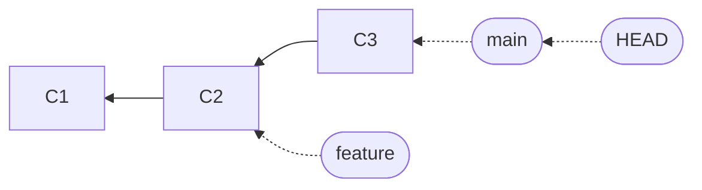

Git her ilanda ya açıkça ("Git ve PR akışı") ya da örtük olarak beklenir. Günlük komutları herkes bilir. Mülakatta ve gerçek bir olay anında fark yaratan, Git'in **nasıl çalıştığını** bilmektir: yanlışlıkla silinen bir commit'i geri getirmek, rebase sırasında çıkan çakışmayı çözmek, hatayı hangi commit'in getirdiğini bulmak.

## Veri modeli

Git bir **anlık görüntü** (snapshot) veritabanıdır, değişiklik listesi değil.

- **Blob:** bir dosyanın içeriği.
- **Tree:** bir dizin: dosya adları ve blob ya da tree işaretçileri.
- **Commit:** bir kök tree, yazar, mesaj ve **ebeveyn commit(ler)** işaretçisi.
- Hepsi içeriklerinin SHA hash'iyle adlandırılır. İçerik değişirse hash değişir. Bu yüzden commit'ler değiştirilemez: "değiştirmek" aslında yeni bir commit oluşturmaktır.



- **Dal (branch):** bir commit'e işaret eden hareketli bir **etikettir**. Dal oluşturmak 41 baytlık bir dosya yazmaktır. Bu yüzden Git'te dallar ucuzdur.
- **HEAD:** şu an üzerinde çalıştığın yer. Genellikle bir dala işaret eder. Doğrudan bir commit'e işaret ediyorsa "detached HEAD" durumundasın demektir.
- **Üç alan:** çalışma dizini (dosyaların), hazırlık alanı (index, `git add` ile), depo (commit'ler).

## Merge ve rebase

`feature` dalı `main`'den ayrıldıktan sonra iki dalda da yeni commit'ler oldu.

**Merge** iki geçmişi birleştiren yeni bir **birleştirme commit'i** oluşturur:

```text
      A---B---C  feature
     /         \
D---E---F---G---M  main
```

**Rebase** `feature`'ın commit'lerini `main`'in ucunun üzerine **yeniden uygular**. Yeni commit'ler (farklı hash'lerle) oluşur:

```text
D---E---F---G  main
             \
              A'--B'--C'  feature
```

| | Merge | Rebase |
| --- | --- | --- |
| Geçmiş | Gerçekte olanı korur, dallanma görünür | Doğrusal ve temiz |
| Commit hash'leri | Değişmez | Değişir (yeni commit'ler) |
| Paylaşılan dalda | Güvenli | **Tehlikeli** |
| Çakışma | Bir kez çözülür | Her commit için ayrı çözülebilir |

**Rebase'in altın kuralı: başkalarının üzerinde çalıştığı (push edilmiş, paylaşılan) commit'leri rebase etme.** Hash'ler değiştiği için başkalarının geçmişiyle uyuşmazlık çıkar. Kendi yerel dalını güncel `main`'in üzerine almak için rebase iyi bir alışkanlıktır.

PR'ları birleştirmenin üç yolu: **merge commit** (geçmiş korunur), **squash merge** (PR'ın bütün commit'leri tek commit olur, ana dal geçmişi temiz kalır) ve **rebase merge** (commit'ler tek tek doğrusal eklenir). Çoğu ekip squash merge'ü tercih eder.

## Çakışma çözmek

```text
<<<<<<< HEAD
    var limit = Math.Min(pageSize, 100);
=======
    var limit = Math.Clamp(pageSize, 1, 50);
>>>>>>> feature/pagination
```

1. Her iki tarafın **niyetini** anla. Biri üst sınırı 100 yapmış, diğeri alt sınır eklemiş ve üst sınırı 50 yapmış. Doğru sonuç çoğu zaman ikisinin birleşimidir, birini seçmek değil.
2. İşaretleri kaldır, dosyayı derle, **testleri çalıştır**.
3. `git add` ve `git merge --continue` (ya da `git rebase --continue`).
4. İşler karıştıysa `git merge --abort` / `git rebase --abort` başlangıca döndürür.

Çakışmaları azaltmanın en iyi yolu küçük PR'lar ve dalı sık güncellemektir.

## Geçmişi geri almak

| Komut | Ne yapar | Paylaşılan dalda |
| --- | --- | --- |
| `git restore <dosya>` | Çalışma dizinindeki değişikliği atar | — |
| `git restore --staged <dosya>` | Hazırlık alanından çıkarır | — |
| `git commit --amend` | Son commit'i değiştirir (yeni hash) | Push edildiyse yapma |
| `git reset --soft HEAD~1` | Son commit'i geri alır, değişiklikler hazırlıkta kalır | Yapma |
| `git reset --mixed HEAD~1` | Değişiklikler çalışma dizininde kalır (varsayılan) | Yapma |
| `git reset --hard HEAD~1` | Commit'i **ve değişiklikleri** atar | Yapma |
| `git revert <commit>` | Bir commit'in tersini yapan **yeni** bir commit oluşturur | **Güvenli** |

Paylaşılan bir dalda yapılmış hatalı bir commit'i geri almanın doğru yolu `revert`'tür: geçmiş yeniden yazılmaz, geri alma da kayıt altındadır.

Zorunlu olarak push etmek gerekirse (`rebase` sonrası kendi dalında) `git push --force-with-lease` kullan. `--force`'tan farkı: uzaktaki dal senin bildiğin halinden farklıysa (başkası push etmişse) reddeder ve onun işini ezmezsin.

## reflog: hiçbir şey gerçekten kaybolmaz

`reset --hard` ile commit'leri sildin, ya da rebase her şeyi bozdu. Git, HEAD'in gittiği her yeri yerel olarak kaydeder:

```bash
git reflog
# 3f9c2ab HEAD@{0}: reset: moving to HEAD~3
# a17e5d0 HEAD@{1}: commit: Sayfalama eklendi       <- kaybettiğin commit
# ...
git reset --hard a17e5d0       # ya da: git branch kurtarma a17e5d0
```

Commit edilmiş her şey reflog kaydı silinene kadar geri getirilebilir. Hiçbir dalın ulaşamadığı commit'ler için bu süre varsayılan olarak 30 gündür. Commit edilmemiş değişiklikler ise `reset --hard` ile gerçekten kaybolur. Bu yüzden şüphedeysen önce commit et ya da `git stash`.

## Kullanışlı araçlar

```bash
git stash push -m "yarım iş"     # değişiklikleri kenara koy
git stash pop                    # geri getir

git cherry-pick 4be1f2c          # başka daldaki tek bir commit'i buraya uygula (ör. hotfix'i sürüm dalına)

git log --oneline --graph --all  # dalların görsel geçmişi
git log -S "RetryCount"          # bu metni ekleyen ya da silen commit'ler
git blame -L 40,60 Order.cs      # satırları en son kim, hangi commit'te değiştirdi

git switch -c feature/x          # yeni dal oluştur ve geç (eski: checkout -b)
git worktree add ../hotfix main  # aynı depodan ikinci bir çalışma dizini
```

### bisect: hatayı getiren commit'i bulmak

Bir hata son 200 commit'ten birinde ortaya çıktı. İkili arama ile en fazla 8 adımda bulunur:

```bash
git bisect start
git bisect bad                   # şu an hatalı
git bisect good v2.3.0           # bu sürümde çalışıyordu
# Git ortadaki commit'e geçer. Test et ve söyle:
git bisect good    # ya da: git bisect bad
# ... tekrar ...
git bisect reset

# Otomatik: bir betik hatayı 0/1 çıkış koduyla bildirirse
git bisect run dotnet test --filter "FullyQualifiedName~PaginationTests"
```

## Dal stratejileri

| Strateji | Yapı | Uygun olduğu yer |
| --- | --- | --- |
| **Trunk-based** | Tek ana dal. Kısa ömürlü (saatler, en fazla birkaç gün) özellik dalları. Yarım işler feature flag arkasında | Sürekli teslim yapan ekipler. Google ve Meta gibi şirketlerin yaklaşımı |
| **GitHub Flow** | `main` + özellik dalları + PR. `main` her zaman dağıtılabilir | Çoğu web uygulaması |
| **GitFlow** | `main`, `develop`, `feature/*`, `release/*`, `hotfix/*` | Planlı sürümler, birden fazla sürümün desteklendiği ürünler (mobil, kurulan yazılım) |

Uzun ömürlü dallar büyük ve acılı birleştirmeler demektir. DORA araştırmaları, kısa ömürlü dallar ve trunk-based geliştirmenin daha yüksek teslim performansıyla ilişkili olduğunu gösterir.

## İyi commit ve PR

**Commit mesajı:**

```text
Sipariş listesine cursor sayfalama ekle

Offset sayfalama 100 bin satırın üzerinde 2 saniyeyi aşıyordu.
Cursor, (CreatedAt, Id) çiftine göre konumlanıyor ve indeksi kullanıyor.
Eski ?page= parametresi bir sürüm daha destekleniyor.

Refs: ORD-412
```

- İlk satır kısa (~50 karakter), emir kipinde ve ne yapıldığını söyler.
- Gövde **neden**'i anlatır. "Ne" zaten diff'te görünür.
- **Conventional Commits** (`feat:`, `fix:`, `refactor:`, `docs:`) bazı ekiplerde değişiklik günlüğü ve sürüm numarası üretimi için kullanılır.
- Her commit derlenebilir ve anlamlı bir adım olmalıdır. Bu, `bisect` ve `revert`'i mümkün kılar.

**PR:**

- **Küçük tut.** 200 satırlık PR dikkatle incelenir, 2000 satırlık PR "LGTM" ile geçer.
- Açıklamada: ne değişti, neden, nasıl test edildi, ekran görüntüsü (arayüzse), riskler ve geri alma planı.
- Refactor ile davranış değişikliğini ayrı PR'lara böl.
- Review yorumlarına cevap ver, çözülenleri işaretle. Tartışma uzarsa sesli konuş.

`.gitignore` ile derleme çıktıları (`bin/`, `obj/`), IDE dosyaları ve **gizli bilgiler** (`.env`, `appsettings.*.local.json`) depoya girmez. Yanlışlıkla commit edilen bir gizli bilgi geçmişten silinse bile ele geçmiş sayılır ve değiştirilir.

## Mülakatta sorulur

- **"Merge ile rebase farkı?"** Merge geçmişi korur ve birleştirme commit'i ekler. Rebase commit'leri yeniden uygular ve doğrusal geçmiş verir, ama hash'leri değiştirir. Paylaşılan dalı rebase etmem.
- **"Push edilmiş hatalı bir commit'i nasıl geri alırsın?"** `git revert`. Geçmişi yeniden yazmaz.
- **"`reset --hard` ile commit'lerimi sildim. Geri getirebilir miyim?"** Evet, `git reflog` ile commit'i bulup dal oluştururum.
- **"Hatayı hangi commit'in getirdiğini nasıl bulursun?"** `git bisect`, mümkünse `bisect run` ile otomatik.
- **"`--force` yerine neden `--force-with-lease`?"** Başkasının push ettiği değişikliği yanlışlıkla ezmemek için.
- **"Hangi dal stratejisini tercih edersin?"** Sürekli teslim yapılan bir web servisi için kısa ömürlü dallarla trunk-based ve feature flag. Planlı sürümlü ürünler için GitFlow'a yakın bir yapı.

## Özet

- Git anlık görüntülerden oluşan, içerikle adreslenen bir veritabanıdır. Dallar commit'lere işaret eden ucuz etiketlerdir.
- Merge geçmişi korur, rebase doğrusallaştırır. Paylaşılan commit'ler rebase edilmez.
- Paylaşılan dalda `revert`, kendi dalında `reset` ve `--force-with-lease`.
- Commit edilmiş hiçbir şey kaybolmaz: `reflog`. Hatayı getiren commit `bisect` ile bulunur.
- Kısa ömürlü dallar, küçük PR'lar ve "neden"i anlatan commit mesajları.
