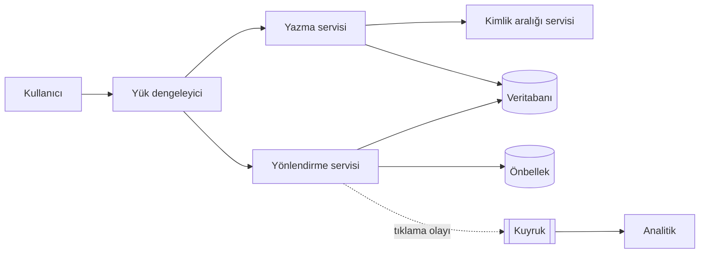

"Bir URL kısaltma servisi tasarlayın" (bit.ly benzeri), küçük görünmesine karşın gereksinim toplama, kapasite tahmini, anahtar üretimi, önbellek ve ölçekleme konularının hepsine dokunur. Bu derste soruyu [mülakat çerçevesi](/tracks/sistem-tasarimi/mulakat-cercevesi) adımlarıyla çözüyoruz.

## 1. Gereksinimler

**İşlevsel:**

- Uzun bir URL verildiğinde kısa bir bağlantı üret.
- Kısa bağlantıya gidildiğinde özgün URL'ye yönlendir.
- İsteğe bağlı: özel takma ad, son kullanma tarihi.

**Kapsam dışı (söyleyerek):** kullanıcı hesapları, ayrıntılı analitik paneli.

**İşlevsel olmayan:**

- Yönlendirme **çok hızlı** olmalı (onlarca milisaniye) ve **yüksek erişilebilir** olmalı: servis çökerse dağıtılmış bütün bağlantılar ölür.
- Kısa kodlar tahmin edilememeli (sırayla gezilerek bütün bağlantılar toplanamamalı).
- Sistem **okuma ağırlıklıdır**.

## 2. Kapasite tahmini

Varsayım: ayda 100 milyon yeni bağlantı, okuma/yazma oranı 100:1.

- Yazma: 100 milyon / (30 × 86.400) ≈ **40 / saniye**.
- Okuma: ≈ **4.000 / saniye** (zirvede birkaç katı).
- Depolama: kayıt başına ~500 bayt, 5 yılda 6 milyar kayıt → **~3 TB**.

Çıkarımlar: yazma hacmi tek bir veritabanı için bile küçüktür; asıl iş okuma yolunu hızlı ve dayanıklı yapmaktır. Veri büyüklüğü tek makine sınırına yakındır; parçalamaya hazırlıklı ama zorunlu olmayan bir model yeterlidir.

**Kod uzunluğu:** `[a-zA-Z0-9]` alfabesi 62 karakterdir. 7 karakter 62⁷ ≈ 3,5 trilyon olasılık verir; 6 milyar kayıt için fazlasıyla yeterlidir.

## 3. API

```http
POST /v1/links
{ "url": "https://ornek.com/cok/uzun/bir/yol", "alias": null, "expiresAt": null }
-> 201 { "code": "aZ3kP9x", "shortUrl": "https://kisa.at/aZ3kP9x" }

GET /{code}
-> 302 Location: https://ornek.com/cok/uzun/bir/yol
```

**301 mi 302 mi?** `301 Moved Permanently` tarayıcıda kalıcı olarak önbelleğe alınır: sonraki tıklamalar sunucunuza hiç gelmez. Bu yükü azaltır ama tıklama sayamazsınız ve bağlantıyı sonradan değiştiremezsiniz. `302 Found` her tıklamayı sunucuya getirir. Analitik ya da süre sonu gerekiyorsa 302 seçilir. Bu, görüşmecilerin sormayı sevdiği bir ödünleşimdir.

Kötüye kullanım için: yazma uç noktasında hız sınırı ve hedef URL'nin doğrulanması (şema denetimi, zararlı alan adı listesi).

## 4. Veri modeli

| Alan | Tip | Not |
| --- | --- | --- |
| `code` | metin, birincil anahtar | Kısa kod |
| `long_url` | metin | Özgün adres |
| `created_at` | zaman | |
| `expires_at` | zaman, boş olabilir | |

Erişim deseni tektir: **koda göre tek kayıt okuma**. İlişki, join, karmaşık sorgu yoktur. Bu, anahtar–değer deposuna (DynamoDB, Cassandra) çok uygun bir yüktür ve yatay ölçekleme kolaydır. Bu hacimde iyi indekslenmiş bir PostgreSQL de rahatça yeter; önemli olan seçimi erişim deseniyle gerekçelendirmektir.

## 5. Kısa kodu nasıl üretmeli

Tasarımın en ilginç kararı budur. Üç yaklaşım:

### A. URL'nin özetini (hash) almak

Uzun URL'nin MD5 ya da SHA-256 özetinin ilk 7 karakterini (base62) kullan.

- Artı: aynı URL hep aynı kodu üretir, durumsuzdur.
- Eksi: **çakışma** olabilir; her yazmada "bu kod alınmış mı?" denetimi ve çakışırsa yeniden deneme gerekir.

### B. Rastgele kod

7 rastgele karakter üret, veritabanında benzersizlik kısıtına güven; çakışırsa yeniden dene.

- Artı: basit ve tahmin edilemez.
- Eksi: yine çakışma denetimi gerekir. 3,5 trilyonluk uzayda 6 milyar kayıtla çakışma olasılığı düşüktür ama sıfır değildir; uzay doldukça artar.

### C. Sayaç + base62

Benzersiz bir tam sayı üret (1, 2, 3, …) ve base62'ye çevir. Çakışma **olanaksızdır**.

```typescript
const ALPHABET = '0123456789abcdefghijklmnopqrstuvwxyzABCDEFGHIJKLMNOPQRSTUVWXYZ';

function toBase62(id: number): string {
  if (id === 0) return ALPHABET[0];

  let code = '';
  while (id > 0) {
    code = ALPHABET[id % 62] + code;
    id = Math.floor(id / 62);
  }

  return code;
}
```

- Eksi 1: ardışık kodlar **tahmin edilebilir**. Çözüm: sayıyı kodlamadan önce tersinir bir karıştırmadan geçirmek.
- Eksi 2: tek bir sayaç darboğaz ve tek hata noktasıdır. Çözüm: her uygulama sunucusuna bir **kimlik aralığı** dağıtmak (ör. biner biner). Sunucu kendi aralığını bellekte tüketir; koordinasyon yalnızca aralık bittiğinde gerekir. Sunucu çökerse aralığın kalanı boşa gider; bunun önemi yoktur.

**Öneri:** aralık dağıtımlı sayaç + karıştırma + base62. Çakışma denetimi gerektirmez, yazma tek bir veritabanı işlemidir ve yatay ölçeklenir. Mülakatta üç seçeneği de söyleyip birini gerekçesiyle seçmek, tek birini anlatmaktan çok daha güçlüdür.

Özel takma adlarda çakışma denetimi kaçınılmazdır: veritabanındaki benzersizlik kısıtı bunu atomik olarak sağlar.

## 6. Üst düzey tasarım



Okuma ve yazma yolları ayrıdır, çünkü yükleri ve gereksinimleri çok farklıdır: yönlendirme servisi basit, durumsuz ve bolca çoğaltılmıştır.

**Yönlendirme akışı:**

1. Önbellekte `code` var mı? Varsa hemen yönlendir.
2. Yoksa veritabanından oku, önbelleğe yaz, yönlendir.
3. Kod bulunamadıysa ya da süresi dolduysa 404 döndür (ve "yok" bilgisini kısa süre önbelleğe al).

## 7. Derinleşme

**Önbellek.** Erişim son derece çarpıktır: bağlantıların küçük bir kısmı tıklamaların büyük kısmını alır. Bu, önbellek için ideal durumdur. Eşleme hiç değişmediği için geçersiz kılma sorunu neredeyse yoktur; uzun TTL ve LRU çıkarma yeterlidir. En popüler bağlantılar için CDN ya da kenar (edge) önbelleği gecikmeyi daha da düşürür.

**Veritabanı ölçekleme.** Önce okuma kopyaları. Veri tek makineye sığmadığında `code` üzerinden hash ile parçalama: anahtar eşit dağılır ve her sorgu tek parçaya gider; bu yüzden parçalama burada alışılmadık biçimde sorunsuzdur.

**Analitik.** Tıklamayı yönlendirme yolunda eşzamanlı yazmak gecikmeyi artırır ve analitik sistemi çökerse yönlendirmeyi de düşürür. Bunun yerine tıklama olayı kuyruğa bırakılır ve ayrı bir tüketici tarafından toplu işlenir. Kuyruk çökerse yönlendirme çalışmaya devam eder; birkaç tıklama kaybı kabul edilebilir.

**Süre sonu.** Okuma anında denetlenir (süresi dolmuşsa 404); kayıtların fiziksel silinmesi arka planda toplu bir işle yapılır.

**Erişilebilirlik.** Durumsuz servisler birden çok erişilebilirlik bölgesinde, veritabanı kopyalı. Önbellek çökerse sistem yavaşlar ama çalışır.

## Bu sorudan çıkarılacak genel dersler

- Okuma/yazma oranı tasarımı belirler: yolları ayırın, okuma yolunu önbellekle koruyun.
- Kimlik üretimi dağıtık sistemlerde başlı başına bir tasarım kararıdır.
- Kritik yolu (yönlendirme) kritik olmayan işlerden (analitik) kuyrukla ayırın.
- Her kararda en az bir alternatifi ve ödünleşimi söyleyin: 301/302, hash/sayaç, SQL/NoSQL.

Bu tasarımı .NET, PostgreSQL, Redis ve Docker ile kurup yük altında ölçmek için: [Proje 1: Ölçeklenebilir URL Kısaltıcı ve Yük Testi](/tracks/sistem-tasarimi/proje-url-kisaltici-ve-yuk-testi).
